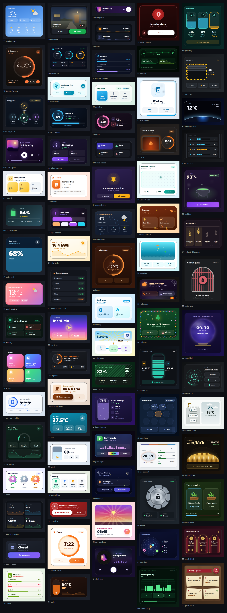

# Card gallery

Eighty complete cards to copy and adapt, from a weather card to a Christmas countdown. Each card is one Magic Card: paste its YAML into the code editor of a new card and change the entity ids to your own. Every page shows the card, the entities it reads and the full YAML. The same YAML is in [cards](cards/) as one file per card.

## Pages

| Page | Cards |
| --- | --- |
| [Climate and weather](climate-weather.md) | Weather hero, Thermostat, Clock and greeting, Air quality, Sensor tiles, Room temperatures, Sunrise and sunset, Hot water boiler, Storm watch, Heating, Cooling |
| [Energy](energy.md) | Energy flow, Device batteries, Water tank, Electric car, Solar today, Solar house, EV charger, Home battery |
| [Lights, rooms and scenes](lights-rooms.md) | Room card, Scenes, Fan, Light dimmer, Blinds, House modes, Party mode, Good night, Sunrise alarm |
| [Media](media.md) | Now playing, Mini player, Speaker group, Vinyl player |
| [Security and presence](security-presence.md) | Security, Who's home, Garage door, Doorbell, Leak alert, Ringing doorbell, Alarm triggered |
| [Appliances](appliances.md) | Washing machine, Home server, Robot vacuum, 3D printer, Coffee machine, Kitchen timer, Network, Dishwasher, Oven, Robot vacuum map |
| [Garden and outdoors](garden-outdoors.md) | Plant care, Pool, Bin day, Garden irrigation, Aquarium |
| [Seasonal](seasonal.md) | Autumn garden, Halloween porch, Christmas countdown |
| [Personal](personal.md) | Up next, Crypto prices, Health today |
| [Sci-fi and fantasy](sci-fi-fantasy.md) | Reactor core, Shield grid, Life support, Airlock, Star chart, Comms array, Grow bay, Cargo bay, Orbital weather, Mainframe, Cauldron, Enchanted lanterns, Castle gate, Crystal ball, Rune ward, Weather tower, Dragon hoard, Herb garden, Minstrel hall, Quest board |

## Animated cards

On thirty-five of the cards something moves, so their pictures are short recordings that loop. They use animation presets, icon effects, flow lines, rings, value backgrounds, seasonal scenes and small animations stored in the card itself (`custom_animations`). None of them needs the Magic Card Utils integration.

| Card | Page |
| --- | --- |
| [Ringing doorbell](security-presence.md#ringing-doorbell) | Security and presence |
| [Storm watch](climate-weather.md#storm-watch) | Climate and weather |
| [Heating](climate-weather.md#heating) | Climate and weather |
| [Cooling](climate-weather.md#cooling) | Climate and weather |
| [Solar house](energy.md#solar-house) | Energy |
| [EV charger](energy.md#ev-charger) | Energy |
| [Home battery](energy.md#home-battery) | Energy |
| [Party mode](lights-rooms.md#party-mode) | Lights, rooms and scenes |
| [Good night](lights-rooms.md#good-night) | Lights, rooms and scenes |
| [Sunrise alarm](lights-rooms.md#sunrise-alarm) | Lights, rooms and scenes |
| [Vinyl player](media.md#vinyl-player) | Media |
| [Alarm triggered](security-presence.md#alarm-triggered) | Security and presence |
| [Network](appliances.md#network) | Appliances |
| [Dishwasher](appliances.md#dishwasher) | Appliances |
| [Oven](appliances.md#oven) | Appliances |
| [Robot vacuum map](appliances.md#robot-vacuum-map) | Appliances |
| [Autumn garden](seasonal.md#autumn-garden) | Seasonal |
| [Aquarium](garden-outdoors.md#aquarium) | Garden and outdoors |
| [Halloween porch](seasonal.md#halloween-porch) | Seasonal |
| [Christmas countdown](seasonal.md#christmas-countdown) | Seasonal |
| [Reactor core](sci-fi-fantasy.md#reactor-core) | Sci-fi and fantasy |
| [Shield grid](sci-fi-fantasy.md#shield-grid) | Sci-fi and fantasy |
| [Life support](sci-fi-fantasy.md#life-support) | Sci-fi and fantasy |
| [Star chart](sci-fi-fantasy.md#star-chart) | Sci-fi and fantasy |
| [Comms array](sci-fi-fantasy.md#comms-array) | Sci-fi and fantasy |
| [Grow bay](sci-fi-fantasy.md#grow-bay) | Sci-fi and fantasy |
| [Cargo bay](sci-fi-fantasy.md#cargo-bay) | Sci-fi and fantasy |
| [Orbital weather](sci-fi-fantasy.md#orbital-weather) | Sci-fi and fantasy |
| [Cauldron](sci-fi-fantasy.md#cauldron) | Sci-fi and fantasy |
| [Enchanted lanterns](sci-fi-fantasy.md#enchanted-lanterns) | Sci-fi and fantasy |
| [Crystal ball](sci-fi-fantasy.md#crystal-ball) | Sci-fi and fantasy |
| [Rune ward](sci-fi-fantasy.md#rune-ward) | Sci-fi and fantasy |
| [Weather tower](sci-fi-fantasy.md#weather-tower) | Sci-fi and fantasy |
| [Herb garden](sci-fi-fantasy.md#herb-garden) | Sci-fi and fantasy |
| [Minstrel hall](sci-fi-fantasy.md#minstrel-hall) | Sci-fi and fantasy |

## Before you paste

-   Some labels are typed text, such as "Closed 42 min ago" or a price change. The notes under each card list them. Replace them with your own text or with a template (`use_template: true`).
-   Tappable tiles are layout modules (`horizontal` or `vertical`) with a `tap_action`. A layout module has no entity of its own, so `toggle` and `more-info` name their entity in the action.
-   Repeated styles use YAML anchors (`&name` and `*name`). Home Assistant expands them when it saves the card.
-   The pictures were taken with sample states. Your values, names and icons will differ.
-   Many animations only play in a given state, for example while a light is on or a vacuum is cleaning. The notes under each card say which.
-   With reduced motion turned on in your system, the animations stand still.
-   A few cards were shot with a theme preset. The note under each of them names the preset and links to its page in the theme examples.

## Related

-   [YAML examples](../yaml/examples/README.md): complete cards that each show one feature in detail
-   [Schema](../yaml/schema.md): every key used on these pages
-   [Modules](../modules/README.md) and [Design](../design/README.md)
