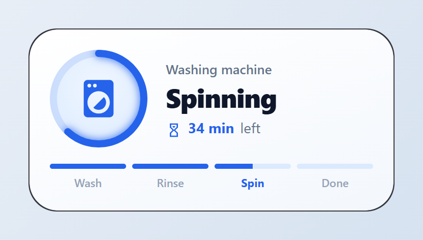
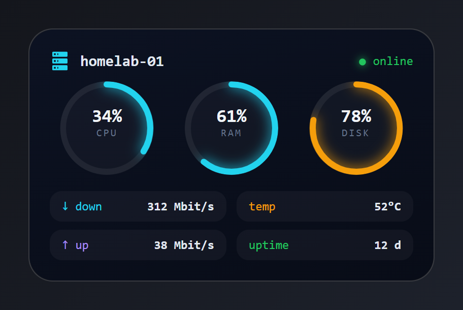
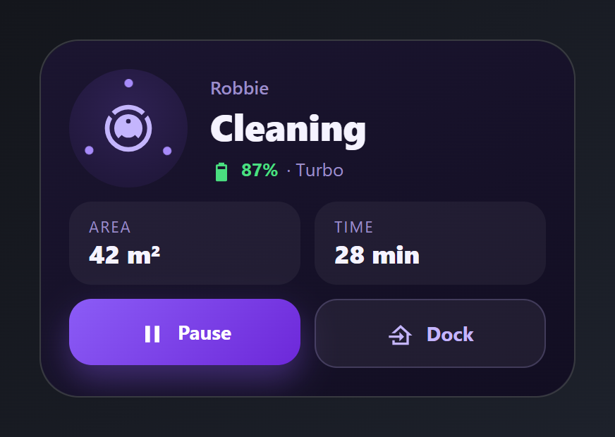
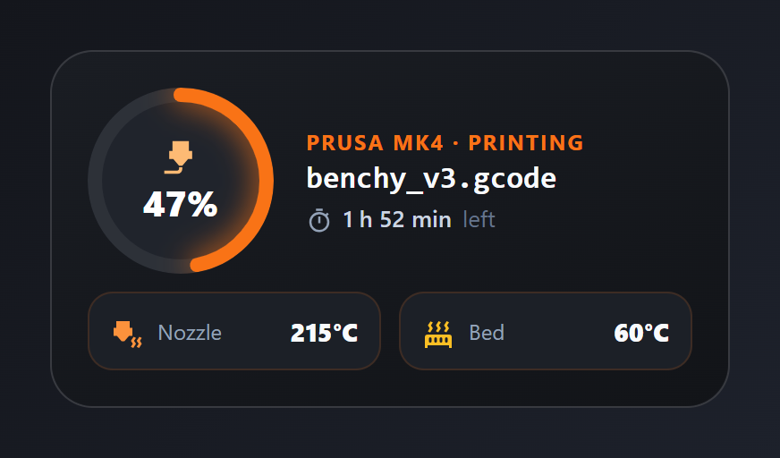
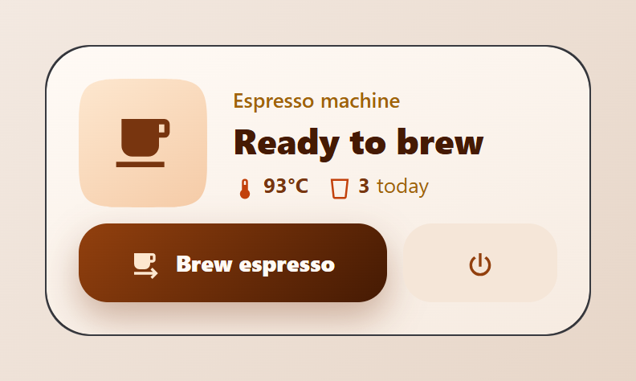
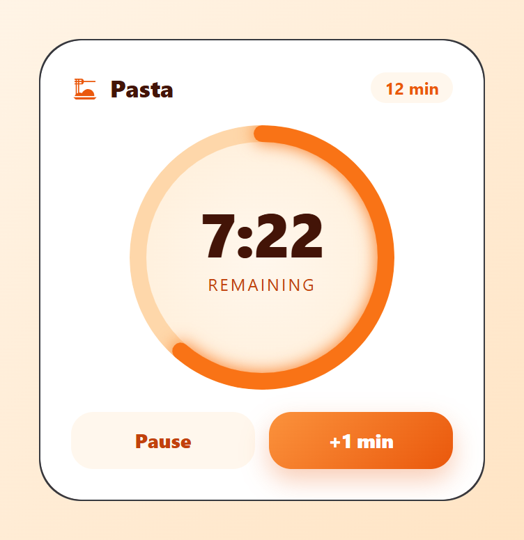
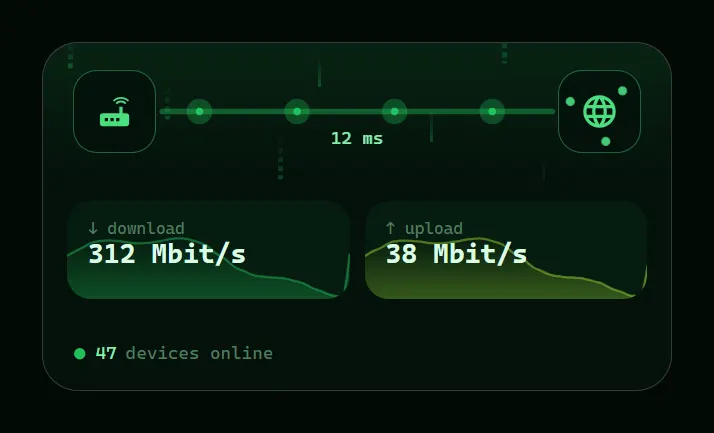
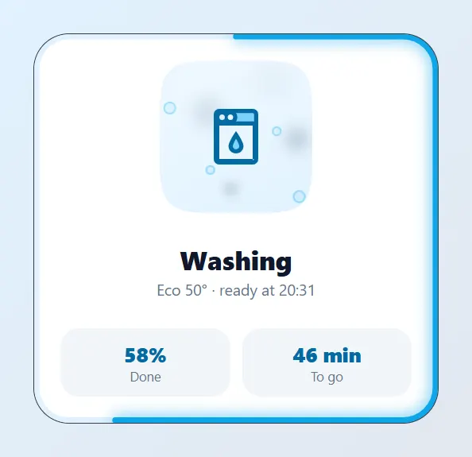
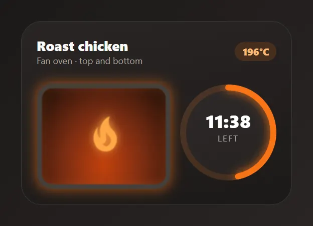
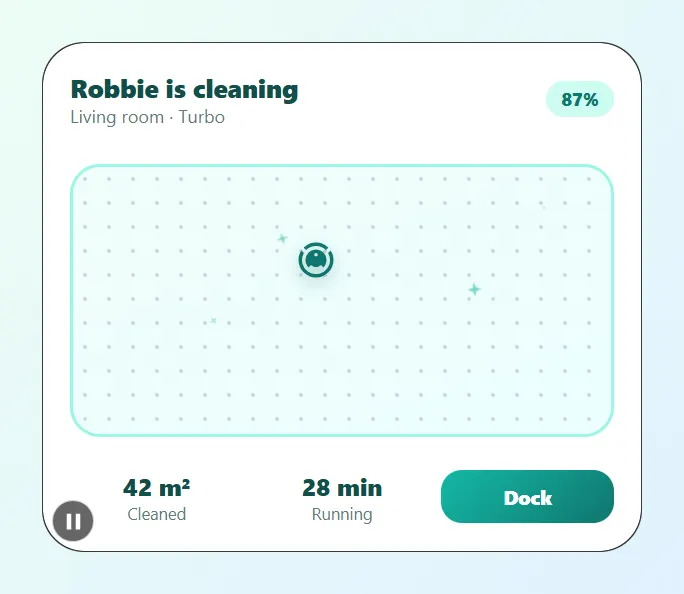

# Appliances

Washer, dishwasher, oven, robot vacuum, 3D printer, coffee machine, kitchen timer, a home server and the network. Paste a card into the code editor of a new card, then change the entity ids to your own. Back to the [gallery](README.md).

## Cards

-   [Washing machine](#washing-machine)
-   [Home server](#home-server)
-   [Robot vacuum](#robot-vacuum)
-   [3D printer](#3d-printer)
-   [Coffee machine](#coffee-machine)
-   [Kitchen timer](#kitchen-timer)
-   [Network](#network)
-   [Dishwasher](#dishwasher)
-   [Oven](#oven)
-   [Robot vacuum map](#robot-vacuum-map)

## Washing machine

Progress ring around a shaking washer, cycle phase and time left. The ring and the shake only show while the washer runs.



Entities: `switch.washer`, `sensor.washer_state`, `sensor.washer_progress`, `sensor.washer_remaining`

The phase bar under the washer is typed: move the coloured `separator` modules to match your machine, or drive them with display conditions on `sensor.washer_state`.

File: [cards/11-washing-machine.yaml](cards/11-washing-machine.yaml)

```yaml
# Washing machine: progress ring around a shaking washer, cycle phase and time left.
# The ring and the shake only show while the washer runs.
# Entities: switch.washer, sensor.washer_state, sensor.washer_progress, sensor.washer_remaining
type: custom:magic-card
name: Washer
background: "linear-gradient(160deg, #ffffff 0%, #f3f7fc 100%)"
border_radius: 28px
padding: 20px
box_shadow: "0 14px 34px rgba(37, 99, 235, 0.14)"
rows:
  - id: main
    column_widths: [auto, 1fr]
    gap: 18px
    columns:
      - vertical_align: center
        modules:
          - type: icon
            entity: switch.washer
            icon: mdi:washing-machine
            size: 44px
            design:
              color: "#2563eb"
              width: 96px
              height: 96px
              display: flex
              align_items: center
              justify_content: center
              shape: circle
              background: "radial-gradient(circle at 50% 40%, #eff6ff 0%, #dbeafe 100%)"
              ring:
                mode: value
                entity: sensor.washer_progress
                width: 7
                color: "#2563eb"
                track_color: "rgba(37,99,235,0.12)"
                glow: 4
              animations:
                - { preset: head-shake, target: icon, trigger: entity_on, duration: 0.9s, intensity: 3 }
      - vertical_align: center
        gap: 2px
        modules:
          - type: text
            text: Washing machine
            design: { font_size: 13px, font_weight: "600", color: "#64748b" }
          - type: text
            use_entity: true
            entity: sensor.washer_state
            design: { font_size: 26px, font_weight: "800", color: "#0f172a", letter_spacing: -0.5px }
          - type: horizontal
            gap: 6px
            align: center
            modules:
              - type: icon
                icon: mdi:timer-sand
                size: 16px
                design: { color: "#2563eb" }
              - type: text
                use_entity: true
                entity: sensor.washer_remaining
                design: { font_size: 14px, font_weight: "700", color: "#2563eb" }
              - type: text
                text: left
                design: { font_size: 14px, color: "#64748b" }
  - id: phases
    layout: "1-1-1-1"
    gap: 6px
    padding: 6px 0 0
    columns:
      - gap: 6px
        modules:
          - type: separator
            separator_style: none
            design: &done { height: 5px, border_radius: 999px, background_color: "#2563eb" }
          - type: text
            text: Wash
            design: &phase { font_size: 11px, font_weight: "600", color: "#94a3b8", text_align: center }
      - gap: 6px
        modules:
          - type: separator
            separator_style: none
            design: *done
          - type: text
            text: Rinse
            design: *phase
      - gap: 6px
        modules:
          - type: separator
            separator_style: none
            design: { height: 5px, border_radius: 999px, background: "linear-gradient(90deg, #2563eb 0%, #2563eb 50%, #dbeafe 50%)" }
          - type: text
            text: Spin
            design: { font_size: 11px, font_weight: "700", color: "#2563eb", text_align: center }
      - gap: 6px
        modules:
          - type: separator
            separator_style: none
            design: { height: 5px, border_radius: 999px, background_color: "#dbeafe" }
          - type: text
            text: Done
            design: *phase
```

## Home server

CPU, memory and disk rings, temperature, uptime and network speeds. Rings change colour as the load climbs.



Entities: `sensor.server_cpu`, `sensor.server_ram`, `sensor.server_disk`, `sensor.server_temp`, `sensor.server_uptime`, `sensor.net_down`, `sensor.net_up`

File: [cards/18-server-stats.yaml](cards/18-server-stats.yaml)

```yaml
# Home server: CPU, memory and disk rings, temperature, uptime and network speeds.
# Rings change colour as the load climbs.
# Entities: sensor.server_cpu, sensor.server_ram, sensor.server_disk,
#           sensor.server_temp, sensor.server_uptime, sensor.net_down, sensor.net_up
type: custom:magic-card
name: Server
background: "linear-gradient(160deg, #0c1222 0%, #080c17 100%)"
border_radius: 24px
padding: 20px
box_shadow: "0 18px 40px rgba(0,0,0,0.5)"
css: "font-family: 'JetBrains Mono', monospace;"
rows:
  - id: head
    column_widths: [auto, 1fr, auto]
    gap: 10px
    columns:
      - vertical_align: center
        modules:
          - type: icon
            icon: mdi:server
            size: 20px
            design: { color: "#22d3ee" }
      - vertical_align: center
        modules:
          - type: text
            text: homelab-01
            design: { font_size: 15px, font_weight: "700", color: "#e2e8f0" }
      - vertical_align: center
        modules:
          - type: horizontal
            gap: 6px
            align: center
            modules:
              - type: icon
                icon: mdi:circle
                size: 8px
                design: { color: "#22c55e", filter: "drop-shadow(0 0 4px #22c55e)" }
              - type: text
                text: online
                design: { font_size: 12px, color: "#22c55e" }
  - id: rings
    layout: "1-1-1"
    gap: 10px
    columns:
      - modules:
          - type: vertical
            align: center
            gap: 0px
            design:
              width: 92px
              height: 92px
              margin: 0 auto
              justify_content: center
              shape: circle
              background_color: "rgba(255,255,255,0.03)"
              ring:
                mode: value
                entity: sensor.server_cpu
                width: 6
                glow: 6
                track_color: "rgba(255,255,255,0.06)"
                thresholds: &load
                  - { from: 0, color: "#22d3ee" }
                  - { from: 70, color: "#f59e0b" }
                  - { from: 90, color: "#ef4444" }
            modules:
              - type: text
                use_entity: true
                entity: sensor.server_cpu
                design: &big { font_size: 18px, font_weight: "700", color: "#f1f5f9" }
              - type: text
                text: CPU
                design: &small { font_size: 10px, color: "#64748b", letter_spacing: 1.5px }
      - modules:
          - type: vertical
            align: center
            gap: 0px
            design:
              width: 92px
              height: 92px
              margin: 0 auto
              justify_content: center
              shape: circle
              background_color: "rgba(255,255,255,0.03)"
              ring:
                mode: value
                entity: sensor.server_ram
                width: 6
                glow: 6
                track_color: "rgba(255,255,255,0.06)"
                thresholds: *load
            modules:
              - type: text
                use_entity: true
                entity: sensor.server_ram
                design: *big
              - type: text
                text: RAM
                design: *small
      - modules:
          - type: vertical
            align: center
            gap: 0px
            design:
              width: 92px
              height: 92px
              margin: 0 auto
              justify_content: center
              shape: circle
              background_color: "rgba(255,255,255,0.03)"
              ring:
                mode: value
                entity: sensor.server_disk
                width: 6
                glow: 6
                track_color: "rgba(255,255,255,0.06)"
                thresholds: *load
            modules:
              - type: text
                use_entity: true
                entity: sensor.server_disk
                design: *big
              - type: text
                text: DISK
                design: *small
  - id: stats
    padding: 6px 0 0
    layout: "1-1"
    gap: 10px
    columns:
      - gap: 8px
        modules:
          - type: horizontal
            justify: space-between
            design: &line { padding: 8px 12px, border_radius: 12px, background_color: "rgba(255,255,255,0.04)" }
            modules:
              - type: text
                text: ↓ down
                design: { font_size: 12px, color: "#22d3ee" }
              - type: text
                use_entity: true
                entity: sensor.net_down
                design: &stat { font_size: 12px, font_weight: "700", color: "#e2e8f0" }
          - type: horizontal
            justify: space-between
            design: *line
            modules:
              - type: text
                text: ↑ up
                design: { font_size: 12px, color: "#a78bfa" }
              - type: text
                use_entity: true
                entity: sensor.net_up
                design: *stat
      - gap: 8px
        modules:
          - type: horizontal
            justify: space-between
            design: *line
            modules:
              - type: text
                text: temp
                design: { font_size: 12px, color: "#f59e0b" }
              - type: text
                use_entity: true
                entity: sensor.server_temp
                design: *stat
          - type: horizontal
            justify: space-between
            design: *line
            modules:
              - type: text
                text: uptime
                design: { font_size: 12px, color: "#22c55e" }
              - type: text
                use_entity: true
                entity: sensor.server_uptime
                design: *stat
```

## Robot vacuum

Status with orbiting dots while cleaning, battery, area and time, and start / dock buttons.



Entities: `vacuum.robot`, `sensor.vacuum_area`, `sensor.vacuum_time`

The robot name and "Turbo" are typed text.

File: [cards/21-robot-vacuum.yaml](cards/21-robot-vacuum.yaml)

```yaml
# Robot vacuum: status with orbiting dots while cleaning, battery, area and time,
# and start / dock buttons.
# Entities: vacuum.robot, sensor.vacuum_area, sensor.vacuum_time
type: custom:magic-card
name: Vacuum
background: "linear-gradient(155deg, #1b1530 0%, #120e22 100%)"
border_radius: 28px
padding: 20px
box_shadow: "0 18px 40px rgba(76, 29, 149, 0.3)"
rows:
  - id: main
    column_widths: [auto, 1fr]
    gap: 16px
    columns:
      - vertical_align: center
        modules:
          - type: icon
            entity: vacuum.robot
            icon: mdi:robot-vacuum
            size: 40px
            design:
              color: "#c4b5fd"
              width: 84px
              height: 84px
              display: flex
              align_items: center
              justify_content: center
              shape: circle
              background: "radial-gradient(circle at 50% 35%, #2e2152 0%, #1d1535 100%)"
              animations:
                - { preset: orbit-dots, color: "#a78bfa", trigger: state, state: cleaning, duration: 2.4s }
      - vertical_align: center
        gap: 2px
        modules:
          - type: text
            text: Robbie
            design: { font_size: 13px, font_weight: "600", color: "#9d8ec9" }
          - type: text
            use_entity: true
            entity: vacuum.robot
            design: { font_size: 26px, font_weight: "800", color: "#f5f3ff" }
          - type: horizontal
            gap: 6px
            align: center
            modules:
              - type: icon
                icon: mdi:battery-80
                size: 16px
                design: { color: "#4ade80" }
              - type: text
                use_entity: true
                entity: vacuum.robot
                attribute: battery_level
                design: { font_size: 13px, font_weight: "700", color: "#4ade80" }
              - type: text
                text: "· Turbo"
                design: { font_size: 13px, color: "#9d8ec9" }
  - id: stats
    layout: "1-1"
    gap: 10px
    columns:
      - modules:
          - type: vertical
            gap: 0px
            design: &stat { padding: 10px 14px, border_radius: 16px, background_color: "rgba(255,255,255,0.05)" }
            modules:
              - type: text
                text: Area
                design: &lab { font_size: 11px, color: "#9d8ec9", text_transform: uppercase, letter_spacing: 1px }
              - type: text
                use_entity: true
                entity: sensor.vacuum_area
                design: &num { font_size: 18px, font_weight: "800", color: "#f5f3ff" }
      - modules:
          - type: vertical
            gap: 0px
            design: *stat
            modules:
              - type: text
                text: Time
                design: *lab
              - type: text
                use_entity: true
                entity: sensor.vacuum_time
                design: *num
  - id: actions
    layout: "1-1"
    gap: 10px
    columns:
      - modules:
          - type: horizontal
            gap: 8px
            align: center
            justify: center
            design:
              padding: 12px
              border_radius: 16px
              background: "linear-gradient(135deg, #8b5cf6, #6d28d9)"
              box_shadow: "0 10px 22px rgba(139,92,246,0.35)"
            actions:
              tap_action: { action: perform-action, service: vacuum.pause, data: { entity_id: vacuum.robot } }
            modules:
              - type: icon
                icon: mdi:pause
                size: 20px
                design: { color: "#ffffff" }
              - type: text
                text: Pause
                design: { font_size: 14px, font_weight: "700", color: "#ffffff" }
      - modules:
          - type: horizontal
            gap: 8px
            align: center
            justify: center
            design:
              padding: 12px
              border_radius: 16px
              background_color: "rgba(255,255,255,0.06)"
              border: "1px solid rgba(196,181,253,0.2)"
            actions:
              tap_action: { action: perform-action, service: vacuum.return_to_base, data: { entity_id: vacuum.robot } }
            modules:
              - type: icon
                icon: mdi:home-import-outline
                size: 20px
                design: { color: "#c4b5fd" }
              - type: text
                text: Dock
                design: { font_size: 14px, font_weight: "700", color: "#c4b5fd" }
```

## 3D printer

Job progress in a ring, file name, time left and temperatures.



Entities: `sensor.printer_progress`, `sensor.printer_time_left`, `sensor.printer_file`, `sensor.printer_nozzle`, `sensor.printer_bed`

The printer model is typed text.

File: [cards/27-3d-printer.yaml](cards/27-3d-printer.yaml)

```yaml
# 3D printer: job progress in a ring, file name, time left and temperatures.
# Entities: sensor.printer_progress, sensor.printer_time_left, sensor.printer_file,
#           sensor.printer_nozzle, sensor.printer_bed
type: custom:magic-card
name: 3D printer
background: "linear-gradient(160deg, #1a1d23 0%, #121418 100%)"
border_radius: 24px
padding: 20px
box_shadow: "0 18px 40px rgba(0,0,0,0.5)"
rows:
  - id: main
    column_widths: [auto, 1fr]
    gap: 18px
    columns:
      - vertical_align: center
        modules:
          - type: vertical
            align: center
            gap: 0px
            design:
              width: 104px
              height: 104px
              justify_content: center
              shape: circle
              background_color: "#20242c"
              ring:
                mode: value
                entity: sensor.printer_progress
                width: 8
                glow: 8
                color: "#f97316"
                track_color: "rgba(255,255,255,0.06)"
            modules:
              - type: icon
                icon: mdi:printer-3d-nozzle
                size: 22px
                design: { color: "#fdba74" }
              - type: text
                use_entity: true
                entity: sensor.printer_progress
                design: { font_size: 20px, font_weight: "800", color: "#ffffff" }
      - vertical_align: center
        gap: 2px
        modules:
          - type: text
            text: Prusa MK4 · Printing
            design: { font_size: 12px, font_weight: "700", color: "#f97316", text_transform: uppercase, letter_spacing: 1px }
          - type: text
            use_entity: true
            entity: sensor.printer_file
            design: { font_size: 17px, font_weight: "800", color: "#f8fafc", font_family: "'JetBrains Mono', monospace" }
          - type: horizontal
            gap: 6px
            align: center
            modules:
              - type: icon
                icon: mdi:timer-outline
                size: 15px
                design: { color: "#94a3b8" }
              - type: text
                use_entity: true
                entity: sensor.printer_time_left
                design: { font_size: 13px, font_weight: "600", color: "#cbd5e1" }
              - type: text
                text: left
                design: { font_size: 13px, color: "#64748b" }
  - id: temps
    layout: "1-1"
    gap: 10px
    columns:
      - modules:
          - type: horizontal
            gap: 8px
            align: center
            design: &cell { padding: 10px 12px, border_radius: 14px, background_color: "#1c2027", border: "1px solid rgba(249,115,22,0.15)" }
            modules:
              - type: icon
                icon: mdi:printer-3d-nozzle-heat
                size: 18px
                design: { color: "#fb923c", animations: [{ preset: heat-shimmer }] }
              - type: text
                text: Nozzle
                design: &lab { font_size: 12px, color: "#94a3b8", flex: "1" }
              - type: text
                use_entity: true
                entity: sensor.printer_nozzle
                design: &val { font_size: 14px, font_weight: "800", color: "#f8fafc" }
      - modules:
          - type: horizontal
            gap: 8px
            align: center
            design: *cell
            modules:
              - type: icon
                icon: mdi:radiator
                size: 18px
                design: { color: "#fbbf24" }
              - type: text
                text: Bed
                design: *lab
              - type: text
                use_entity: true
                entity: sensor.printer_bed
                design: *val
```

## Coffee machine

A steaming cup while it's on, boiler temperature, cups today, and one big brew button.



Entities: `switch.coffee_machine`, `sensor.coffee_boiler`, `sensor.coffee_count`

The brew button runs `script.brew_espresso`. Point it at your own script.

File: [cards/28-coffee-machine.yaml](cards/28-coffee-machine.yaml)

```yaml
# Coffee machine: a steaming cup while it's on, boiler temperature, cups today,
# and one big brew button.
# Entities: switch.coffee_machine, sensor.coffee_boiler, sensor.coffee_count
type: custom:magic-card
name: Coffee
background: "linear-gradient(160deg, #fffaf5 0%, #f6ebe1 100%)"
border_radius: 28px
padding: 20px
box_shadow: "0 14px 34px rgba(120, 53, 15, 0.16)"
rows:
  - id: main
    column_widths: [auto, 1fr]
    gap: 16px
    columns:
      - vertical_align: center
        modules:
          - type: icon
            entity: switch.coffee_machine
            icon: mdi:coffee
            size: 40px
            design:
              color: "#78350f"
              width: 80px
              height: 80px
              display: flex
              align_items: center
              justify_content: center
              shape: squircle
              background: "linear-gradient(145deg, #fde7cf, #f5cba7)"
      - vertical_align: center
        gap: 2px
        modules:
          - type: text
            text: Espresso machine
            design: { font_size: 13px, font_weight: "600", color: "#a16207" }
          - type: text
            text: Ready to brew
            design: { font_size: 22px, font_weight: "800", color: "#451a03" }
          - type: horizontal
            gap: 12px
            modules:
              - type: horizontal
                gap: 4px
                align: center
                modules:
                  - type: icon
                    icon: mdi:thermometer
                    size: 15px
                    design: { color: "#c2410c" }
                  - type: text
                    use_entity: true
                    entity: sensor.coffee_boiler
                    design: { font_size: 13px, font_weight: "700", color: "#78350f" }
              - type: horizontal
                gap: 4px
                align: center
                modules:
                  - type: icon
                    icon: mdi:cup-outline
                    size: 15px
                    design: { color: "#c2410c" }
                  - type: text
                    use_entity: true
                    entity: sensor.coffee_count
                    design: { font_size: 13px, font_weight: "700", color: "#78350f" }
                  - type: text
                    text: today
                    design: { font_size: 13px, color: "#a16207" }
  - id: brew
    layout: "2-1"
    gap: 10px
    columns:
      - modules:
          - type: horizontal
            gap: 8px
            align: center
            justify: center
            design:
              padding: 13px
              border_radius: 18px
              background: "linear-gradient(135deg, #92400e, #451a03)"
              box_shadow: "0 10px 22px rgba(120,53,15,0.35)"
            actions:
              tap_action: { action: perform-action, service: script.brew_espresso }
            modules:
              - type: icon
                icon: mdi:coffee-to-go
                size: 20px
                design: { color: "#fde7cf" }
              - type: text
                text: Brew espresso
                design: { font_size: 14px, font_weight: "800", color: "#fffaf5" }
      - modules:
          - type: horizontal
            gap: 6px
            align: center
            justify: center
            design:
              padding: 13px
              border_radius: 18px
              background_color: "#f5e6d8"
            actions:
              tap_action: { action: toggle, entity: switch.coffee_machine }
            modules:
              - type: icon
                icon: mdi:power
                size: 20px
                design: { color: "#92400e" }
```

## Kitchen timer

A countdown inside a ring that empties as the timer runs.



Entities: `timer.pasta`

The "12 min" chip is typed text.

File: [cards/33-kitchen-timer.yaml](cards/33-kitchen-timer.yaml)

```yaml
# Kitchen timer: a countdown inside a ring that empties as the timer runs.
# Entities: timer.pasta
type: custom:magic-card
name: Timer
background: "#ffffff"
border_radius: 30px
padding: 22px
box_shadow: "0 14px 34px rgba(234, 88, 12, 0.16)"
rows:
  - id: head
    column_widths: [1fr, auto]
    columns:
      - vertical_align: center
        modules:
          - type: horizontal
            gap: 8px
            align: center
            modules:
              - type: icon
                icon: mdi:pasta
                size: 20px
                design: { color: "#ea580c" }
              - type: text
                text: Pasta
                design: { font_size: 17px, font_weight: "800", color: "#431407" }
      - vertical_align: center
        modules:
          - type: text
            text: 12 min
            design: { font_size: 12px, font_weight: "700", color: "#ea580c", padding: 3px 10px, border_radius: 999px, background_color: "#fff7ed" }
  - id: ring
    padding: 6px 0
    columns:
      - modules:
          - type: vertical
            align: center
            gap: 0px
            design:
              width: 190px
              height: 190px
              margin: 0 auto
              justify_content: center
              shape: circle
              background: "radial-gradient(circle, #fff7ed 0%, #ffedd5 100%)"
              ring:
                mode: value
                entity: timer.pasta
                timer_fill: remaining
                width: 12
                glow: 6
                color: "#f97316"
                track_color: "#fed7aa"
            modules:
              - type: text
                use_entity: true
                entity: timer.pasta
                entity_display: remaining
                design: { font_size: 44px, font_weight: "800", color: "#431407", font_variant: tabular-nums, letter_spacing: -1px }
              - type: text
                text: remaining
                design: { font_size: 12px, color: "#c2410c", text_transform: uppercase, letter_spacing: 1.5px }
  - id: actions
    layout: "1-1"
    gap: 10px
    columns:
      - modules:
          - type: text
            text: Pause
            design: { text_align: center, padding: 11px, border_radius: 16px, font_size: 14px, font_weight: "800", color: "#c2410c", background_color: "#fff7ed" }
            actions:
              tap_action: { action: perform-action, service: timer.pause, data: { entity_id: timer.pasta } }
      - modules:
          - type: text
            text: "+1 min"
            design: { text_align: center, padding: 11px, border_radius: 16px, font_size: 14px, font_weight: "800", color: "#ffffff", background: "linear-gradient(135deg, #fb923c, #ea580c)", box_shadow: "0 8px 18px rgba(234,88,12,0.3)" }
            actions:
              tap_action: { action: perform-action, service: timer.change, data: { entity_id: timer.pasta, duration: "00:01:00" } }
```

## Network

Matrix rain behind the header, data flowing between the router and the internet in both directions, and sparklines of the last hours.



Entities: `sensor.net_down`, `sensor.net_up`, `sensor.wan_ping`, `sensor.connected_devices`

The flow line needs the module ids `internet` and `router`.

File: [cards/53-network.yaml](cards/53-network.yaml)

```yaml
# Network: matrix rain behind the header, data flowing between the router and the internet in both directions, and sparklines of the last hours.
# Entities: sensor.net_down, sensor.net_up, sensor.wan_ping, sensor.connected_devices
type: custom:magic-card
name: Network
background: "#04110a"
border_radius: 24px
padding: 0px
box_shadow: "0 18px 40px rgba(0, 0, 0, 0.6)"
css: "font-family: 'Cascadia Code', Consolas, monospace;"
rows:
  - id: head
    padding: 18px 20px
    design:
      background: "linear-gradient(180deg, rgba(34,197,94,0.10), rgba(34,197,94,0))"
      animations:
        - { id: matrix, preset: matrix-rain, color: "#22c55e", strength: 35, intensity: 12 }
    column_widths: [auto, 1fr, auto]
    gap: 0px
    columns:
      - vertical_align: center
        modules:
          - id: router
            type: icon
            icon: mdi:router-wireless
            size: 26px
            design:
              color: "#4ade80"
              width: 54px
              height: 54px
              display: flex
              align_items: center
              justify_content: center
              border_radius: 16px
              border: "1px solid rgba(74,222,128,0.4)"
              background_color: "rgba(4,17,10,0.85)"
      - vertical_align: center
        modules:
          - type: text
            use_entity: true
            entity: sensor.wan_ping
            design: { text_align: center, font_size: 12px, color: "#86efac", margin_top: 34px }
      - vertical_align: center
        modules:
          - id: internet
            type: icon
            icon: mdi:web
            size: 26px
            design:
              color: "#4ade80"
              width: 54px
              height: 54px
              display: flex
              align_items: center
              justify_content: center
              border_radius: 16px
              border: "1px solid rgba(74,222,128,0.4)"
              background_color: "rgba(4,17,10,0.85)"
              animations:
                - { id: orbit, preset: orbit-dots, color: "#4ade80", strength: 90, intensity: 3 }
  - id: speeds
    layout: "1-1"
    gap: 10px
    padding: 4px 16px 16px
    columns:
      - modules:
          - type: vertical
            gap: 0px
            design:
              padding: 12px 14px 20px
              border_radius: 16px
              background_color: "rgba(34,197,94,0.06)"
              value_background: { type: sparkline, entity: sensor.net_down, hours: 12, color: "#22c55e", opacity: 30% }
            modules:
              - type: text
                text: ↓ download
                design: &lbl { font_size: 11px, color: "#4d7c5f" }
              - type: text
                use_entity: true
                entity: sensor.net_down
                design: &val { font_size: 18px, font_weight: "700", color: "#dcfce7" }
      - modules:
          - type: vertical
            gap: 0px
            design:
              padding: 12px 14px 20px
              border_radius: 16px
              background_color: "rgba(34,197,94,0.06)"
              value_background: { type: sparkline, entity: sensor.net_up, hours: 12, color: "#a3e635", opacity: 30% }
            modules:
              - type: text
                text: ↑ upload
                design: *lbl
              - type: text
                use_entity: true
                entity: sensor.net_up
                design: *val
  - id: foot
    padding: 0 20px 16px
    columns:
      - modules:
          - type: horizontal
            gap: 6px
            align: center
            modules:
              - type: icon
                icon: mdi:circle
                size: 9px
                design:
                  color: "#22c55e"
                  animations:
                    - { id: blink, preset: fade-pulse, target: icon, duration: 1.4s }
              - type: text
                use_entity: true
                entity: sensor.connected_devices
                design: { font_size: 12px, color: "#86efac" }
              - type: text
                text: devices online
                design: { font_size: 12px, color: "#4d7c5f" }
flows:
  - { id: down, from: internet, to: router, entity: sensor.net_down, max: 1000, color: "#22c55e", width: 2, dots: 4, dot_size: 5, glow: 6, route: straight }
```

## Dishwasher

The icon tumbles like a drum while it washes, steam rises from the top, and a ring round the card fills with the progress.



Entities: `sensor.dishwasher_state`, `sensor.dishwasher_progress`, `sensor.dishwasher_remaining`

The programme and the ready time are typed text. The icon tumbles while the state is a washing state such as `Washing`.

File: [cards/54-dishwasher.yaml](cards/54-dishwasher.yaml)

```yaml
# Dishwasher: the icon tumbles like a drum while it washes, steam rises from the top, and a ring round the card fills with the progress.
# Entities: sensor.dishwasher_state, sensor.dishwasher_progress, sensor.dishwasher_remaining
type: custom:magic-card
name: Dishwasher
background: "#ffffff"
border_radius: 30px
padding: 22px
box_shadow: "0 16px 36px rgba(15, 23, 42, 0.14)"
ring:
  mode: value
  entity: sensor.dishwasher_progress
  width: 5
  glow: 6
  color: "#0ea5e9"
  track_color: "#e0f2fe"
rows:
  - id: drum
    columns:
      - modules:
          - type: icon
            entity: sensor.dishwasher_state
            icon: mdi:dishwasher
            size: 56px
            icon_fx:
              device: auto
              colors: { style: duotone, primary: "#0369a1", secondary: "#7dd3fc" }
            design:
              width: 128px
              height: 128px
              margin: 0 auto
              display: flex
              align_items: center
              justify_content: center
              shape: squircle
              background: "linear-gradient(160deg, #f0f9ff, #e0f2fe)"
              animations:
                - { id: steam, preset: steam-rise, color: "#94a3b8", strength: 60, intensity: 5 }
                - { id: bubbles, preset: bubbles, color: "#38bdf8", strength: 50, intensity: 5 }
  - id: text
    padding: 14px 0 0
    columns:
      - gap: 2px
        modules:
          - type: text
            use_entity: true
            entity: sensor.dishwasher_state
            design: { text_align: center, font_size: 22px, font_weight: "800", color: "#0f172a" }
          - type: text
            text: Eco 50° · ready at 20:31
            design: { text_align: center, font_size: 13px, color: "#64748b" }
  - id: stats
    layout: "1-1"
    gap: 10px
    padding: 14px 0 0
    columns:
      - modules:
          - type: vertical
            gap: 0px
            align: center
            design: &stat { padding: 10px, border_radius: 16px, background_color: "#f1f5f9" }
            modules:
              - type: text
                use_entity: true
                entity: sensor.dishwasher_progress
                design: &val { font_size: 17px, font_weight: "800", color: "#0369a1" }
              - type: text
                text: Done
                design: &lbl { font_size: 11px, color: "#64748b" }
      - modules:
          - type: vertical
            gap: 0px
            align: center
            design: *stat
            modules:
              - type: text
                use_entity: true
                entity: sensor.dishwasher_remaining
                design: *val
              - type: text
                text: To go
                design: *lbl
```

## Oven

A flickering fire over a shimmering hot window, a timer ring that empties live, and the oven temperature.



Entities: `sensor.oven_temperature`, `timer.oven`

The dish name and the oven mode are typed text.

File: [cards/55-oven.yaml](cards/55-oven.yaml)

```yaml
# Oven: a flickering fire over a shimmering hot window, a timer ring that empties live, and the oven temperature.
# Entities: sensor.oven_temperature, timer.oven
type: custom:magic-card
name: Oven
background: "linear-gradient(170deg, #292524 0%, #1c1917 100%)"
border_radius: 28px
padding: 20px
box_shadow: "0 20px 44px rgba(0, 0, 0, 0.55)"
rows:
  - id: head
    column_widths: [1fr, auto]
    columns:
      - vertical_align: center
        gap: 0px
        modules:
          - type: text
            text: Roast chicken
            design: { font_size: 18px, font_weight: "800", color: "#fafaf9" }
          - type: text
            text: Fan oven · top and bottom
            design: { font_size: 12px, color: "#a8a29e" }
      - vertical_align: center
        modules:
          - type: text
            use_entity: true
            entity: sensor.oven_temperature
            design: { font_size: 13px, font_weight: "800", color: "#fdba74", padding: 4px 10px, border_radius: 999px, background_color: "rgba(249,115,22,0.16)" }
  - id: window
    column_widths: [1fr, 128px]
    gap: 14px
    padding: 14px 0 0
    columns:
      - modules:
          - type: icon
            icon: mdi:fire
            size: 56px
            design:
              color: "#fb923c"
              height: 128px
              display: flex
              align_items: center
              justify_content: center
              border_radius: 20px
              border: "6px solid #44403c"
              background: "radial-gradient(ellipse at 50% 80%, #c2410c 0%, #7c2d12 45%, #1c0f08 100%)"
              animations:
                - { id: flicker, preset: flame-flicker, target: icon, intensity: 12 }
                - { id: glow, preset: aura, color: "#f97316", strength: 50, intensity: 18 }
                - { id: shimmer, preset: heat-shimmer, intensity: 2 }
      - modules:
          - type: vertical
            align: center
            justify: center
            gap: 0px
            design:
              width: 128px
              height: 128px
              shape: circle
              background_color: "rgba(255,255,255,0.04)"
              ring:
                mode: value
                entity: timer.oven
                width: 8
                glow: 6
                color: "#f97316"
                track_color: "rgba(249,115,22,0.14)"
            modules:
              - type: text
                use_entity: true
                entity: timer.oven
                entity_display: remaining
                design: { font_size: 24px, font_weight: "800", color: "#ffffff", font_variant: tabular-nums }
              - type: text
                text: left
                design: { font_size: 11px, color: "#a8a29e", text_transform: uppercase, letter_spacing: 1.5px }
```

## Robot vacuum map

The robot drives a cleaning pattern across a little floor plan while it cleans, leaving a sparkle behind. The route is a path animation stored in the card. It plays while the vacuum is cleaning.



Entities: `vacuum.robot`, `sensor.vacuum_area`, `sensor.vacuum_time`

The route is a fixed zigzag. Change the `d` path in `custom_animations` to fit your room. It plays while the vacuum is cleaning.

File: [cards/56-vacuum-map.yaml](cards/56-vacuum-map.yaml)

```yaml
# Robot vacuum map: the robot drives a cleaning pattern across a little floor plan while it cleans, leaving a sparkle behind.
# The route is a path animation stored in the card. It plays while the vacuum is cleaning.
# Entities: vacuum.robot, sensor.vacuum_area, sensor.vacuum_time
type: custom:magic-card
name: Robot vacuum
background: "#ffffff"
border_radius: 28px
padding: 18px
box_shadow: "0 16px 36px rgba(15, 118, 110, 0.16)"
custom_animations:
  vacuum-route:
    name: Vacuum route
    kind: path
    duration: 8
    easing: linear
    iterations: infinite
    path:
      d: "M0 0 L250 0 L250 34 L0 34 L0 68 L250 68 L250 100 L0 100 L0 0"
      units: px
      subject: icon
rows:
  - id: head
    column_widths: [1fr, auto]
    columns:
      - vertical_align: center
        gap: 0px
        modules:
          - type: text
            text: Robbie is cleaning
            design: { font_size: 17px, font_weight: "800", color: "#134e4a" }
          - type: text
            text: Living room · Turbo
            design: { font_size: 12px, color: "#5f7c79" }
      - vertical_align: center
        modules:
          - type: text
            use_entity: true
            entity: vacuum.robot
            attribute: battery_level
            design: { font_size: 12px, font_weight: "800", color: "#0f766e", padding: 4px 10px, border_radius: 999px, background_color: "#ccfbf1" }
  - id: map
    padding: 14px 0 0
    columns:
      - modules:
          - type: vertical
            align: start
            design:
              height: 150px
              padding: 14px
              border_radius: 20px
              border: "2px solid #99f6e4"
              background: "radial-gradient(circle, #cbd5e1 1px, transparent 1.5px) 0 0 / 16px 16px, linear-gradient(160deg, #f0fdfa, #ecfeff)"
              animations:
                - { id: sparkle, preset: twinkle, color: "#14b8a6", strength: 60, intensity: 6 }
            modules:
              - type: icon
                entity: vacuum.robot
                icon: mdi:robot-vacuum
                size: 28px
                design:
                  color: "#0f766e"
                  filter: "drop-shadow(0 4px 6px rgba(15,118,110,0.35))"
                  animations:
                    - { id: route, preset: custom:vacuum-route, target: icon, trigger: entity_on }
  - id: stats
    layout: "1-1-1"
    gap: 8px
    padding: 12px 0 0
    columns:
      - modules:
          - type: vertical
            gap: 0px
            align: center
            modules:
              - type: text
                use_entity: true
                entity: sensor.vacuum_area
                design: &val { font_size: 16px, font_weight: "800", color: "#134e4a" }
              - type: text
                text: Cleaned
                design: &lbl { font_size: 11px, color: "#5f7c79" }
      - modules:
          - type: vertical
            gap: 0px
            align: center
            modules:
              - type: text
                use_entity: true
                entity: sensor.vacuum_time
                design: *val
              - type: text
                text: Running
                design: *lbl
      - modules:
          - type: text
            text: Dock
            design: { text_align: center, padding: 9px, border_radius: 14px, font_size: 13px, font_weight: "800", color: "#ffffff", background: "linear-gradient(135deg, #14b8a6, #0f766e)" }
            actions:
              tap_action: { action: perform-action, service: vacuum.return_to_base, data: { entity_id: vacuum.robot } }
```
