# Climate and weather

Weather, thermostats, room temperatures, air quality and daylight. Paste a card into the code editor of a new card, then change the entity ids to your own. Back to the [gallery](README.md).

## Cards

-   [Weather hero](#weather-hero)
-   [Thermostat](#thermostat)
-   [Clock and greeting](#clock-and-greeting)
-   [Air quality](#air-quality)
-   [Sensor tiles](#sensor-tiles)
-   [Room temperatures](#room-temperatures)
-   [Sunrise and sunset](#sunrise-and-sunset)
-   [Hot water boiler](#hot-water-boiler)
-   [Storm watch](#storm-watch)
-   [Heating](#heating)
-   [Cooling](#cooling)

## Weather hero

A sky gradient with the current conditions, then a 5-day strip.

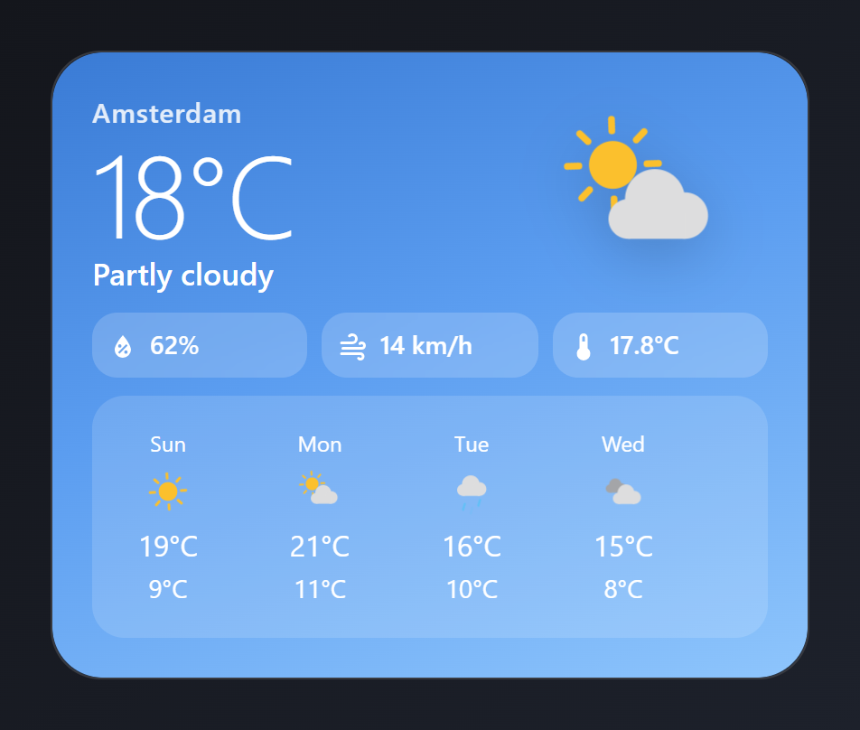

Entities: `weather.home`, `sensor.outdoor_temperature`

The city name is typed text.

File: [cards/01-weather-hero.yaml](cards/01-weather-hero.yaml)

```yaml
# Weather hero: a sky gradient with the current conditions, then a 5-day strip.
# Entities: weather.home, sensor.outdoor_temperature
type: custom:magic-card
name: Weather
background: "linear-gradient(160deg, #3a7bd5 0%, #5b9df0 45%, #8ec5fc 100%)"
border_radius: 28px
padding: 22px
box_shadow: "0 18px 40px rgba(58, 123, 213, 0.35)"
css: "color: #ffffff;"
rows:
  - id: now
    column_widths: [1fr, auto]
    columns:
      - vertical_align: center
        gap: 2px
        modules:
          - type: text
            text: Amsterdam
            design:
              font_size: 15px
              font_weight: "500"
              opacity: "0.85"
              letter_spacing: 0.5px
          - type: text
            use_entity: true
            entity: weather.home
            attribute: temperature
            design:
              font_size: 64px
              font_weight: "200"
              line_height: "1"
              letter_spacing: -2px
          - type: text
            use_entity: true
            entity: weather.home
            design:
              font_size: 17px
              font_weight: "500"
      - vertical_align: center
        modules:
          - type: weather
            entity: weather.home
            show_temperature: false
            show_condition: false
            animated_icons: true
            design:
              css: "--mc-icon-size-xl: 112px;"
              filter: "drop-shadow(0 8px 16px rgba(0,0,0,0.18))"
  - id: details
    columns:
      - modules:
          - type: horizontal
            gap: 8px
            modules:
              - type: info
                entity: weather.home
                attribute: humidity
                show_name: false
                show_icon: true
                icon: mdi:water-percent
                design: &pill
                  flex: "1"
                  padding: 8px 8px
                  css: "--mc-icon-size-lg: 18px; --mc-gap-md: 6px; --mc-font-size-xl: 14px;"
                  white_space: nowrap
                  border_radius: 14px
                  background_color: "rgba(255,255,255,0.18)"
                  backdrop_filter: blur(6px)
                  font_size: 13px
                  color: "#ffffff"
              - type: info
                entity: weather.home
                attribute: wind_speed
                show_name: false
                show_icon: true
                icon: mdi:weather-windy
                design: *pill
              - type: info
                entity: sensor.outdoor_temperature
                show_name: false
                show_icon: true
                icon: mdi:thermometer
                design: *pill
  - id: forecast
    columns:
      - modules:
          - type: forecast
            entity: weather.home
            forecast_type: daily
            num_forecasts: 4
            show_precipitation: false
            design:
              css: "--mc-forecast-icon-size: 30px; justify-content: space-between;"
              padding: 10px 4px
              border_radius: 18px
              background_color: "rgba(255,255,255,0.14)"
              color: "#ffffff"
```

## Thermostat

The room temperature inside a glowing ring that fills with the heat.

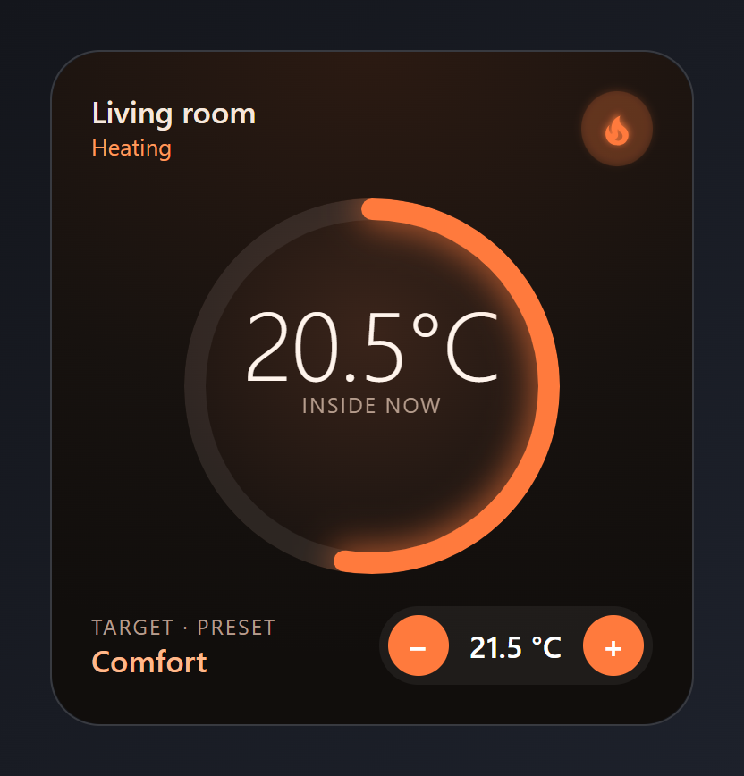

Entities: `climate.living_room`

The ring runs from 10 to 30 °C. Change `min` and `max` under `ring` for another range.

File: [cards/02-thermostat-ring.yaml](cards/02-thermostat-ring.yaml)

```yaml
# Thermostat: the room temperature inside a glowing ring that fills with the heat.
# Entities: climate.living_room
type: custom:magic-card
name: Thermostat
background: "radial-gradient(120% 90% at 50% 0%, #2b1a12 0%, #17120f 60%, #110e0c 100%)"
border_radius: 28px
padding: 22px
box_shadow: "0 18px 40px rgba(0,0,0,0.45)"
rows:
  - id: head
    column_widths: [1fr, auto]
    columns:
      - gap: 0px
        modules:
          - type: text
            text: Living room
            design: { font_size: 17px, font_weight: "600", color: "#f6e7dc" }
          - type: text
            use_entity: true
            entity: climate.living_room
            attribute: hvac_action
            design: { font_size: 13px, color: "#ff9a5a" }
      - modules:
          - type: icon
            entity: climate.living_room
            icon: mdi:fire
            size: 22px
            design:
              color: "#ff7a3d"
              padding: 9px
              border_radius: 50%
              background_color: "rgba(255,122,61,0.16)"
              animations:
                - preset: flame-flicker
  - id: dial
    columns:
      - vertical_align: center
        modules:
          - type: vertical
            align: center
            gap: 0px
            modules:
              - type: text
                use_entity: true
                entity: climate.living_room
                attribute: current_temperature
                design:
                  font_size: 54px
                  font_weight: "300"
                  color: "#fff4ec"
                  letter_spacing: -1px
                  line_height: "1"
              - type: text
                text: Inside now
                design: { font_size: 12px, color: "#b59c8c", letter_spacing: 1px, text_transform: uppercase }
            design:
              width: 210px
              height: 210px
              margin: 8px auto
              justify_content: center
              shape: circle
              background: "radial-gradient(circle at 50% 35%, #3a241a 0%, #1d1511 70%)"
              ring:
                mode: value
                entity: climate.living_room
                attribute: current_temperature
                min: 10
                max: 30
                width: 12
                glow: 10
                color: "#ff7a3d"
                track_color: "rgba(255,255,255,0.07)"
                linecap: round
  - id: target
    column_widths: [1fr, auto]
    columns:
      - vertical_align: center
        gap: 0px
        modules:
          - type: text
            text: Target · preset
            design: { font_size: 12px, color: "#b59c8c", text_transform: uppercase, letter_spacing: 1px }
          - type: text
            use_entity: true
            entity: climate.living_room
            attribute: preset_mode
            design: { font_size: 17px, font_weight: "600", color: "#ffb88a" }
      - vertical_align: center
        modules:
          - type: spinbox
            entity: climate.living_room
            design:
              color: "#ffffff"
              background_color: "rgba(255,255,255,0.06)"
              border_radius: 999px
              padding: 5px
              css: "--mc-spinbox-btn-color: #ff7a3d; --mc-spinbox-btn-size: 34px; --mc-spinbox-value-font-size: 17px; --mc-spinbox-gap: 12px;"
```

## Clock and greeting

A large clock on frosted glass over a dusk gradient. The time and greeting are Home Assistant templates (they update every minute).

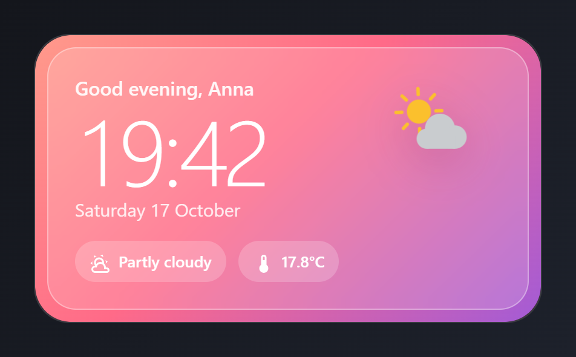

Entities: `weather.home`, `sensor.outdoor_temperature`

The greeting, time and date are Home Assistant templates and update every minute. The name in the greeting is typed text.

File: [cards/08-clock-greeting.yaml](cards/08-clock-greeting.yaml)

```yaml
# Clock and greeting: a large clock on frosted glass over a dusk gradient.
# The time and greeting are Home Assistant templates (they update every minute).
# Entities: weather.home, sensor.outdoor_temperature
type: custom:magic-card
name: Clock
background: "linear-gradient(135deg, #ff9a8b 0%, #ff6a88 45%, #a35bd6 100%)"
border_radius: 30px
padding: 10px
box_shadow: "0 20px 44px rgba(255, 106, 136, 0.35)"
rows:
  - id: glass
    padding: 22px
    design:
      border_radius: 24px
      background_color: "rgba(255,255,255,0.16)"
      backdrop_filter: blur(10px)
      border: "1px solid rgba(255,255,255,0.35)"
    column_widths: [1fr, auto]
    columns:
      - gap: 0px
        modules:
          - type: text
            use_template: true
            text: "{{ 'Good morning' if now().hour < 12 else 'Good afternoon' if now().hour < 18 else 'Good evening' }}, Anna"
            design: { font_size: 16px, font_weight: "600", color: "rgba(255,255,255,0.92)" }
          - type: text
            use_template: true
            text: "{{ now().strftime('%H:%M') }}"
            design:
              font_size: 76px
              font_weight: "200"
              color: "#ffffff"
              letter_spacing: -3px
              line_height: "1.05"
              font_variant: tabular-nums
          - type: text
            use_template: true
            text: "{{ now().strftime('%A %-d %B') }}"
            design: { font_size: 15px, color: "rgba(255,255,255,0.85)" }
          - type: horizontal
            gap: 10px
            design: { margin_top: 16px }
            modules:
              - type: horizontal
                gap: 6px
                align: center
                design: &chip
                  padding: 6px 12px
                  border_radius: 999px
                  background_color: "rgba(255,255,255,0.2)"
                modules:
                  - type: icon
                    icon: mdi:weather-partly-cloudy
                    size: 18px
                    design: { color: "#ffffff" }
                  - type: text
                    use_entity: true
                    entity: weather.home
                    design: { font_size: 13px, font_weight: "600", color: "#ffffff" }
              - type: horizontal
                gap: 6px
                align: center
                design: *chip
                modules:
                  - type: icon
                    icon: mdi:thermometer
                    size: 18px
                    design: { color: "#ffffff" }
                  - type: text
                    use_entity: true
                    entity: sensor.outdoor_temperature
                    design: { font_size: 13px, font_weight: "600", color: "#ffffff" }
      - vertical_align: start
        modules:
          - type: weather
            entity: weather.home
            show_temperature: false
            show_condition: false
            design:
              css: "--mc-icon-size-xl: 84px;"
              filter: "drop-shadow(0 10px 18px rgba(120,30,90,0.25))"
```

## Air quality

An index gauge with colour bands, three pollutant readings and a 24-hour CO2 sparkline behind the bottom tile.

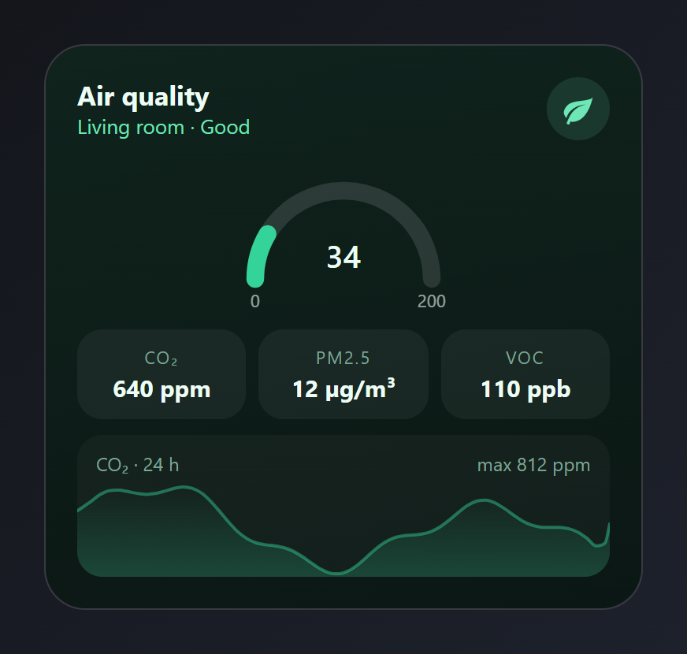

Entities: `sensor.aqi`, `sensor.co2`, `sensor.pm25`, `sensor.voc`

The "Good" rating and "max 812 ppm" are typed text.

File: [cards/12-air-quality.yaml](cards/12-air-quality.yaml)

```yaml
# Air quality: an index gauge with colour bands, three pollutant readings and a
# 24-hour CO2 sparkline behind the bottom tile.
# Entities: sensor.aqi, sensor.co2, sensor.pm25, sensor.voc
type: custom:magic-card
name: Air quality
background: "linear-gradient(170deg, #10231d 0%, #0b1714 100%)"
border_radius: 26px
padding: 20px
box_shadow: "0 18px 40px rgba(0,0,0,0.45)"
rows:
  - id: head
    column_widths: [1fr, auto]
    columns:
      - gap: 0px
        modules:
          - type: text
            text: Air quality
            design: { font_size: 17px, font_weight: "700", color: "#ecfdf5" }
          - type: text
            text: Living room · Good
            design: { font_size: 13px, color: "#6ee7b7" }
      - modules:
          - type: icon
            icon: mdi:leaf
            size: 22px
            design:
              color: "#6ee7b7"
              width: 40px
              height: 40px
              display: flex
              align_items: center
              justify_content: center
              border_radius: 50%
              background_color: "rgba(110,231,183,0.12)"
  - id: gauge
    columns:
      - modules:
          - type: gauge
            entity: sensor.aqi
            min: 0
            max: 200
            gauge_style: half
            needle: false
            show_name: false
            show_unit: false
            severity:
              - { from: 0, color: "#34d399" }
              - { from: 50, color: "#facc15" }
              - { from: 100, color: "#fb923c" }
              - { from: 150, color: "#f87171" }
            design: { color: "#ecfdf5", max_width: 240px, margin: 0 auto }
  - id: readings
    layout: "1-1-1"
    gap: 8px
    columns:
      - modules:
          - type: vertical
            gap: 2px
            align: center
            design: &cell
              padding: 10px 6px
              border_radius: 16px
              background_color: "rgba(255,255,255,0.05)"
            modules:
              - type: text
                text: CO₂
                design: &lab { font_size: 11px, color: "#7fa596", text_transform: uppercase, letter_spacing: 1px }
              - type: text
                use_entity: true
                entity: sensor.co2
                design: &num { font_size: 15px, font_weight: "700", color: "#ecfdf5" }
      - modules:
          - type: vertical
            gap: 2px
            align: center
            design: *cell
            modules:
              - type: text
                text: PM2.5
                design: *lab
              - type: text
                use_entity: true
                entity: sensor.pm25
                design: *num
      - modules:
          - type: vertical
            gap: 2px
            align: center
            design: *cell
            modules:
              - type: text
                text: VOC
                design: *lab
              - type: text
                use_entity: true
                entity: sensor.voc
                design: *num
  - id: trend
    columns:
      - modules:
          - type: horizontal
            justify: space-between
            align: start
            design:
              height: 70px
              padding: 10px 12px
              border_radius: 16px
              background_color: "rgba(255,255,255,0.03)"
              value_background:
                type: sparkline
                entity: sensor.co2
                hours: 24
                color: "#34d399"
                opacity: 22%
                line_width: 2
            modules:
              - type: text
                text: CO₂ · 24 h
                design: { font_size: 12px, color: "#7fa596" }
              - type: text
                text: max 812 ppm
                design: { font_size: 12px, color: "#7fa596" }
```

## Sensor tiles

Four readings, each with its last 24 hours drawn as a sparkline behind the value.

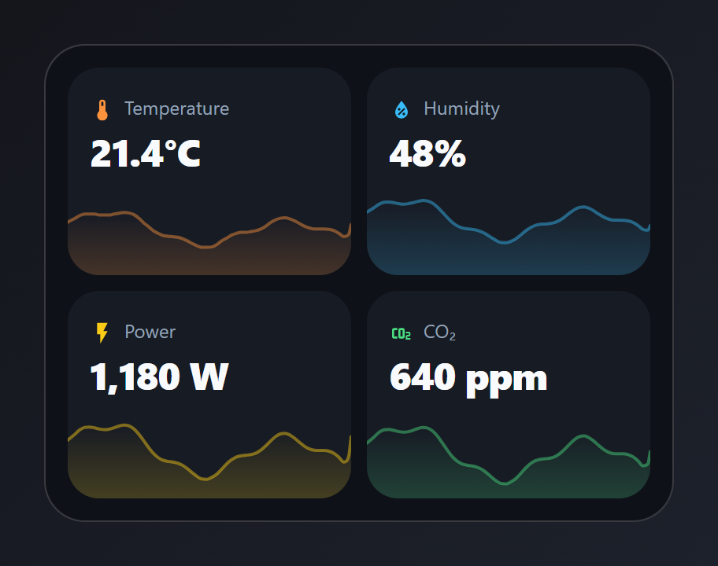

Entities: `sensor.indoor_temperature`, `sensor.indoor_humidity`, `sensor.house_power`, `sensor.co2`

File: [cards/14-sensor-sparklines.yaml](cards/14-sensor-sparklines.yaml)

```yaml
# Sensor tiles: four readings, each with its last 24 hours drawn as a sparkline
# behind the value.
# Entities: sensor.indoor_temperature, sensor.indoor_humidity, sensor.house_power, sensor.co2
type: custom:magic-card
name: Sensors
background: "#0e1117"
border_radius: 26px
padding: 14px
box_shadow: "0 18px 40px rgba(0,0,0,0.5)"
rows:
  - id: r1
    layout: "1-1"
    gap: 10px
    columns:
      - modules:
          - type: vertical
            gap: 2px
            design:
              height: 104px
              padding: 14px
              border_radius: 20px
              background_color: "#171b24"
              value_background: { type: sparkline, entity: sensor.indoor_temperature, min: 17, max: 29, color: "#fb923c", opacity: 20%, line_width: 2 }
            actions:
              tap_action: { action: more-info, entity: sensor.indoor_temperature }
            modules:
              - type: horizontal
                gap: 6px
                align: center
                modules:
                  - type: icon
                    icon: mdi:thermometer
                    size: 16px
                    design: { color: "#fb923c" }
                  - type: text
                    text: Temperature
                    design: &lab { font_size: 12px, color: "#94a3b8" }
              - type: text
                use_entity: true
                entity: sensor.indoor_temperature
                design: &num { font_size: 24px, font_weight: "800", color: "#f8fafc", letter_spacing: -0.5px }
      - modules:
          - type: vertical
            gap: 2px
            design:
              height: 104px
              padding: 14px
              border_radius: 20px
              background_color: "#171b24"
              value_background: { type: sparkline, entity: sensor.indoor_humidity, min: 30, max: 80, color: "#38bdf8", opacity: 20%, line_width: 2 }
            actions:
              tap_action: { action: more-info, entity: sensor.indoor_humidity }
            modules:
              - type: horizontal
                gap: 6px
                align: center
                modules:
                  - type: icon
                    icon: mdi:water-percent
                    size: 16px
                    design: { color: "#38bdf8" }
                  - type: text
                    text: Humidity
                    design: *lab
              - type: text
                use_entity: true
                entity: sensor.indoor_humidity
                design: *num
  - id: r2
    layout: "1-1"
    gap: 10px
    columns:
      - modules:
          - type: vertical
            gap: 2px
            design:
              height: 104px
              padding: 14px
              border_radius: 20px
              background_color: "#171b24"
              value_background: { type: sparkline, entity: sensor.house_power, min: 0, max: 2600, color: "#facc15", opacity: 20%, line_width: 2 }
            actions:
              tap_action: { action: more-info, entity: sensor.house_power }
            modules:
              - type: horizontal
                gap: 6px
                align: center
                modules:
                  - type: icon
                    icon: mdi:flash
                    size: 16px
                    design: { color: "#facc15" }
                  - type: text
                    text: Power
                    design: *lab
              - type: text
                use_entity: true
                entity: sensor.house_power
                design: *num
      - modules:
          - type: vertical
            gap: 2px
            design:
              height: 104px
              padding: 14px
              border_radius: 20px
              background_color: "#171b24"
              value_background: { type: sparkline, entity: sensor.co2, min: 300, max: 1300, color: "#4ade80", opacity: 20%, line_width: 2 }
            actions:
              tap_action: { action: more-info, entity: sensor.co2 }
            modules:
              - type: horizontal
                gap: 6px
                align: center
                modules:
                  - type: icon
                    icon: mdi:molecule-co2
                    size: 16px
                    design: { color: "#4ade80" }
                  - type: text
                    text: CO₂
                    design: *lab
              - type: text
                use_entity: true
                entity: sensor.co2
                design: *num
```

## Room temperatures

One row per room with a colour-coded value pill. Cold rooms show blue, comfortable green, warm orange.

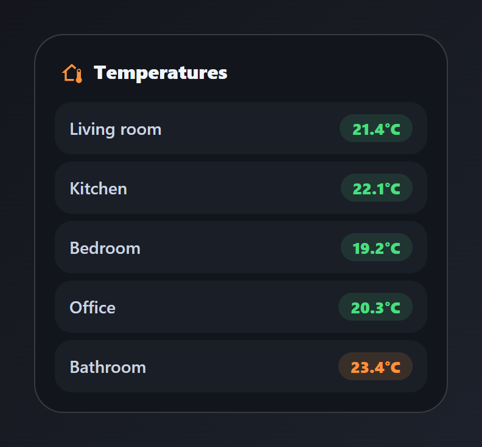

Entities: `sensor.indoor_temperature`, `sensor.kitchen_temperature`, `sensor.bedroom_temperature`, `sensor.office_temperature`, `sensor.bathroom_temperature`

File: [cards/25-room-temperatures.yaml](cards/25-room-temperatures.yaml)

```yaml
# Room temperatures: one row per room with a colour-coded value pill.
# Cold rooms show blue, comfortable green, warm orange.
# Entities: sensor.indoor_temperature, sensor.kitchen_temperature,
#           sensor.bedroom_temperature, sensor.office_temperature, sensor.bathroom_temperature
type: custom:magic-card
name: Temperatures
background: "#12151c"
border_radius: 24px
padding: 16px
box_shadow: "0 18px 40px rgba(0,0,0,0.45)"
rows:
  - id: title
    columns:
      - modules:
          - type: horizontal
            gap: 8px
            align: center
            design: { padding: 2px 4px 4px }
            modules:
              - type: icon
                icon: mdi:home-thermometer-outline
                size: 20px
                design: { color: "#fb923c" }
              - type: text
                text: Temperatures
                design: { font_size: 16px, font_weight: "800", color: "#f1f5f9" }
  - id: list
    columns:
      - gap: 6px
        modules:
          - type: horizontal
            justify: space-between
            align: center
            design: &row { padding: 10px 12px, border_radius: 14px, background_color: "#1a1e27" }
            modules:
              - type: text
                text: Living room
                design: &room { font_size: 14px, font_weight: "600", color: "#cbd5e1" }
              - type: text
                use_entity: true
                entity: sensor.indoor_temperature
                design: &pill
                  font_size: 13px
                  font_weight: "800"
                  padding: 3px 10px
                  border_radius: 999px
                  color: "#4ade80"
                  background_color: "rgba(74,222,128,0.12)"
                  conditional:
                    - { id: cold, name: Cold, conditions: [{ type: state, below: 19 }], design: { color: "#60a5fa", background_color: "rgba(96,165,250,0.14)" } }
                    - { id: warm, name: Warm, conditions: [{ type: state, above: 22.9 }], design: { color: "#fb923c", background_color: "rgba(251,146,60,0.14)" } }
          - type: horizontal
            justify: space-between
            align: center
            design: *row
            modules:
              - type: text
                text: Kitchen
                design: *room
              - type: text
                use_entity: true
                entity: sensor.kitchen_temperature
                design: *pill
          - type: horizontal
            justify: space-between
            align: center
            design: *row
            modules:
              - type: text
                text: Bedroom
                design: *room
              - type: text
                use_entity: true
                entity: sensor.bedroom_temperature
                design: *pill
          - type: horizontal
            justify: space-between
            align: center
            design: *row
            modules:
              - type: text
                text: Office
                design: *room
              - type: text
                use_entity: true
                entity: sensor.office_temperature
                design: *pill
          - type: horizontal
            justify: space-between
            align: center
            design: *row
            modules:
              - type: text
                text: Bathroom
                design: *room
              - type: text
                use_entity: true
                entity: sensor.bathroom_temperature
                design: *pill
```

## Sunrise and sunset

A dawn-to-dusk gradient with the times and the day length.

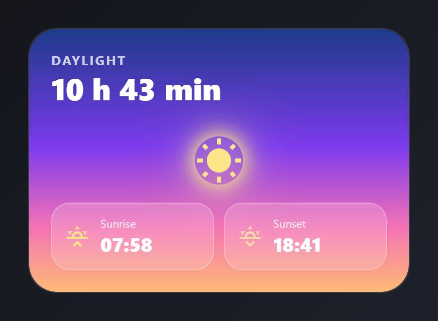

Entities: `sensor.sunrise`, `sensor.sunset`, `sensor.day_length`

Needs text sensors for sunrise, sunset and day length, for example template sensors built on `sun.sun`.

File: [cards/26-sun-times.yaml](cards/26-sun-times.yaml)

```yaml
# Sunrise and sunset: a dawn-to-dusk gradient with the times and the day length.
# Entities: sensor.sunrise, sensor.sunset, sensor.day_length
type: custom:magic-card
name: Sun
background: "linear-gradient(180deg, #1e3a8a 0%, #7c3aed 45%, #f472b6 75%, #fdba74 100%)"
border_radius: 28px
padding: 22px
box_shadow: "0 20px 44px rgba(124, 58, 237, 0.3)"
rows:
  - id: head
    columns:
      - gap: 0px
        modules:
          - type: text
            text: Daylight
            design: { font_size: 13px, font_weight: "700", color: "rgba(255,255,255,0.75)", text_transform: uppercase, letter_spacing: 1.5px }
          - type: text
            use_entity: true
            entity: sensor.day_length
            design: { font_size: 30px, font_weight: "800", color: "#ffffff" }
  - id: sun
    padding: 18px 0 8px
    columns:
      - modules:
          - type: icon
            icon: mdi:white-balance-sunny
            size: 48px
            design:
              color: "#fde68a"
              margin: 0 auto
              border_radius: 50%
              filter: "drop-shadow(0 0 22px rgba(253,230,138,0.9))"
              animations: [{ preset: glow-pulse, color: "#fde68a", intensity: 20, duration: 4s }]
  - id: times
    layout: "1-1"
    gap: 10px
    columns:
      - modules:
          - type: horizontal
            gap: 10px
            align: center
            design: &glass
              padding: 12px
              border_radius: 18px
              background_color: "rgba(255,255,255,0.16)"
              backdrop_filter: blur(8px)
              border: "1px solid rgba(255,255,255,0.25)"
            modules:
              - type: icon
                icon: mdi:weather-sunset-up
                size: 26px
                design: { color: "#fde68a" }
              - type: vertical
                gap: 0px
                modules:
                  - type: text
                    text: Sunrise
                    design: &lab { font_size: 11px, color: "rgba(255,255,255,0.8)" }
                  - type: text
                    use_entity: true
                    entity: sensor.sunrise
                    design: &time { font_size: 19px, font_weight: "800", color: "#ffffff" }
      - modules:
          - type: horizontal
            gap: 10px
            align: center
            design: *glass
            modules:
              - type: icon
                icon: mdi:weather-sunset-down
                size: 26px
                design: { color: "#fed7aa" }
              - type: vertical
                gap: 0px
                modules:
                  - type: text
                    text: Sunset
                    design: *lab
                  - type: text
                    use_entity: true
                    entity: sensor.sunset
                    design: *time
```

## Hot water boiler

Tank temperature as a vertical fill with a heat shimmer, set point, mode and a 24-hour sparkline.

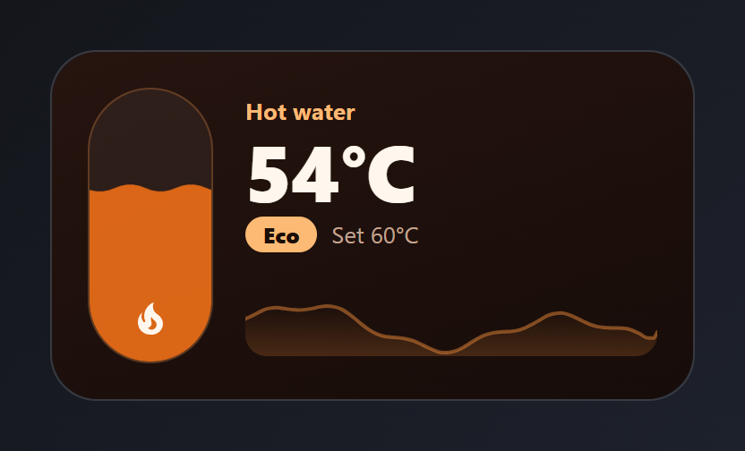

Entities: `water_heater.boiler`, `sensor.boiler_temperature`

The "Eco" pill and the set point are typed text.

File: [cards/34-boiler.yaml](cards/34-boiler.yaml)

```yaml
# Hot water boiler: tank temperature as a vertical fill with a heat shimmer,
# set point, mode and a 24-hour sparkline.
# Entities: water_heater.boiler, sensor.boiler_temperature
type: custom:magic-card
name: Boiler
background: "linear-gradient(160deg, #26140f 0%, #160c09 100%)"
border_radius: 26px
padding: 20px
box_shadow: "0 18px 40px rgba(0,0,0,0.45)"
rows:
  - id: main
    column_widths: [70px, 1fr]
    gap: 18px
    columns:
      - modules:
          - type: icon
            icon: mdi:fire
            size: 24px
            design:
              color: "#fff7ed"
              height: 140px
              display: flex
              align_items: flex-end
              justify_content: center
              padding_bottom: 12px
              border_radius: 35px
              background_color: "rgba(255,255,255,0.05)"
              border: "1px solid rgba(251,146,60,0.25)"
              value_background:
                type: fill
                entity: sensor.boiler_temperature
                min: 20
                max: 75
                color: "#f97316"
                opacity: 85%
                wave: true
      - vertical_align: center
        gap: 2px
        modules:
          - type: text
            text: Hot water
            design: { font_size: 13px, font_weight: "700", color: "#fdba74" }
          - type: text
            use_entity: true
            entity: sensor.boiler_temperature
            design: { font_size: 44px, font_weight: "800", color: "#fff7ed", letter_spacing: -1px, line_height: "1.05" }
          - type: horizontal
            gap: 8px
            align: center
            modules:
              - type: text
                text: Eco
                design: { font_size: 12px, font_weight: "800", color: "#1c0d06", padding: 2px 10px, border_radius: 999px, background_color: "#fdba74" }
              - type: text
                text: "Set 60°C"
                design: { font_size: 13px, color: "#c2a491" }
          - type: horizontal
            design:
              height: 46px
              margin_top: 10px
              border_radius: 12px
              value_background: { type: sparkline, entity: sensor.boiler_temperature, color: "#fb923c", opacity: 20%, line_width: 2 }
            modules: []
```

## Storm watch

A live weather scene with rain and lightning behind the current conditions and three storm readings. The scene follows the weather entity, so the card shows sun, clouds, snow or a night sky on other days.

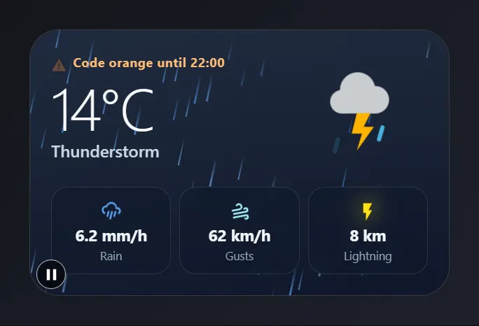

Entities: `weather.garden`, `sensor.rain_rate`, `sensor.wind_gust`, `sensor.lightning_distance`

The warning line is typed text. The scene follows `weather.garden`, so it changes with the weather.

File: [cards/42-storm-watch.yaml](cards/42-storm-watch.yaml)

```yaml
# Storm watch: a live weather scene with rain and lightning behind the current conditions and three storm readings.
# The scene follows the weather entity, so the card shows sun, clouds, snow or a night sky on other days.
# Entities: weather.garden, sensor.rain_rate, sensor.wind_gust, sensor.lightning_distance
type: custom:magic-card
name: Storm watch
background: "linear-gradient(170deg, #1e293b 0%, #0f172a 100%)"
border_radius: 28px
padding: 20px
box_shadow: "0 20px 44px rgba(2, 6, 23, 0.6)"
seasonal:
  scene: weather
  weather_entity: weather.garden
  intensity: 80%
rows:
  - id: now
    column_widths: [1fr, auto]
    columns:
      - vertical_align: center
        gap: 2px
        modules:
          - type: horizontal
            gap: 6px
            align: center
            modules:
              - type: icon
                icon: mdi:alert
                size: 15px
                design:
                  color: "#fb923c"
                  animations:
                    - { id: blink, preset: blink, duration: 1.6s, intensity: 70 }
              - type: text
                text: Code orange until 22:00
                design: { font_size: 12px, font_weight: "700", color: "#fdba74", letter_spacing: 0.4px }
          - type: text
            use_entity: true
            entity: weather.garden
            attribute: temperature
            design: { font_size: 56px, font_weight: "200", color: "#f8fafc", line_height: "1.05", letter_spacing: -2px }
          - type: text
            use_entity: true
            entity: weather.garden
            design: { font_size: 16px, font_weight: "600", color: "#cbd5e1" }
      - vertical_align: center
        modules:
          - type: weather
            entity: weather.garden
            show_temperature: false
            show_condition: false
            animated_icons: true
            design:
              css: "--mc-icon-size-xl: 104px;"
  - id: stats
    layout: "1-1-1"
    gap: 8px
    padding: 14px 0 0
    columns:
      - modules:
          - type: vertical
            gap: 2px
            align: center
            design: &stat
              padding: 10px 6px
              border_radius: 16px
              background_color: "rgba(15,23,42,0.55)"
              border: "1px solid rgba(148,163,184,0.18)"
              backdrop_filter: blur(6px)
            modules:
              - type: icon
                icon: mdi:weather-pouring
                size: 20px
                design:
                  color: "#60a5fa"
                  animations:
                    - { id: drip, preset: bounce, target: icon, intensity: 3, duration: 1.2s }
              - type: text
                use_entity: true
                entity: sensor.rain_rate
                design: &val { font_size: 15px, font_weight: "700", color: "#f1f5f9" }
              - type: text
                text: Rain
                design: &lbl { font_size: 11px, color: "#94a3b8" }
      - modules:
          - type: vertical
            gap: 2px
            align: center
            design: *stat
            modules:
              - type: icon
                icon: mdi:weather-windy
                size: 20px
                design:
                  color: "#a5f3fc"
                  animations:
                    - { id: sway, preset: sway, target: icon, intensity: 12, duration: 1.4s }
              - type: text
                use_entity: true
                entity: sensor.wind_gust
                design: *val
              - type: text
                text: Gusts
                design: *lbl
      - modules:
          - type: vertical
            gap: 2px
            align: center
            design: *stat
            modules:
              - type: icon
                icon: mdi:flash
                size: 20px
                design:
                  color: "#facc15"
                  animations:
                    - { id: flicker, preset: neon-flicker, target: icon, color: "#facc15", intensity: 10 }
              - type: text
                use_entity: true
                entity: sensor.lightning_distance
                design: *val
              - type: text
                text: Lightning
                design: *lbl
```

## Heating

The fire icon flickers like a flame while the thermostat heats, inside a temperature ring that glows and breathes. The flame comes from the icon's Auto device animation, so it stops by itself when the heating goes idle.

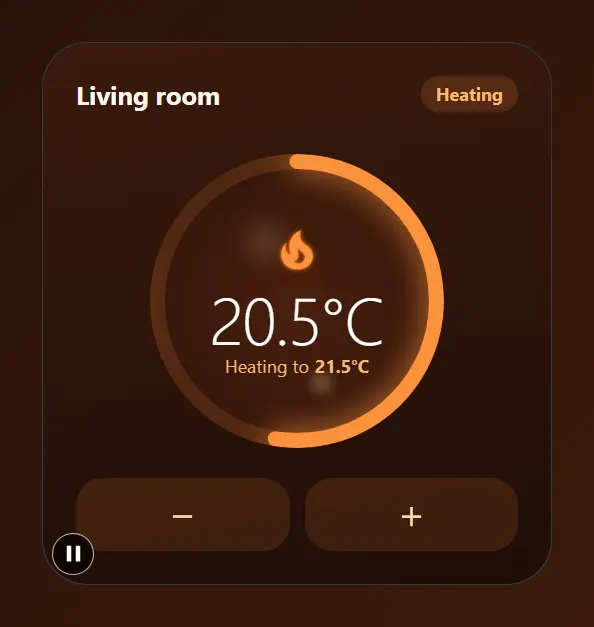

Entities: `climate.living_room`

The ring runs from 10 to 30 °C. The halo plays while the climate state is `heat`.

File: [cards/43-heating.yaml](cards/43-heating.yaml)

```yaml
# Heating: the fire icon flickers like a flame while the thermostat heats, inside a temperature ring that glows and breathes.
# The flame comes from the icon's Auto device animation, so it stops by itself when the heating goes idle.
# Entities: climate.living_room
type: custom:magic-card
name: Heating
background: "linear-gradient(170deg, #3a1a0e 0%, #1f0d06 100%)"
border_radius: 30px
padding: 22px
box_shadow: "0 20px 44px rgba(124, 45, 18, 0.45)"
rows:
  - id: head
    column_widths: [1fr, auto]
    columns:
      - vertical_align: center
        modules:
          - type: text
            text: Living room
            design: { font_size: 17px, font_weight: "700", color: "#fff7ed" }
      - vertical_align: center
        modules:
          - type: text
            use_entity: true
            entity: climate.living_room
            attribute: hvac_action
            design: { font_size: 12px, font_weight: "700", color: "#fdba74", padding: 4px 10px, border_radius: 999px, background_color: "rgba(251,146,60,0.16)" }
  - id: dial
    padding: 18px 0 10px
    columns:
      - modules:
          - type: vertical
            align: center
            gap: 2px
            design:
              width: 196px
              height: 196px
              margin: 0 auto
              justify_content: center
              shape: circle
              background: "radial-gradient(circle, #4a200f 0%, #2a1108 100%)"
              ring:
                mode: value
                entity: climate.living_room
                attribute: current_temperature
                min: 10
                max: 30
                width: 10
                glow: 10
                track_color: "rgba(251,146,60,0.14)"
                thresholds:
                  - { from: 10, color: "#38bdf8" }
                  - { from: 18, color: "#fb923c" }
                  - { from: 24, color: "#ef4444" }
              animations:
                - { id: aura, preset: aura, trigger: state, trigger_entity: climate.living_room, state: heat, color: "#f97316", strength: 45, intensity: 22 }
                - { id: steam, preset: steam-rise, color: "#fed7aa", strength: 35, intensity: 4 }
            modules:
              - type: icon
                entity: climate.living_room
                icon: mdi:fire
                size: 36px
                icon_fx:
                  device: auto
                design: { color: "#fb923c" }
              - type: text
                use_entity: true
                entity: climate.living_room
                attribute: current_temperature
                design: { font_size: 44px, font_weight: "300", color: "#ffffff", line_height: "1", letter_spacing: -1px }
              - type: horizontal
                gap: 4px
                align: center
                modules:
                  - type: text
                    text: "Heating to"
                    design: { font_size: 12px, color: "#fdba74" }
                  - type: text
                    use_entity: true
                    entity: climate.living_room
                    attribute: temperature
                    design: { font_size: 12px, font_weight: "700", color: "#fdba74" }
  - id: buttons
    layout: "1-1"
    gap: 10px
    columns:
      - modules:
          - type: icon
            icon: mdi:minus
            size: 22px
            design: &round
              color: "#fed7aa"
              padding: 12px
              display: flex
              justify_content: center
              border_radius: 18px
              background_color: "rgba(251,146,60,0.12)"
            actions:
              tap_action: { action: perform-action, service: climate.set_temperature, data: { entity_id: climate.living_room, temperature: 21 } }
      - modules:
          - type: icon
            icon: mdi:plus
            size: 22px
            design: *round
            actions:
              tap_action: { action: perform-action, service: climate.set_temperature, data: { entity_id: climate.living_room, temperature: 22 } }
```

## Cooling

The air conditioner shows falling snow on its icon while it cools, the fan spins at its own speed, and wind lines drift through the card. Both icons use the Auto device animation, so they react to the entities by themselves.

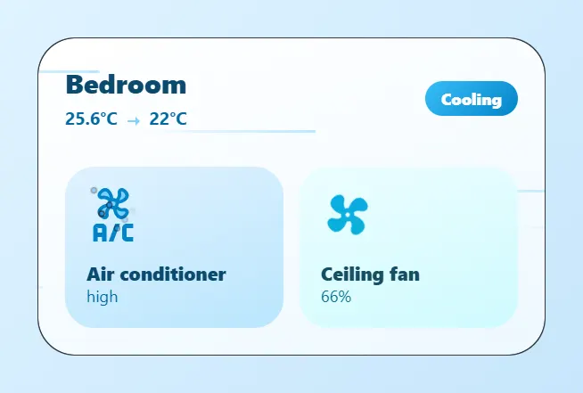

Entities: `climate.bedroom`, `fan.bedroom`

File: [cards/44-cooling.yaml](cards/44-cooling.yaml)

```yaml
# Cooling: the air conditioner shows falling snow on its icon while it cools, the fan spins at its own speed, and wind lines drift through the card.
# Both icons use the Auto device animation, so they react to the entities by themselves.
# Entities: climate.bedroom, fan.bedroom
type: custom:magic-card
name: Bedroom cooling
background: "linear-gradient(160deg, #ffffff 0%, #eef8ff 100%)"
border_radius: 28px
padding: 20px
box_shadow: "0 16px 36px rgba(14, 116, 144, 0.18)"
animations:
  - { id: wind, preset: wind-lines, color: "#38bdf8", strength: 35, intensity: 5 }
rows:
  - id: head
    column_widths: [1fr, auto]
    columns:
      - vertical_align: center
        gap: 2px
        modules:
          - type: text
            text: Bedroom
            design: { font_size: 20px, font_weight: "800", color: "#0c4a6e" }
          - type: horizontal
            gap: 4px
            align: center
            modules:
              - type: text
                use_entity: true
                entity: climate.bedroom
                attribute: current_temperature
                design: { font_size: 13px, font_weight: "700", color: "#0369a1" }
              - type: icon
                icon: mdi:arrow-right-thin
                size: 16px
                design: { color: "#7dd3fc" }
              - type: text
                use_entity: true
                entity: climate.bedroom
                attribute: temperature
                design: { font_size: 13px, font_weight: "700", color: "#0369a1" }
      - vertical_align: center
        modules:
          - type: text
            text: Cooling
            design: { font_size: 12px, font_weight: "800", color: "#ffffff", padding: 5px 12px, border_radius: 999px, background: "linear-gradient(135deg, #38bdf8, #0284c7)" }
  - id: tiles
    layout: "1-1"
    gap: 12px
    padding: 16px 0 0
    columns:
      - modules:
          - type: vertical
            gap: 10px
            design: &tile
              padding: 16px
              border_radius: 22px
              background: "linear-gradient(160deg, #e0f2fe, #bae6fd)"
            actions:
              tap_action: { action: more-info, entity: climate.bedroom }
            modules:
              - type: icon
                entity: climate.bedroom
                icon: mdi:air-conditioner
                size: 40px
                icon_fx:
                  device: auto
                  colors: { style: duotone, primary: "#0284c7", secondary: "#7dd3fc" }
              - type: vertical
                gap: 0px
                modules:
                  - type: text
                    text: Air conditioner
                    design: { font_size: 14px, font_weight: "800", color: "#0c4a6e" }
                  - type: text
                    use_entity: true
                    entity: climate.bedroom
                    attribute: fan_mode
                    design: { font_size: 12px, color: "#0369a1" }
      - modules:
          - type: vertical
            gap: 10px
            design:
              padding: 16px
              border_radius: 22px
              background: "linear-gradient(160deg, #ecfeff, #cffafe)"
            actions:
              tap_action: { action: toggle, entity: fan.bedroom }
            modules:
              - type: icon
                entity: fan.bedroom
                icon: mdi:fan
                size: 40px
                icon_fx:
                  device: auto
                  colors: { style: gradient, gradient: ["#06b6d4", "#0ea5e9"], angle: 45 }
              - type: vertical
                gap: 0px
                modules:
                  - type: text
                    text: Ceiling fan
                    design: { font_size: 14px, font_weight: "800", color: "#164e63" }
                  - type: text
                    use_entity: true
                    entity: fan.bedroom
                    attribute: percentage
                    design: { font_size: 12px, color: "#0e7490" }
```
