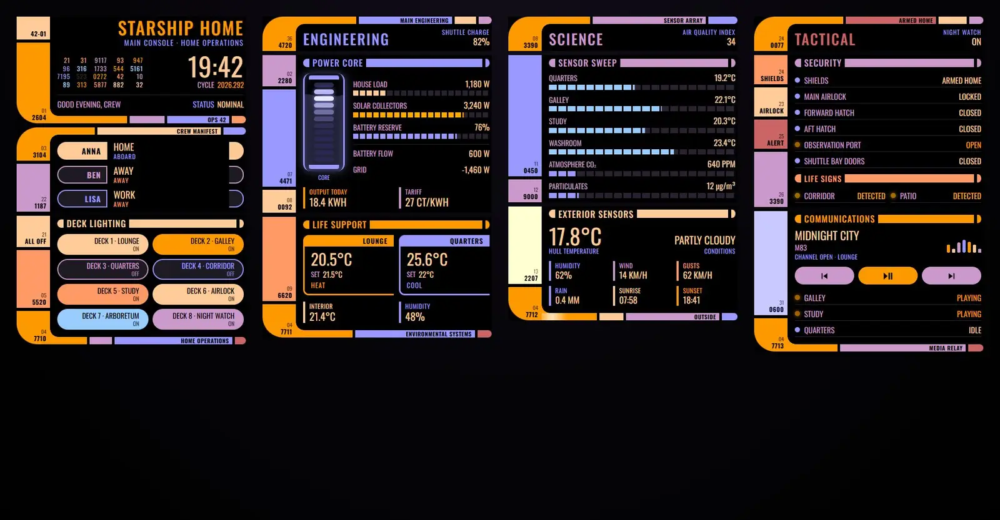
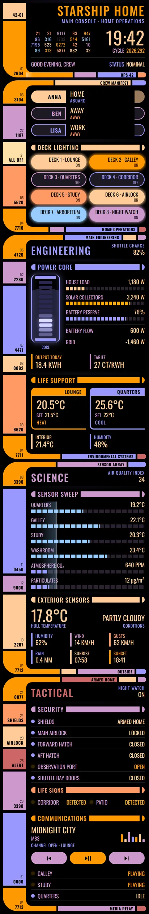

# Starship bridge

A home dashboard made to look like a starship's bridge console. It's one Sections view with four columns (Bridge, Engineering, Science, Tactical) and 12 Magic Cards. Each card is a console panel: a column of coloured blocks on the left, readouts on the right, and rounded elbows where a section's frame opens and closes. The gaps between the cards line up with the gaps between the sidebar blocks, so the whole view reads as one console. When the alarm goes off, every panel turns red and starts to blink.





## What's on it

| Section | Cards |
| --- | --- |
| Bridge | Header with the title, the clock, the date as a cycle number, a blinking number cascade and the status line. Crew manifest (who's home). Deck lighting: eight pills, tap to toggle, hold for details; the "All off" block turns every light off. |
| Engineering | Heading. Power core: a stack of cells with a pulse running up through them, inside a chamber that fills with the battery level and glows while the solar panels deliver more than 1 kW. The pulse speeds up when the house load goes over 2.5 kW, and the core turns amber when the battery drops under 20 %. Next to it: house load, solar, battery, battery flow and grid, energy today and the tariff. Life support: both thermostats, indoor temperature and humidity. |
| Science | Heading. Sensor sweep: room temperatures, CO₂ and particulates with a scan line passing over them. Exterior sensors: outdoor temperature, conditions, humidity, wind, gusts, rain, sunrise and sunset. |
| Tactical | Heading. Security: alarm, lock (tap to toggle), doors, window, garage, and the motion sensors as "life signs". Communications: what's playing, previous / play-pause / next, and the other speakers. |

Alert: while `alarm_control_panel.home` is `triggered`, every card gets a dark red glow, the sidebar blocks and elbows turn red and blink, and the header and section titles change to a flashing "Alert". Holding the "Alert" block in the Tactical sidebar triggers the alarm.

Font: Antonio, loaded by the card from Google Fonts. Text is in capitals.

## Install

1. Copy `theme.yaml` into `/config/themes/` (any file name ending in `.yaml`).
2. Make sure `configuration.yaml` loads themes:

   ```yaml
   frontend:
     themes: !include_dir_merge_named themes
   ```

3. Reload themes (Developer tools → Actions → `frontend.reload_themes`) or restart Home Assistant.
4. Install Magic Card if you haven't already (HACS, or `magic-card.js` as a dashboard resource).
5. Settings → Dashboards → Add dashboard → New dashboard from scratch. Open it, then three dots → Edit dashboard → three dots → Raw configuration editor. Replace everything with the contents of `dashboard.yaml` and save.
6. Swap the entity ids for your own (table below). The view picks the "Starship Console" theme by itself.

For bigger changes, edit the generator and run it again rather than editing the YAML by hand.

## Entities

| Entity | What it is |
| --- | --- |
| `alarm_control_panel.home` | Alarm ("Shields"). `triggered` sets off the alert. |
| `lock.front_door` | Front door lock ("Main airlock") |
| `binary_sensor.front_door` | Front door contact ("Forward hatch") |
| `binary_sensor.back_door` | Back door contact ("Aft hatch") |
| `binary_sensor.garage_window` | Garage window contact ("Observation port") |
| `cover.garage_door` | Garage door ("Shuttle bay doors") |
| `binary_sensor.hall_motion` | Hall motion ("Life signs · Corridor") |
| `binary_sensor.patio_motion` | Patio motion ("Life signs · Patio") |
| `person.anna`, `person.ben`, `person.lisa` | People in the crew manifest |
| `light.living_room`, `light.kitchen`, `light.bedroom`, `light.hallway`, `light.desk`, `light.porch`, `light.garden`, `light.nightlight` | Deck lighting pills 1 to 8 |
| `sensor.house_power` | House load (W): pulse speed of the core |
| `sensor.solar_power` | Solar power (W): solar collectors, core glow |
| `sensor.home_battery` | Home battery (%): battery reserve, chamber fill, amber core |
| `sensor.battery_power` | Battery charge / discharge power (W) |
| `sensor.grid_power` | Grid power (W), negative is export |
| `sensor.energy_today` | Energy used today (kWh) |
| `sensor.energy_price` | Current tariff |
| `sensor.car_battery` | Car battery (%) ("Shuttle charge") |
| `climate.living_room`, `climate.bedroom` | Thermostats ("Lounge", "Quarters") |
| `sensor.indoor_temperature`, `sensor.indoor_humidity` | Indoor temperature and humidity |
| `sensor.bedroom_temperature`, `sensor.kitchen_temperature`, `sensor.office_temperature`, `sensor.bathroom_temperature` | Room temperatures in the sensor sweep |
| `sensor.co2`, `sensor.pm25`, `sensor.aqi` | Air quality |
| `weather.home` | Weather (conditions, humidity, wind) |
| `sensor.outdoor_temperature` | Outdoor temperature ("Hull temperature") |
| `sensor.wind_gust`, `sensor.rain_today` | Gusts and rain today |
| `sensor.sunrise`, `sensor.sunset` | Sunrise and sunset times |
| `media_player.living_room` | Main speaker in Communications |
| `media_player.kitchen`, `media_player.office`, `media_player.bedroom` | Other speakers |
| `input_boolean.night_mode` | Night mode ("Night watch") |

Actions without an entity of their own: `light.turn_off` with `entity_id: all` (All off block), `alarm_control_panel.alarm_trigger` (hold Alert), `media_player.media_previous_track` / `media_play_pause` / `media_next_track`.

Templates: the clock `{{ now().strftime('%H:%M') }}`, the greeting, and the cycle number `{{ now().strftime('%Y.%j') }}` (year and day of the year).
