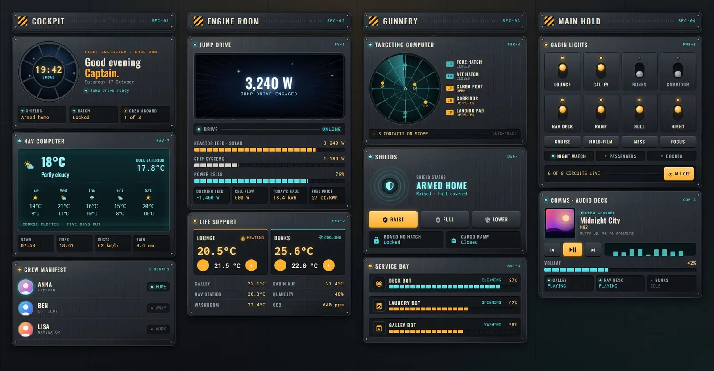
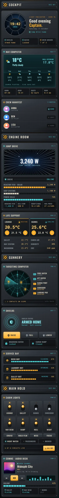

# Freighter cockpit

A Home Assistant dashboard dressed as the cockpit of a battered old light freighter. The panels are brushed gunmetal with rivets and scuffs, the indicator lamps are amber and the readouts are teal holo screens. It's one Sections view with four sections and 14 cards, all of them Magic Cards. When the solar panels produce, the jump-drive viewport fills with star streaks.





## What's on it

| Section | Cards |
| --- | --- |
| Cockpit | Heading; cockpit viewport with the clock, greeting, date, jump-drive line and status chips (alarm, lock, crew aboard); nav computer weather with a five-day forecast, dawn, dusk, gusts and rain; crew manifest of the three people |
| Engine room | Heading; jump drive (solar power in a viewport that fills with star streaks while the panels produce, segmented bars for solar, house load and battery, tiles for grid, battery flow, energy today and price); life support (two thermostats with +/- controls, room temperatures, humidity, CO2) |
| Gunnery | Heading; targeting computer (doors, window and motion sensors as blips on a round scope with a radar sweep); shields (alarm state, arm home / arm away / disarm keys, front door lock, garage door); service bay (robot vacuum, washer, dishwasher) |
| Main hold | Heading; cabin lights (eight chunky toggle switches, four scene keys, three mode switches, an all-off key); comms audio deck (now playing with cover, controls, equaliser, volume, three other speakers) |

Fonts: Oswald for labels and Inconsolata for readouts. The card loads both from Google Fonts.

## Install

1. Copy `theme.yaml` into `/config/themes/` (make the folder if needed).
2. Make sure `configuration.yaml` has:

   ```yaml
   frontend:
     themes: !include_dir_merge_named themes
   ```

3. Restart Home Assistant, or run the `frontend.reload_themes` action.
4. Install Magic Card if you haven't already.
5. Settings → Dashboards → Add dashboard → New dashboard from scratch. Open it, choose Edit → three dots → Raw configuration editor, paste the contents of `dashboard.yaml` and save.
6. Swap the placeholder entity ids for your own (see below).

The view sets `theme: Gunmetal Freighter`, so the theme applies to this dashboard only.

## Entities

| Entity | Used for |
| --- | --- |
| `weather.home` | Current weather and forecast |
| `sensor.outdoor_temperature` | Outside temperature ("hull exterior") |
| `sensor.wind_gust`, `sensor.rain_today` | Gusts and rain today |
| `sensor.sunrise`, `sensor.sunset` | Dawn and dusk tiles |
| `sensor.indoor_temperature`, `sensor.indoor_humidity`, `sensor.co2` | Cabin air readouts |
| `sensor.kitchen_temperature`, `sensor.office_temperature`, `sensor.bathroom_temperature` | Room temperatures |
| `climate.living_room`, `climate.bedroom` | The two thermostats |
| `sensor.solar_power` | Solar power; above 50 W the jump-drive viewport shows the star streaks |
| `sensor.house_power` | House load |
| `sensor.home_battery`, `sensor.battery_power` | Battery charge and battery flow |
| `sensor.grid_power` | Grid import (positive) or export (negative) |
| `sensor.energy_today`, `sensor.energy_price` | Energy today and price |
| `alarm_control_panel.home` | Shields: state and arm/disarm keys |
| `lock.front_door` | Boarding hatch (tap for more info) |
| `cover.garage_door` | Cargo ramp (tap toggles) |
| `binary_sensor.front_door`, `binary_sensor.back_door`, `binary_sensor.garage_window` | Door and window blips on the scope |
| `binary_sensor.hall_motion`, `binary_sensor.patio_motion` | Motion blips on the scope |
| `light.living_room`, `light.kitchen`, `light.bedroom`, `light.hallway`, `light.desk`, `light.porch`, `light.garden`, `light.nightlight` | The eight light switches (tap toggles, hold for more info) |
| `scene.relax`, `scene.movie`, `scene.dinner`, `scene.focus` | Scene keys |
| `input_boolean.night_mode`, `input_boolean.guest_mode`, `input_boolean.vacation` | Mode switches |
| `media_player.living_room` | Now playing, controls and volume |
| `media_player.kitchen`, `media_player.office`, `media_player.bedroom` | Other speakers |
| `person.anna`, `person.ben`, `person.lisa` | Crew manifest and the crew-aboard count |
| `vacuum.robot` | Robot vacuum state and battery |
| `sensor.washer_state`, `sensor.washer_progress` | Washer state and progress |
| `sensor.dishwasher_state`, `sensor.dishwasher_progress` | Dishwasher state and progress |

A few texts are templates that count entities: people at home, lights on, and door, window and motion sensors that are on. The all-off key calls `light.turn_off` with `entity_id: all`.
