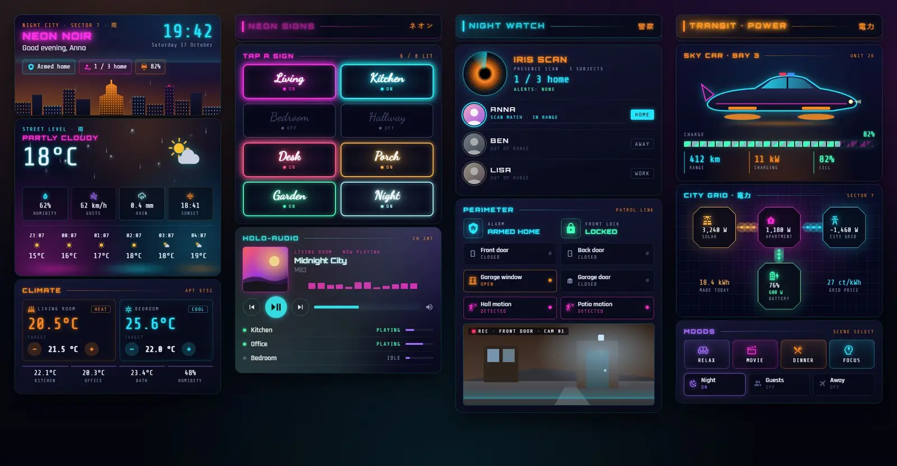
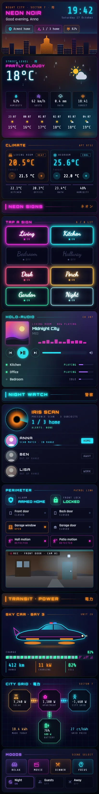

# Neon noir

A Home Assistant dashboard for a city flat on a rainy night: deep navy glass, magenta and cyan neon, and a sodium-orange haze over the skyline. It's one Sections view of 13 Magic Cards. Rain runs down the weather card, the light switches are neon signs that flicker when lit, and people at home show up on an iris scanner.





## What's on it

| Section | Cards |
| --- | --- |
| Header and home | Hero (title, greeting, big clock, alarm, who's home, car charge, skyline with a glowing tower and rain), weather (rain running down the glass, neon reflections, hourly forecast), climate (two thermostats with target buttons, room temperatures) |
| Neon signs | Heading, eight light switches drawn as neon signs that flicker when lit (tap to toggle, hold for details), now playing with an equaliser and the other speakers |
| Night watch | Heading, presence as an iris scan (one line per person), security (alarm, lock, doors, windows, motion, camera with a scanline) |
| Transit and power | Heading, the sky car (battery, range, charging), the city power grid (solar, flat, grid and battery with moving flow lines), moods (four scenes and three house modes) |

The Japanese glyphs are decoration: 雨 (rain), ネオン (neon), 警察 (police) and 電力 (electric power).

## Install

1. Copy `theme.yaml` to `/config/themes/`. Your `configuration.yaml` needs:

   ```yaml
   frontend:
     themes: !include_dir_merge_named themes
   ```

2. Reload themes (Developer tools → Actions → `frontend.reload_themes`), or restart Home Assistant.
3. Fonts: Orbitron, Rajdhani and Share Tech Mono aren't in Magic Card's own font list. Add them as a dashboard resource: Settings → Dashboards → three-dot menu → Resources → Add resource, type Stylesheet, URL:
   `https://fonts.googleapis.com/css2?family=Orbitron:wght@500;700;800;900&family=Rajdhani:wght@400;500;600;700&family=Share+Tech+Mono&display=swap`
   Without it the cards fall back to Oswald and Source Code Pro, which the card loads itself. The neon sign names use Dancing Script, which the card also loads.
4. Install Magic Card if you haven't already.
5. Settings → Dashboards → Add dashboard → New dashboard from scratch. Open it, three-dot menu → Edit dashboard → three-dot menu → Raw configuration editor, and paste `dashboard.yaml`.
6. Swap the entity ids below for your own. The view uses the theme "Neon Noir".

Change the generator rather than the YAML when you can.

## Entities

| Entity | What |
| --- | --- |
| `weather.home` | Weather: condition, temperature, humidity, hourly forecast |
| `sensor.wind_gust` | Wind gusts |
| `sensor.rain_today` | Rain today |
| `sensor.sunset` | Sunset time |
| `climate.living_room` | Living room thermostat |
| `climate.bedroom` | Bedroom air conditioning |
| `sensor.kitchen_temperature` | Kitchen temperature |
| `sensor.office_temperature` | Office temperature |
| `sensor.bathroom_temperature` | Bathroom temperature |
| `sensor.indoor_humidity` | Indoor humidity |
| `light.living_room`, `light.kitchen`, `light.bedroom`, `light.hallway`, `light.desk`, `light.porch`, `light.garden`, `light.nightlight` | The eight neon sign switches |
| `media_player.living_room` | Main player: cover, title, artist, volume, controls |
| `media_player.kitchen`, `media_player.office`, `media_player.bedroom` | Other speakers (state and volume) |
| `person.anna`, `person.ben`, `person.lisa` | People (picture and state) |
| `alarm_control_panel.home` | Alarm |
| `lock.front_door` | Front door lock |
| `binary_sensor.front_door`, `binary_sensor.back_door` | Door contacts |
| `binary_sensor.garage_window` | Garage window contact |
| `cover.garage_door` | Garage door |
| `binary_sensor.hall_motion`, `binary_sensor.patio_motion` | Motion sensors |
| `camera.front_door` | Front door camera (snapshot) |
| `sensor.car_battery` | Car battery % |
| `sensor.car_range` | Car range |
| `sensor.car_charge_power` | Car charging power |
| `switch.car_charger` | Charger on or off (runs the charging stripes) |
| `sensor.solar_power` | Solar power |
| `sensor.house_power` | House load |
| `sensor.grid_power` | Grid power (negative is export) |
| `sensor.battery_power` | Home battery power (positive is charging) |
| `sensor.home_battery` | Home battery % |
| `sensor.energy_today` | Solar energy today |
| `sensor.energy_price` | Electricity price |
| `scene.relax`, `scene.movie`, `scene.dinner`, `scene.focus` | Mood scenes |
| `input_boolean.night_mode`, `input_boolean.guest_mode`, `input_boolean.vacation` | House modes |

Templates in the hero, the lights card and the presence card count `person` entities that are home and `light` entities that are on. The light count says "/ 8"; change it if you have a different number of lights.
