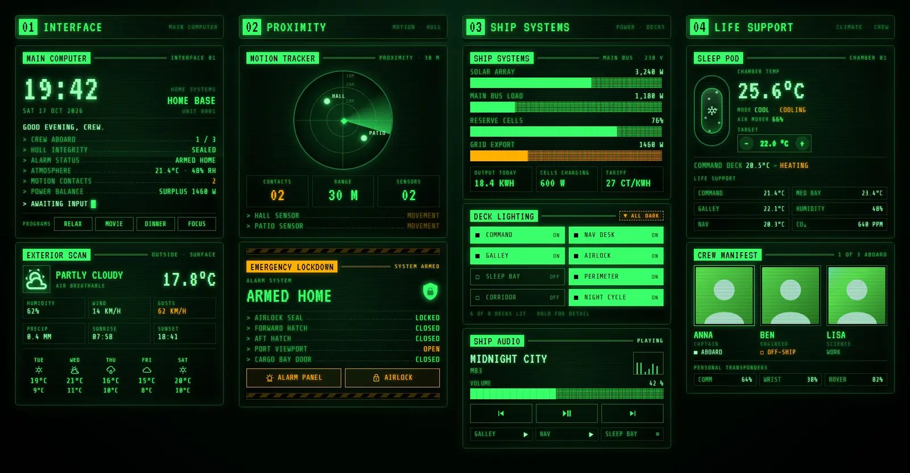
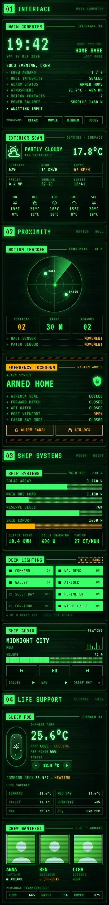

# CRT terminal

A Home Assistant dashboard dressed as an old ship's computer terminal: green phosphor text on black CRT glass, scanlines, a slow flicker, inverse-video title tabs and amber for anything that needs attention. It's one Sections view with 13 Magic Cards, including a motion tracker that pings for every motion sensor that is on.





## What's on it

| Section | Cards |
| --- | --- |
| 01 Interface | The terminal hero (clock, date, greeting, templated status lines, a blinking cursor, scene buttons) and the exterior scan (weather, wind, rain, sunrise and sunset, 5-day forecast). |
| 02 Proximity | The motion tracker: a radar with a rotating sweep and a blip with a ping for each motion sensor that is on. Under it, the emergency lockdown panel: alarm state, lock, doors, window and garage door, between hazard stripes. When the alarm is triggered the card turns red, the stripes crawl and "ALARM TRIGGERED" strobes. |
| 03 Ship systems | Power readout with block-character bars (solar, house load, battery, grid), deck lighting (tap a tile to toggle, hold for details, "All dark" turns every light off), and ship audio (now playing, volume bar, transport buttons, other speakers). |
| 04 Life support | The sleep pod (bedroom climate with a pod, falling frost while cooling, a target-temperature spinbox, the living-room thermostat and room readings) and the crew manifest (people with green-tinted photos, who is aboard, phone, watch and car batteries). |

## Install

1. Theme: copy `theme.yaml` into `/config/themes/` (for example as `green_phosphor.yaml`). Your `configuration.yaml` needs:

   ```yaml
   frontend:
     themes: !include_dir_merge_named themes
   ```

   Restart once if you've just added that, otherwise run Developer tools → Actions → `frontend.reload_themes`.
2. Fonts: add the stylesheet from `fonts.txt` as a dashboard resource. Settings → Dashboards → ⋮ → Resources → Add resource, URL
   `https://fonts.googleapis.com/css2?family=Share+Tech+Mono&family=VT323&display=swap`, type Stylesheet. Without it the cards fall back to Source Code Pro, which Magic Card loads itself; the layout still works, it just looks less like a CRT. The block bars use Fira Code, which Magic Card also loads.
3. Dashboard: install Magic Card if you haven't already. Then Settings → Dashboards → Add dashboard → New dashboard from scratch, open it, ⋮ → Edit dashboard → ⋮ → Raw configuration editor, and paste the whole of `dashboard.yaml`. Save.
4. Swap the placeholder entity ids below for your own (search and replace in the raw editor).

The view sets `theme: Green Phosphor`, so the theme applies to this dashboard only.

Change names or entities there if you'd rather regenerate than edit the YAML by hand.

## Entities

| Entity id | What it is |
| --- | --- |
| `alarm_control_panel.home` | Alarm panel |
| `lock.front_door` | Front door lock ("airlock seal") |
| `binary_sensor.front_door` | Front door contact ("forward hatch") |
| `binary_sensor.back_door` | Back door contact ("aft hatch") |
| `binary_sensor.garage_window` | Garage window contact ("port viewport") |
| `cover.garage_door` | Garage door ("cargo bay door") |
| `binary_sensor.hall_motion` | Hall motion sensor (radar blip) |
| `binary_sensor.patio_motion` | Patio motion sensor (radar blip) |
| `sensor.solar_power` | Solar production, W |
| `sensor.house_power` | House consumption, W |
| `sensor.grid_power` | Grid power, W (negative = export) |
| `sensor.battery_power` | Home battery power, W (positive = charging) |
| `sensor.home_battery` | Home battery charge, % |
| `sensor.energy_today` | Energy produced today, kWh |
| `sensor.energy_price` | Electricity price |
| `weather.home` | Weather entity with a daily forecast |
| `sensor.outdoor_temperature` | Outdoor temperature |
| `sensor.wind_gust` | Wind gusts |
| `sensor.rain_today` | Rain today |
| `sensor.sunrise`, `sensor.sunset` | Sunrise and sunset times |
| `climate.bedroom` | Bedroom air conditioning ("sleep pod") |
| `climate.living_room` | Living-room thermostat ("command deck") |
| `fan.bedroom` | Bedroom fan ("air mover") |
| `sensor.indoor_temperature`, `sensor.indoor_humidity` | Living-room temperature and humidity |
| `sensor.kitchen_temperature`, `sensor.office_temperature`, `sensor.bathroom_temperature` | Room temperatures |
| `sensor.co2` | CO₂ |
| `light.living_room`, `light.kitchen`, `light.bedroom`, `light.hallway`, `light.desk`, `light.porch`, `light.garden`, `light.nightlight` | The eight deck-lighting tiles |
| `media_player.living_room` | Main speaker (now playing, volume, transport) |
| `media_player.kitchen`, `media_player.office`, `media_player.bedroom` | Other speakers |
| `person.anna`, `person.ben`, `person.lisa` | Crew (with entity pictures) |
| `sensor.phone_battery`, `sensor.watch_battery`, `sensor.car_battery` | Phone, watch and car batteries |
| `scene.relax`, `scene.movie`, `scene.dinner`, `scene.focus` | Scene buttons in the hero |

Some templates name entities directly: the hero (`lock.front_door`, `alarm_control_panel.home`, both motion sensors, `sensor.grid_power`, indoor temperature and humidity, every `person.*`), the motion tracker's contact count, the light count and the power bars. Search and replace catches those too.
