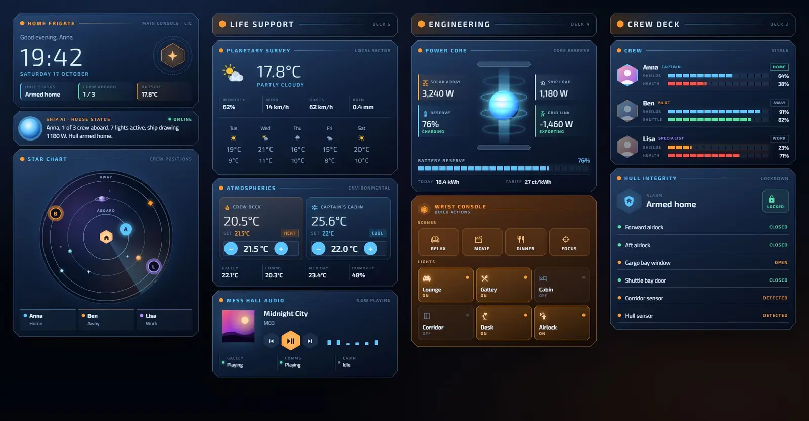
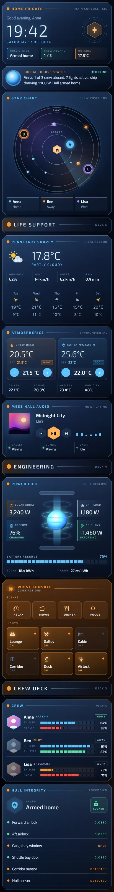

# Frigate console

A Home Assistant dashboard styled as the combat information centre of a deep-space frigate. Panels are blue-white glass with cut corners and hairline frames on deep-space black, and orange marks the things you can tap. It has one Sections view of 13 Magic Cards in four columns, with a star chart that shows who's home as markers on orbits.





## What's on it

| Section | Cards |
| --- | --- |
| CIC | Hero (clock, greeting, date, alarm, crew aboard, outside temperature), AI status line, star chart |
| Life support | Heading, weather with a five-day forecast, two thermostats with room temperatures, media player |
| Engineering | Heading, power core (solar, house load, battery, grid, energy today, price), quick actions (4 scenes, 6 lights) |
| Crew deck | Heading, crew vitals (people with device battery bars), hull integrity (alarm, lock, doors, window, garage, motion) |

A few cards in more detail:

- Star chart: a round chart with three orbits. Planets drift on the middle orbit and the house sits in the centre. Each person is a lettered marker: at home they circle on the inner orbit, and when away they wait on the outer one with a pulse.
- Power core: a glowing blue core with rings pulsing upwards and an energy beam running through it. Beside it are solar, house load, battery and grid, with a segmented battery reserve bar underneath.
- Quick actions: an orange wrist-console panel with scene buttons and light tiles. Tap a light to toggle it; tiles that are on light up orange.
- AI status line: a pulsing orb and one sentence summing up the house: who's home, how many lights are on, the power draw and the alarm state.
- Crew vitals: each person has a hexagon avatar, a rank, their state, and segmented bars for phone ("Shields"), watch ("Health") or car ("Shuttle") battery. A phone below 25 % turns its bar orange.

## Install

1. Copy `theme.yaml` to `/config/themes/glass_console.yaml`. Your `configuration.yaml` needs:

   ```yaml
   frontend:
     themes: !include_dir_merge_named themes
   ```

2. Restart Home Assistant, or run the action `frontend.reload_themes`.
3. Fonts: the cards use Exo 2 and Titillium Web. Add the URL in `fonts.txt` as a dashboard resource: Settings → Dashboards → ⋮ → Resources → Add resource, type Stylesheet. Without it the cards fall back to Montserrat and Source Sans Pro, which Magic Card loads itself.
4. Install Magic Card if you haven't already.
5. Settings → Dashboards → Add dashboard → New dashboard from scratch. Open it, then ⋮ → Edit dashboard → ⋮ → Raw configuration editor. Paste the whole of `dashboard.yaml` and save.
6. Swap the entity ids below for your own.

The view sets `theme: Glass Console`, so the theme applies to this dashboard only.

## Entities

| Entity | What it is |
| --- | --- |
| `weather.home` | Weather and forecast; humidity and wind come from its attributes |
| `sensor.outdoor_temperature` | Outside temperature |
| `sensor.wind_gust` | Wind gusts |
| `sensor.rain_today` | Rain today |
| `sensor.indoor_humidity` | Indoor humidity |
| `climate.living_room` | Living room thermostat ("Crew deck") |
| `climate.bedroom` | Bedroom air conditioning ("Captain's cabin") |
| `sensor.kitchen_temperature` | Kitchen temperature ("Galley") |
| `sensor.office_temperature` | Office temperature ("Comms") |
| `sensor.bathroom_temperature` | Bathroom temperature ("Med bay") |
| `media_player.living_room` | Main speaker: cover art, title, artist, controls |
| `media_player.kitchen`, `media_player.office`, `media_player.bedroom` | Other speakers, state only |
| `sensor.solar_power` | Solar production (W) |
| `sensor.house_power` | House consumption (W) |
| `sensor.grid_power` | Grid power (W; negative means exporting) |
| `sensor.home_battery` | Home battery charge (%) |
| `sensor.battery_power` | Battery power (W; positive means charging) |
| `sensor.energy_today` | Energy produced today (kWh) |
| `sensor.energy_price` | Current energy price |
| `scene.relax`, `scene.movie`, `scene.dinner`, `scene.focus` | Scene buttons |
| `light.living_room`, `light.kitchen`, `light.bedroom`, `light.hallway`, `light.desk`, `light.porch` | Light tiles (tap to toggle) |
| `person.anna`, `person.ben`, `person.lisa` | People on the star chart and in the crew vitals card |
| `sensor.phone_battery`, `sensor.watch_battery` | Anna's phone and watch battery |
| `sensor.phone_2_battery`, `sensor.car_battery` | Ben's phone and car battery |
| `sensor.phone_3_battery`, `sensor.watch_2_battery` | Lisa's phone and watch battery |
| `alarm_control_panel.home` | Alarm |
| `lock.front_door` | Front door lock (tap for details) |
| `binary_sensor.front_door`, `binary_sensor.back_door` | Door contacts |
| `binary_sensor.garage_window` | Garage window contact |
| `cover.garage_door` | Garage door |
| `binary_sensor.hall_motion`, `binary_sensor.patio_motion` | Motion sensors |

The hero and the AI status line also count `person.*` entities that are `home` and `light.*` entities that are `on`, using templates.
