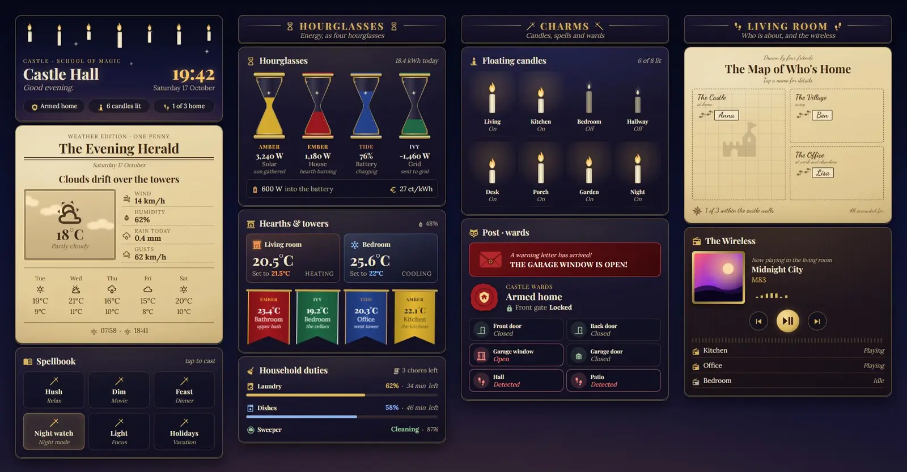
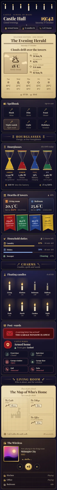

# Castle Hall

A wizard-school dashboard for Home Assistant, made from 13 Magic Cards in one sections view. It is set in a castle hall at night, with a starry ceiling, floating candles, parchment and ink, four house colours, wax seals and gilded frames. The hero shows the time, a greeting and chips for the alarm, lights and people at home. Weather is printed as a newspaper front page with a sepia picture and a 5-day forecast. Scenes are spells you tap to cast, energy fills four hourglasses, the thermostats sit next to four room banners, and the lights are floating candles that flicker when on. Security arrives as a red warning letter when a door or window is open, otherwise it reads "All quiet". A parchment map shows who is home, in the village or elsewhere, and there is a wireless set for media and a list of household duties.



On a phone:



## Install

1. Copy `theme.yaml` into `/config/themes/`. If you haven't set up themes yet, add this to `configuration.yaml` and restart:

   ```yaml
   frontend:
     themes: !include_dir_merge_named themes
   ```

2. Reload themes: Developer tools → Actions → `frontend.reload_themes`.
3. Settings → Dashboards → Add dashboard → New dashboard from scratch. Open it, then ⋮ → Edit dashboard → ⋮ → Raw configuration editor. Paste in all of `dashboard.yaml` and save.
4. Swap the entity ids for your own (see the table below). The view already uses the theme "Castle Hall".

You need Magic Card installed.

Fonts: the cards ask for Cinzel, Crimson Text and IM Fell English first. Devices that don't have them get Playfair Display, Lora and Dancing Script from Magic Card's own font list instead. The screenshots show these fallbacks.

## Entities

| Entity | What it is |
| --- | --- |
| `weather.home` | Weather and forecast |
| `sensor.rain_today`, `sensor.wind_gust` | Rain today, wind gusts |
| `sensor.sunrise`, `sensor.sunset` | Sunrise and sunset times (text) |
| `sun.sun` | Starry ceiling on the hero card |
| `climate.living_room`, `climate.bedroom` | Thermostats |
| `sensor.indoor_humidity` | Indoor humidity |
| `sensor.bathroom_temperature`, `sensor.bedroom_temperature`, `sensor.office_temperature`, `sensor.kitchen_temperature` | Room temperatures (the banners) |
| `sensor.solar_power`, `sensor.house_power`, `sensor.grid_power` | Solar, house load and grid power in W (grid: negative means exporting) |
| `sensor.home_battery`, `sensor.battery_power` | Battery charge in %, battery power in W |
| `sensor.energy_today`, `sensor.energy_price` | Energy today in kWh, price |
| `light.living_room`, `light.kitchen`, `light.bedroom`, `light.hallway`, `light.desk`, `light.porch`, `light.garden`, `light.nightlight` | The eight candles |
| `scene.relax`, `scene.movie`, `scene.dinner`, `scene.focus` | Spell scenes |
| `input_boolean.night_mode`, `input_boolean.vacation` | Spell switches |
| `alarm_control_panel.home` | Alarm (wax seal, warning letter when triggered) |
| `lock.front_door` | Front door lock |
| `binary_sensor.front_door`, `binary_sensor.back_door`, `binary_sensor.garage_window` | Door and window contacts (an open one brings the warning letter) |
| `cover.garage_door` | Garage door |
| `binary_sensor.hall_motion`, `binary_sensor.patio_motion` | Motion sensors |
| `person.anna`, `person.ben`, `person.lisa` | People on the map |
| `media_player.living_room` | Main speaker with cover art and controls |
| `media_player.kitchen`, `media_player.office`, `media_player.bedroom` | Other speakers |
| `sensor.washer_progress`, `sensor.washer_remaining`, `sensor.dishwasher_progress`, `sensor.dishwasher_remaining` | Appliance progress (%) and time left (min) |
| `vacuum.robot` | Robot vacuum |
| `todo.chores` | Chores list |

The hero and the candles card count lights that are on and people at home with templates over all `light.*` and `person.*` entities. The "of 8" and "of 3" in the text are typed in, so change them if your numbers differ.
