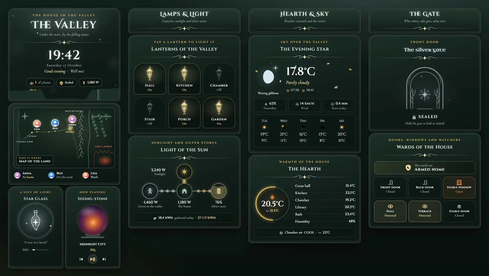
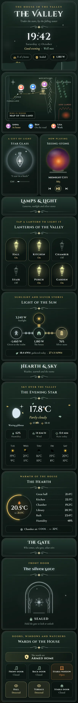

# Moonlit Valley

A Home Assistant dashboard set in a valley at night, with silver filigree, sage and forest green, and autumn gold. It is one sections view built only from Magic Cards: 13 cards in four sections. It comes with a matching theme called Moonlit Valley.





## What's on it

| Section | Cards |
| --- | --- |
| The valley | Title, clock, greeting and a status line (people home, front lock, house load) over a valley silhouette with twinkling stars and mist. A map of the land with a marker for each person: at home they stand by the valley house, when away they are on the road, and in any other zone they are at the town to the west. A star-glass night light that glows while the light is on (tap to toggle). A seeing-stone media card that glows and swirls while music plays, with track, artist and play controls. |
| Lamps & Light | Six lanterns, one per light. Tap one to toggle it; a lit lantern glows and flickers softly. Energy: sunlight, the house, the battery and the grid, with light flowing between them. |
| Hearth & Sky | Weather: the moon phase with a glinting star, the outdoor temperature, sunrise and sunset, humidity, wind, rain and a five-day forecast, with autumn leaves falling behind. Climate: the living room thermostat as a ring, six room readings and the bedroom air conditioning. |
| The Gate | The front lock drawn as a silver gate that lights up when it is unlocked. Tap for details, hold to lock or unlock. The alarm and six sensors (doors, window, motion, garage door). |

## Install

1. Copy `theme.yaml` into `/config/themes/`, for example as `/config/themes/moonlit_valley.yaml`. Your `configuration.yaml` needs:

    ```yaml
    frontend:
      themes: !include_dir_merge_named themes
    ```

2. Restart Home Assistant, or run the `frontend.reload_themes` action.
3. Add the fonts. Go to Settings → Dashboards → ⋮ → Resources → Add resource, choose **Stylesheet** and paste the URL from `fonts.txt`:

    ```
    https://fonts.googleapis.com/css2?family=Cinzel:wght@400;600;700&family=Cinzel+Decorative:wght@400;700&family=Cormorant+Garamond:ital,wght@0,500;0,600;0,700;1,500;1,600&family=Uncial+Antiqua&display=swap
    ```

    Without it the cards fall back to Playfair Display and Lora, which Magic Card loads by itself. The fonts come from Google, so every device that shows the dashboard needs internet access and sends a request to Google.
4. Install Magic Card if you haven't already.
5. Add the **Moon** integration (Settings → Devices & services → Add integration → Moon). It provides `sensor.moon_phase`.
6. Create a new dashboard, open it, choose ⋮ → Edit dashboard → ⋮ → Raw configuration editor and paste in the contents of `dashboard.yaml`.
7. Swap the entity ids below for your own.

## Entities

| Entity | What it is |
| --- | --- |
| `person.anna`, `person.ben`, `person.lisa` | People on the map and in the hero's count |
| `weather.home` | Condition, humidity, wind and the forecast |
| `sensor.outdoor_temperature` | Outdoor temperature |
| `sensor.moon_phase` | Moon phase (Moon integration) |
| `sensor.sunrise`, `sensor.sunset` | Sunrise and sunset times |
| `sensor.rain_today` | Rain today |
| `climate.living_room` | Main thermostat (ring) |
| `climate.bedroom` | Bedroom air conditioning |
| `sensor.indoor_temperature`, `sensor.kitchen_temperature`, `sensor.bedroom_temperature`, `sensor.office_temperature`, `sensor.bathroom_temperature` | Room temperatures |
| `sensor.indoor_humidity` | Indoor humidity |
| `light.living_room`, `light.kitchen`, `light.bedroom`, `light.hallway`, `light.porch`, `light.garden` | The six lanterns |
| `light.nightlight` | The night light (star-glass card) |
| `media_player.living_room` | The speaker shown in the seeing-stone |
| `sensor.solar_power` | Solar power (W) |
| `sensor.house_power` | House load (W) |
| `sensor.grid_power` | Grid power (W, negative = exporting) |
| `sensor.battery_power` | Battery power (W, positive = charging) |
| `sensor.home_battery` | Battery level (%) |
| `sensor.energy_today` | Energy produced today (kWh) |
| `sensor.energy_price` | Energy price |
| `lock.front_door` | Front door lock (the gate) |
| `alarm_control_panel.home` | Alarm |
| `binary_sensor.front_door`, `binary_sensor.back_door` | Door contacts |
| `binary_sensor.garage_window` | Window contact |
| `binary_sensor.hall_motion`, `binary_sensor.patio_motion` | Motion sensors |
| `cover.garage_door` | Garage door |

The hero's people count is a template: `{{ states.person | selectattr('state','eq','home') | list | count }}`. The "of 3" next to it is fixed text, so change it if you have a different number of people.
