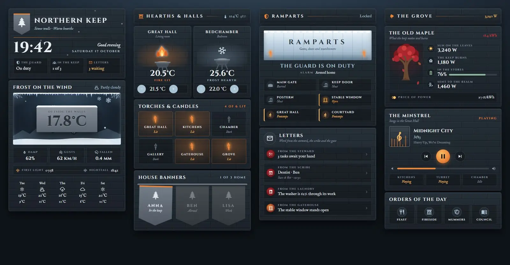
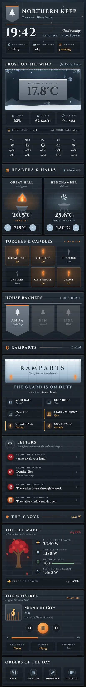

# Northern Keep

A Home Assistant dashboard set in a cold castle in the north: grey granite, iron, frost and braziers full of embers. It is one sections view made of 14 Magic Cards, and it comes with a matching theme called Northern Keep. Fires flicker in the braziers while a room heats, torches light up with the lights, snow falls over the header, and the people's banners sway while they are home.





## What is on it

| Section | Cards |
| --- | --- |
| Keep | A header with a pine banner, a big clock, the greeting and three tiles (alarm, people at home, open tasks). Under it the weather: the outside temperature carved into a snow-capped stone, humidity, gusts, rain, sunrise and sunset, and a 5-day forecast. |
| Hearths & halls | Two braziers for the thermostats, with plus and minus for the target temperature. Six torches for the lights (tap to switch, hold for details). Banners for the people, bright while they are home and faded while they are away. |
| Ramparts | An ice rampart with the alarm state under it, then the gate lock, doors, window and motion sensors. Letters for open tasks, the next calendar event, the washing machine and any open door or window. |
| The grove | An old maple with falling leaves for energy (solar, house load, battery, grid, price), the minstrel for media with controls, volume and other speakers, and four scenes. |

## Install

1. Copy `theme.yaml` into `/config/themes/` (for example as `/config/themes/northern-keep.yaml`). Your `configuration.yaml` needs:

   ```yaml
   frontend:
     themes: !include_dir_merge_named themes
   ```

2. Restart Home Assistant, or run the action `frontend.reload_themes`.
3. Fonts (optional): in Settings → Dashboards → ⋮ → Resources, add this URL as a stylesheet:
   `https://fonts.googleapis.com/css2?family=Cinzel:wght@400;600;700&family=IM+Fell+English:ital@0;1&display=swap`
   Without it the cards fall back to Playfair Display and Lora.
4. Install Magic Card if you have not already.
5. Settings → Dashboards → Add dashboard → New dashboard from scratch. Open it, choose ⋮ → Edit dashboard → ⋮ → Raw configuration editor, and paste in all of `dashboard.yaml`.
6. Replace the entity ids with your own (see the table below). The view already uses the Northern Keep theme.

For bigger changes, edit the generator and run it again.

## Entities

| Entity | Used for |
| --- | --- |
| `weather.home` | Condition, humidity, forecast |
| `sensor.outdoor_temperature` | The carved temperature |
| `sensor.wind_gust` | Gusts |
| `sensor.rain_today` | Rain today |
| `sensor.sunrise`, `sensor.sunset` | Sunrise and sunset |
| `sensor.indoor_temperature`, `sensor.indoor_humidity` | Hearths heading |
| `climate.living_room`, `climate.bedroom` | The two braziers |
| `light.living_room`, `light.kitchen`, `light.bedroom`, `light.hallway`, `light.porch`, `light.garden` | Torches |
| `person.anna`, `person.ben`, `person.lisa` | Banners and the people count |
| `alarm_control_panel.home` | Alarm tile and ramparts |
| `lock.front_door` | Main gate |
| `binary_sensor.front_door`, `binary_sensor.back_door` | Doors |
| `binary_sensor.garage_window` | Window |
| `binary_sensor.hall_motion`, `binary_sensor.patio_motion` | Motion |
| `todo.chores` | Open tasks (header and letters) |
| `calendar.family` | Next event (letters) |
| `sensor.washer_progress` | Washing machine (letters) |
| `sensor.solar_power`, `sensor.house_power`, `sensor.grid_power`, `sensor.home_battery` | Energy |
| `sensor.energy_today`, `sensor.energy_price` | Energy today, price |
| `media_player.living_room` | Minstrel (now playing, controls, volume) |
| `media_player.kitchen`, `media_player.office`, `media_player.bedroom` | Other speakers |
| `scene.dinner`, `scene.relax`, `scene.movie`, `scene.focus` | Scenes |

The light count, people count and grid value use templates with the entity ids written in them. If you change those entities, change the templates too.
