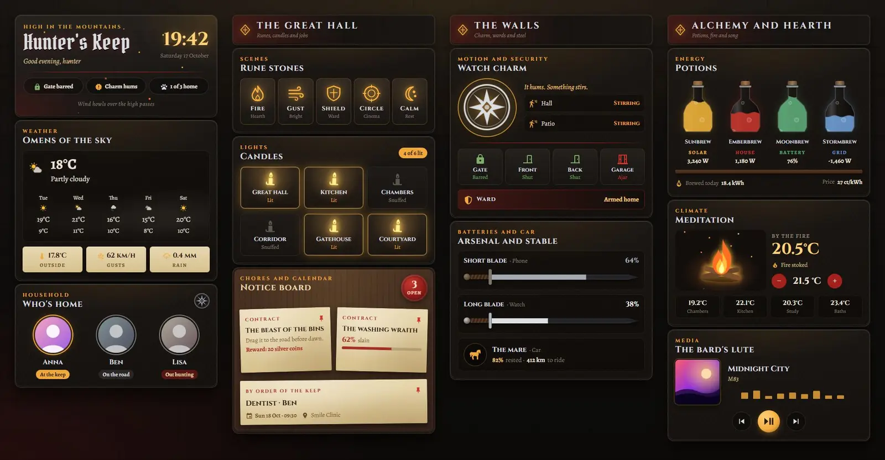
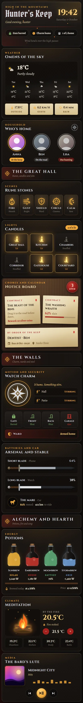

# Hunter's Keep

A dark-fantasy dashboard for Home Assistant, built from 14 Magic Cards in one sections view. It's dressed as a beast hunter's keep in the mountains: weathered leather and dark steel, blood-red and silver trim, amber runes and parchment notices pinned to a board. The theme is called Mountain Keep.



On a phone:



## What's on it

- The keep: the title, a greeting, a big clock and three chips for the gate lock, motion and who's home. Then the weather with a five-day forecast, and the household with a badge for each person: at the keep, on the road or out hunting.
- The great hall: five rune stones that start scenes or arm the alarm, six candles for the lights (tap to switch, lit candles flicker), and a notice board with the open chores on a wax seal, two job notes and the next calendar event.
- The walls: a watch charm that trembles and glows while either motion sensor is on, with the doors, the garage window and the alarm below it. Under that, the arsenal: two blades whose edges fill with the phone and watch battery, and the mare for the car.
- Alchemy and hearth: four potion bottles that fill with solar, house load, home battery and grid power, a campfire for the living room thermostat with the room temperatures, and the media player as the bard's lute.

## Install

1. Copy `theme.yaml` into `/config/themes/`. If you haven't set up themes yet, add this to `configuration.yaml` and restart:

   ```yaml
   frontend:
     themes: !include_dir_merge_named themes
   ```

2. Reload themes: Developer tools → Actions → `frontend.reload_themes`.
3. Fonts: the cards use Cinzel, Alegreya and Pirata One. Magic Card only loads the Google Fonts in its own font picker, so add them as a resource: Settings → Dashboards → ⋮ → Resources → Add resource, URL `https://fonts.googleapis.com/css2?family=Cinzel:wght@400;700&family=Alegreya:ital,wght@0,400;0,700;1,400&family=Pirata+One&display=swap`, type Stylesheet. Without it the cards fall back to Playfair Display and Lora.
4. Settings → Dashboards → Add dashboard → New dashboard from scratch. Open it, then ⋮ → Edit dashboard → ⋮ → Raw configuration editor. Paste in all of `dashboard.yaml` and save.
5. Swap the entity ids for your own (see the table below). The view already uses the theme "Mountain Keep".

You need Magic Card installed. Make your changes there and run it again.

## Entities

| Entity | What it is |
| --- | --- |
| `weather.home` | Weather and forecast |
| `sensor.outdoor_temperature` | Outside temperature |
| `sensor.wind_gust` | Wind gusts |
| `sensor.rain_today` | Rain today |
| `person.anna`, `person.ben`, `person.lisa` | People in the house |
| `scene.relax`, `scene.focus`, `scene.movie`, `scene.night` | Scenes behind four of the rune stones |
| `alarm_control_panel.home` | Alarm (the Shield stone arms it at home) |
| `light.living_room`, `light.kitchen`, `light.bedroom`, `light.hallway`, `light.porch`, `light.garden` | The six candles |
| `todo.chores` | To-do list, open items on the wax seal |
| `sensor.washer_progress` | Washing machine progress (%) |
| `calendar.family` | Next calendar event |
| `binary_sensor.hall_motion`, `binary_sensor.patio_motion` | Motion sensors that make the charm tremble |
| `lock.front_door` | Front door lock |
| `binary_sensor.front_door`, `binary_sensor.back_door` | Door contacts |
| `binary_sensor.garage_window` | Window contact |
| `sensor.phone_battery`, `sensor.watch_battery` | The two blade batteries |
| `sensor.car_battery`, `sensor.car_range` | Car charge and range |
| `sensor.solar_power`, `sensor.house_power`, `sensor.grid_power` | Power in W (grid negative while exporting) |
| `sensor.home_battery` | Home battery charge (%) |
| `sensor.energy_today`, `sensor.energy_price` | Energy produced today, current price |
| `climate.living_room` | Thermostat behind the campfire |
| `sensor.bedroom_temperature`, `sensor.kitchen_temperature`, `sensor.office_temperature`, `sensor.bathroom_temperature` | Room temperatures |
| `media_player.living_room` | Speaker for the bard card |
