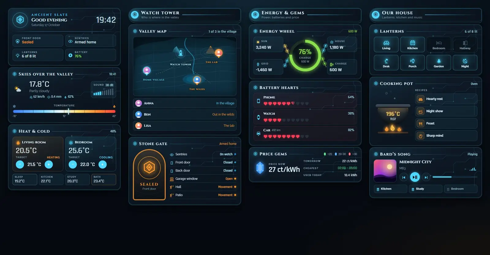
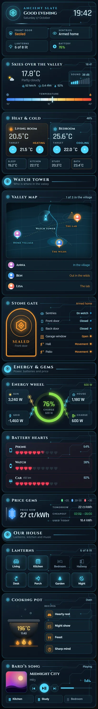

# Ancient Slate

A fantasy dashboard styled as an old stone tablet that still glows: dark blue-black panels, cyan circuit lines and amber accents, with a hexagon rune on every card. It's one sections view with 14 Magic Cards (three section headings and eleven content cards), covering weather, climate, a map of who's where, security, energy, device batteries, the energy price, lights, the oven and music.





What's on it:

- Hero: a pulsing rune with ripple rings, a greeting, the date, a big clock and four chips (front door, alarm, lights on, home battery).
- Weather: condition and outdoor temperature with gusts, rain and humidity, a temperature gauge from cold blue to hot red with a needle, and a sound meter driven by a noise sensor.
- Heat & cold: two thermostats with plus and minus buttons, and four room temperatures.
- Valley map: a survey map with a watch tower that sweeps and pings. Each person is a pin with their picture: at the village when home, at the lab when the state is `Work`, out in the wilds otherwise. A list underneath says where everyone is.
- Stone gate: the front door lock as an arched gate, amber while locked and blue when unlocked, next to the alarm, doors, garage window and motion sensors. Anything open or moving turns amber and blinks.
- Energy wheel: the home battery as a ring that goes from green to yellow to red as it drains, with solar, grid, house and battery tiles joined by flow lines.
- Battery hearts: phone, watch and car batteries as ten hearts each. Every heart is 10 %, so you see full, half and empty hearts.
- Price gems: the energy price as a gem that is green under 20, blue from 20 to 30 and red over 30 ct/kWh, plus tomorrow's average, the cheapest window and the energy used today.
- Lanterns: eight light tiles. Tap one to toggle it, hold it for details.
- Cooking pot: oven temperature and timer in a bubbling pot over flickering flames, with four scenes as recipes.
- Bard's song: what's playing on the living room speaker, with cover art, controls and volume, plus three more speakers.

## Install

1. Copy `theme.yaml` into `/config/themes/`. If you haven't set up themes yet, add this to `configuration.yaml` and restart:

   ```yaml
   frontend:
     themes: !include_dir_merge_named themes
   ```

2. Reload themes: Developer tools → Actions → `frontend.reload_themes`.
3. Add the fonts: Settings → Dashboards → ⋮ → Resources → Add resource, type Stylesheet, with the URL from `fonts.txt`:
   `https://fonts.googleapis.com/css2?family=Cinzel:wght@400;700&family=Rajdhani:wght@500;600;700&display=swap`
   Without it, titles fall back to Lora and numbers to Oswald.
4. Settings → Dashboards → Add dashboard → New dashboard from scratch. Open it, then ⋮ → Edit dashboard → ⋮ → Raw configuration editor. Paste in all of `dashboard.yaml` and save.
5. Swap the entity ids for your own (see the table below). The view already uses the theme "Ancient Slate".

You need Magic Card installed.

## Entities

| Entity | What it is |
| --- | --- |
| `weather.home` | Weather (condition, humidity) |
| `sensor.outdoor_temperature` | Outdoor temperature (gauge needle, −10 to 40 °C) |
| `sensor.noise_level` | Noise level in dB (sound meter, 20 to 70 dB) |
| `sensor.wind_gust`, `sensor.rain_today` | Wind gusts, rain today |
| `sensor.sunset` | Sunset time |
| `climate.living_room` | Living room thermostat (heating) |
| `climate.bedroom` | Bedroom thermostat (cooling) |
| `sensor.indoor_humidity` | Indoor humidity |
| `sensor.bedroom_temperature`, `sensor.kitchen_temperature`, `sensor.office_temperature`, `sensor.bathroom_temperature` | Room temperatures |
| `person.anna`, `person.ben`, `person.lisa` | People with a picture (map pins). `home` = village, `Work` = lab, anything else = the wilds |
| `lock.front_door` | Front door lock (stone gate) |
| `alarm_control_panel.home` | Alarm |
| `binary_sensor.front_door`, `binary_sensor.back_door`, `binary_sensor.garage_window` | Door and window contacts |
| `binary_sensor.hall_motion`, `binary_sensor.patio_motion` | Motion sensors |
| `sensor.home_battery`, `sensor.battery_power` | Home battery charge in % (energy wheel), battery power |
| `sensor.solar_power`, `sensor.house_power`, `sensor.grid_power` | Solar, house load and grid power (grid: negative means exporting) |
| `sensor.energy_today` | Energy used today |
| `sensor.phone_battery`, `sensor.watch_battery`, `sensor.car_battery` | Device batteries (hearts) |
| `sensor.car_range` | Car range |
| `sensor.energy_price` | Energy price now in ct/kWh (gem colour) |
| `sensor.energy_price_tomorrow_avg` | Tomorrow's average price |
| `sensor.energy_cheapest_window` | Cheapest time window (text) |
| `light.living_room`, `light.kitchen`, `light.bedroom`, `light.hallway`, `light.desk`, `light.porch`, `light.garden`, `light.nightlight` | Lights (lanterns) |
| `sensor.oven_temperature`, `timer.oven` | Oven temperature and timer |
| `scene.relax`, `scene.movie`, `scene.dinner`, `scene.focus` | Scenes (recipes) |
| `media_player.living_room` | Main speaker with cover art, controls and volume |
| `media_player.kitchen`, `media_player.office`, `media_player.bedroom` | Other speakers |

The light count in the hero and on the lanterns card, and the "in the village" count on the map, are templates that list these exact entity ids, so change them there too.
