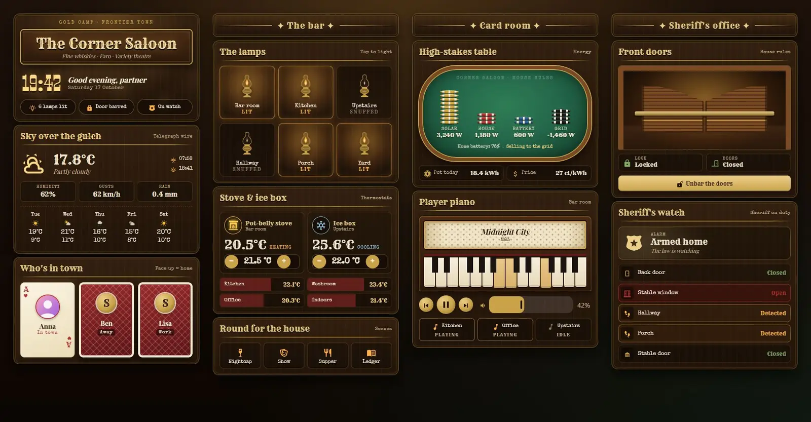
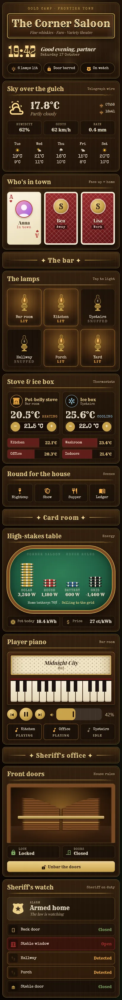

# Frontier Saloon

A Home Assistant dashboard dressed as a saloon in a gold-rush town: dark polished wood, brass rails, green felt and oil-lamp light. It is one Sections view with 13 Magic Cards and a matching theme called "Frontier Saloon".





## What's on it

| Section | Cards |
| --- | --- |
| Front of house | Saloon sign with clock, greeting and a status line (lamps lit, door barred, alarm). Weather ("Sky over the gulch") with a five-day forecast. "Who's in town": each person is a playing card, face up when home and face down (with their state) when away. |
| The bar | Six oil lamps as light switches; a lit lamp flickers and glows. Two thermostats (pot-belly stove and ice box) with room thermometers. A "Round for the house" row of scenes. |
| Card room | A poker table for energy: chip stacks for solar, house, battery and grid grow by 400 W a chip. A player piano for media: the music roll scrolls and the keys play while the speaker plays, with controls, volume and three more room speakers. |
| Sheriff's office | Swinging saloon doors for the front door: they sway gently when shut, swing wide when the door sensor is open, and a brass bar lies across them while the lock is locked. Below it, the alarm as a sheriff's badge and a list of door, window and motion sensors. |

Tap a lamp to toggle it, a person or sensor for its details, a scene to run it, a room speaker to play or pause it.

## Install

1. Copy `theme.yaml` to `/config/themes/` (any file name). Make sure `configuration.yaml` has:

   ```yaml
   frontend:
     themes: !include_dir_merge_named themes
   ```

2. Restart Home Assistant, or run the `frontend.reload_themes` action.
3. Fonts: the card loads Playfair Display itself. Rye, Smokum and Special Elite need a resource. Go to Settings → Dashboards → ⋮ → Resources → Add resource, paste the URL from `fonts.txt` and pick Stylesheet:

   ```
   https://fonts.googleapis.com/css2?family=Rye&family=Smokum&family=Special+Elite&display=swap
   ```

   Without it the dashboard falls back to Playfair Display, Georgia and Courier New. Loading the fonts sends a request to Google from each device that shows the dashboard.
4. Install Magic Card if you haven't yet.
5. Settings → Dashboards → Add dashboard → New dashboard from scratch. Open it, ⋮ → Edit dashboard → ⋮ → Raw configuration editor, paste the whole of `dashboard.yaml` and save.
6. Swap the placeholder entity ids below for your own.

## Entities

| Entity | What it is |
| --- | --- |
| `weather.home` | Weather and forecast |
| `sensor.outdoor_temperature` | Outdoor temperature |
| `sensor.wind_gust` | Wind gusts |
| `sensor.rain_today` | Rain today |
| `sensor.sunrise`, `sensor.sunset` | Sunrise and sunset times (text) |
| `person.anna`, `person.ben`, `person.lisa` | People (playing cards) |
| `light.living_room` | Bar room lamp |
| `light.kitchen` | Kitchen lamp |
| `light.bedroom` | Upstairs lamp |
| `light.hallway` | Hallway lamp |
| `light.porch` | Porch lamp |
| `light.garden` | Yard lamp |
| `climate.living_room` | Heating thermostat (pot-belly stove) |
| `climate.bedroom` | Cooling thermostat (ice box) |
| `sensor.kitchen_temperature`, `sensor.office_temperature`, `sensor.bathroom_temperature`, `sensor.indoor_temperature` | Room thermometers |
| `scene.relax`, `scene.movie`, `scene.dinner`, `scene.focus` | Scenes: Nightcap, Show, Supper, Ledger |
| `sensor.solar_power`, `sensor.house_power`, `sensor.battery_power`, `sensor.grid_power` | Power in W; grid is negative when exporting |
| `sensor.home_battery` | Home battery charge in % |
| `sensor.energy_today` | Energy produced today ("pot") |
| `sensor.energy_price` | Energy price |
| `media_player.living_room` | Player piano speaker (title, artist, volume) |
| `media_player.kitchen`, `media_player.office`, `media_player.bedroom` | Other room speakers |
| `lock.front_door` | Front door lock (the bar across the doors) |
| `binary_sensor.front_door` | Front door contact (makes the doors swing) |
| `alarm_control_panel.home` | Alarm (sheriff's badge) |
| `binary_sensor.back_door` | Back door contact |
| `binary_sensor.garage_window` | Stable window contact |
| `binary_sensor.hall_motion`, `binary_sensor.patio_motion` | Motion in the hallway and on the porch |
| `cover.garage_door` | Stable door (garage door) |

The status line also counts every `light.*` that is on.
