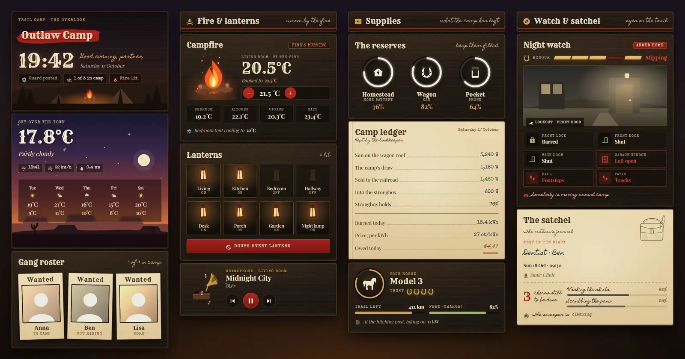
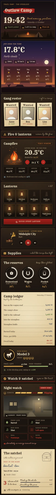

# Outlaw Camp

A western camp dashboard set at dusk: canvas and campfire light, journal pages and red ink. It is a single Home Assistant sections view with 14 Magic Cards, and it comes with a matching theme called Outlaw Camp.





## What is on it

| Section | Cards |
| --- | --- |
| Camp | Header with the camp name on a red brush stroke, a large clock, a greeting and status pills (alarm, who is home, heating). A dusk sky that fades to night over mesas, with the outdoor temperature, sunset, wind, rain and a five-day forecast. A gang roster: one wanted poster per person, showing where they are. |
| Fire & lanterns | Campfire climate card: flames and rising embers while the living room heats, cold logs and smoke when it doesn't, plus a target spinbox and four room temperatures. Lanterns: eight lights, tap to toggle, hold for details, and a button that turns them all off. A gramophone media card whose music notes float up while it plays. |
| Supplies | The reserves: the home, car and phone batteries drawn as draining rings that turn red below 25 %. A camp ledger on paper: solar, house load, export or import, battery, energy today, price in cents and today's cost in dollars. A horse card for the car with trust horseshoes, range, charge and charging state. |
| Watch & satchel | A watch card with an honour meter (one segment per lock, door, window and the alarm), a sepia camera view, and door, window and motion tiles that turn red and blink when something needs a look. The satchel is a journal page with the next calendar event, open chores, appliance progress and the robot vacuum. |

## Install

1. Copy `theme.yaml` to `/config/themes/` (any file name ending in `.yaml`). Your `configuration.yaml` needs:

   ```yaml
   frontend:
     themes: !include_dir_merge_named themes
   ```

2. Reload themes: Developer tools → Actions → `frontend.reload_themes`, or restart.
3. Add the fonts. Rye, Special Elite and Homemade Apple are not on the list of fonts Magic Card loads itself. Go to Settings → Dashboards → ⋮ → Resources → Add resource, choose type **Stylesheet**, and paste the URL from `fonts.txt`:

   ```
   https://fonts.googleapis.com/css2?family=Homemade+Apple&family=Rye&family=Special+Elite&display=swap
   ```

   If you skip this step the cards use Playfair Display, Courier and Dancing Script instead. Everything still works, it just looks less western.
4. Install Magic Card if you haven't yet.
5. Settings → Dashboards → Add dashboard → New dashboard from scratch. Open it, then ⋮ → Edit dashboard → ⋮ → Raw configuration editor. Paste the contents of `dashboard.yaml` and save.
6. Replace the placeholder entity ids with your own (search and replace in the raw editor works well).

## Entities

| Entity | What it is |
| --- | --- |
| `alarm_control_panel.home` | Alarm: header pill, watch badge, honour meter |
| `lock.front_door` | Front door lock (tap locks it) |
| `binary_sensor.front_door`, `binary_sensor.back_door` | Door contacts |
| `binary_sensor.garage_window` | Window contact |
| `binary_sensor.hall_motion`, `binary_sensor.patio_motion` | Motion sensors |
| `camera.front_door` | Camera snapshot on the watch card |
| `person.anna`, `person.ben`, `person.lisa` | People on the wanted posters (picture, name, where) |
| `weather.home` | Condition and daily forecast |
| `sensor.outdoor_temperature` | Outdoor temperature |
| `sensor.sunset`, `sensor.wind_gust`, `sensor.rain_today` | Sky chips |
| `climate.living_room` | Campfire thermostat (`hvac_action: heating` lights the fire) |
| `climate.bedroom` | Bedroom cooling line |
| `sensor.bedroom_temperature`, `sensor.kitchen_temperature`, `sensor.office_temperature`, `sensor.bathroom_temperature` | Room temperatures |
| `light.living_room`, `light.kitchen`, `light.bedroom`, `light.hallway`, `light.desk`, `light.porch`, `light.garden`, `light.nightlight` | Lanterns |
| `media_player.living_room` | Gramophone (title, artist, controls) |
| `sensor.home_battery`, `sensor.car_battery`, `sensor.phone_battery` | The reserves (%) |
| `sensor.solar_power`, `sensor.house_power`, `sensor.grid_power`, `sensor.battery_power` | Ledger power lines (W; grid below 0 means export) |
| `sensor.energy_today` | Energy used today (kWh) |
| `sensor.energy_price` | Price in ct/kWh, used for today's cost in dollars |
| `sensor.car_range` | Car range (bar runs to 500 km) |
| `sensor.car_charge_power`, `binary_sensor.car_charging` | Car charging state |
| `calendar.family` | Next diary entry (`message`, `start_time`, `location`) |
| `todo.chores` | Open chores |
| `sensor.washer_progress`, `sensor.dishwasher_progress` | Appliance progress (%) |
| `vacuum.robot` | Robot vacuum |

Some text uses templates: the clock, date and greeting, how many people are home and how many lights are on, the grid figure and today's cost. The light count uses every `light.*` entity, and the people count uses every `person.*` entity.
