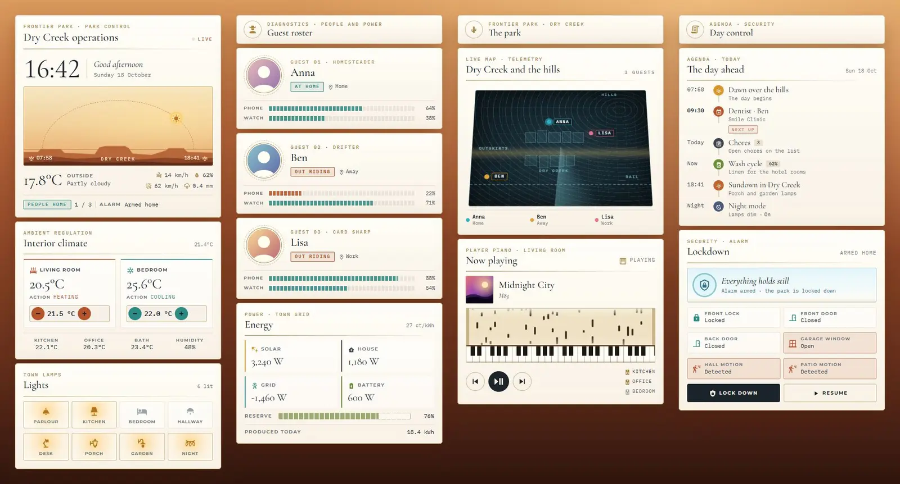
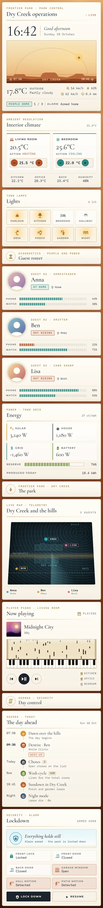

# Park Control

A Home Assistant Sections dashboard built only from Magic Card cards. It dresses a home up as the control room over a Wild West theme park, with a matching theme called "Park Control". The cards are white glass with thin gold lines, laid over a sun-baked desert. Headings are set in Cormorant Garamond, labels in Montserrat and readouts in IBM Plex Mono.





## What's on it

Four sections, 14 cards:

- Operations (header card, climate, lights). The header shows the title, a large clock, a greeting and the date. Below that sits a desert panorama where the sun follows its arc by the sun's azimuth, with sunrise and sunset at the ends. The bottom of the card has the weather readout and a status line: people at home, and the alarm state. The climate card has two thermostats with plus/minus controls and the room temperatures. The lamps are eight tiles; tap one to toggle it.
- Guest roster (heading, one diagnostics card per person, energy). Each person card shows a portrait in a turning ring, their status ("At home" or "Out riding"), where they are, and segmented bars for phone and watch battery. A bar turns rust below 25 %. The energy card shows solar, house, grid and battery power, a segmented battery reserve bar, today's production and the energy price.
- The park (heading, live map, player piano). The live map is a tilted holographic table of the town. Each person is a glowing point that moves to the town when home, to the hills when at Work, and to the outskirts otherwise. The player piano is the media card: a punched paper roll scrolls over a keyboard while music plays, with track info, transport buttons and the other speakers.
- Day control (heading, day timeline, lockdown). The timeline lays out the day: sunrise, the next calendar event, open chores, the washer, sunset and night mode. Lockdown is the security card. While the alarm is armed it reads "Everything holds still" with a scanline. It shows "Free roam" when disarmed and turns red when triggered. Below that are the lock (tap to lock or unlock), door, window and motion tiles, and Lock down (arm home) and Resume (disarm) buttons.

## Install

1. Copy `theme.yaml` to `/config/themes/` (for example as `/config/themes/park-control.yaml`). Your `configuration.yaml` needs:
   ```yaml
   frontend:
     themes: !include_dir_merge_named themes
   ```
2. Reload themes (Developer tools → Actions → `frontend.reload_themes`), or restart Home Assistant.
3. Fonts: add the URL in `fonts.txt` as a dashboard resource. Go to Settings → Dashboards → ⋮ → Resources → Add resource, and pick type *Stylesheet*. Without it, the cards fall back to Playfair Display and Source Code Pro, which Magic Card loads itself.
4. Settings → Dashboards → Add dashboard → New dashboard from scratch. Open it, then ⋮ → Edit dashboard → ⋮ → Raw configuration editor. Paste `dashboard.yaml` and save.
5. Replace the entity ids below with your own.

The Lock down button calls `alarm_control_panel.alarm_arm_home` and Resume calls `alarm_control_panel.alarm_disarm`. If your alarm needs a code, add `code` to the action's `data`.

## Entities

| Entity | What it is |
| --- | --- |
| `sun.sun` | Sun; its `azimuth` attribute places the sun on the arc |
| `sensor.sunrise`, `sensor.sunset` | Sunrise and sunset times (text sensors) |
| `weather.home` | Weather: condition, wind speed, humidity |
| `sensor.outdoor_temperature` | Outside temperature |
| `sensor.wind_gust` | Wind gust |
| `sensor.rain_today` | Rain today |
| `alarm_control_panel.home` | Alarm |
| `person.anna`, `person.ben`, `person.lisa` | The three people |
| `sensor.phone_battery`, `sensor.watch_battery` | Anna's phone and watch battery |
| `sensor.ben_phone_battery`, `sensor.ben_watch_battery` | Ben's phone and watch battery |
| `sensor.lisa_phone_battery`, `sensor.lisa_watch_battery` | Lisa's phone and watch battery |
| `climate.living_room`, `climate.bedroom` | Thermostats |
| `sensor.indoor_temperature` | Indoor temperature (climate header) |
| `sensor.kitchen_temperature`, `sensor.office_temperature`, `sensor.bathroom_temperature` | Room temperatures |
| `sensor.indoor_humidity` | Indoor humidity |
| `light.living_room`, `light.kitchen`, `light.bedroom`, `light.hallway`, `light.desk`, `light.porch`, `light.garden`, `light.nightlight` | Lights |
| `sensor.solar_power`, `sensor.house_power`, `sensor.grid_power`, `sensor.battery_power` | Power flows (W) |
| `sensor.home_battery` | Home battery charge (%) |
| `sensor.energy_today` | Energy produced today |
| `sensor.energy_price` | Energy price |
| `media_player.living_room` | Main player (the player piano) |
| `media_player.kitchen`, `media_player.office`, `media_player.bedroom` | Other speakers |
| `calendar.family` | Calendar; next event message, start time and location |
| `todo.chores` | Chores list (open items) |
| `sensor.washer_progress` | Washer progress (%) |
| `input_boolean.night_mode` | Night mode |
| `lock.front_door` | Front door lock |
| `binary_sensor.front_door`, `binary_sensor.back_door`, `binary_sensor.garage_window` | Door and window contacts |
| `binary_sensor.hall_motion`, `binary_sensor.patio_motion` | Motion sensors |

The header counts people at home and the lights card counts lights that are on with templates over `states.person` and `states.light`.
