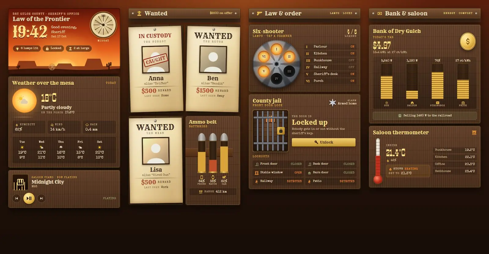
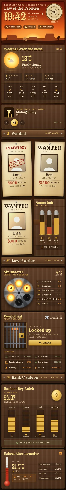

# Sheriff's office

A spaghetti-western dashboard for Home Assistant: one Sections view built only from Magic Cards, with a matching theme called "Frontier Sheriff". It's a sun-bleached sheriff's office out on the frontier. Weather sits under a blazing orange sky, the household hangs as wanted posters on the board, six lamps sit in a revolver cylinder, the front door is a jail cell, and the energy bill gets paid in gold coins. A tumbleweed rolls along the bottom of the header.





## What's on it

| Section | Cards |
| --- | --- |
| Header | Big clock with a greeting and the date, a sundial whose shadow drifts, status chips (lamps lit, front lock, people out), and a mesa skyline with a rolling tumbleweed |
| | Weather over the mesa: a shimmering sun disc around the current weather icon, temperature, condition, porch temperature, humidity, wind, rain and a five-day forecast |
| | Saloon piano: now playing, with previous, play/pause and next |
| Wanted | Heading with the total reward on offer |
| | A wanted poster per person. It says "Wanted" while they're away and "In custody", with a "Caught" stamp, while they're home. Each poster also shows the name, the alias, the reward from a sensor and where they were last seen |
| | Ammo belt: phone, watch and car batteries as cartridges that fill up, plus the car's range |
| Law & order | Six-shooter: six lamps as revolver chambers that glow when on. Tap a chamber or a row in the list to toggle that lamp |
| | County jail: the front door lock as a barred cell door that slides open when unlocked, with a Lock/Unlock button, the alarm on a tin star, and six lookouts (doors, window, garage, motion) |
| Bank & saloon | Gold coins: today's cost in dollars (energy today × price), coin stacks for solar, house load, battery and price, and whether you're selling to or buying from the grid |
| | Saloon thermometer: indoor temperature as a mercury tube, humidity, the thermostat's action and set point, and four room temperatures |

14 Magic Cards in total.

## Install

1. Copy `theme.yaml` into `/config/themes/` (for example as `/config/themes/frontier_sheriff.yaml`). Your `configuration.yaml` needs:

   ```yaml
   frontend:
     themes: !include_dir_merge_named themes
   ```

2. Reload themes: Developer tools → Actions → `frontend.reload_themes`, or restart Home Assistant.
3. Add the fonts. The dashboard uses Rye, Sancreek, Smokum and Special Elite from Google Fonts. Go to Settings → Dashboards → ⋮ → Resources → Add resource, choose **Stylesheet**, and paste:

   ```
   https://fonts.googleapis.com/css2?family=Rye&family=Sancreek&family=Smokum&family=Special+Elite&display=swap
   ```

   Without it the cards fall back to Playfair Display and Courier New. Loading the fonts sends a request to Google from every device that shows the dashboard.
4. Make the three reward sensors, or point the posters at sensors of your own (see below).
5. Settings → Dashboards → Add dashboard → New dashboard from scratch. Open it, ⋮ → Edit dashboard → ⋮ → Raw configuration editor, and paste the whole of `dashboard.yaml`.
6. Swap the placeholder entity ids for your own (search and replace in the raw editor).

The view sets `theme: Frontier Sheriff`. The theme gives Home Assistant's own card box a plain wood colour, and the Magic Cards draw their planks, parchment and metal on top.

Change the generator and run it again rather than editing the YAML by hand.

### Reward sensors

The posters read the reward from `sensor.reward_anna`, `sensor.reward_ben` and `sensor.reward_lisa`. Any number works. An `input_number` helper plus a template sensor will do, or just point them at something fun, such as days since that person last did the dishes. Example:

```yaml
template:
  - sensor:
      - name: Reward Anna
        unique_id: reward_anna
        unit_of_measurement: "$"
        state: "{{ states('input_number.reward_anna') | int(0) }}"
```

## Entities

| Entity id | What it is |
| --- | --- |
| `weather.home` | Weather (current conditions, humidity, wind, daily forecast) |
| `sensor.outdoor_temperature` | Outdoor temperature ("on the porch") |
| `sensor.rain_today` | Rain today |
| `sensor.indoor_temperature` | Indoor temperature (thermometer) |
| `sensor.indoor_humidity` | Indoor humidity |
| `sensor.bedroom_temperature`, `sensor.kitchen_temperature`, `sensor.office_temperature`, `sensor.bathroom_temperature` | Room temperatures |
| `climate.living_room` | Thermostat (action and set point) |
| `light.living_room`, `light.kitchen`, `light.bedroom`, `light.hallway`, `light.desk`, `light.porch` | The six lamps in the revolver |
| `lock.front_door` | Front door lock (jail cell) |
| `alarm_control_panel.home` | Alarm (tin star) |
| `binary_sensor.front_door`, `binary_sensor.back_door` | Door contacts |
| `binary_sensor.garage_window` | Window contact |
| `cover.garage_door` | Garage door |
| `binary_sensor.hall_motion`, `binary_sensor.patio_motion` | Motion sensors |
| `person.anna`, `person.ben`, `person.lisa` | People on the wanted posters (picture, name, state) |
| `sensor.reward_anna`, `sensor.reward_ben`, `sensor.reward_lisa` | Reward per poster, a number in $ |
| `sensor.phone_battery`, `sensor.watch_battery`, `sensor.car_battery` | Battery levels (ammo belt) |
| `sensor.car_range` | Car range |
| `sensor.solar_power`, `sensor.house_power`, `sensor.home_battery`, `sensor.grid_power` | Solar, house load, battery level, grid power (negative = exporting) |
| `sensor.energy_today`, `sensor.energy_price` | Energy today (kWh) and price (ct/kWh), multiplied for today's cost |
| `media_player.living_room` | The saloon piano (now playing and controls) |

The header also counts every `light.*` that is on.
