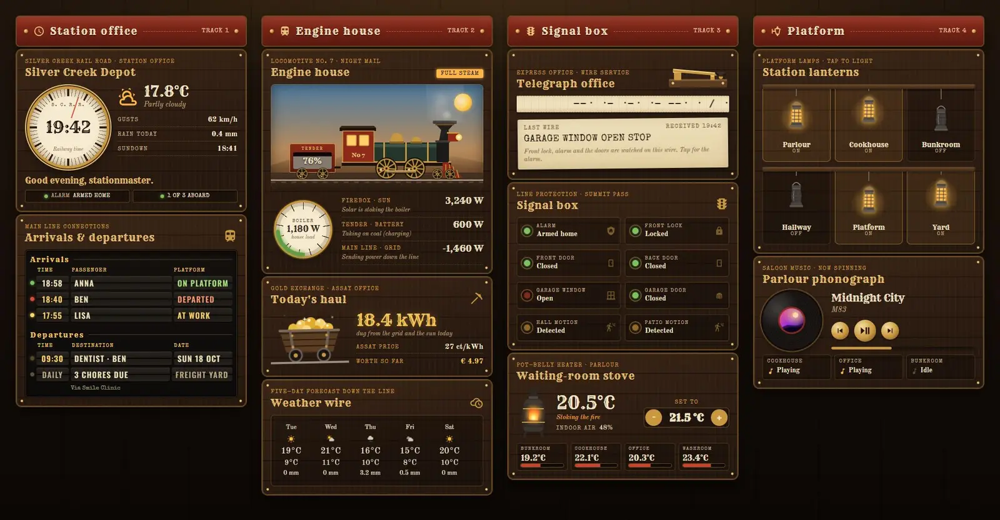
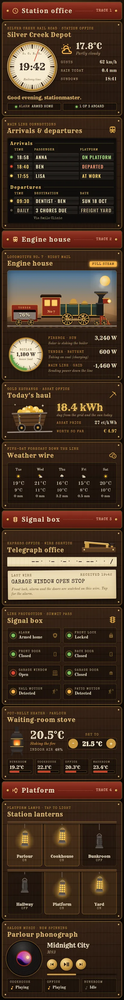

# Railroad Depot

A Home Assistant dashboard set in a gold-rush railroad depot at night. The station master's office has walnut planks, brass rivets and lantern light. It is one Sections view with 14 Magic Cards and a matching theme called "Railroad Depot".





## What's on it

The cards sit in four tracks:

- Station office: a station clock with a sweeping second hand and the weather beside it. Under it, a split-flap board shows who has arrived (on platform, departed, or at a place, with the expected arrival time) and the next calendar departure.
- Engine house: a steam locomotive for energy. The boiler gauge shows the house load and the coal tender fills with the battery. When the panels produce, the sun is up and smoke rises from the stack. A mine cart full of gold shows today's kWh, the price and what it has cost so far. A weather wire gives the five-day forecast.
- Signal box: a telegraph key taps out the most pressing status in Morse on a paper ticker tape. Signal lamps show the alarm, lock, doors, garage and motion: green is clear, amber is caution, red is danger. The waiting-room stove covers the thermostat and room temperatures.
- Platform: six station lanterns (tap to switch a light, hold for details) and a phonograph for the media player.

## Install

1. Copy `theme.yaml` to `/config/themes/railroad_depot.yaml`. Your `configuration.yaml` needs:
   ```yaml
   frontend:
     themes: !include_dir_merge_named themes
   ```
   Restart Home Assistant, or run the action `frontend.reload_themes`.
2. Add the fonts. The dashboard uses Rye, Special Elite and Old Standard TT, and Magic Card does not load these itself. Go to Settings → Dashboards → ⋮ → Resources → Add resource, choose type **Stylesheet** and paste the URL from `fonts.txt`:
   ```
   https://fonts.googleapis.com/css2?family=Rye&family=Special+Elite&family=Old+Standard+TT:ital,wght@0,400;0,700;1,400&display=swap
   ```
   Without it the cards fall back to Playfair Display, PT Serif and Courier New.
3. Make a new dashboard (Settings → Dashboards → Add dashboard → New dashboard from scratch), open it, choose ⋮ → Edit dashboard → ⋮ → Raw configuration editor, and paste all of `dashboard.yaml`.
4. Swap the placeholder entity ids for your own (see below). The view already selects the theme "Railroad Depot".

To change several things at once, edit the generator and run it again.

## Entities

| Entity | What it is |
| --- | --- |
| `weather.home` | Weather: condition icon, state and the forecast |
| `sensor.outdoor_temperature` | Outside temperature next to the clock |
| `sensor.wind_gust` | Wind gusts |
| `sensor.rain_today` | Rain today |
| `sensor.sunset` | Sunset time |
| `person.anna`, `person.ben`, `person.lisa` | People on the arrivals board |
| `sensor.anna_eta`, `sensor.ben_eta`, `sensor.lisa_eta` | Expected arrival time as `HH:MM`, shown while the person is away (for example a template sensor over a travel-time sensor) |
| `calendar.family` | Next event on the departures board (time, title, date, location) |
| `todo.chores` | Number of open chores |
| `alarm_control_panel.home` | Alarm: header chip, signal lamp and the telegraph |
| `lock.front_door` | Front lock |
| `binary_sensor.front_door`, `binary_sensor.back_door` | Door contacts |
| `binary_sensor.garage_window` | Garage window contact |
| `cover.garage_door` | Garage door |
| `binary_sensor.hall_motion`, `binary_sensor.patio_motion` | Motion sensors |
| `sensor.solar_power` | Solar power (firebox, sun and smoke) |
| `sensor.house_power` | House load (boiler gauge, 0 to 5,000 W) |
| `sensor.home_battery` | Battery charge in % (coal tender) |
| `sensor.battery_power` | Battery power, positive while charging |
| `sensor.grid_power` | Grid power, negative while exporting |
| `sensor.energy_today` | Energy used today in kWh (mine cart) |
| `sensor.energy_price` | Price in ct/kWh. The cost line shows €; change the sign in the card if you pay in another currency |
| `climate.living_room` | Thermostat (stove) |
| `sensor.indoor_humidity` | Indoor humidity |
| `sensor.bedroom_temperature`, `sensor.kitchen_temperature`, `sensor.office_temperature`, `sensor.bathroom_temperature` | Room thermometers |
| `light.living_room`, `light.kitchen`, `light.bedroom`, `light.hallway`, `light.porch`, `light.garden` | Lanterns |
| `media_player.living_room` | Phonograph: title, artist, cover, controls, volume |
| `media_player.kitchen`, `media_player.office`, `media_player.bedroom` | Other speakers |

The telegraph message picks the first of these that applies: garage window open, front door open, back door open, lock open, otherwise the alarm state. It is used for the plain message and for the Morse version.
