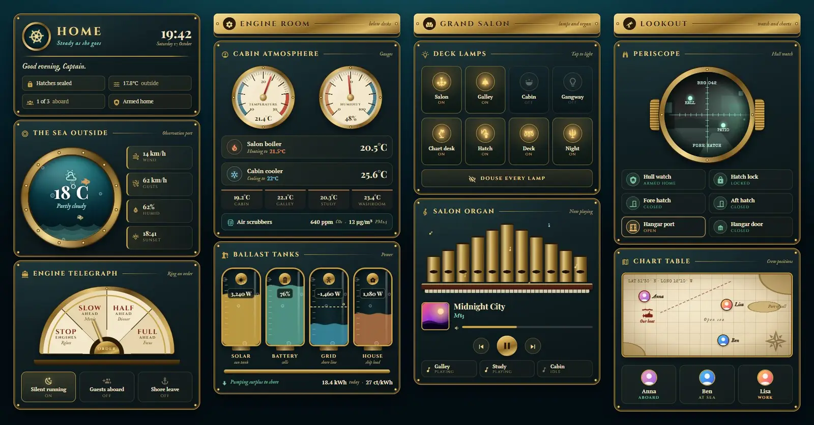
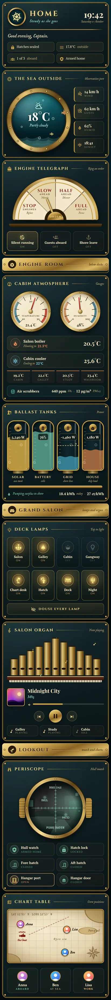

# Brass submarine

A Home Assistant Sections dashboard dressed as an old brass submarine, with riveted iron plates, a porthole onto a teal sea and a pipe organ in the salon. All 12 cards are Magic Cards (`custom:magic-card`), in four sections. The bridge has the brass name plate with clock, greeting and status line, a porthole where the weather is the sea outside (waves, bubbles and two passing fish), and an engine order telegraph for scenes. The engine room has dial gauges for temperature and humidity whose needles follow the sensors, the two thermostats, cabin temperatures, air quality and four ballast tanks for solar, battery, grid and house load. The grand salon has eight deck lamps you tap to switch, a button that turns them all off, and the organ for media, whose pipes glow and send up notes while the speaker plays. The lookout has a periscope over the front door camera, with motion shown as blips, six watch tiles for alarm, lock, doors, window and garage, and a chart table that pins each person aboard, at sea or in port.





## Install

1. Copy `theme.yaml` into `/config/themes/` (any file name). Your `configuration.yaml` needs:

   ```yaml
   frontend:
     themes: !include_dir_merge_named themes
   ```

2. Reload themes (Developer tools → Actions → `frontend.reload_themes`), or restart Home Assistant.
3. Add the fonts. Go to Settings → Dashboards → ⋮ → Resources → Add resource, choose type **Stylesheet** and paste the URL from `fonts.txt`:

   ```
   https://fonts.googleapis.com/css2?family=Cinzel:wght@400;700&family=IM+Fell+English:ital@0;1&family=Special+Elite&display=swap
   ```

   Without it, the cards fall back to Playfair Display, PT Serif and Source Code Pro, which Magic Card loads by itself.
4. Settings → Dashboards → Add dashboard → New dashboard from scratch. Open it, then ⋮ → Edit dashboard → ⋮ → Raw configuration editor. Paste `dashboard.yaml` and save.
5. Swap the placeholder entity ids below for your own.

The view uses the theme `Brass Submarine`, which is dark only.

## Entities

| Entity | What it is |
| --- | --- |
| `weather.home` | Weather: condition, temperature, wind and humidity in the porthole |
| `sensor.outdoor_temperature` | Outside temperature (status line) |
| `sensor.wind_gust` | Wind gusts |
| `sensor.sunset` | Sunset time |
| `sensor.indoor_temperature` | Temperature dial |
| `sensor.indoor_humidity` | Humidity dial |
| `climate.living_room` | Heating thermostat ("Salon boiler") |
| `climate.bedroom` | Cooling thermostat ("Cabin cooler") |
| `sensor.bedroom_temperature`, `sensor.kitchen_temperature`, `sensor.office_temperature`, `sensor.bathroom_temperature` | Room temperatures (Cabin, Galley, Study, Washroom) |
| `sensor.co2`, `sensor.pm25` | Air quality ("Air scrubbers") |
| `sensor.solar_power` | Solar power, W (tank scale 0–5000) |
| `sensor.home_battery` | Battery charge, % |
| `sensor.grid_power` | Grid power, W; negative is export (tank scale −3000 to 3000, dashed line at 0) |
| `sensor.house_power` | House load, W (tank scale 0–3000) |
| `sensor.energy_today` | Energy today, kWh |
| `sensor.energy_price` | Energy price |
| `scene.relax`, `scene.movie`, `scene.dinner`, `scene.focus` | Telegraph orders: Stop, Slow ahead, Half ahead, Full ahead |
| `input_boolean.night_mode`, `input_boolean.guest_mode`, `input_boolean.vacation` | Silent running, Guests aboard, Shore leave |
| `light.living_room`, `light.kitchen`, `light.bedroom`, `light.hallway`, `light.desk`, `light.porch`, `light.garden`, `light.nightlight` | Deck lamps |
| `media_player.living_room` | The organ: now playing, controls and volume |
| `media_player.kitchen`, `media_player.office`, `media_player.bedroom` | Other speakers (tap to play or pause) |
| `camera.front_door` | Periscope view |
| `binary_sensor.hall_motion`, `binary_sensor.patio_motion` | Motion, shown as contacts in the periscope |
| `alarm_control_panel.home` | Alarm ("Hull watch") |
| `lock.front_door` | Front door lock ("Hatch lock") |
| `binary_sensor.front_door`, `binary_sensor.back_door` | Door contacts (Fore hatch, Aft hatch) |
| `binary_sensor.garage_window` | Garage window ("Hangar port") |
| `cover.garage_door` | Garage door ("Hangar door") |
| `person.anna`, `person.ben`, `person.lisa` | People on the chart table |

The status line counts the people at home with `{{ states.person | selectattr('state', 'eq', 'home') | list | count }}` and shows "of 3". Change the 3 if you have a different number of people.
