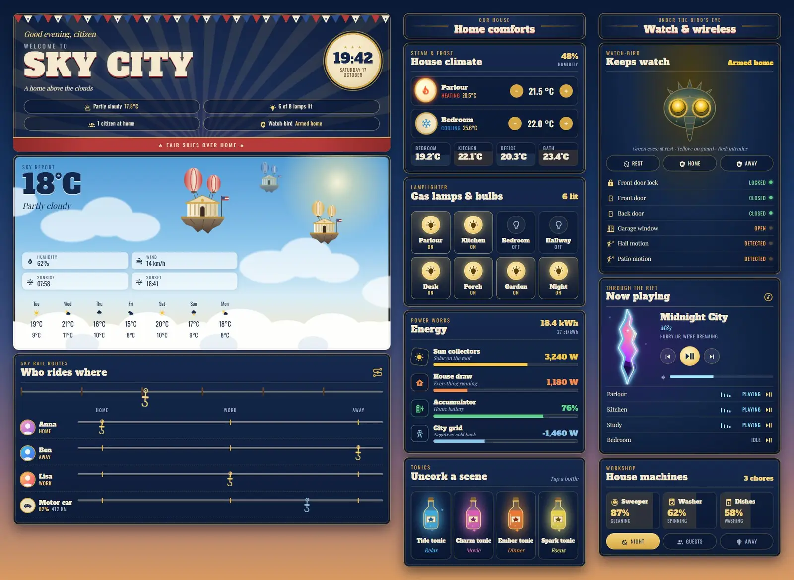
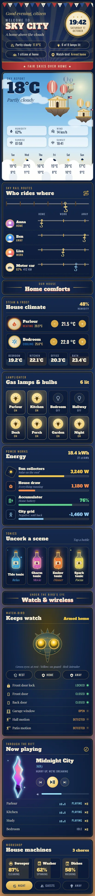

# Sky City

A Home Assistant dashboard set in a city of buildings floating on balloons above the clouds. It is one sections view made only of Magic Cards, with a matching theme called Sky City: navy enamel cards with gilt edges, cream slab-serif type, red, white and blue bunting, and a golden-hour sky behind it all.



On a phone:



## What's on it

| Card | What it shows |
| --- | --- |
| Poster header | Bunting, a slowly turning sunburst, a greeting, a big "Sky City" title, a clock medallion and four status chips (weather, lamps lit, people home, alarm). |
| Sky report | Weather on a sunlit sky: drifting clouds, three floating buildings that bob up and down, a cloud bank rolling past below, today's numbers and a 7-day forecast. |
| Sky rail routes | Who is where. Each person hangs from a hook on their own rail and slides to Home, Work or Away. The car's hook moves with its charge level. A spare hook keeps travelling along the top rail. |
| Home comforts (heading) | Section plaque. |
| House climate | Two thermostats with + and − buttons (a flickering flame while heating, a turning snowflake while cooling) and four room temperatures. |
| Lamplighter | Eight lamps. Tap to toggle, hold for details. Lit lamps glow. |
| Energy | Solar, house load, home battery and grid, each with a value bar. |
| Tonics | Four scenes as tonic bottles, each with its own glow. Tap a bottle to start the scene. |
| Watch & wireless (heading) | Section plaque. |
| Watch-bird | The alarm as a watchful bird. Its eyes are green when disarmed, yellow when armed and red when triggered. Buttons to disarm or arm, plus lock, doors, window and motion. |
| Through the rift | Now playing, with the cover art seen through a glowing rift that breathes while music plays. Controls, volume and every speaker below. |
| Workshop | Robot vacuum, washer and dishwasher progress, a chores count and toggles for night, guest and away mode. |

## Install

1. Copy `theme.yaml` to `/config/themes/sky_city.yaml`. If you haven't yet, add this to `configuration.yaml` and restart:

   ```yaml
   frontend:
     themes: !include_dir_merge_named themes
   ```

2. Reload themes (Developer tools → Actions → `frontend.reload_themes`).
3. Add the headline font: Settings → Dashboards → ⋮ → Resources → Add resource, type **Stylesheet**, with the URL from `fonts.txt`:
   `https://fonts.googleapis.com/css2?family=Alfa+Slab+One&display=swap`
   Without it the titles fall back to Playfair Display, which the card loads itself (as it does Oswald).
4. Settings → Dashboards → Add dashboard → New dashboard from scratch. Open it, then ⋮ → Edit dashboard → ⋮ → Raw configuration editor, paste all of `dashboard.yaml` and save.
5. Swap the entity ids below for your own. The view picks the Sky City theme by itself.

Magic Card must be installed.

## Entities

| Entity | Used for |
| --- | --- |
| `weather.home` | Sky report, header chip |
| `sensor.outdoor_temperature` | Header chip |
| `sensor.sunrise`, `sensor.sunset` | Sky report (text sensors, e.g. `07:58`) |
| `person.anna`, `person.ben`, `person.lisa` | Sky rail riders |
| `sensor.car_battery`, `sensor.car_range` | The car's hook and readout |
| `scene.relax`, `scene.movie`, `scene.dinner`, `scene.focus` | Tonic bottles |
| `climate.living_room`, `climate.bedroom` | Thermostats |
| `sensor.indoor_humidity` | Climate card |
| `sensor.bedroom_temperature`, `sensor.kitchen_temperature`, `sensor.office_temperature`, `sensor.bathroom_temperature` | Room temperatures |
| `light.living_room`, `light.kitchen`, `light.bedroom`, `light.hallway`, `light.desk`, `light.porch`, `light.garden`, `light.nightlight` | Lamps (also counted in the header) |
| `sensor.solar_power`, `sensor.house_power`, `sensor.home_battery`, `sensor.grid_power` | Energy bars (grid is negative when exporting) |
| `sensor.energy_today`, `sensor.energy_price` | Energy card header |
| `alarm_control_panel.home` | The bird's eyes, header chip, arm buttons |
| `lock.front_door` | Security list |
| `binary_sensor.front_door`, `binary_sensor.back_door`, `binary_sensor.garage_window` | Security list |
| `binary_sensor.hall_motion`, `binary_sensor.patio_motion` | Security list |
| `media_player.living_room` | Now playing (title, artist, album, cover, volume) |
| `media_player.kitchen`, `media_player.office`, `media_player.bedroom` | Speaker list |
| `vacuum.robot` | Sweeper tile (state and `battery_level`) |
| `sensor.washer_state`, `sensor.washer_progress` | Washer tile |
| `sensor.dishwasher_state`, `sensor.dishwasher_progress` | Dishes tile |
| `todo.chores` | Chores count |
| `input_boolean.night_mode`, `input_boolean.guest_mode`, `input_boolean.vacation` | Mode toggles |

The header counts people at home with a template over all `person.*` entities, and the lamp count template lists the eight lights above. If you change the lights, change that list in both the header and the lamp card.
