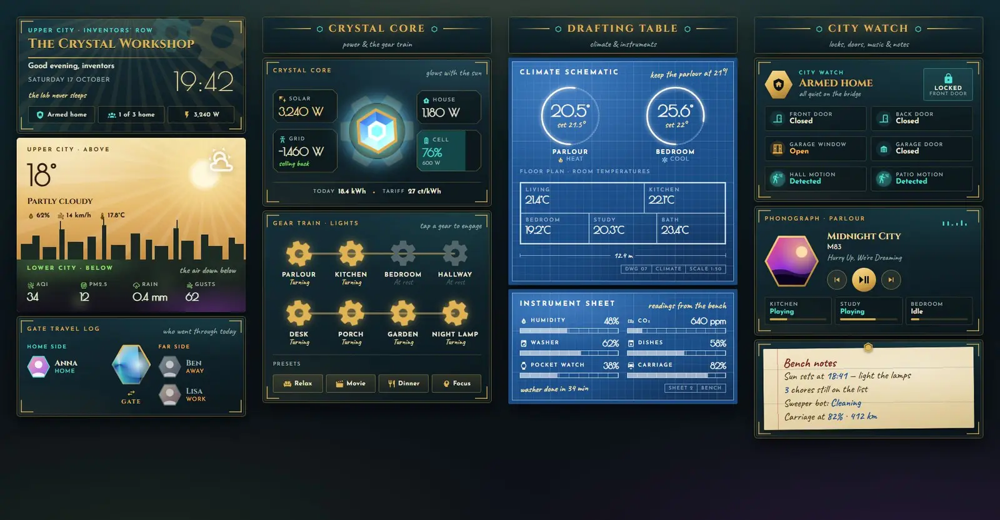
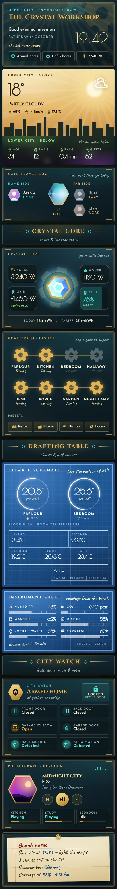

# Crystal Workshop

An inventor's workshop in a gold-and-teal art deco city, with green and purple smog drifting through the streets below. It's one Sections view of 13 Magic Cards and a matching theme. The header has turning brass gears, the weather card is split between the bright upper city and the smoggy lower city, an energy crystal spins faster in strong sun, and the lights are a row of gears you tap to turn.





## What's on it

- Header: title, greeting, date, a large clock, and chips for the alarm, who is home and solar power.
- Weather, above and below: the top half shows the temperature, sky, humidity and wind over a city skyline. The bottom half has air quality, PM2.5, rain and gusts, with smoke drifting through.
- Gate travel log: people at home stand on the home side of a spinning gate. People who are away appear on the far side, greyed out.
- Crystal core (energy): a crystal spins inside a brass gear. It spins faster and glows brighter above 2 kW of solar, and dims below 50 W. Solar, grid, house load and the battery sit on plates around it.
- Gear train (lights): eight gears on a brass rod. A gear turns while its light is on. Tap a gear to toggle its light. Four scene buttons sit underneath.
- Drafting table: a climate blueprint with two thermostat dials and a floor plan of room temperatures, and an instrument sheet with humidity, CO₂, the washer, the dishwasher and two batteries.
- City watch (security): alarm, front lock, doors, garage window and door, and motion. When the alarm goes off the card turns purple and an "Alarm breach" banner appears.
- Phonograph (media): album art in a brass hexagon, transport buttons, and the other speakers with their volume.
- Bench notes: a pinned paper note with the sunset, chores, the robot vacuum and the car.

## Install

1. **Fonts.** The deco fonts (Cinzel, Josefin Sans, Poiret One, Caveat) aren't in the card's own font list. Go to Settings → Dashboards → ⋮ → Resources → Add resource, paste the URL from `fonts.txt` and pick **Stylesheet**:

   ```
   https://fonts.googleapis.com/css2?family=Cinzel:wght@400;600;700&family=Josefin+Sans:wght@300;400;600;700&family=Poiret+One&family=Caveat:wght@500;700&display=swap
   ```

   Without it, the cards fall back to Playfair Display, Raleway and Dancing Script.
2. **Theme.** Copy `theme.yaml` to `/config/themes/` (any file name works). Your `configuration.yaml` needs:

   ```yaml
   frontend:
     themes: !include_dir_merge_named themes
   ```

   Restart Home Assistant once, or run the `frontend.reload_themes` action.
3. **Dashboard.** Settings → Dashboards → Add dashboard → New dashboard from scratch. Open it, then ⋮ → Edit dashboard → ⋮ → Raw configuration editor. Paste all of `dashboard.yaml` and save. The view sets `theme: Crystal Workshop` itself.
4. Replace the placeholder entity ids with your own (see below).

## Entities

| Entity | What it is |
| --- | --- |
| `weather.home` | Weather (temperature, humidity and wind attributes) |
| `sensor.outdoor_temperature` | Outdoor temperature |
| `sensor.aqi` | Air quality index |
| `sensor.pm25` | PM2.5 |
| `sensor.rain_today` | Rain today |
| `sensor.wind_gust` | Wind gusts |
| `person.anna`, `person.ben`, `person.lisa` | People (with pictures) |
| `sensor.solar_power` | Solar production (W) |
| `sensor.house_power` | House load (W) |
| `sensor.grid_power` | Grid power, negative when exporting (W) |
| `sensor.battery_power` | Battery power, positive when charging (W) |
| `sensor.home_battery` | Home battery charge (%) |
| `sensor.energy_today` | Energy used today (kWh) |
| `sensor.energy_price` | Energy price |
| `light.living_room`, `light.kitchen`, `light.bedroom`, `light.hallway`, `light.desk`, `light.porch`, `light.garden`, `light.nightlight` | Lights in the gear train |
| `scene.relax`, `scene.movie`, `scene.dinner`, `scene.focus` | Scene buttons |
| `climate.living_room`, `climate.bedroom` | Thermostats |
| `sensor.indoor_temperature`, `sensor.kitchen_temperature`, `sensor.bedroom_temperature`, `sensor.office_temperature`, `sensor.bathroom_temperature` | Room temperatures on the floor plan |
| `sensor.indoor_humidity` | Indoor humidity |
| `sensor.co2` | CO₂ |
| `sensor.washer_progress`, `sensor.washer_remaining` | Washing machine progress (%) and minutes left |
| `sensor.dishwasher_progress` | Dishwasher progress (%) |
| `sensor.watch_battery`, `sensor.car_battery`, `sensor.car_range` | Watch and car battery, car range |
| `alarm_control_panel.home` | Alarm |
| `lock.front_door` | Front door lock |
| `binary_sensor.front_door`, `binary_sensor.back_door` | Door contacts |
| `binary_sensor.garage_window` | Window contact |
| `cover.garage_door` | Garage door |
| `binary_sensor.hall_motion`, `binary_sensor.patio_motion` | Motion sensors |
| `media_player.living_room` | Main speaker (title, artist, album, picture) |
| `media_player.kitchen`, `media_player.office`, `media_player.bedroom` | Other speakers |
| `sensor.sunset` | Sunset time |
| `todo.chores` | Chores list |
| `vacuum.robot` | Robot vacuum |
