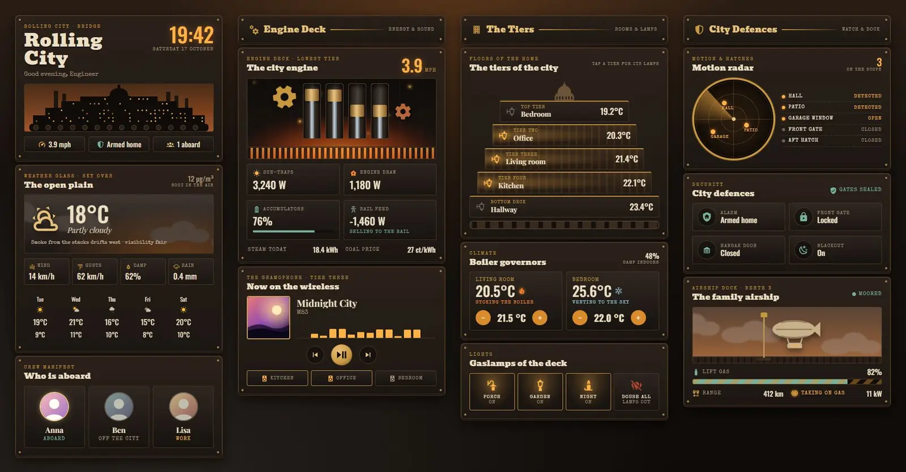
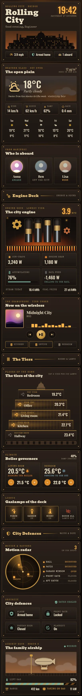

# Rolling City

A Home Assistant dashboard dressed as a city on caterpillar tracks: soot, brass, iron tiers and a furnace that never goes out. It is one Sections view with 14 Magic Cards and a matching theme, Soot and Brass. The theme is dark only.





## What is on it

- Bridge (hero): the city name, a big clock, a greeting, a skyline of tiers and smokestacks with drifting smoke, and three chips: city speed, alarm and how many people are home.
- Weather: the weather glass, with smoke and soot clouds rolling over the sky panel, wind, gusts, humidity, rain and a five-day forecast.
- Crew manifest: who is home ("Aboard"), away ("Off the city") or somewhere else.
- City engine (showpiece): four pistons and two cogs that run faster as the house load rises, a flickering furnace with embers, and the speed in mph worked out from the house load. Below it: solar, house load, battery and grid, plus today's energy and the price.
- Gramophone: what the living room speaker is playing, with equaliser bars, transport buttons and the other speakers.
- Tiers (showpiece): each floor or room as a tier of the city, narrow at the top and wide at the bottom, with its temperature. Tap a tier to toggle its light. Lit tiers glow, and the tracks underneath roll faster with the house load.
- Boiler governors: both thermostats with current temperature, what they are doing and a target spinbox.
- Gaslamps: porch, garden and night light (tap to toggle), plus a button that turns every light off.
- Motion radar (showpiece): a brass radar scope with a sweeping beam. Each motion sensor, door or window that is on shows as a pinging blip; the list beside it shows all of them.
- City defences: alarm, front door lock, garage door and night mode.
- Airship dock (showpiece): the car as an airship. It is moored to its mast while the car is home and floats free when it is away. The lift gas bar is the car battery, and it shows stripes while charging.

## Install

1. Copy `theme.yaml` into `/config/themes/` (any file name). Your `configuration.yaml` needs:

   ```yaml
   frontend:
     themes: !include_dir_merge_named themes
   ```

2. Restart Home Assistant once, or run **Developer tools → Actions → `frontend.reload_themes`**.
3. Add the fonts: **Settings → Dashboards → ⋮ → Resources → Add resource**, type **Stylesheet**, with the URL in `fonts.txt`:

   ```
   https://fonts.googleapis.com/css2?family=Bevan&family=Special+Elite&display=swap
   ```

   Without it, the cards fall back to Playfair Display and Inconsolata, which the card loads itself.
4. Make sure Magic Card is installed.
5. **Settings → Dashboards → Add dashboard → New dashboard from scratch**. Open it, then **⋮ → Edit dashboard → ⋮ → Raw configuration editor**, paste all of `dashboard.yaml` and save.
6. Swap the placeholder entity ids for your own (see below).

Edit the generator if you want to change many cards at once.

## Entities

| Entity | What it is |
| --- | --- |
| `weather.home` | Weather (temperature, humidity, wind, forecast) |
| `sensor.wind_gust` | Wind gusts |
| `sensor.rain_today` | Rain today |
| `sensor.pm25` | PM2.5, shown as soot in the air |
| `person.anna`, `person.ben`, `person.lisa` | People |
| `sensor.solar_power` | Solar power |
| `sensor.house_power` | House load; also drives the engine speed, the pistons, cogs and tracks |
| `sensor.grid_power` | Grid power (negative = exporting) |
| `sensor.home_battery` | Home battery charge |
| `sensor.energy_today` | Energy produced today |
| `sensor.energy_price` | Energy price |
| `media_player.living_room` | Main speaker (title, artist, cover, controls) |
| `media_player.kitchen`, `media_player.office`, `media_player.bedroom` | Other speakers |
| `sensor.bedroom_temperature`, `sensor.office_temperature`, `sensor.indoor_temperature`, `sensor.kitchen_temperature`, `sensor.bathroom_temperature` | Room temperatures on the tiers |
| `light.bedroom`, `light.desk`, `light.living_room`, `light.kitchen`, `light.hallway` | Tier lights |
| `light.porch`, `light.garden`, `light.nightlight` | Gaslamps |
| `climate.living_room`, `climate.bedroom` | Thermostats |
| `sensor.indoor_humidity` | Indoor humidity |
| `binary_sensor.hall_motion`, `binary_sensor.patio_motion` | Motion sensors (radar) |
| `binary_sensor.front_door`, `binary_sensor.back_door`, `binary_sensor.garage_window` | Door and window contacts (radar) |
| `alarm_control_panel.home` | Alarm |
| `lock.front_door` | Front door lock |
| `cover.garage_door` | Garage door |
| `input_boolean.night_mode` | Night mode |
| `device_tracker.car` | Car location (`home` = moored) |
| `sensor.car_battery`, `sensor.car_range`, `sensor.car_charge_power` | Car battery, range and charging power |
| `binary_sensor.car_charging` | Car is charging |

The engine speed is a template: house load divided by 300, in mph. Change the divisor in the hero and engine cards if you want another scale.
