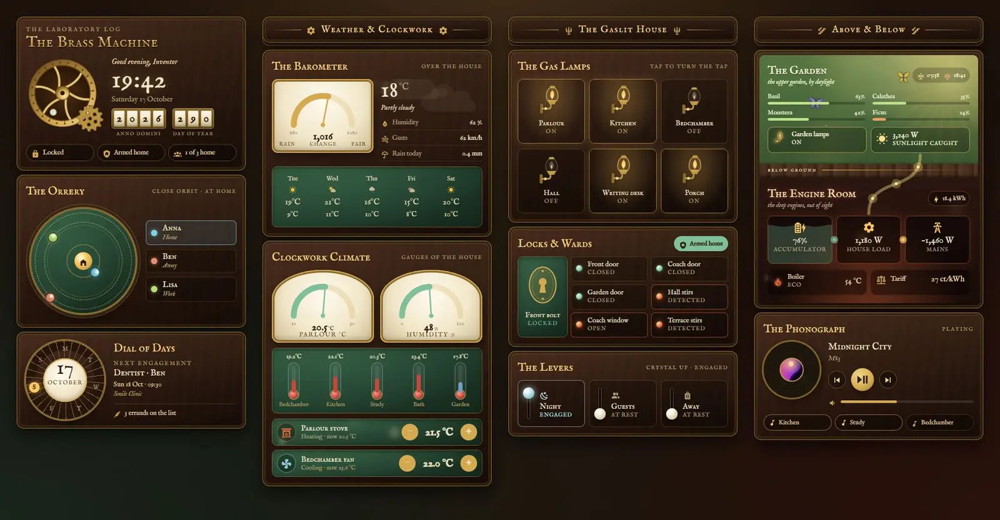
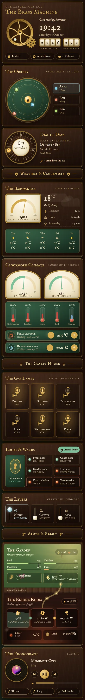

# Brass Laboratory

A Victorian inventor's laboratory by gaslight: mahogany panels, green leather, brass dials and crystal levers. It is one Sections view built only from Magic Cards (`custom:magic-card`), with a matching dark theme called "Brass Laboratory". The header holds a brass machine with turning cogs, a clock and odometer counters for the year and the day of the year. Below it are an orrery for the people at home, a dial of days for the calendar, an aneroid barometer for the weather, clockwork climate dials and thermometers, gas lamps for the lights, keyhole plates and warning lights for security, crystal levers for house modes, a garden-and-engine-room card for plants and energy, and a phonograph for media.





## Install

1. Install Magic Card if you haven't already.
2. Copy `theme.yaml` to `/config/themes/` (any file name). Your `configuration.yaml` needs:

   ```yaml
   frontend:
     themes: !include_dir_merge_named themes
   ```

   Then restart Home Assistant or run the action `frontend.reload_themes`.
3. Add the fonts. Go to Settings → Dashboards → ⋮ → Resources → Add resource, choose the type Stylesheet and paste the URL from `fonts.txt`:

   ```
   https://fonts.googleapis.com/css2?family=IM+Fell+English:ital@0;1&family=IM+Fell+English+SC&display=swap
   ```

   Without it the cards fall back to Playfair Display and Lora, which the card loads itself.
4. Go to Settings → Dashboards → Add dashboard → New dashboard from scratch. Open it, choose ⋮ → Edit dashboard → ⋮ → Raw configuration editor, paste all of `dashboard.yaml` and save. The view picks the "Brass Laboratory" theme by itself.
5. Replace the placeholder entity ids with your own (see below).

## Entities

| Entity id | What it is |
| --- | --- |
| `weather.home` | Weather: conditions, temperature, humidity, forecast, and the `pressure` attribute for the barometer |
| `sensor.wind_gust` | Wind gusts |
| `sensor.rain_today` | Rain today |
| `climate.living_room` | Living room thermostat (heating) |
| `climate.bedroom` | Bedroom air conditioning (cooling) |
| `sensor.indoor_humidity` | Indoor humidity |
| `sensor.bedroom_temperature` | Bedroom temperature |
| `sensor.kitchen_temperature` | Kitchen temperature |
| `sensor.office_temperature` | Office temperature |
| `sensor.bathroom_temperature` | Bathroom temperature |
| `sensor.outdoor_temperature` | Outdoor temperature |
| `light.living_room` | Living room light |
| `light.kitchen` | Kitchen light |
| `light.bedroom` | Bedroom light |
| `light.hallway` | Hallway light |
| `light.desk` | Desk lamp |
| `light.porch` | Porch light |
| `light.garden` | Garden lights |
| `lock.front_door` | Front door lock |
| `alarm_control_panel.home` | Alarm |
| `binary_sensor.front_door` | Front door contact |
| `binary_sensor.back_door` | Back door contact |
| `binary_sensor.garage_window` | Garage window contact |
| `cover.garage_door` | Garage door |
| `binary_sensor.hall_motion` | Hall motion |
| `binary_sensor.patio_motion` | Patio motion |
| `input_boolean.night_mode` | Night mode |
| `input_boolean.guest_mode` | Guest mode |
| `input_boolean.vacation` | Holiday mode |
| `person.anna`, `person.ben`, `person.lisa` | The people in the orrery |
| `calendar.family` | Family calendar (next appointment) |
| `todo.chores` | Chores list (number of open items) |
| `sensor.sunrise`, `sensor.sunset` | Sunrise and sunset times |
| `sensor.basil_moisture`, `sensor.monstera_moisture`, `sensor.calathea_moisture`, `sensor.ficus_moisture` | Plant soil moisture |
| `sensor.solar_power` | Solar power |
| `sensor.house_power` | House load |
| `sensor.grid_power` | Grid power (negative is export) |
| `sensor.battery_power` | Battery power (positive is charging) |
| `sensor.home_battery` | Home battery charge |
| `sensor.energy_today` | Energy produced today |
| `sensor.energy_price` | Electricity price |
| `water_heater.boiler` | Boiler |
| `media_player.living_room` | Living room speaker (the phonograph) |
| `media_player.kitchen`, `media_player.office`, `media_player.bedroom` | Other speakers |

The orrery counts everyone with a `person` entity for "1 of 3 home". The weekday ring and the clock use Home Assistant templates, so they show your server's time.
