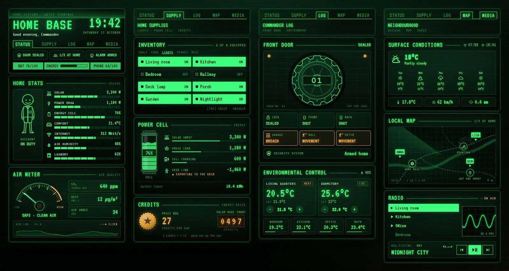
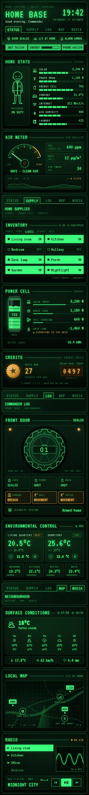

# Home Base: a green terminal dashboard

A Home Assistant Sections dashboard built only from Magic Card cards. It looks like an old wrist terminal in an underground shelter: green phosphor on dark glass, scanlines, amber for warnings, and a tab bar heading each section. The theme is called Green Terminal.





## What's on it

Four sections, 14 cards:

- Status: the header with a greeting, a big clock, the tab bar, three status chips (door, who's home, alarm) and a bottom bar with the home battery, today's energy and the phone battery. Below it, home stats: a resident figure next to seven segmented bars for solar, power draw, battery, comfort, internet, humidity and laundry. Then the air meter: CO₂ moves a dial needle that twitches, with PM2.5, AQI and a 24-hour log.
- Supplies: the lights as an inventory list (tap to toggle), a power cell that fills with the home battery charge next to solar, load, battery and grid, and a credits counter for the energy price and what today's solar output is worth.
- Log: a cog-shaped door. While the front door is locked it stays shut; when it unlocks, it rolls aside and shows the lit hallway behind it. Underneath are the door and window contacts, motion and the alarm, then two thermostats and four room temperatures.
- Map and media: weather and forecast, a local map with a marker for each person at home, at work or out, and the radio: four media players, a scrolling waveform, the track playing and controls.

## Install

1. Copy `theme.yaml` to `/config/themes/` and make sure `configuration.yaml` has:
   ```yaml
   frontend:
     themes: !include_dir_merge_named themes
   ```
2. Restart Home Assistant once, or run the action `frontend.reload_themes`.
3. Fonts: the dashboard uses VT323 and Share Tech Mono. Add them as a dashboard resource: Settings → Dashboards → ⋮ → Resources → Add resource, URL `https://fonts.googleapis.com/css2?family=VT323&family=Share+Tech+Mono&display=swap` (also in `fonts.txt`), type Stylesheet. Without it the cards fall back to Inconsolata and Fira Code, which Magic Card loads itself.
4. Settings → Dashboards → Add dashboard → New dashboard from scratch. Open it, then ⋮ → Edit dashboard → ⋮ → Raw configuration editor, paste `dashboard.yaml` and save.
5. Swap the entity ids below for your own.

## Entities

| Entity | What it is |
| --- | --- |
| `person.anna`, `person.ben`, `person.lisa` | People: header count and map markers (home, `not_home`, any other zone = work) |
| `lock.front_door` | Front door lock: the cog door and the "door sealed" chip |
| `alarm_control_panel.home` | Alarm |
| `binary_sensor.front_door`, `binary_sensor.back_door` | Door contacts |
| `binary_sensor.garage_window` | Window contact |
| `binary_sensor.hall_motion`, `binary_sensor.patio_motion` | Motion sensors |
| `sensor.home_battery` | Home battery charge (%): bottom bar and power cell |
| `sensor.phone_battery` | Phone battery (%) |
| `sensor.energy_today` | Energy produced today (kWh) |
| `sensor.energy_price` | Energy price (ct/kWh): credits |
| `sensor.solar_power`, `sensor.house_power`, `sensor.battery_power`, `sensor.grid_power` | Power in W (grid negative while exporting) |
| `sensor.indoor_temperature`, `sensor.indoor_humidity` | Indoor temperature and humidity |
| `sensor.net_down` | Download speed |
| `sensor.washer_progress` | Washing machine progress (%) |
| `sensor.co2`, `sensor.pm25`, `sensor.aqi` | Air quality for the air meter |
| `light.living_room`, `light.kitchen`, `light.bedroom`, `light.hallway`, `light.desk`, `light.porch`, `light.garden`, `light.nightlight` | The eight inventory lights |
| `climate.living_room`, `climate.bedroom` | Thermostats |
| `sensor.bedroom_temperature`, `sensor.kitchen_temperature`, `sensor.office_temperature`, `sensor.bathroom_temperature` | Room temperatures |
| `weather.home` | Weather and forecast |
| `sensor.outdoor_temperature`, `sensor.wind_gust`, `sensor.rain_today` | Outside temperature, gusts, rain today |
| `sensor.sunrise`, `sensor.sunset` | Sunrise and sunset times |
| `media_player.living_room` | Main player (now playing, controls, waveform) |
| `media_player.kitchen`, `media_player.office`, `media_player.bedroom` | The other three players |
