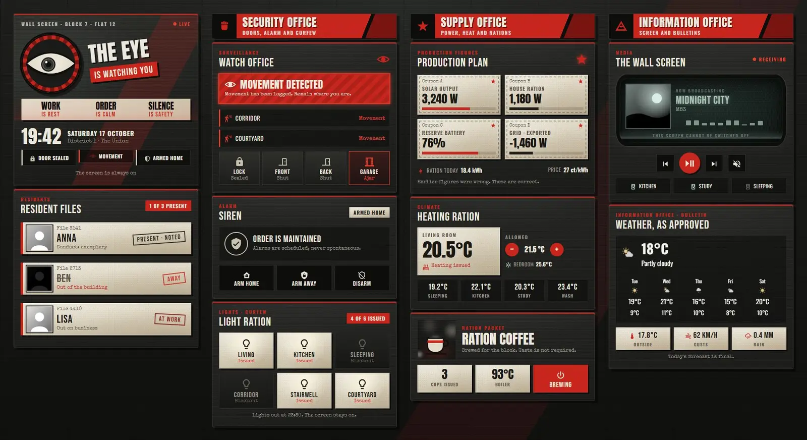
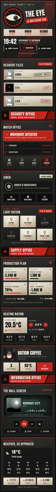

# Block 7: a wall-screen dashboard

A Home Assistant Sections dashboard built only from Magic Card cards. It looks like the wall screen in a flat in a grim concrete housing block: brutalist grey, poster red and black, cream ration paper and a grey-green CRT glow. The header has a watching eye whose iris looks left and right and blinks now and then in front of slowly turning red rays, three slogans, a big clock and status chips. Residents get stamped files, motion becomes a red "Movement detected" banner, and a triggered alarm turns its card red with a shaking title. Energy comes as ration coupons, the coffee machine steams while it's on, and the media player sits on a flickering screen with scanlines. The theme is called Concrete Broadcast.



Phone view:



## Install

1. Copy `theme.yaml` to `/config/themes/` and make sure `configuration.yaml` has:
   ```yaml
   frontend:
     themes: !include_dir_merge_named themes
   ```
2. Restart Home Assistant once, or run the action `frontend.reload_themes`.
3. Fonts: the dashboard uses Anton, Bebas Neue and Special Elite, plus Oswald, which Magic Card loads itself. Add the others as a dashboard resource: Settings → Dashboards → ⋮ → Resources → Add resource, URL `https://fonts.googleapis.com/css2?family=Anton&family=Bebas+Neue&family=Special+Elite&display=swap` (also in `fonts.txt`), type Stylesheet. Without it the cards fall back to Oswald and Courier New.
4. Settings → Dashboards → Add dashboard → New dashboard from scratch. Open it, then ⋮ → Edit dashboard → ⋮ → Raw configuration editor, paste `dashboard.yaml` and save.
5. Swap the entity ids below for your own.

## Entities

| Entity | What it is |
| --- | --- |
| `lock.front_door` | Front door lock |
| `binary_sensor.hall_motion`, `binary_sensor.patio_motion` | Motion sensors |
| `binary_sensor.front_door`, `binary_sensor.back_door` | Door contacts |
| `binary_sensor.garage_window` | Window contact |
| `alarm_control_panel.home` | Alarm; triggered turns the alarm card red |
| `person.anna`, `person.ben`, `person.lisa` | People in the house |
| `light.living_room`, `light.kitchen`, `light.bedroom`, `light.hallway`, `light.porch`, `light.garden` | The six lights |
| `sensor.solar_power`, `sensor.house_power`, `sensor.grid_power` | Power in W (grid negative while exporting) |
| `sensor.home_battery` | Home battery charge (%) |
| `sensor.energy_today`, `sensor.energy_price` | Energy today, current price |
| `climate.living_room`, `climate.bedroom` | Thermostats |
| `sensor.bedroom_temperature`, `sensor.kitchen_temperature`, `sensor.office_temperature`, `sensor.bathroom_temperature` | Room temperatures |
| `switch.coffee_machine` | Coffee machine (tap to toggle) |
| `sensor.coffee_count`, `sensor.coffee_boiler` | Cups today, boiler temperature |
| `media_player.living_room` | Main speaker on the wall screen |
| `media_player.kitchen`, `media_player.office`, `media_player.bedroom` | Other speakers |
| `weather.home` | Weather and forecast |
| `sensor.outdoor_temperature`, `sensor.wind_gust`, `sensor.rain_today` | Outside temperature, gusts, rain today |

The two count templates (people at home, lights on) need no extra entities.
