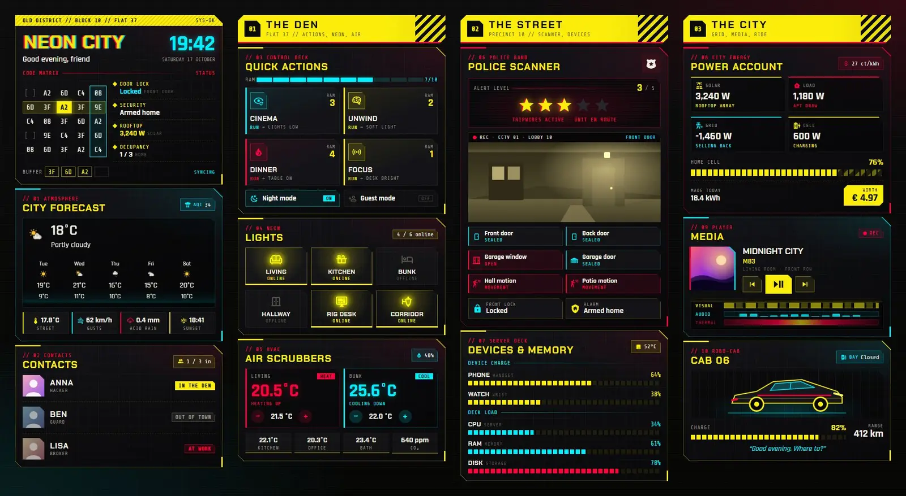
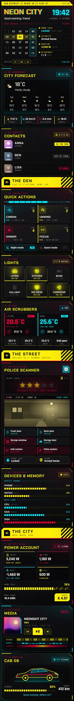

# Neon City: a hacker's den dashboard

A Home Assistant Sections dashboard built only from Magic Card cards, set in a hacker's flat in a tower block. Acid yellow, hot red and cyan on black, with cut-corner panels, hazard stripes, segmented bars and the odd glitch. The hero has a glitching title, a clock and a code matrix with four status slots (lock, alarm, solar, people home). Below it sit a weather card and the household as contacts. The den section has four scene tiles with switches for night and guest mode, six light tiles and the thermostats. The street section has a police scanner whose alert level (one to five stars) counts tripped doors, windows and motion sensors, a camera snapshot and the device batteries and server load as segmented bars. The city section shows solar, load, grid and battery power with today's value in euros, the media player with visual, audio and thermal layer tracks, and the car with its charge, range and garage bay.





## Install

1. Copy `theme.yaml` to `/config/themes/` and make sure `configuration.yaml` has:
   ```yaml
   frontend:
     themes: !include_dir_merge_named themes
   ```
   Restart Home Assistant once, or run the action `frontend.reload_themes`. The theme is called Neon City. It makes the standard card surface transparent, because every card draws its own cut-corner plate.
2. Fonts: the dashboard uses Chakra Petch, Rajdhani and Share Tech Mono. Add them as a dashboard resource: Settings → Dashboards → ⋮ → Resources → Add resource, type Stylesheet, URL
   `https://fonts.googleapis.com/css2?family=Chakra+Petch:wght@500;600;700&family=Rajdhani:wght@500;600;700&family=Share+Tech+Mono&display=swap`
   (also in `fonts.txt`). Without it the cards fall back to Oswald, PT Sans and Source Code Pro.
3. Settings → Dashboards → Add dashboard → New dashboard from scratch. Open it, then ⋮ → Edit dashboard → ⋮ → Raw configuration editor, paste `dashboard.yaml` and save.
4. Swap the entity ids below for your own.

## Entities

| Entity | What it is |
| --- | --- |
| `lock.front_door` | Front door lock |
| `alarm_control_panel.home` | Alarm |
| `person.anna`, `person.ben`, `person.lisa` | People in the house |
| `weather.home` | Weather and forecast |
| `sensor.aqi` | Air quality index |
| `sensor.outdoor_temperature`, `sensor.wind_gust`, `sensor.rain_today`, `sensor.sunset` | Outside temperature, gusts, rain today, sunset |
| `scene.movie`, `scene.relax`, `scene.dinner`, `scene.focus` | The four scene tiles |
| `input_boolean.night_mode`, `input_boolean.guest_mode` | Mode switches |
| `light.living_room`, `light.kitchen`, `light.bedroom`, `light.hallway`, `light.desk`, `light.porch` | The six light tiles |
| `climate.living_room`, `climate.bedroom` | Thermostats |
| `sensor.indoor_humidity` | Indoor humidity |
| `sensor.kitchen_temperature`, `sensor.office_temperature`, `sensor.bathroom_temperature` | Room temperatures |
| `sensor.co2` | CO₂ |
| `binary_sensor.front_door`, `binary_sensor.back_door`, `binary_sensor.garage_window` | Door and window contacts (alert stars) |
| `binary_sensor.hall_motion`, `binary_sensor.patio_motion` | Motion sensors (alert stars) |
| `cover.garage_door` | Garage door |
| `camera.front_door` | Camera snapshot |
| `sensor.phone_battery`, `sensor.watch_battery` | Phone and watch battery (%) |
| `sensor.server_cpu`, `sensor.server_ram`, `sensor.server_disk`, `sensor.server_temp` | Home server load and temperature |
| `sensor.solar_power`, `sensor.house_power`, `sensor.grid_power`, `sensor.battery_power` | Power in W (grid negative while exporting, battery positive while charging) |
| `sensor.home_battery` | Home battery charge (%) |
| `sensor.energy_today`, `sensor.energy_price` | Energy produced today (kWh) and price (ct/kWh) |
| `media_player.living_room` | Media player |
| `sensor.car_battery`, `sensor.car_range` | Car charge and range |
