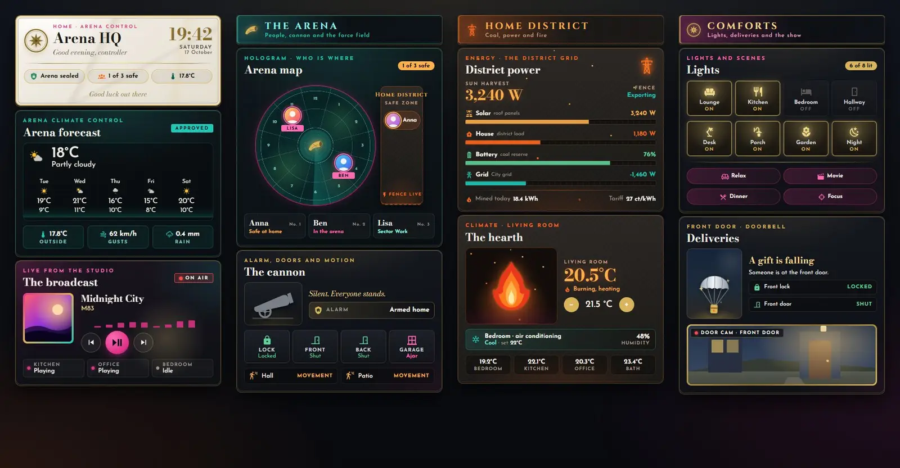
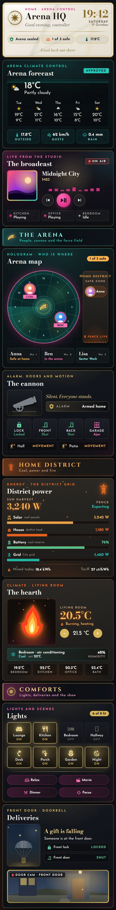

# Arena Control

A Home Assistant Sections dashboard built only from Magic Card cards and dressed as the control room of a televised arena. Two looks share the screen: white marble, gold and loud magenta and teal broadcast light for the show, coal grey and ember orange for the home district. A holographic arena map shows who is at home and who is out, an alarm fires a cannon, the thermostat burns as a flame and the doorbell drops a silver parachute. The theme is called Arena Control.





## Install

1. Copy `theme.yaml` to `/config/themes/` and make sure `configuration.yaml` has:
   ```yaml
   frontend:
     themes: !include_dir_merge_named themes
   ```
2. Restart Home Assistant once, or run the action `frontend.reload_themes`.
3. Fonts: the dashboard uses Bodoni Moda, Cinzel and Josefin Sans. Magic Card only loads the Google Fonts in its own font picker, so add these as a dashboard resource: Settings → Dashboards → ⋮ → Resources → Add resource. Use the URL in `fonts.txt` (`https://fonts.googleapis.com/css2?family=Bodoni+Moda:ital,wght@0,400;0,700;1,400;1,700&family=Cinzel:wght@400;700&family=Josefin+Sans:wght@400;600;700&display=swap`) and the type Stylesheet. Without it the cards fall back to Playfair Display and Montserrat.
4. Settings → Dashboards → Add dashboard → New dashboard from scratch. Open it, then ⋮ → Edit dashboard → ⋮ → Raw configuration editor. Paste `dashboard.yaml` and save.
5. Swap the entity ids below for your own.

## Entities

| Entity | What it is |
| --- | --- |
| `weather.home` | Weather and forecast |
| `sensor.outdoor_temperature` | Outside temperature |
| `sensor.wind_gust` | Wind gusts |
| `sensor.rain_today` | Rain today |
| `media_player.living_room` | Main speaker for the broadcast card |
| `media_player.kitchen`, `media_player.office`, `media_player.bedroom` | Other speakers |
| `person.anna`, `person.ben`, `person.lisa` | People on the arena map |
| `alarm_control_panel.home` | Alarm (the cannon fires on `triggered`) |
| `lock.front_door` | Front door lock |
| `binary_sensor.front_door`, `binary_sensor.back_door` | Door contacts |
| `binary_sensor.garage_window` | Window contact |
| `binary_sensor.hall_motion`, `binary_sensor.patio_motion` | Motion sensors |
| `sensor.solar_power`, `sensor.house_power`, `sensor.grid_power` | Power in W (grid negative while exporting) |
| `sensor.home_battery` | Home battery charge (%) |
| `sensor.energy_today`, `sensor.energy_price` | Energy today, current price |
| `climate.living_room` | Thermostat behind the flame |
| `climate.bedroom` | Bedroom air conditioning |
| `sensor.indoor_humidity` | Indoor humidity |
| `sensor.bedroom_temperature`, `sensor.kitchen_temperature`, `sensor.office_temperature`, `sensor.bathroom_temperature` | Room temperatures |
| `light.living_room`, `light.kitchen`, `light.bedroom`, `light.hallway`, `light.desk`, `light.porch`, `light.garden`, `light.nightlight` | The eight light tiles |
| `scene.relax`, `scene.movie`, `scene.dinner`, `scene.focus` | Scenes behind the four scene buttons |
| `binary_sensor.front_doorbell` | Doorbell (drops the parachute while `on`) |
| `camera.front_door` | Door camera snapshot |
