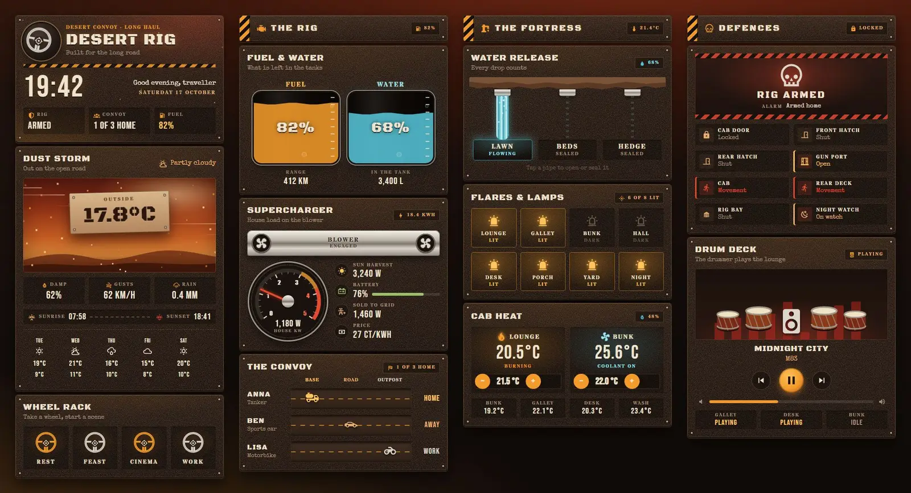
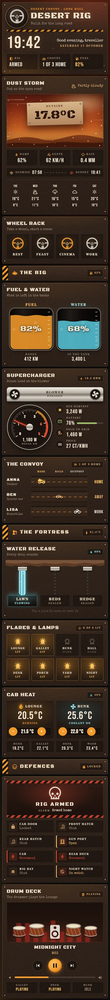

# Desert Rig

A Home Assistant Sections dashboard built only from Magic Card cards. It looks like the cab of a tanker truck crossing an orange desert: rusted, riveted steel plates, hazard stripes, chrome, stencilled lettering and a red dust storm on the horizon. The fuel and water tanks fill with your car battery and water tank levels, a dial and two blowers follow the house load, three pipes in a cliff pour water while the irrigation runs, and a row of drums thumps along while music plays. The theme is called Desert Rig.





## Install

1. Copy `theme.yaml` to `/config/themes/` and make sure `configuration.yaml` has:
   ```yaml
   frontend:
     themes: !include_dir_merge_named themes
   ```
   Restart Home Assistant once, or run the action `frontend.reload_themes`.
2. Fonts: the dashboard uses Black Ops One, Stardos Stencil, Bebas Neue and Special Elite. Add them as a dashboard resource: Settings → Dashboards → ⋮ → Resources → Add resource, URL `https://fonts.googleapis.com/css2?family=Black+Ops+One&family=Bebas+Neue&family=Special+Elite&family=Stardos+Stencil:wght@400;700&display=swap` (also in `fonts.txt`), type Stylesheet. Without it the cards fall back to Impact, Oswald and Courier.
3. Settings → Dashboards → Add dashboard → New dashboard from scratch. Open it, then ⋮ → Edit dashboard → ⋮ → Raw configuration editor, paste `dashboard.yaml` and save.
4. Swap the entity ids below for your own.

## Entities

| Entity | What it is |
| --- | --- |
| `weather.home` | Weather and forecast |
| `sensor.outdoor_temperature` | Outside temperature |
| `sensor.wind_gust` | Wind gusts (above 40 the storm card shows lightning) |
| `sensor.rain_today` | Rain today |
| `sensor.sunrise`, `sensor.sunset` | Sunrise and sunset times |
| `alarm_control_panel.home` | Alarm |
| `person.anna`, `person.ben`, `person.lisa` | People in the convoy |
| `sensor.car_battery`, `sensor.car_range` | Car charge (the fuel tank) and range |
| `sensor.water_tank`, `sensor.water_tank_litres` | Water tank level (%) and volume |
| `sensor.house_power` | House load on the dial and the blower speed |
| `sensor.solar_power`, `sensor.grid_power` | Solar and grid power in W (grid negative while exporting) |
| `sensor.home_battery` | Home battery charge (%) |
| `sensor.energy_today`, `sensor.energy_price` | Energy today, current price |
| `scene.relax`, `scene.dinner`, `scene.movie`, `scene.focus` | Scenes behind the four wheels |
| `switch.zone_lawn`, `switch.zone_beds`, `switch.zone_hedge` | Irrigation zones |
| `light.living_room`, `light.kitchen`, `light.bedroom`, `light.hallway`, `light.desk`, `light.porch`, `light.garden`, `light.nightlight` | The eight lamps |
| `climate.living_room`, `climate.bedroom` | Thermostats |
| `sensor.indoor_temperature`, `sensor.indoor_humidity` | Indoor temperature and humidity |
| `sensor.bedroom_temperature`, `sensor.kitchen_temperature`, `sensor.office_temperature`, `sensor.bathroom_temperature` | Room temperatures |
| `lock.front_door` | Front door lock |
| `binary_sensor.front_door`, `binary_sensor.back_door` | Door contacts |
| `binary_sensor.garage_window` | Window contact |
| `binary_sensor.hall_motion`, `binary_sensor.patio_motion` | Motion sensors |
| `cover.garage_door` | Garage door |
| `input_boolean.night_mode` | Night mode |
| `media_player.living_room` | Main speaker for the drum card |
| `media_player.kitchen`, `media_player.office`, `media_player.bedroom` | Other speakers |
