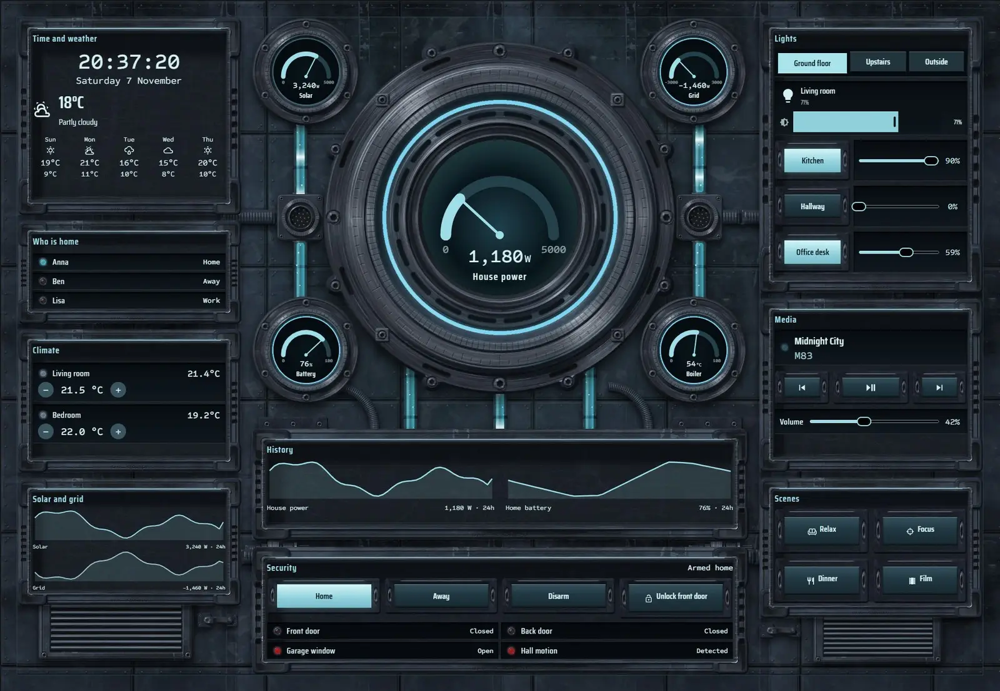
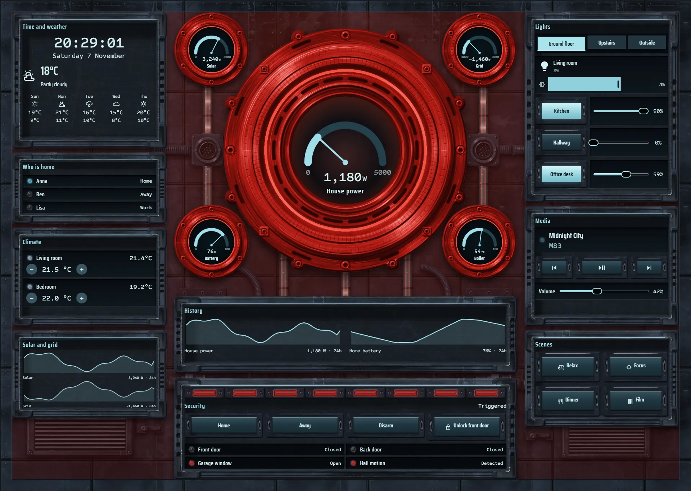
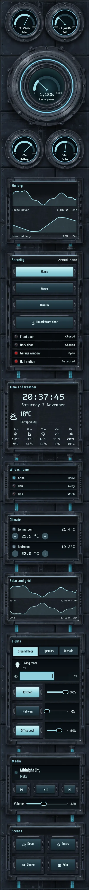

# Reactor bay

The home, run from the wall of a working reactor bay on a spacecraft. One armoured hull fills the screen, with a very large reactor bezel in the centre. Its glass core pulses faster as house power rises, and lit coolant tubes carry solar and grid flow to junctions beside it, in the direction the grid is actually running.







## What's on it

- House power on a `gauge` in the reactor bezel, with solar, grid, battery and boiler on `gauge` modules in smaller bezels.
- Recessed screen bays with `clock`, `weather`, `forecast`, `graphs` and who is home.
- Lights in `tabs` (Ground floor, Upstairs, Outside) with `light`, `button` and `slider`.
- Climate with `spinbox`, media with transport `button` modules and a volume `slider`, and scene keys in a housing on the hull.
- Security with arm and lock keys. When the alarm triggers, red lamps fill the security bay, the core and bezels turn red, the tubes run red and the hull takes on a red light.

## Install

1. Copy `theme.yaml` to `/config/themes/` and make sure `configuration.yaml` has:
   ```yaml
   frontend:
     themes: !include_dir_merge_named themes
   ```
   Restart Home Assistant once, or run the action `frontend.reload_themes`.
2. Copy the pictures: the `tex` and `parts` folders of [`_assets/future`](../_assets/future) to `/config/www/future/`. If `/config/www` is new, restart Home Assistant once.
3. Fonts: add them as a dashboard resource: Settings → Dashboards → ⋮ → Resources → Add resource, URL `https://fonts.googleapis.com/css2?family=Saira+Condensed:wght@400;500;600&family=Sometype+Mono:wght@400;500&display=swap`, type Stylesheet.
4. Settings → Dashboards → Add dashboard → New dashboard from scratch. Open it, then ⋮ → Edit dashboard → ⋮ → Raw configuration editor, paste `dashboard.yaml` and save.
5. Swap the entity ids below for your own.

## Entities

| What it is | Entity |
| --- | --- |
| Lights | `light.bedroom`, `light.bedside`, `light.christmas_tree`, `light.desk`, `light.garden`, `light.hall_ceiling`, `light.hallway`, `light.kitchen`, `light.living_room`, `light.nightlight`, `light.porch` |
| Thermostats | `climate.bedroom`, `climate.living_room` |
| Alarm | `alarm_control_panel.home` |
| Locks | `lock.front_door` |
| Doors, windows and motion | `binary_sensor.back_door`, `binary_sensor.front_door`, `binary_sensor.garage_window`, `binary_sensor.hall_motion` |
| People | `person.anna`, `person.ben`, `person.lisa` |
| Sensors | `sensor.bedroom_temperature`, `sensor.boiler_temperature`, `sensor.grid_power`, `sensor.home_battery`, `sensor.house_power`, `sensor.indoor_temperature`, `sensor.solar_power` |
| Weather and forecast | `weather.home` |
| Media | `media_player.living_room` |
| Scenes | `scene.dinner`, `scene.focus`, `scene.movie`, `scene.relax` |
