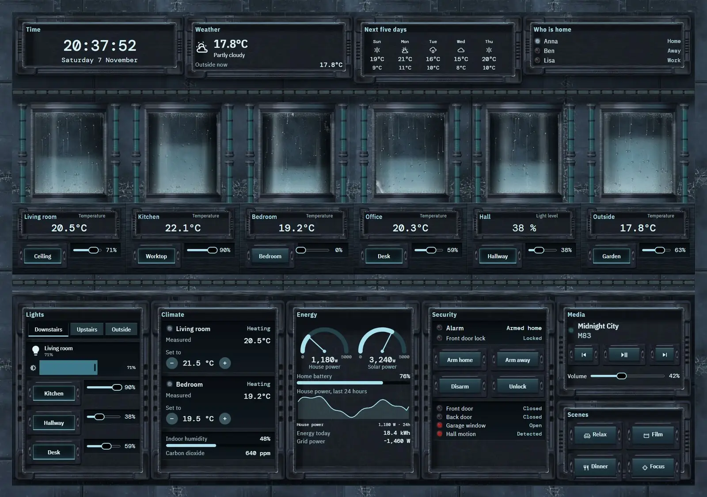
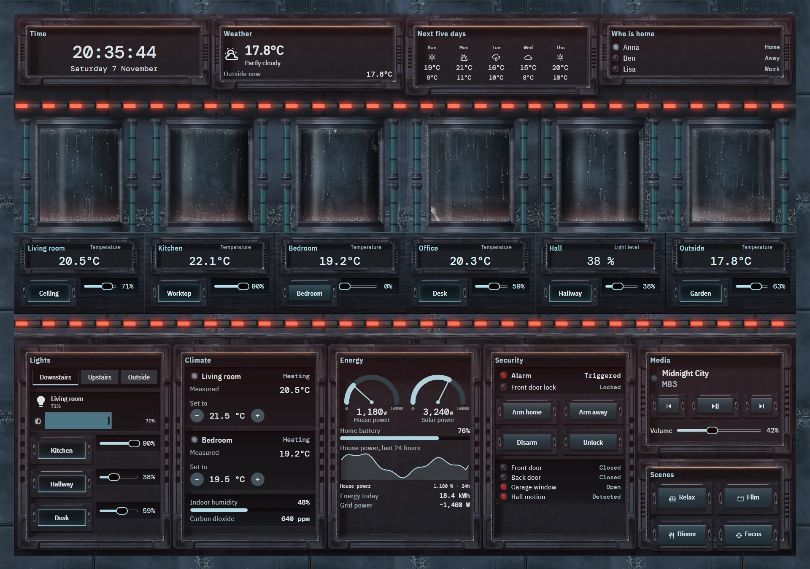
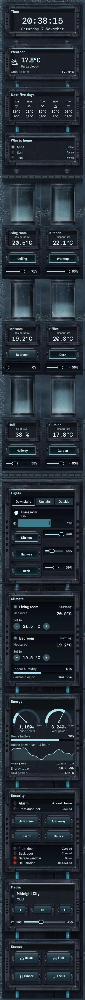

# Cryogenic vault

The home, run from a cryogenic storage vault. Six frosted glass cylinders stand as a colonnade across the top of a frosted steel wall, one for each zone of the house. Frost creeps along the wall's seams, condensation beads on the glass, and cold mist drifts along the floor.







## What's on it

- Each cylinder holds a real vertical `bar`, so the light inside stands at that zone's value and rises or falls with it: temperature for the living room, kitchen, bedroom, office and outside, and brightness for the hall. The reading sits on a bezel below, with a `button` and `slider` for that zone's light on the plinth.
- A lintel over the cylinders carries `clock`, `weather`, `forecast` and who is home.
- A low service desk runs under them with lights in `tabs` (`light`, `button`, `slider`), climate with `spinbox`, energy with `gauge`, `bar` and `graphs`, security with arm and lock keys, media transport and volume, and scene keys.
- When the alarm triggers, the light sinks out of every cylinder, red strip lamps run along the plinth and the lintel, the bay strips turn red and a red wash comes over the wall. The readings stay on their bezels.

## Credits

The frost in `art/frostTile.webp` and `art/cylinderGlass.webp` is built from the colour maps of [Ice002](https://ambientcg.com/view?id=Ice002) and [Ice003](https://ambientcg.com/view?id=Ice003) from ambientCG, which publishes its assets under CC0 1.0 Universal. Credit is not required.

## Install

1. Copy `theme.yaml` to `/config/themes/` and make sure `configuration.yaml` has:
   ```yaml
   frontend:
     themes: !include_dir_merge_named themes
   ```
   Restart Home Assistant once, or run the action `frontend.reload_themes`.
2. Copy the pictures: the `tex` and `parts` folders of [`_assets/future`](../_assets/future) to `/config/www/future/`, and the contents of `art` to `/config/www/27-cryogenic-vault/`. If `/config/www` is new, restart Home Assistant once.
3. Fonts: add them as a dashboard resource: Settings → Dashboards → ⋮ → Resources → Add resource, URL `https://fonts.googleapis.com/css2?family=IBM+Plex+Sans+Condensed:wght@300;400;500;600&family=DM+Mono:wght@300;400;500&display=swap`, type Stylesheet.
4. Settings → Dashboards → Add dashboard → New dashboard from scratch. Open it, then ⋮ → Edit dashboard → ⋮ → Raw configuration editor, paste `dashboard.yaml` and save.
5. Swap the entity ids below for your own.

## Entities

| What it is | Entity |
| --- | --- |
| Lights | `light.bedroom`, `light.bedside`, `light.christmas_tree`, `light.desk`, `light.garden`, `light.hall_ceiling`, `light.hallway`, `light.kitchen`, `light.living_room`, `light.nightlight`, `light.porch` |
| Thermostats | `climate.bedroom`, `climate.living_room` |
| Alarm | `alarm_control_panel.home` |
| Locks | `lock.front_door` |
| Doors, windows and motion | `binary_sensor.back_door`, `binary_sensor.front_door`, `binary_sensor.garage_window`, `binary_sensor.hall_motion` |
| People | `person.anna`, `person.ben`, `person.lisa` |
| Sensors | `sensor.bedroom_temperature`, `sensor.co2`, `sensor.energy_today`, `sensor.grid_power`, `sensor.home_battery`, `sensor.house_power`, `sensor.indoor_humidity`, `sensor.kitchen_temperature`, `sensor.office_temperature`, `sensor.outdoor_temperature`, `sensor.solar_power` |
| Weather and forecast | `weather.home` |
| Media | `media_player.living_room` |
| Scenes | `scene.dinner`, `scene.focus`, `scene.movie`, `scene.relax` |
