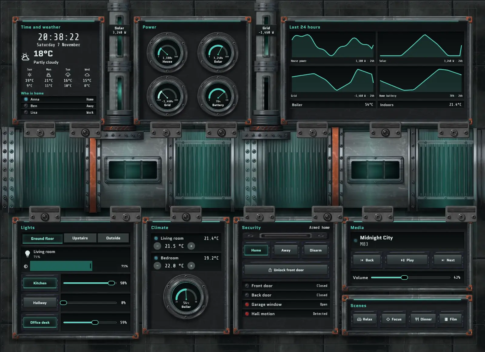
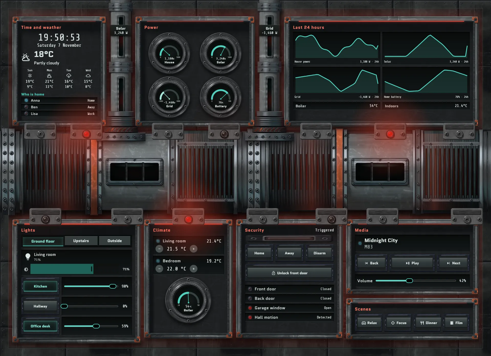
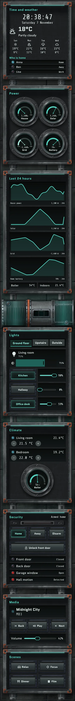

# Drive spine

The home, run from the service corridor beside a ship's main drive. One enormous drive shaft crosses the whole wall at mid-height. Teal light travels along it, seen through real openings in the steel: cooling fins, an inspection window and coil windings. It moves faster as house power rises. Solar and grid come down two thick feeder pipes and join it from above.

Clock, weather, who is home, power dials and 24-hour history are mounted above the shaft. Lights, climate, security, media and scenes hang below it in hatches. On a phone the panels stack, with a shorter section of shaft after the history and feeder pipes between panels.

Grey is painted steel, teal is light, and red-orange on collars and corner plates is safety paint. Only lit red means alarm. When the alarm is triggered the shaft light turns red and slows, the beacons along the shaft come on, the wall takes a red wash and every hatch strip turns red.







## Install

1. Copy `theme.yaml` to `/config/themes/` and make sure `configuration.yaml` has:
   ```yaml
   frontend:
     themes: !include_dir_merge_named themes
   ```
   Restart Home Assistant once, or run the action `frontend.reload_themes`.
2. Copy the pictures: the `tex` and `parts` folders of [`_assets/future`](../_assets/future) to `/config/www/future/`, and the contents of `art` to `/config/www/28-drive-spine/`. If `/config/www` is new, restart Home Assistant once.
3. Fonts: add them as a dashboard resource: Settings → Dashboards → ⋮ → Resources → Add resource, URL `https://fonts.googleapis.com/css2?family=Quantico:wght@400;700&family=Share+Tech+Mono&display=swap`, type Stylesheet.
4. Settings → Dashboards → Add dashboard → New dashboard from scratch. Open it, then ⋮ → Edit dashboard → ⋮ → Raw configuration editor, paste `dashboard.yaml` and save.
5. Swap the entity ids below for your own.

## Entities

| What it is | Entity |
| --- | --- |
| Lights | `light.bedroom`, `light.bedside`, `light.christmas_tree`, `light.desk`, `light.garden`, `light.hall_ceiling`, `light.hallway`, `light.kitchen`, `light.living_room`, `light.nightlight`, `light.porch` |
| Thermostats | `climate.bedroom`, `climate.living_room` |
| Alarm | `alarm_control_panel.home` |
| Locks | `lock.front_door` |
| Doors, windows and motion | `binary_sensor.back_door`, `binary_sensor.front_door`, `binary_sensor.garage_window`, `binary_sensor.hall_motion` |
| People | `person.anna`, `person.ben`, `person.lisa` |
| Sensors | `sensor.bedroom_temperature`, `sensor.boiler_temperature`, `sensor.grid_power`, `sensor.home_battery`, `sensor.house_power`, `sensor.indoor_temperature`, `sensor.solar_power` |
| Weather and forecast | `weather.home` |
| Media | `media_player.living_room` |
| Scenes | `scene.dinner`, `scene.focus`, `scene.movie`, `scene.relax` |
