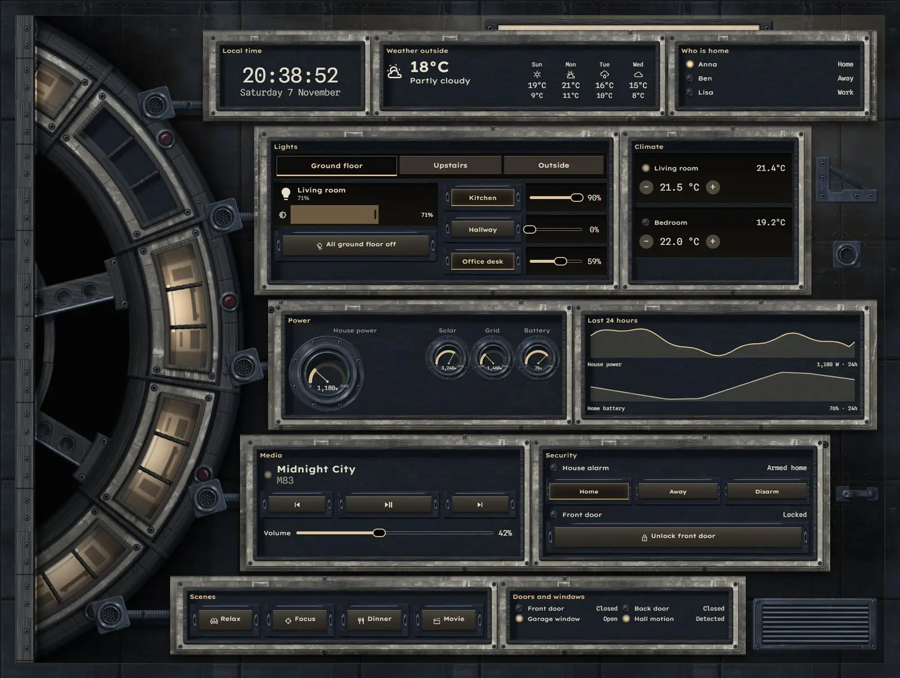
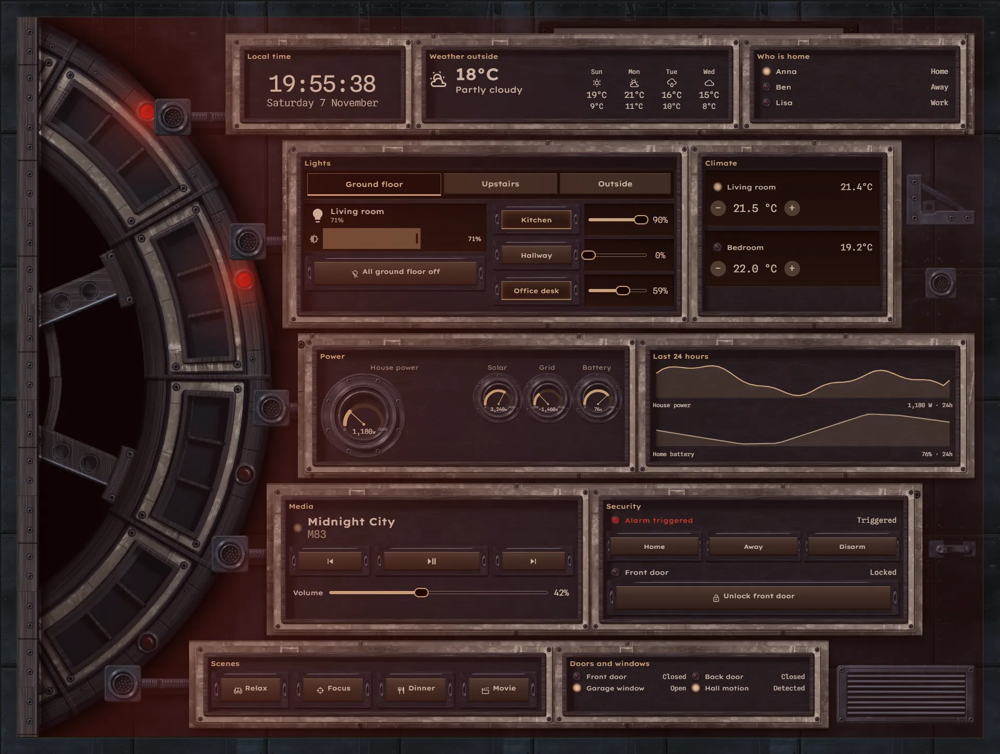
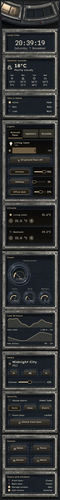

# Gravity ring

The home, run from the hub of a rotating habitat. A segmented ring 1500 px across sits off the left of the wall, so only its right arc shows, cut by the wall edge. It turns very slowly, faster as house power rises. Each segment is a window on a room, lit while that room's lamp is on. Panels stand on worn enamel plates that step in and out along the curve, under one warm-white lamp.







## What's on it

- `clock`, `weather`, `forecast` and who is home.
- Lights in `tabs` (Ground floor, Upstairs, Outside) with `light`, `button` and `slider`.
- Climate with `spinbox`, power on `gauge` modules in bezels, and `graphs` for the last 24 hours.
- Media with transport `button` modules and a volume `slider`, security with arm and lock keys, scene keys, doors and windows.

The windows follow living room, kitchen, hallway, office desk, bedroom and guest room. Each room has two opposite segments, so it shows once as the ring comes round.

When the alarm triggers, the windows lose their light, red emergency lamps run round the ring, the ring and its guide rollers stop, the wall lamp goes out and the wall takes on a red light.

## Install

1. Copy `theme.yaml` to `/config/themes/` and make sure `configuration.yaml` has:
   ```yaml
   frontend:
     themes: !include_dir_merge_named themes
   ```
   Restart Home Assistant once, or run the action `frontend.reload_themes`.
2. Copy the pictures: the `tex` and `parts` folders of [`_assets/future`](../_assets/future) to `/config/www/future/`, and the contents of `art` to `/config/www/29-gravity-ring/`. If `/config/www` is new, restart Home Assistant once.
3. Fonts: add them as a dashboard resource: Settings → Dashboards → ⋮ → Resources → Add resource, URL `https://fonts.googleapis.com/css2?family=Lexend+Exa:wght@300;400;500;600&family=Spline+Sans+Mono:wght@300;400&display=swap`, type Stylesheet.
4. Settings → Dashboards → Add dashboard → New dashboard from scratch. Open it, then ⋮ → Edit dashboard → ⋮ → Raw configuration editor, paste `dashboard.yaml` and save.
5. Swap the entity ids below for your own.

## Entities

| What it is | Entity |
| --- | --- |
| Lights | `light.bedroom`, `light.bedside`, `light.christmas_tree`, `light.desk`, `light.garden`, `light.hall_ceiling`, `light.hallway`, `light.kitchen`, `light.living_room`, `light.nightlight`, `light.porch` |
| Thermostats | `climate.bedroom`, `climate.living_room` |
| Alarm | `alarm_control_panel.home` |
| Locks | `lock.front_door` |
| Doors, windows and motion | `binary_sensor.back_door`, `binary_sensor.front_door`, `binary_sensor.garage_window`, `binary_sensor.hall_motion` |
| People | `person.anna`, `person.ben`, `person.lisa` |
| Sensors | `sensor.bedroom_temperature`, `sensor.grid_power`, `sensor.home_battery`, `sensor.house_power`, `sensor.indoor_temperature`, `sensor.solar_power` |
| Weather and forecast | `weather.home` |
| Media | `media_player.living_room` |
| Scenes | `scene.dinner`, `scene.focus`, `scene.movie`, `scene.relax` |
