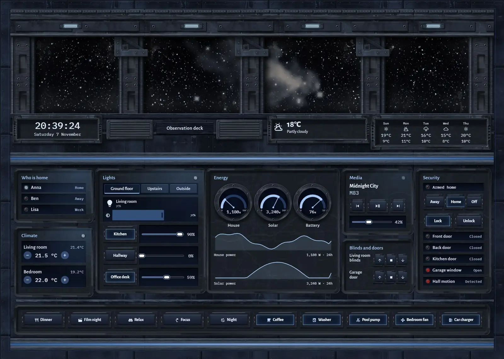
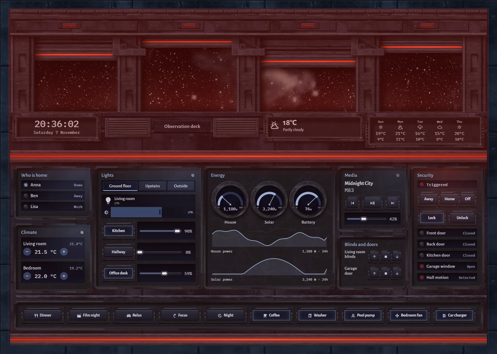
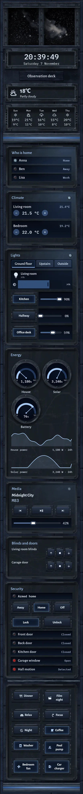

# Bridge console

The home, run from a ship's observation deck. A wide armoured window fills the top half: a deep-space photograph behind thick glass, framed by heavy ribs and an overhead beam. Below it one long composite desk crosses the whole width, with every control in a moulded recess and a tray of lit keys along the front.







## What's on it

- `clock`, `weather` and `forecast` as small inset displays in the window sill.
- Lights in `tabs` (Ground floor, Upstairs, Outside) with `light`, `button` and `slider`.
- Climate with `spinbox`, who is home, media transport and volume, blinds and doors, arm and lock keys, door contacts, and scene and appliance keys.

## Movement

The stars drift slowly and a faint reflection sweeps across the thick glass. Desk lamps follow the lights, the heating, the media player and who is home. The edge rails breathe faster as house power rises, and the room's lamps reflect low in the glass while the living room light is on.

When the alarm triggers, four blast shutters drop part-way over the window to different depths, the beacons on the beam flash and the desk's edge rails turn red.

## Photograph

`art/deep-field.webp` is a crop of "Witch Head Brews Baby Stars" (PIA17553), from NASA's WISE mission. Courtesy NASA/JPL-Caltech.
Source: https://images.nasa.gov/details/PIA17553

The picture is used under NASA's [media usage guidelines](https://www.nasa.gov/nasa-brand-center/images-and-media/) and JPL's [image use policy](https://www.jpl.nasa.gov/imagepolicy). NASA content is generally not subject to copyright in the United States, but it carries no formal CC0 dedication, and Caltech makes no warranty about ownership. NASA, JPL and Caltech do not endorse this project or Magic Card. The original is false-colour infrared. This copy is cropped to a wide band, regraded to a near-black sky with white stars and a pale nebula that fades out softly, shifted sideways so the nebula crosses the window's frames, and downscaled to 2048 x 660.

## Install

1. Copy `theme.yaml` to `/config/themes/` and make sure `configuration.yaml` has:
   ```yaml
   frontend:
     themes: !include_dir_merge_named themes
   ```
   Restart Home Assistant once, or run the action `frontend.reload_themes`.
2. Copy the pictures: the `tex` and `parts` folders of [`_assets/future`](../_assets/future) to `/config/www/future/`, and the contents of `art` to `/config/www/30-bridge-console/`. If `/config/www` is new, restart Home Assistant once.
3. Fonts: add them as a dashboard resource: Settings → Dashboards → ⋮ → Resources → Add resource, URL `https://fonts.googleapis.com/css2?family=Alegreya+Sans:wght@400;500;700&family=IBM+Plex+Mono:wght@400;500&display=swap`, type Stylesheet.
4. Settings → Dashboards → Add dashboard → New dashboard from scratch. Open it, then ⋮ → Edit dashboard → ⋮ → Raw configuration editor, paste `dashboard.yaml` and save.
5. Swap the entity ids below for your own.

## Entities

| What it is | Entity |
| --- | --- |
| Lights | `light.bedroom`, `light.bedside`, `light.christmas_tree`, `light.desk`, `light.garden`, `light.hall_ceiling`, `light.hallway`, `light.kitchen`, `light.living_room`, `light.nightlight`, `light.porch` |
| Thermostats | `climate.bedroom`, `climate.living_room` |
| Alarm | `alarm_control_panel.home` |
| Locks | `lock.front_door` |
| Doors, windows and motion | `binary_sensor.back_door`, `binary_sensor.front_door`, `binary_sensor.garage_window`, `binary_sensor.hall_motion`, `binary_sensor.kitchen_door` |
| Covers | `cover.garage_door`, `cover.living_blinds` |
| People | `person.anna`, `person.ben`, `person.lisa` |
| Sensors | `sensor.bedroom_temperature`, `sensor.home_battery`, `sensor.house_power`, `sensor.indoor_temperature`, `sensor.solar_power` |
| Weather and forecast | `weather.home` |
| Media | `media_player.living_room` |
| Scenes | `scene.dinner`, `scene.focus`, `scene.movie`, `scene.night`, `scene.relax` |
| Switches | `switch.car_charger`, `switch.coffee_machine`, `switch.pool_pump`, `switch.washer` |
| Fans | `fan.bedroom` |
