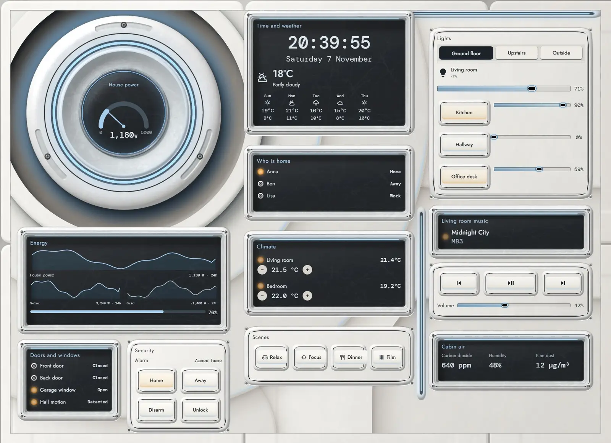
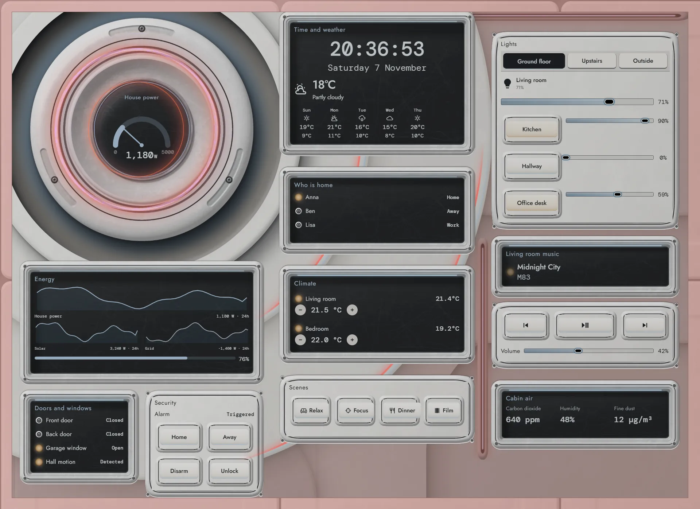
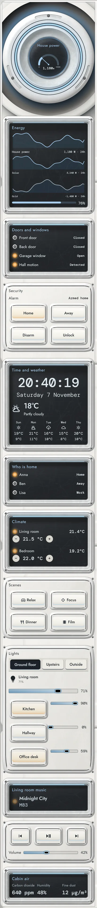

# Clean module

The home, run from the wall of a pressurised white crew module. A very large ceramic housing sits off-centre in a deep moulded dish, with the real house power gauge on its dark glass centre and a soft blue ring that pulses faster as the house draws more. Great collars and shells sweep out from it, lit low from the left, so the wall falls from pale off-white into mid-grey.

Readings sit in dark glass bays, and controls are moulded keys on white hatches with graphite text. Soft blue is the only light colour. Amber means a lamp is on, and red means alarm: the wall dims to grey and the seams and core ring turn red.







## Install

1. Copy `theme.yaml` to `/config/themes/` and make sure `configuration.yaml` has:
   ```yaml
   frontend:
     themes: !include_dir_merge_named themes
   ```
   Restart Home Assistant once, or run the action `frontend.reload_themes`.
2. Copy the pictures: the `tex` and `parts` folders of [`_assets/ceramic`](../_assets/ceramic) to `/config/www/ceramic/`. If `/config/www` is new, restart Home Assistant once.
3. Fonts: add them as a dashboard resource: Settings → Dashboards → ⋮ → Resources → Add resource, URL `https://fonts.googleapis.com/css2?family=Jost:wght@300;400;500&family=DM+Mono:wght@300;400;500&display=swap`, type Stylesheet.
4. Settings → Dashboards → Add dashboard → New dashboard from scratch. Open it, then ⋮ → Edit dashboard → ⋮ → Raw configuration editor, paste `dashboard.yaml` and save.
5. Swap the entity ids below for your own.

## Entities

| What it is | Entity |
| --- | --- |
| Lights | `light.bedroom`, `light.bedside`, `light.christmas_tree`, `light.desk`, `light.garden`, `light.hall_ceiling`, `light.hallway`, `light.kitchen`, `light.living_room`, `light.nightlight`, `light.porch` |
| Thermostats | `climate.bedroom`, `climate.living_room` |
| Alarm | `alarm_control_panel.home` |
| Locks | `lock.front_door` |
| Doors, windows and motion | `binary_sensor.back_door`, `binary_sensor.front_door`, `binary_sensor.garage_window`, `binary_sensor.hall_motion` |
| People | `person.anna`, `person.ben`, `person.lisa` |
| Sensors | `sensor.bedroom_temperature`, `sensor.co2`, `sensor.grid_power`, `sensor.home_battery`, `sensor.house_power`, `sensor.indoor_humidity`, `sensor.indoor_temperature`, `sensor.pm25`, `sensor.solar_power` |
| Weather and forecast | `weather.home` |
| Media | `media_player.living_room` |
| Scenes | `scene.dinner`, `scene.focus`, `scene.movie`, `scene.relax` |
