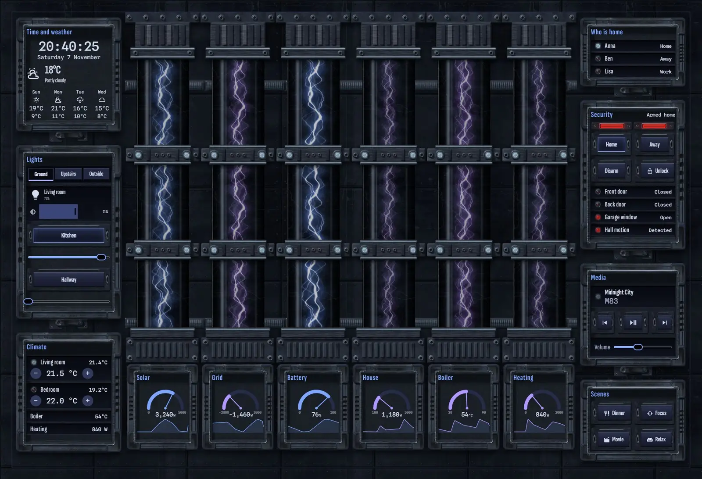
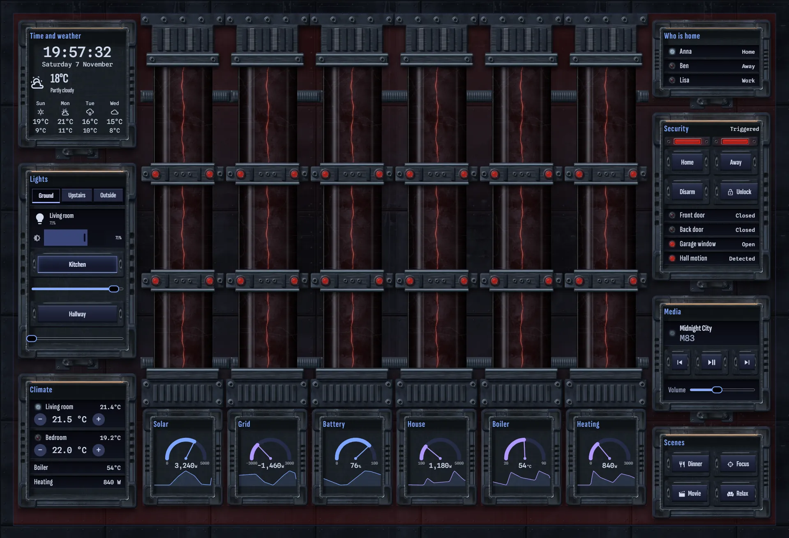
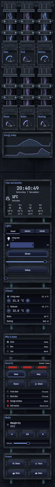

# Plasma conduits

The home, run from a power distribution hall: six full-height glass containment columns across the centre, one each for solar, grid, battery, house, boiler and heating. Each filament's thickness, brightness and speed follow that circuit's value, and grid export reverses the flow and turns the filament violet. A gauge and a 24-hour graph sit at each foot; on a phone the columns stack in threes with their gauges, and solar and house graphs follow below.

Lights and climate hang in hatches on the left wall, with time and weather above them. Who is home, security, media and scenes hang on the right wall.

When the alarm goes off, every filament collapses to a thin red thread, the clamp lamps turn red, and the hatches and the wall take on red light.

Needs `sensor.heating_power` for the heating column; swap it for your own heating circuit.







## Install

1. Copy `theme.yaml` to `/config/themes/` and make sure `configuration.yaml` has:
   ```yaml
   frontend:
     themes: !include_dir_merge_named themes
   ```
   Restart Home Assistant once, or run the action `frontend.reload_themes`.
2. Copy the pictures: the `tex` and `parts` folders of [`_assets/future`](../_assets/future) to `/config/www/future/`, and the contents of `art` to `/config/www/32-plasma-conduits/`. If `/config/www` is new, restart Home Assistant once.
3. Fonts: add them as a dashboard resource: Settings → Dashboards → ⋮ → Resources → Add resource, URL `https://fonts.googleapis.com/css2?family=Sofia+Sans+Extra+Condensed:wght@400;500;600;700&family=Spline+Sans+Mono:wght@400;500&display=swap`, type Stylesheet.
4. Settings → Dashboards → Add dashboard → New dashboard from scratch. Open it, then ⋮ → Edit dashboard → ⋮ → Raw configuration editor, paste `dashboard.yaml` and save.
5. Swap the entity ids below for your own.

## Entities

| What it is | Entity |
| --- | --- |
| Lights | `light.bedroom`, `light.bedside`, `light.christmas_tree`, `light.garden`, `light.hallway`, `light.kitchen`, `light.living_room`, `light.nightlight`, `light.porch` |
| Thermostats | `climate.bedroom`, `climate.living_room` |
| Alarm | `alarm_control_panel.home` |
| Locks | `lock.front_door` |
| Doors, windows and motion | `binary_sensor.back_door`, `binary_sensor.front_door`, `binary_sensor.garage_window`, `binary_sensor.hall_motion` |
| People | `person.anna`, `person.ben`, `person.lisa` |
| Sensors | `sensor.bedroom_temperature`, `sensor.boiler_temperature`, `sensor.grid_power`, `sensor.heating_power`, `sensor.home_battery`, `sensor.house_power`, `sensor.indoor_temperature`, `sensor.solar_power` |
| Weather and forecast | `weather.home` |
| Media | `media_player.living_room` |
| Scenes | `scene.dinner`, `scene.focus`, `scene.movie`, `scene.relax` |
