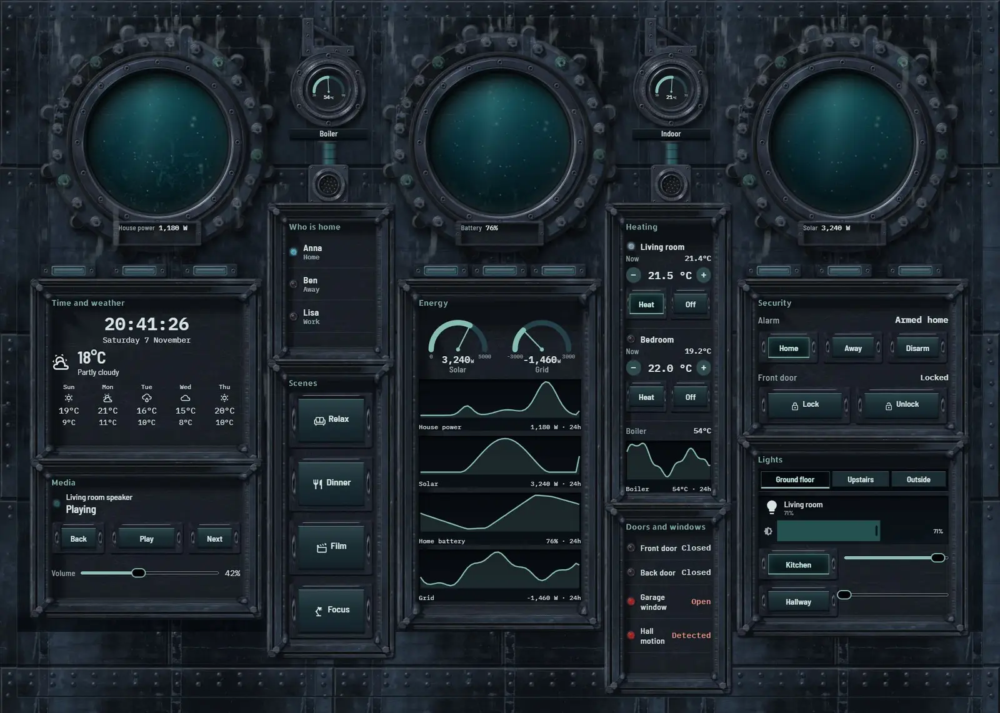
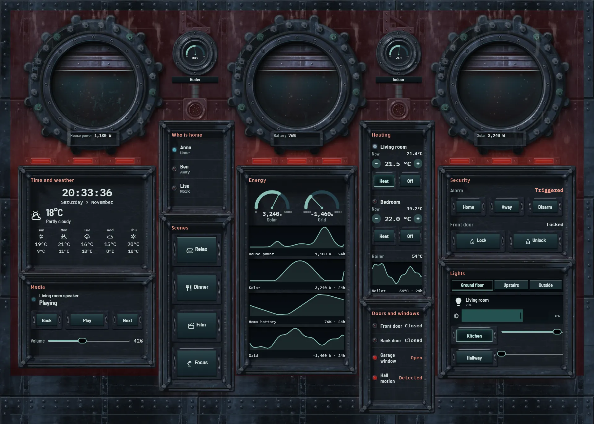
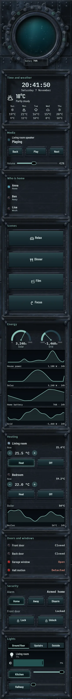

# Deep sea station

The home, run from a station on the ocean floor. A blue-black riveted pressure hull with salt crust, weeping laps and a little dull teal corrosion carries three huge portholes in bolted collars. Black water sits behind thick glass with silt drifting and slow light coming down.

Each porthole answers one real value:

- Left: the murk rolls faster as house power rises.
- Middle: the murk bank climbs the glass as the battery runs down.
- Right: the light shafts move with solar power.

Data sits in recessed inspection hatches with dogged clamps, between and below the portholes. Two real gauges for the boiler and indoor temperature are mounted in bezels in the waist between the collars.

When the alarm triggers, every hull lamp goes emergency red, the whole hull floods red, the water's light turns red and a bulkhead shutter drops part-way across each porthole.







## Install

1. Copy `theme.yaml` to `/config/themes/` and make sure `configuration.yaml` has:
   ```yaml
   frontend:
     themes: !include_dir_merge_named themes
   ```
   Restart Home Assistant once, or run the action `frontend.reload_themes`.
2. Copy the pictures: the `tex` and `parts` folders of [`_assets/future`](../_assets/future) to `/config/www/future/`, and the contents of `art` to `/config/www/34-deep-sea-station/`. If `/config/www` is new, restart Home Assistant once.
3. Fonts: add them as a dashboard resource: Settings → Dashboards → ⋮ → Resources → Add resource, URL `https://fonts.googleapis.com/css2?family=Allerta+Stencil&family=IBM+Plex+Mono:wght@400;500;600&family=Barlow+Semi+Condensed:wght@400;500;600&display=swap`, type Stylesheet.
4. Settings → Dashboards → Add dashboard → New dashboard from scratch. Open it, then ⋮ → Edit dashboard → ⋮ → Raw configuration editor, paste `dashboard.yaml` and save.
5. Swap the entity ids below for your own.

## Entities

| What it is | Entity |
| --- | --- |
| Lights | `light.bedroom`, `light.bedside`, `light.garden`, `light.hall_ceiling`, `light.hallway`, `light.kitchen`, `light.living_room`, `light.porch` |
| Thermostats | `climate.bedroom`, `climate.living_room` |
| Alarm | `alarm_control_panel.home` |
| Locks | `lock.front_door` |
| Doors, windows and motion | `binary_sensor.back_door`, `binary_sensor.front_door`, `binary_sensor.garage_window`, `binary_sensor.hall_motion` |
| People | `person.anna`, `person.ben`, `person.lisa` |
| Sensors | `sensor.bedroom_temperature`, `sensor.boiler_temperature`, `sensor.grid_power`, `sensor.home_battery`, `sensor.house_power`, `sensor.indoor_temperature`, `sensor.solar_power` |
| Weather and forecast | `weather.home` |
| Media | `media_player.living_room` |
| Scenes | `scene.dinner`, `scene.focus`, `scene.movie`, `scene.relax` |
