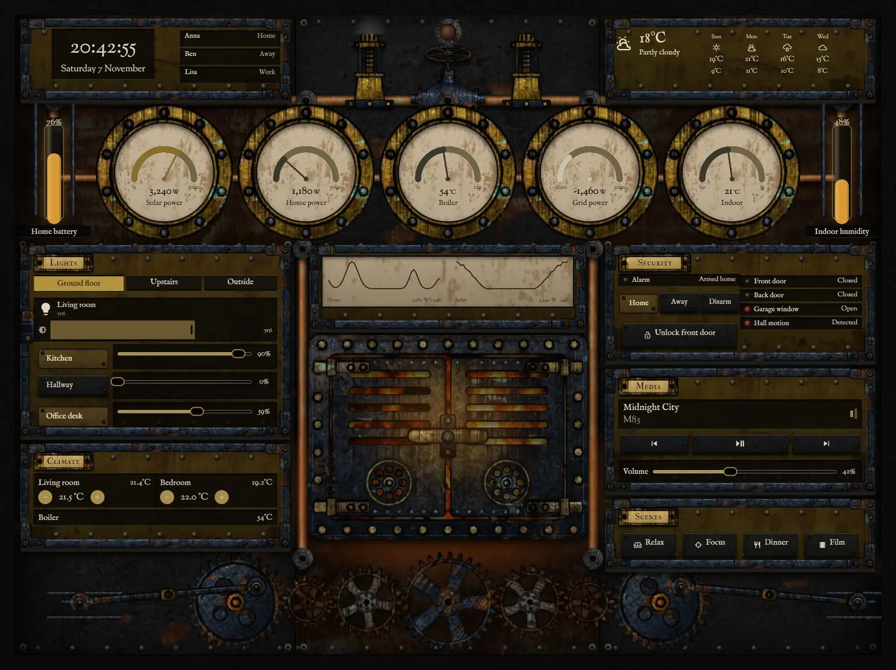
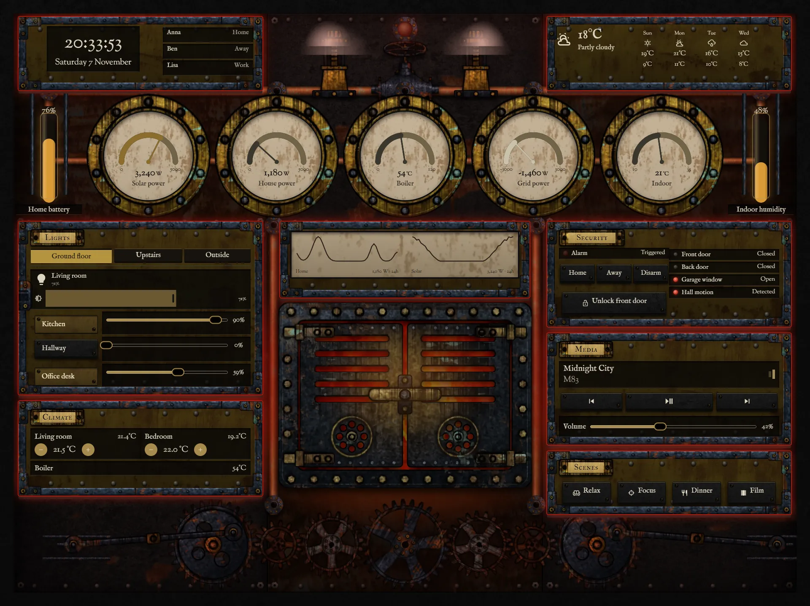
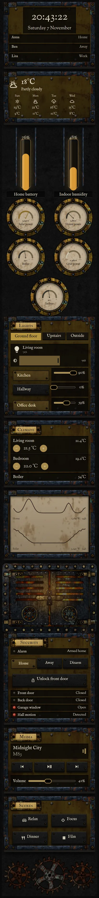

# Locomotive cab

The home, run from the footplate of an old steam locomotive, facing the backhead: blackened iron, rubbed brass, grease, coal dust and heat stains. The layout is symmetrical round the firebox door, with the driver's side on the left and the fireman's side on the right.







## What moves

- The fire shows through real holes in the door. Its brightness, and the light it throws on the plates, follow `sensor.boiler_temperature`.
- The gears, cranks, rods and crossheads run faster as `sensor.house_power` rises.
- The gauge glasses are real vertical `bar` modules for `sensor.home_battery` and `sensor.indoor_humidity`.
- When `alarm_control_panel.home` is triggered, the fire flares red, the whistle-valve lamp flashes, steam jets from both safety valves, the wall shakes and takes a red wash, and every plate gets a red rim.

## Install

1. Copy `theme.yaml` to `/config/themes/` and make sure `configuration.yaml` has:
   ```yaml
   frontend:
     themes: !include_dir_merge_named themes
   ```
   Restart Home Assistant once, or run the action `frontend.reload_themes`.
2. Copy the pictures: the `tex` and `parts` folders of [`_assets/steam`](../_assets/steam) to `/config/www/steam/`, and the contents of `art` to `/config/www/37-locomotive-cab/`. If `/config/www` is new, restart Home Assistant once.
3. Fonts: add them as a dashboard resource: Settings → Dashboards → ⋮ → Resources → Add resource, URL `https://fonts.googleapis.com/css2?family=IM+Fell+Double+Pica+SC&family=IM+Fell+English&family=Sorts+Mill+Goudy&display=swap`, type Stylesheet.
4. Settings → Dashboards → Add dashboard → New dashboard from scratch. Open it, then ⋮ → Edit dashboard → ⋮ → Raw configuration editor, paste `dashboard.yaml` and save.
5. Swap the entity ids below for your own.

## Entities

| What it is | Entity |
| --- | --- |
| Lights | `light.bedroom`, `light.bedside`, `light.christmas_tree`, `light.desk`, `light.garden`, `light.hall_ceiling`, `light.hallway`, `light.kitchen`, `light.living_room`, `light.nightlight`, `light.porch` |
| Thermostats | `climate.bedroom`, `climate.living_room` |
| Alarm | `alarm_control_panel.home` |
| Locks | `lock.front_door` |
| Doors, windows and motion | `binary_sensor.back_door`, `binary_sensor.front_door`, `binary_sensor.garage_window`, `binary_sensor.hall_motion` |
| People | `person.anna`, `person.ben`, `person.lisa` |
| Sensors | `sensor.bedroom_temperature`, `sensor.boiler_temperature`, `sensor.grid_power`, `sensor.home_battery`, `sensor.house_power`, `sensor.indoor_humidity`, `sensor.indoor_temperature`, `sensor.solar_power` |
| Weather and forecast | `weather.home` |
| Media | `media_player.living_room` |
| Scenes | `scene.dinner`, `scene.focus`, `scene.movie`, `scene.relax` |
