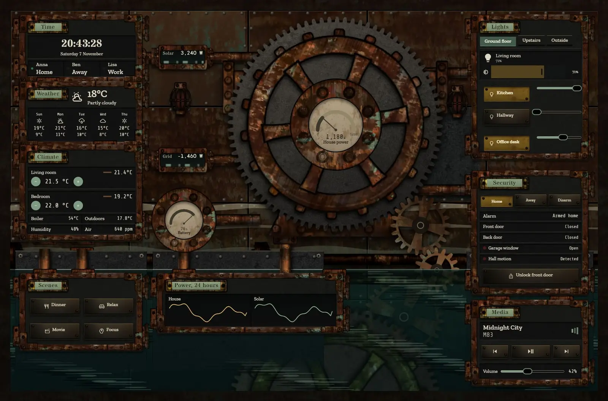
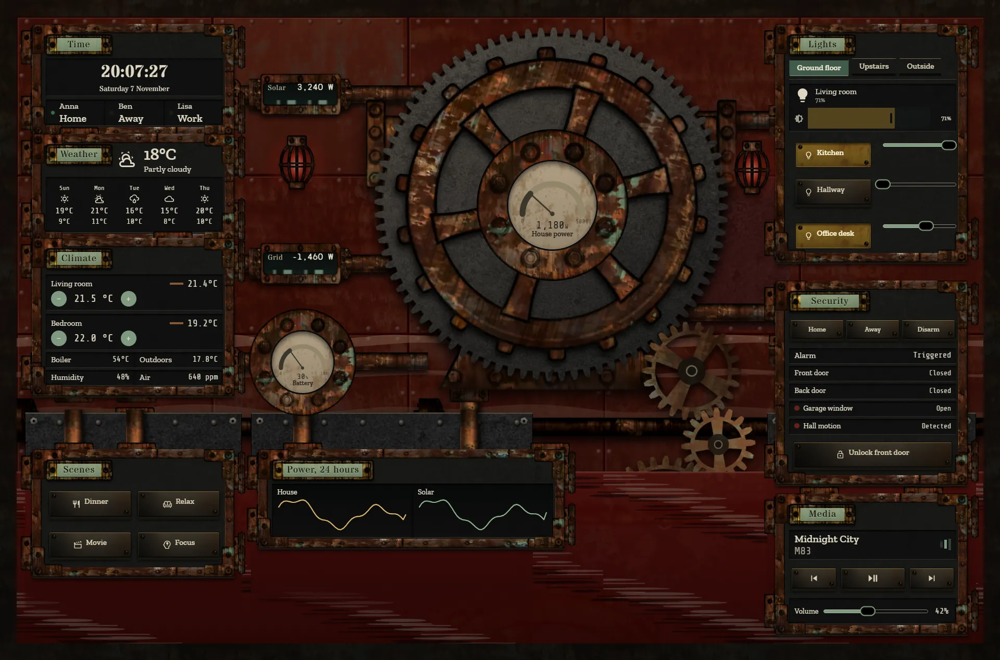
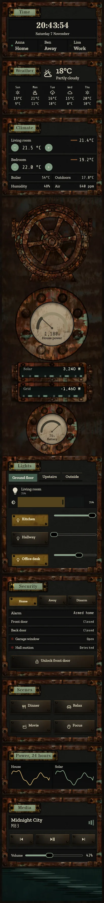

# Flooded pump house

The home, run from a half-flooded Victorian pumping station. An enormous valve wheel on a toothed bull gear fills the centre of a corroded iron wall, and the lower third of the wall stands in dark water, with the bottom hatches on iron plinths.







## What moves and why

- The valve wheel turns with solar power, and its bull gear drives a meshed gear train down into the water.
- Solar and grid show through windows set into their pipes, moving at a speed set by their sensor. Grid flow reverses when you export. House power is the dial on the wheel, and the battery has its own dial.
- The waterline follows the home battery: it rises and falls with the charge, with slow ripples and a live reflection of the machine in the surface.
- When the alarm is triggered, the caged red lamps come on, the wall reddens, the water turns dark red and the mains shudder slowly.

## SVG files

The `svg` folder holds a copy of every drawing on this dashboard (backgrounds), so you can open them in a vector editor or use them elsewhere. You don't need the folder to install the dashboard, because `dashboard.yaml` already contains the same SVG.

## Install

1. Copy `theme.yaml` to `/config/themes/` and make sure `configuration.yaml` has:
   ```yaml
   frontend:
     themes: !include_dir_merge_named themes
   ```
   Restart Home Assistant once, or run the action `frontend.reload_themes`.
2. Copy the pictures: the `tex` and `parts` folders of [`_assets/steam`](../_assets/steam) to `/config/www/steam/`, and the contents of `art` to `/config/www/38-flooded-pump-house/`. If `/config/www` is new, restart Home Assistant once.
3. Fonts: add them as a dashboard resource: Settings → Dashboards → ⋮ → Resources → Add resource, URL `https://fonts.googleapis.com/css2?family=Stardos+Stencil:wght@400;700&family=Zilla+Slab:wght@500;600&family=Share+Tech+Mono&family=Syne+Mono&display=swap`, type Stylesheet.
4. Settings → Dashboards → Add dashboard → New dashboard from scratch. Open it, then ⋮ → Edit dashboard → ⋮ → Raw configuration editor, paste `dashboard.yaml` and save.
5. Swap the entity ids below for your own.

## Entities

| What it is | Entity |
| --- | --- |
| Lights | `light.bedroom`, `light.bedside`, `light.christmas_tree`, `light.desk`, `light.garden`, `light.hall_ceiling`, `light.hallway`, `light.kitchen`, `light.living_room`, `light.nightlight`, `light.porch` |
| Thermostats | `climate.bedroom`, `climate.living_room` |
| Alarm | `alarm_control_panel.home` |
| Locks | `lock.front_door` |
| Doors, windows and motion | `binary_sensor.back_door`, `binary_sensor.front_door`, `binary_sensor.garage_window`, `binary_sensor.hall_motion` |
| People | `person.anna`, `person.ben`, `person.lisa` |
| Sensors | `sensor.bedroom_temperature`, `sensor.boiler_temperature`, `sensor.co2`, `sensor.grid_power`, `sensor.home_battery`, `sensor.house_power`, `sensor.indoor_humidity`, `sensor.indoor_temperature`, `sensor.outdoor_temperature`, `sensor.solar_power` |
| Weather and forecast | `weather.home` |
| Media | `media_player.living_room` |
| Scenes | `scene.dinner`, `scene.focus`, `scene.movie`, `scene.relax` |
