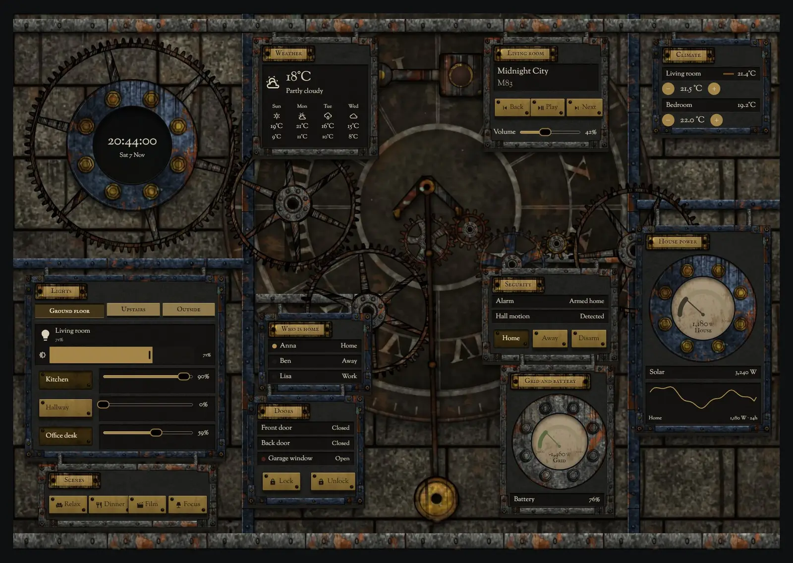
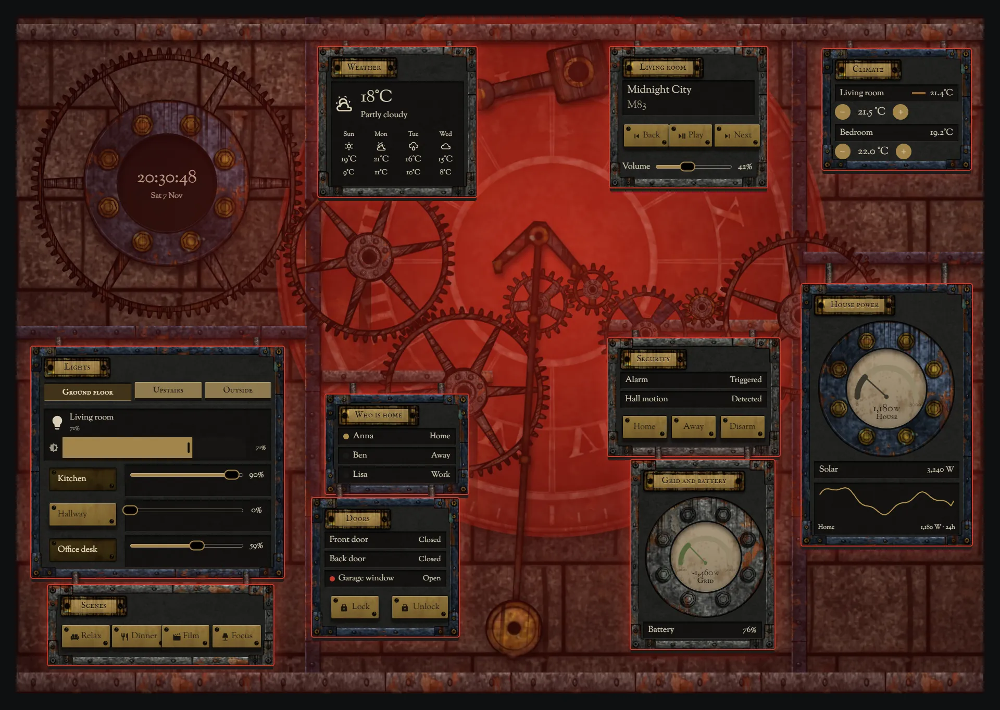
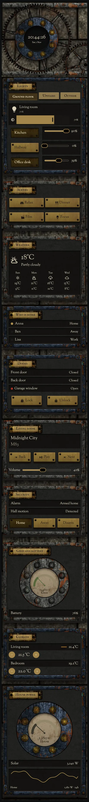

# Tower escapement

The home, run from inside the mechanism room of an old clock tower: tarnished brass wheels on dark iron frames, pigeon-stained stone, old grease and dust in the light from the back of the clock face. It is one card.







## What is on it

- Eight meshing wheels whose speed follows house power, and a pendulum on a real two-second beat, which is a four-second full swing.
- The real `clock` module in a dark enamel window on the great wheel, with weather, forecast, who is home, lights in tabs, climate, security, doors, media, scenes and energy on plates hung between the wheels.
- Daylight through the clock face follows `sun.sun`.

## Alarm

The striking hammer lamp flashes, every wheel and the pendulum stop, and red light comes through the clock face across the whole wall.

## Install

1. Copy `theme.yaml` to `/config/themes/` and make sure `configuration.yaml` has:
   ```yaml
   frontend:
     themes: !include_dir_merge_named themes
   ```
   Restart Home Assistant once, or run the action `frontend.reload_themes`.
2. Copy the pictures: the `tex` and `parts` folders of [`_assets/steam`](../_assets/steam) to `/config/www/steam/`, and the contents of `art` to `/config/www/39-tower-escapement/`. If `/config/www` is new, restart Home Assistant once.
3. Fonts: add them as a dashboard resource: Settings → Dashboards → ⋮ → Resources → Add resource, URL `https://fonts.googleapis.com/css2?family=IM+Fell+English+SC&family=Sorts+Mill+Goudy&display=swap`, type Stylesheet.
4. Settings → Dashboards → Add dashboard → New dashboard from scratch. Open it, then ⋮ → Edit dashboard → ⋮ → Raw configuration editor, paste `dashboard.yaml` and save.
5. Swap the entity ids below for your own.

## Entities

| What it is | Entity |
| --- | --- |
| Lights | `light.bedroom`, `light.bedside`, `light.christmas_tree`, `light.desk`, `light.garden`, `light.hall_ceiling`, `light.hallway`, `light.kitchen`, `light.living_room`, `light.nightlight`, `light.porch` |
| Thermostats | `climate.bedroom`, `climate.living_room` |
| Alarm | `alarm_control_panel.home` |
| Locks | `lock.front_door` |
| Doors, windows and motion | `binary_sensor.back_door`, `binary_sensor.front_door`, `binary_sensor.garage_window`, `binary_sensor.hall_motion` |
| People | `person.anna`, `person.ben`, `person.lisa` |
| Sensors | `sensor.bedroom_temperature`, `sensor.grid_power`, `sensor.home_battery`, `sensor.house_power`, `sensor.indoor_temperature`, `sensor.solar_power` |
| Weather and forecast | `weather.home` |
| Media | `media_player.living_room` |
| Scenes | `scene.dinner`, `scene.focus`, `scene.movie`, `scene.relax` |
