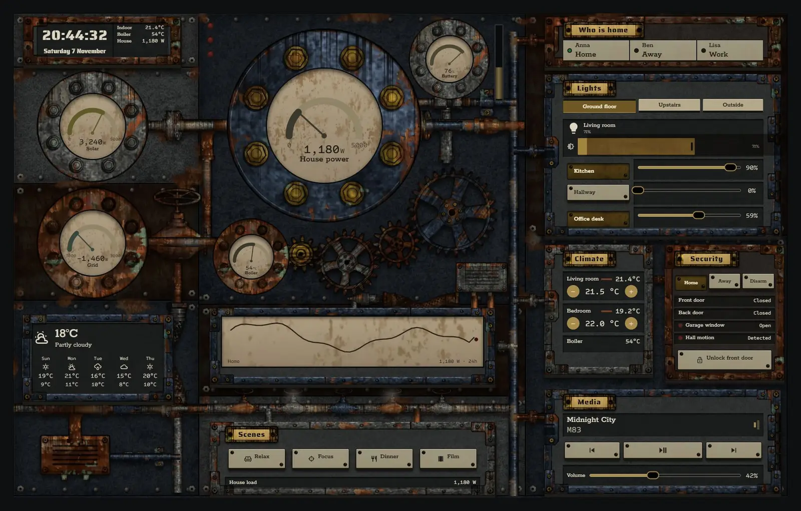
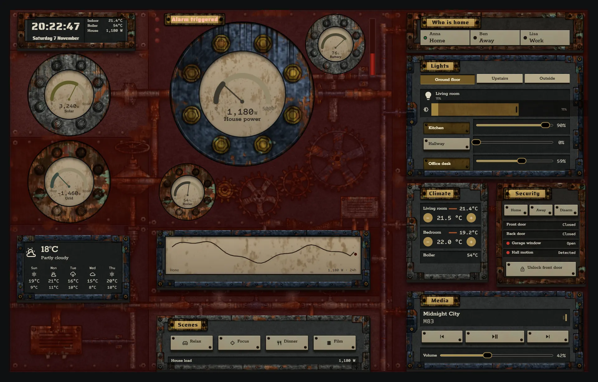
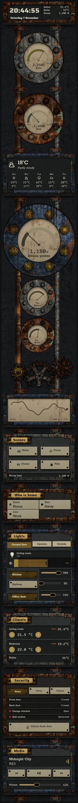

# Boiler house

The whole home, run from one old boiler house: soot-black and grey iron plates, rust at the seams and bolts, and worn brass only where hands touch. It is one card. Pulses move through the pipes from the solar and grid plates to the house, gears turn at a speed set by house power, and the gauge needles follow their sensors.







## What's on it

- House power, solar, grid, battery and boiler on `gauge` modules in bolted flanges, with a 24-hour `graphs` chart.
- A meshing gear train whose speed follows house power, and pipe pulses whose speed follows solar, grid and house power.
- Clock, weather and forecast, and who is home.
- Lights in tabs (Ground floor, Upstairs, Outside), climate with spinboxes, media with transport buttons and volume, and scenes.
- Security with arm and disarm buttons, door sensors and the front door lock. When the alarm is triggered, the lamps turn red, the sight glass fills with red, the house power flange shakes and the gears run faster.

## Install

1. Copy `theme.yaml` to `/config/themes/` and make sure `configuration.yaml` has:
   ```yaml
   frontend:
     themes: !include_dir_merge_named themes
   ```
   Restart Home Assistant once, or run the action `frontend.reload_themes`.
2. Copy the pictures: the `tex` and `parts` folders of [`_assets/steam`](../_assets/steam) to `/config/www/steam/`. If `/config/www` is new, restart Home Assistant once.
3. Fonts: add them as a dashboard resource: Settings → Dashboards → ⋮ → Resources → Add resource, URL `https://fonts.googleapis.com/css2?family=Rokkitt:wght@400;500;600&family=Saira+Stencil+One&family=Sometype+Mono:wght@400;500&display=swap`, type Stylesheet.
4. Settings → Dashboards → Add dashboard → New dashboard from scratch. Open it, then ⋮ → Edit dashboard → ⋮ → Raw configuration editor, paste `dashboard.yaml` and save.
5. Swap the entity ids below for your own.

## Entities

| What it is | Entity |
| --- | --- |
| Lights | `light.bedroom`, `light.bedside`, `light.christmas_tree`, `light.desk`, `light.garden`, `light.hall_ceiling`, `light.hallway`, `light.kitchen`, `light.living_room`, `light.nightlight`, `light.porch` |
| Thermostats | `climate.bedroom`, `climate.living_room` |
| Alarm | `alarm_control_panel.home` |
| Locks | `lock.front_door` |
| Doors, windows and motion | `binary_sensor.back_door`, `binary_sensor.front_door`, `binary_sensor.garage_window`, `binary_sensor.hall_motion` |
| People | `person.anna`, `person.ben`, `person.lisa` |
| Sensors | `sensor.bedroom_temperature`, `sensor.boiler_temperature`, `sensor.grid_power`, `sensor.home_battery`, `sensor.house_power`, `sensor.indoor_temperature`, `sensor.solar_power` |
| Weather and forecast | `weather.home` |
| Media | `media_player.living_room` |
| Scenes | `scene.dinner`, `scene.focus`, `scene.movie`, `scene.relax` |
