# Complete dashboards

Twenty-five complete dashboards for Home Assistant. Each is a sections view built only from Magic Cards, with a matching theme. There are five each for sci-fi, fantasy, western, steampunk and dystopian homes. Every dashboard covers a header, weather, climate, lights, security, energy, media and who is home, plus a few cards that suit its setting.

Each folder has the dashboard YAML to paste into the raw configuration editor, the theme file, the font stylesheet where one is needed, and a README with the install steps and the entities it uses. The entity ids are placeholders: change them to your own.

Back to the [card gallery](../README.md).

## Sci-fi

| | Dashboard |
| --- | --- |
| [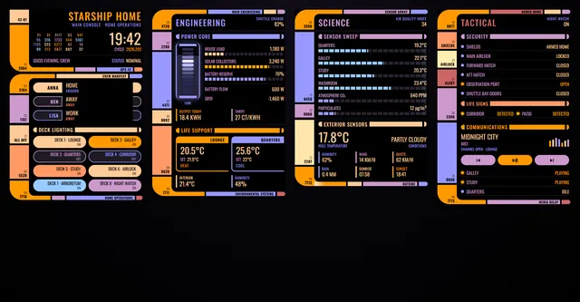](01-starship-bridge/README.md) | [Starship bridge](01-starship-bridge/README.md) A home dashboard made to look like a starship's bridge console. It is one sections view with four columns (Bridge, Engineering, Science, Tactical) and 12 Magic Cards. Each card is a console panel: a column of coloured blocks on the left, readouts on the right, and rounded elbows where a section's frame opens and closes. The gaps between cards line up with the gaps between the sidebar blocks, so the view reads as one console. When the alarm goes off, every panel turns red and blinks. |
| [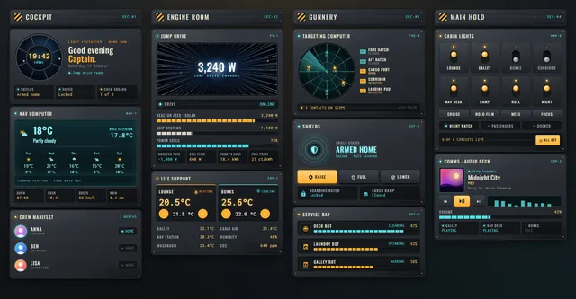](02-freighter-cockpit/README.md) | [Freighter cockpit](02-freighter-cockpit/README.md) A Home Assistant dashboard styled as the cockpit of a battered old light freighter. The panels are brushed gunmetal with rivets and scuffs, the indicator lamps are amber and the readouts are teal holo screens. It is one sections view with four sections and 14 cards, all Magic Cards. When the solar panels produce, the jump-drive viewport fills with star streaks. |
| [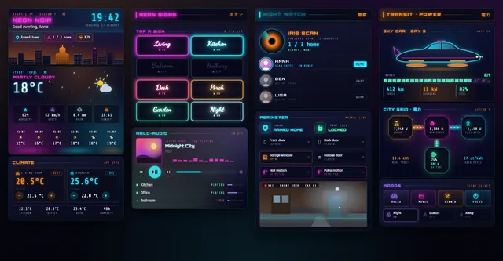](03-neon-noir/README.md) | [Neon noir](03-neon-noir/README.md) A Home Assistant dashboard for a city flat on a rainy night: deep navy glass, magenta and cyan neon, and a sodium-orange haze over the skyline. It is one sections view of 13 Magic Cards. Rain runs down the weather card, the light switches are neon signs that flicker when lit, and people at home show up on an iris scanner. |
| [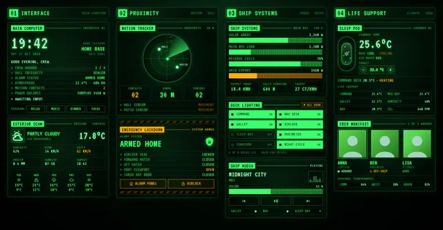](04-crt-terminal/README.md) | [CRT terminal](04-crt-terminal/README.md) A Home Assistant dashboard styled as an old ship's computer terminal: green phosphor text on black CRT glass, scanlines, a slow flicker, inverse-video title tabs, and amber for anything that needs attention. It is one sections view with 13 Magic Cards, including a motion tracker that pings for each motion sensor that is on. |
| [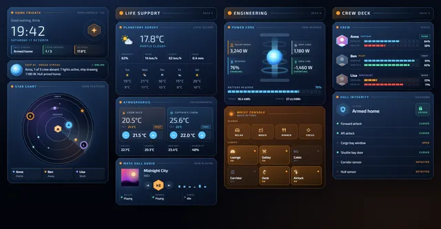](05-frigate-console/README.md) | [Frigate console](05-frigate-console/README.md) A Home Assistant dashboard styled as the combat information centre of a deep-space frigate. Panels are blue-white glass with cut corners and hairline frames on deep-space black. Orange marks anything you can tap. It is one sections view of 13 Magic Cards in four columns, with a star chart that shows who is home as markers on orbits. |

## Fantasy

| | Dashboard |
| --- | --- |
| [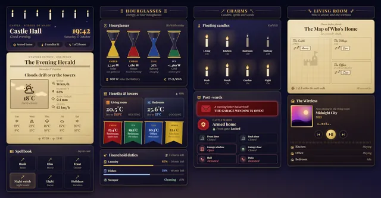](06-castle-hall/README.md) | [Castle Hall](06-castle-hall/README.md) A wizard-school dashboard for Home Assistant, made from 13 Magic Cards in one sections view. It is set in a castle hall at night, with a starry ceiling, floating candles, parchment and ink, four house colours, wax seals and gilded frames. The hero shows the time, a greeting and chips for the alarm, lights and people at home. Weather is printed as a newspaper front page with a sepia picture and a 5-day forecast. Scenes are spells you tap to cast, energy fills four hourglasses, and the thermostats sit next to four room banners. The lights are floating candles that flicker when on. Security shows a red warning letter when a door or window is open, and otherwise reads "All quiet". A parchment map shows who is home, in the village or elsewhere. There is also a wireless set for media and a list of household duties. |
| [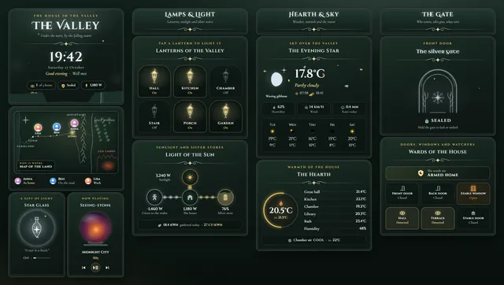](07-moonlit-valley/README.md) | [Moonlit Valley](07-moonlit-valley/README.md) A Home Assistant dashboard set in a valley at night, with silver filigree, sage and forest green, and autumn gold. It is one sections view built only from Magic Cards: 13 cards in four sections. It comes with a matching theme called Moonlit Valley. |
| [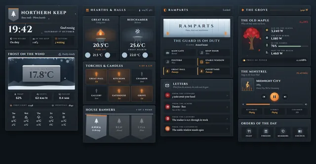](08-northern-keep/README.md) | [Northern Keep](08-northern-keep/README.md) A Home Assistant dashboard set in a cold castle in the north: grey granite, iron, frost and braziers full of embers. It is one sections view of 14 Magic Cards, with a matching theme called Northern Keep. Fires flicker in the braziers while a room heats, torches light up with the lights, snow falls over the header, and the people's banners sway while they are home. |
| [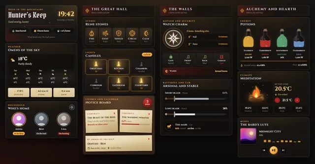](09-hunters-keep/README.md) | [Hunter's Keep](09-hunters-keep/README.md) A dark-fantasy dashboard for Home Assistant, built from 14 Magic Cards in one sections view. It is dressed as a beast hunter's keep in the mountains: weathered leather and dark steel, blood-red and silver trim, amber runes and parchment notices pinned to a board. The theme is called Mountain Keep. |
| [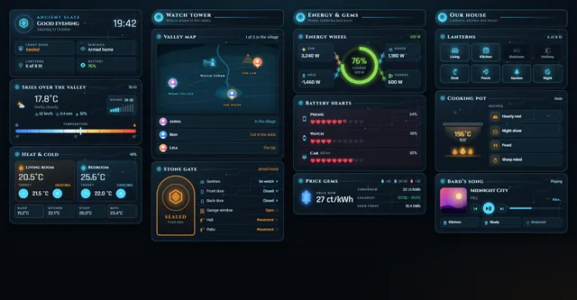](10-ancient-slate/README.md) | [Ancient Slate](10-ancient-slate/README.md) A fantasy dashboard styled as an old stone tablet that still glows: dark blue-black panels, cyan circuit lines and amber accents, with a hexagon rune on every card. It is one sections view with 14 Magic Cards (three section headings and eleven content cards). It covers weather, climate, a map of who is where, security, energy, device batteries, the energy price, lights, the oven and music. |

## Western

| | Dashboard |
| --- | --- |
| [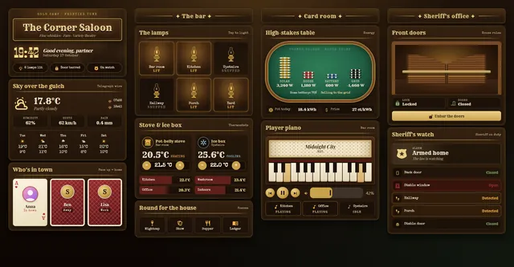](11-frontier-saloon/README.md) | [Frontier Saloon](11-frontier-saloon/README.md) A Home Assistant dashboard styled as a saloon in a gold-rush town: dark polished wood, brass rails, green felt and oil-lamp light. It is one sections view with 13 Magic Cards and a matching theme called "Frontier Saloon". |
| [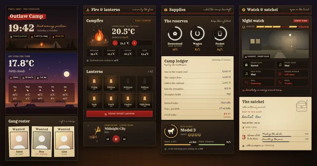](12-outlaw-camp/README.md) | [Outlaw Camp](12-outlaw-camp/README.md) A western camp dashboard set at dusk: canvas and campfire light, journal pages and red ink. It is one Home Assistant sections view with 14 Magic Cards and a matching theme called Outlaw Camp. |
| [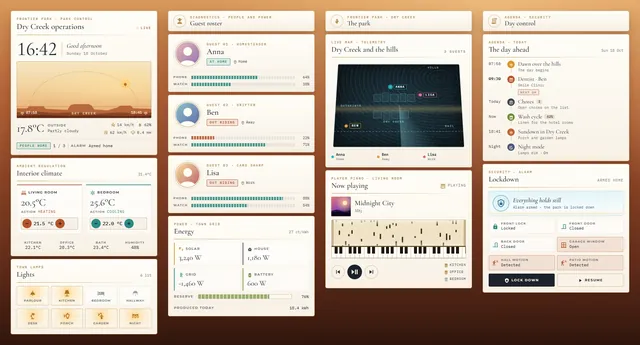](13-park-control/README.md) | [Park Control](13-park-control/README.md) A Home Assistant sections dashboard built only from Magic Cards. It sets a home up as the control room of a Wild West theme park, with a matching theme called "Park Control". The cards are white glass with thin gold lines, laid over a sun-baked desert. Headings use Cormorant Garamond, labels Montserrat and readouts IBM Plex Mono. |
| [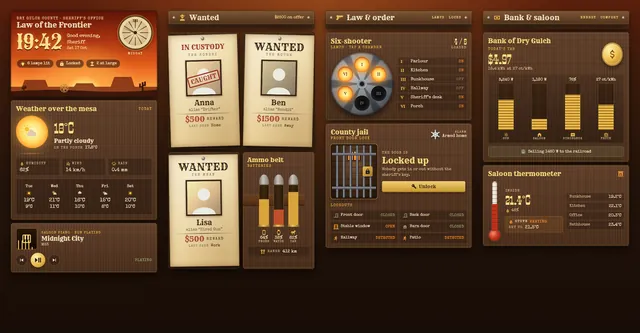](14-sheriff-office/README.md) | [Sheriff's office](14-sheriff-office/README.md) A spaghetti-western dashboard for Home Assistant: one sections view built only from Magic Cards, with a matching theme called "Frontier Sheriff". It shows a sun-bleached sheriff's office on the frontier. Weather sits under a blazing orange sky, the household hangs as wanted posters on the board, six lamps sit in a revolver cylinder, the front door is a jail cell, and the energy bill is paid in gold coins. A tumbleweed rolls along the bottom of the header. |
| [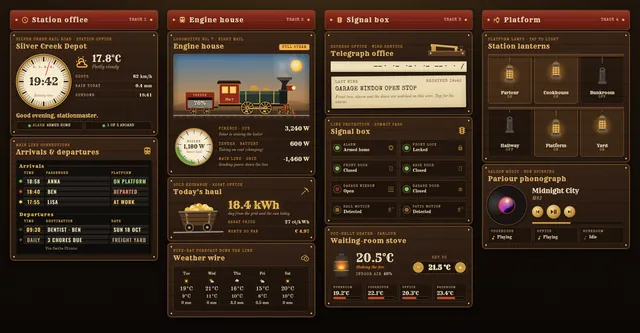](15-railroad-depot/README.md) | [Railroad Depot](15-railroad-depot/README.md) A Home Assistant dashboard set in a gold-rush railroad depot at night. The station master's office has walnut planks, brass rivets and lantern light. It is one sections view with 14 Magic Cards and a matching theme called "Railroad Depot". |

## Steampunk

| | Dashboard |
| --- | --- |
| [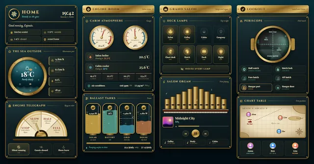](16-brass-submarine/README.md) | [Brass submarine](16-brass-submarine/README.md) A Home Assistant sections dashboard styled as an old brass submarine, with riveted iron plates, a porthole onto a teal sea and a pipe organ in the salon. All 12 cards are Magic Cards (`custom:magic-card`), in four sections. The bridge has the brass name plate with clock, greeting and status line, a porthole where the weather is the sea outside (waves, bubbles and two passing fish), and an engine order telegraph for scenes. The engine room has dial gauges for temperature and humidity whose needles follow the sensors, the two thermostats, cabin temperatures, air quality and four ballast tanks for solar, battery, grid and house load. The grand salon has eight deck lamps you tap to switch, a button that turns them all off, and the organ for media, whose pipes glow and send up notes while the speaker plays. The lookout has a periscope over the front door camera, with motion shown as blips, six watch tiles for alarm, lock, doors, window and garage, and a chart table that pins each person aboard, at sea or in port. |
| [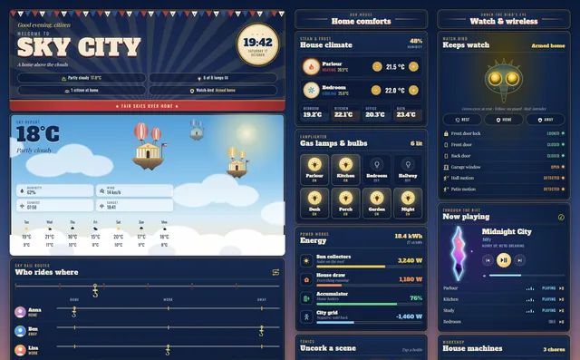](17-sky-city/README.md) | [Sky City](17-sky-city/README.md) A Home Assistant dashboard set in a city of buildings floating on balloons above the clouds. It is one sections view made only of Magic Cards, with a matching theme called Sky City: navy enamel cards with gilt edges, cream slab-serif type, red, white and blue bunting, and a golden-hour sky behind it all. |
| [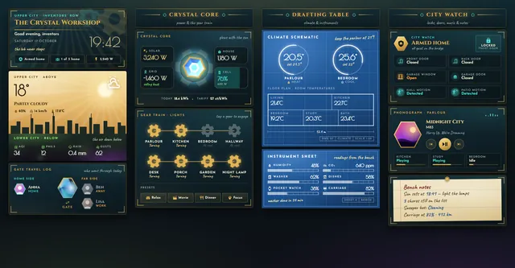](18-crystal-workshop/README.md) | [Crystal Workshop](18-crystal-workshop/README.md) An inventor's workshop in a gold-and-teal art deco city, with green and purple smog drifting through the streets below. It is one sections view of 13 Magic Cards and a matching theme. The header has turning brass gears. The weather card is split between the bright upper city and the smoggy lower city. An energy crystal spins faster in strong sun, and the lights are a row of gears you tap to turn. |
| [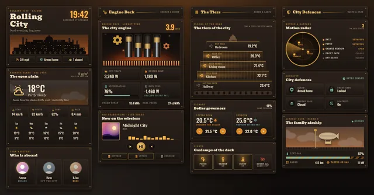](19-rolling-city/README.md) | [Rolling City](19-rolling-city/README.md) A Home Assistant dashboard dressed as a city on caterpillar tracks: soot, brass, iron tiers and a furnace that never goes out. It is one sections view with 14 Magic Cards and a matching theme, Soot and Brass. The theme is dark only. |
| [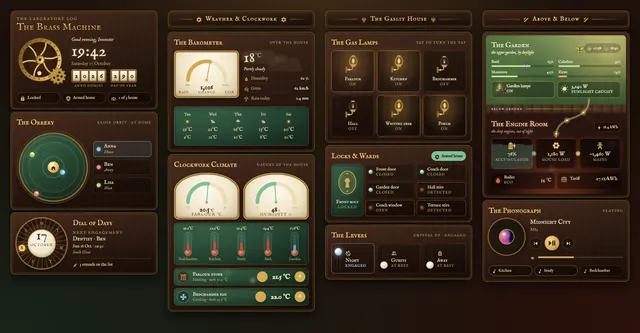](20-brass-laboratory/README.md) | [Brass Laboratory](20-brass-laboratory/README.md) A Victorian inventor's laboratory by gaslight: mahogany panels, green leather, brass dials and crystal levers. It is one sections view built only from Magic Cards (`custom:magic-card`), with a matching dark theme called "Brass Laboratory". The header holds a brass machine with turning cogs, a clock and odometer counters for the year and the day of the year. Below it are an orrery for the people at home, a dial of days for the calendar, an aneroid barometer for the weather, clockwork climate dials and thermometers, gas lamps for the lights, keyhole plates and warning lights for security, crystal levers for house modes, a garden-and-engine-room card for plants and energy, and a phonograph for media. |

## Dystopian

| | Dashboard |
| --- | --- |
| [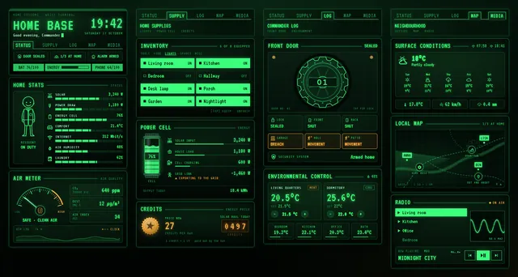](21-home-base/README.md) | [Home Base: a green terminal dashboard](21-home-base/README.md) A Home Assistant sections dashboard built only from Magic Cards. It looks like an old wrist terminal in an underground shelter: green phosphor on dark glass, scanlines, amber for warnings, and a tab bar heading each section. The theme is called Green Terminal. |
| [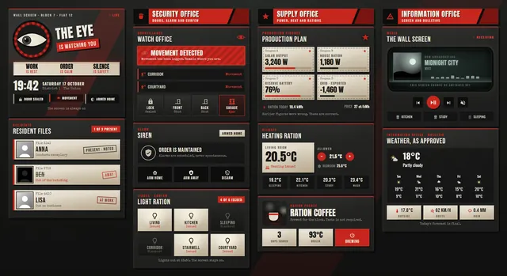](22-concrete-broadcast/README.md) | [Block 7: a wall-screen dashboard](22-concrete-broadcast/README.md) A Home Assistant sections dashboard built only from Magic Cards. It looks like the wall screen in a flat in a grim concrete housing block: brutalist grey, poster red and black, cream ration paper and a grey-green CRT glow. The header has a watching eye whose iris looks left and right and blinks now and then in front of slowly turning red rays, three slogans, a big clock and status chips. Residents get stamped files, motion becomes a red "Movement detected" banner, and a triggered alarm turns its card red with a shaking title. Energy comes as ration coupons, the coffee machine steams while it's on, and the media player sits on a flickering screen with scanlines. The theme is called Concrete Broadcast. |
| [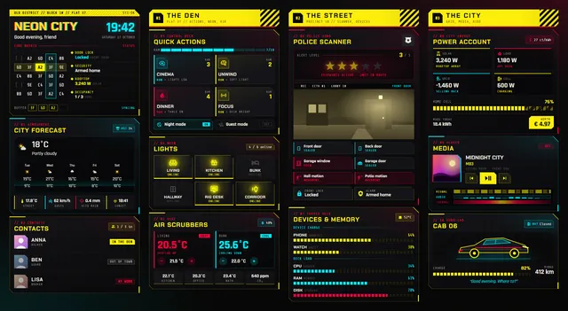](23-neon-city/README.md) | [Neon City: a hacker's den dashboard](23-neon-city/README.md) A Home Assistant sections dashboard built only from Magic Cards, set in a hacker's flat in a tower block. Acid yellow, hot red and cyan on black, with cut-corner panels, hazard stripes, segmented bars and the odd glitch. The hero has a glitching title, a clock and a code matrix with four status slots (lock, alarm, solar, people home). Below it sit a weather card and the household as contacts. The den section has four scene tiles with switches for night and guest mode, six light tiles and the thermostats. The street section has a police scanner whose alert level (one to five stars) counts tripped doors, windows and motion sensors, a camera snapshot and the device batteries and server load as segmented bars. The city section shows solar, load, grid and battery power with today's value in euros, the media player with visual, audio and thermal layer tracks, and the car with its charge, range and garage bay. |
| [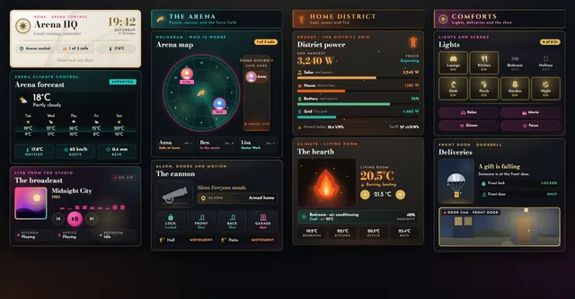](24-arena-control/README.md) | [Arena Control](24-arena-control/README.md) A Home Assistant sections dashboard built only from Magic Cards, dressed as the control room of a televised arena. Two looks share the screen: white marble, gold and loud magenta and teal broadcast light for the show, and coal grey and ember orange for the home district. A holographic arena map shows who is at home and who is out. An alarm fires a cannon, the thermostat burns as a flame, and the doorbell drops a silver parachute. The theme is called Arena Control. |
| [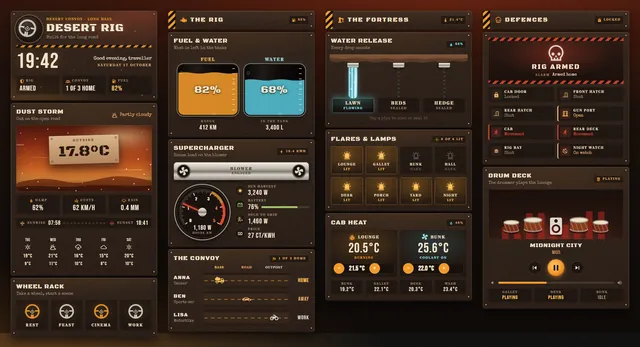](25-desert-rig/README.md) | [Desert Rig](25-desert-rig/README.md) A Home Assistant sections dashboard built only from Magic Cards. It looks like the cab of a tanker truck crossing an orange desert: rusted, riveted steel plates, hazard stripes, chrome, stencilled lettering and a red dust storm on the horizon. The fuel and water tanks fill with your car battery and water tank levels. A dial and two blowers follow the house load, three pipes in a cliff pour water while the irrigation runs, and a row of drums thumps along while music plays. The theme is called Desert Rig. |
