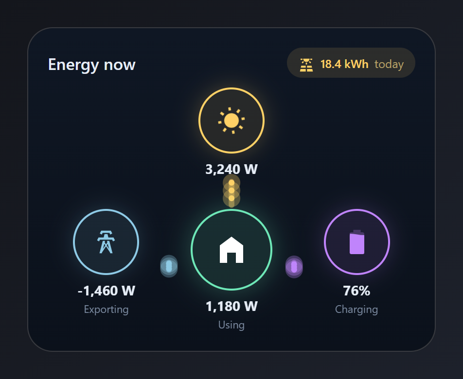
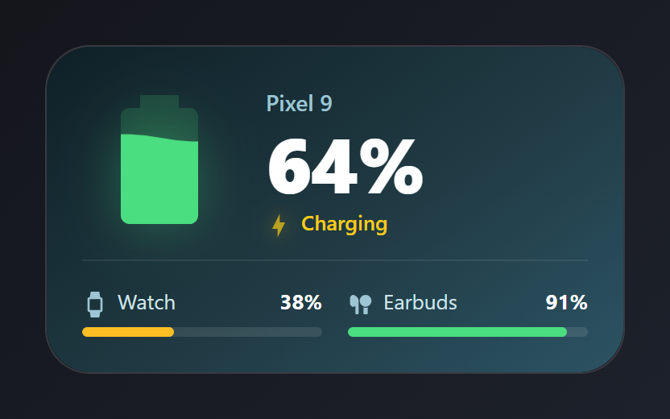
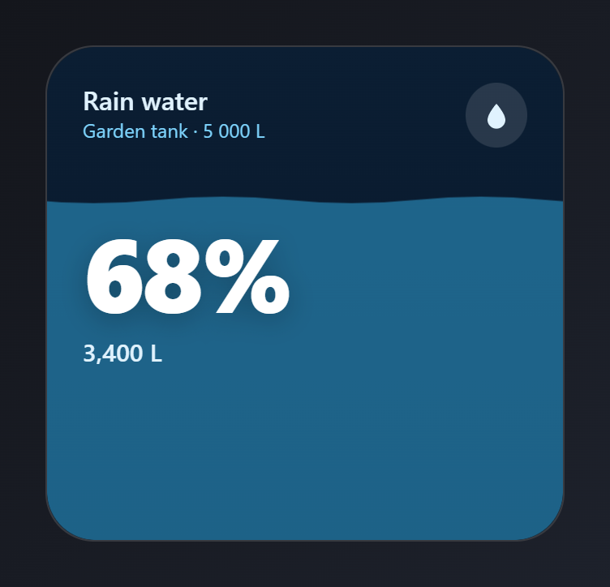
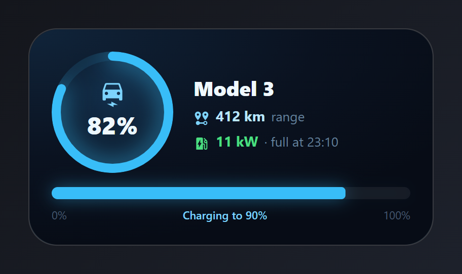
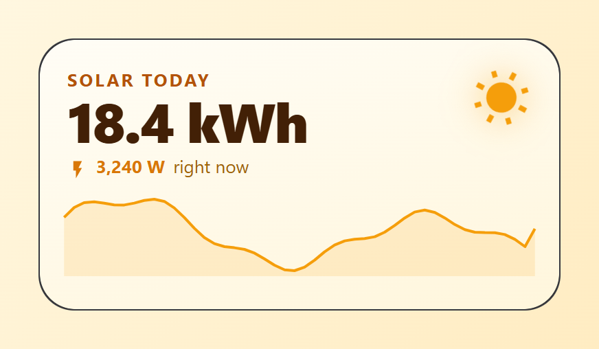
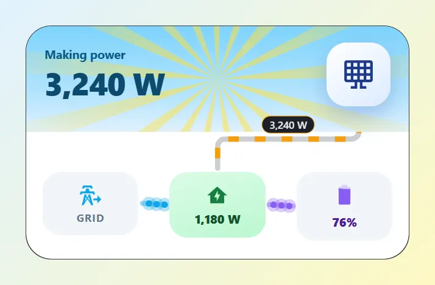
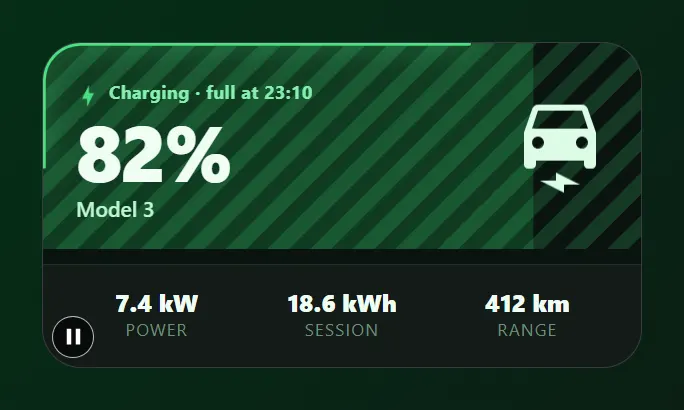
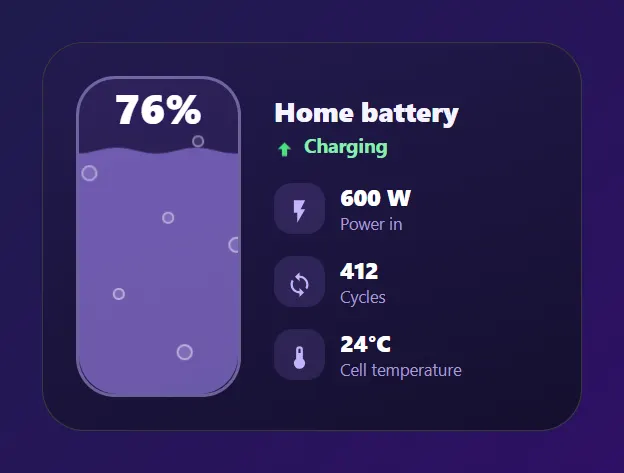

# Energy

Power flows, solar, storage, batteries and car charging. Paste a card into the code editor of a new card, then change the entity ids to your own. Back to the [gallery](README.md).

## Cards

-   [Energy flow](#energy-flow)
-   [Device batteries](#device-batteries)
-   [Water tank](#water-tank)
-   [Electric car](#electric-car)
-   [Solar today](#solar-today)
-   [Solar house](#solar-house)
-   [EV charger](#ev-charger)
-   [Home battery](#home-battery)

## Energy flow

Solar, grid, home and battery, with animated power lines between them.



Entities: `sensor.solar_power`, `sensor.house_power`, `sensor.grid_power`, `sensor.battery_power`, `sensor.home_battery`, `sensor.energy_today`

The "Exporting", "Using" and "Charging" labels are typed text. Flow lines need the module ids `solar`, `house`, `grid` and `battery`.

File: [cards/03-energy-flow.yaml](cards/03-energy-flow.yaml)

```yaml
# Energy flow: solar, grid, home and battery, with animated power lines between them.
# Entities: sensor.solar_power, sensor.house_power, sensor.grid_power,
#           sensor.battery_power, sensor.home_battery, sensor.energy_today
type: custom:magic-card
name: Energy
background: "linear-gradient(180deg, #0f1724 0%, #0b111b 100%)"
border_radius: 26px
padding: 20px
box_shadow: "0 18px 40px rgba(0,0,0,0.5)"
rows:
  - id: head
    column_widths: [1fr, auto]
    columns:
      - vertical_align: center
        modules:
          - type: text
            text: Energy now
            design: { font_size: 17px, font_weight: "600", color: "#e6edf7" }
      - vertical_align: center
        modules:
          - type: horizontal
            gap: 6px
            align: center
            design:
              padding: 5px 12px
              border_radius: 999px
              background_color: "rgba(255,209,102,0.12)"
            modules:
              - type: icon
                icon: mdi:solar-power-variant
                size: 16px
                design: { color: "#ffd166" }
              - type: text
                use_entity: true
                entity: sensor.energy_today
                design: { font_size: 12px, font_weight: "600", color: "#ffd166" }
              - type: text
                text: today
                design: { font_size: 12px, color: "#b8a26a" }
  - id: top
    layout: "1-1-1"
    columns:
      - modules: []
      - modules:
          - id: solar
            type: vertical
            align: center
            gap: 6px
            modules:
              - type: icon
                icon: mdi:white-balance-sunny
                size: 30px
                design:
                  color: "#ffd166"
                  width: 64px
                  height: 64px
                  display: flex
                  align_items: center
                  justify_content: center
                  border_radius: 50%
                  border: "2px solid #ffd166"
                  background_color: "rgba(255,209,102,0.10)"
                  box_shadow: "0 0 24px rgba(255,209,102,0.25)"
                  animations:
                    - { preset: fast-spin, target: icon, duration: 24s }
              - type: text
                use_entity: true
                entity: sensor.solar_power
                design: &val { font_size: 14px, font_weight: "700", color: "#e6edf7" }
      - modules: []
  - id: middle
    layout: "1-1-1"
    padding: 22px 0 0
    columns:
      - modules:
          - id: grid
            type: vertical
            align: center
            gap: 6px
            modules:
              - type: icon
                icon: mdi:transmission-tower
                size: 28px
                design:
                  color: "#8ecae6"
                  width: 64px
                  height: 64px
                  display: flex
                  align_items: center
                  justify_content: center
                  border_radius: 50%
                  border: "2px solid #8ecae6"
                  background_color: "rgba(142,202,230,0.10)"
                  box_shadow: "0 0 24px rgba(142,202,230,0.2)"
              - type: text
                use_entity: true
                entity: sensor.grid_power
                design: *val
              - type: text
                text: Exporting
                design: &sub { font_size: 11px, color: "#7b8aa0", margin_top: -4px }
      - modules:
          - id: house
            type: vertical
            align: center
            gap: 6px
            modules:
              - type: icon
                icon: mdi:home-variant
                size: 36px
                design:
                  color: "#ffffff"
                  width: 80px
                  height: 80px
                  display: flex
                  align_items: center
                  justify_content: center
                  border_radius: 50%
                  border: "2px solid #6ee7b7"
                  background_color: "rgba(110,231,183,0.12)"
                  box_shadow: "0 0 30px rgba(110,231,183,0.3)"
              - type: text
                use_entity: true
                entity: sensor.house_power
                design: *val
              - type: text
                text: Using
                design: *sub
      - modules:
          - id: battery
            type: vertical
            align: center
            gap: 6px
            modules:
              - type: icon
                entity: sensor.home_battery
                icon: mdi:battery
                size: 30px
                icon_fx:
                  fill: { color: "#c084fc", empty_color: 25% }
                design:
                  color: "#c084fc"
                  width: 64px
                  height: 64px
                  display: flex
                  align_items: center
                  justify_content: center
                  border_radius: 50%
                  border: "2px solid #c084fc"
                  background_color: "rgba(192,132,252,0.10)"
                  box_shadow: "0 0 24px rgba(192,132,252,0.22)"
              - type: text
                use_entity: true
                entity: sensor.home_battery
                design: *val
              - type: text
                text: Charging
                design: *sub
flows:
  - { id: solar-house, from: solar, to: house, entity: sensor.solar_power, max: 5000, color: "#ffd166", glow: 6, dots: 3, route: straight }
  - { id: house-grid, from: house, to: grid, entity: sensor.grid_power, max: 5000, color: "#8ecae6", glow: 6, route: straight, reverse_negative: false }
  - { id: house-battery, from: house, to: battery, entity: sensor.battery_power, max: 3000, color: "#c084fc", glow: 6, route: straight }
```

## Device batteries

A big phone battery that fills with the charge (liquid wave), and mini bars for the watch and earbuds.



Entities: `sensor.phone_battery`, `binary_sensor.phone_charging`, `sensor.watch_battery`, `sensor.earbuds_battery`

The phone name is typed text.

File: [cards/06-phone-battery.yaml](cards/06-phone-battery.yaml)

```yaml
# Device batteries: a big phone battery that fills with the charge (liquid wave),
# and mini bars for the watch and earbuds.
# Entities: sensor.phone_battery, binary_sensor.phone_charging,
#           sensor.watch_battery, sensor.earbuds_battery
type: custom:magic-card
name: Batteries
background: "linear-gradient(145deg, #0f2027 0%, #203a43 55%, #2c5364 100%)"
border_radius: 28px
padding: 22px
box_shadow: "0 18px 40px rgba(15, 32, 39, 0.5)"
rows:
  - id: main
    column_widths: [auto, 1fr]
    gap: 18px
    columns:
      - vertical_align: center
        modules:
          - type: icon
            entity: sensor.phone_battery
            icon: mdi:battery
            size: 96px
            icon_fx:
              fill:
                color: "#4ade80"
                empty_color: 16%
                wave: true
            design:
              color: "#4ade80"
              filter: "drop-shadow(0 0 16px rgba(74,222,128,0.35))"
      - vertical_align: center
        gap: 2px
        modules:
          - type: text
            text: Pixel 9
            design: { font_size: 14px, color: "#9ec5d3", font_weight: "600" }
          - type: text
            use_entity: true
            entity: sensor.phone_battery
            design: { font_size: 48px, font_weight: "800", color: "#ffffff", line_height: "1.05", letter_spacing: -1px }
          - type: horizontal
            gap: 6px
            align: center
            display:
              conditions: [{ type: state, entity: binary_sensor.phone_charging, state: "on" }]
            modules:
              - type: icon
                icon: mdi:lightning-bolt
                size: 16px
                design:
                  color: "#facc15"
                  filter: "drop-shadow(0 0 6px rgba(250,204,21,0.7))"
                  animations: [{ preset: fade-pulse, duration: 1.8s, intensity: 40 }]
              - type: text
                text: Charging
                design: { font_size: 13px, font_weight: "600", color: "#facc15" }
  - id: others
    padding: 14px 0 0
    design:
      border_top: "1px solid rgba(255,255,255,0.08)"
    layout: "1-1"
    gap: 16px
    columns:
      - gap: 6px
        modules:
          - type: horizontal
            justify: space-between
            align: center
            modules:
              - type: horizontal
                gap: 6px
                align: center
                modules:
                  - type: icon
                    icon: mdi:watch-variant
                    size: 16px
                    design: { color: "#9ec5d3" }
                  - type: text
                    text: Watch
                    design: { font_size: 13px, color: "#cfe3ea" }
              - type: text
                use_entity: true
                entity: sensor.watch_battery
                design: { font_size: 13px, font_weight: "700", color: "#ffffff" }
          - type: bar
            entity: sensor.watch_battery
            show_value: false
            bar_height: 6px
            bar_background: "rgba(255,255,255,0.1)"
            severity:
              - { from: 0, color: "#f87171" }
              - { from: 20, color: "#fbbf24" }
              - { from: 50, color: "#4ade80" }
            design: { border_radius: 999px }
      - gap: 6px
        modules:
          - type: horizontal
            justify: space-between
            align: center
            modules:
              - type: horizontal
                gap: 6px
                align: center
                modules:
                  - type: icon
                    icon: mdi:earbuds
                    size: 16px
                    design: { color: "#9ec5d3" }
                  - type: text
                    text: Earbuds
                    design: { font_size: 13px, color: "#cfe3ea" }
              - type: text
                use_entity: true
                entity: sensor.earbuds_battery
                design: { font_size: 13px, font_weight: "700", color: "#ffffff" }
          - type: bar
            entity: sensor.earbuds_battery
            show_value: false
            bar_height: 6px
            bar_background: "rgba(255,255,255,0.1)"
            severity:
              - { from: 0, color: "#f87171" }
              - { from: 20, color: "#fbbf24" }
              - { from: 50, color: "#4ade80" }
            design: { border_radius: 999px }
```

## Water tank

The whole card fills up like the tank, with a moving wave on top.



Entities: `sensor.water_tank`, `sensor.water_tank_litres`

The tank size in the subtitle is typed text.

File: [cards/07-water-tank.yaml](cards/07-water-tank.yaml)

```yaml
# Water tank: the whole card fills up like the tank, with a moving wave on top.
# Entities: sensor.water_tank, sensor.water_tank_litres
type: custom:magic-card
name: Water tank
background: "linear-gradient(180deg, #0b1e33 0%, #08172a 100%)"
border_radius: 30px
padding: 22px
card_height: 260px
box_shadow: "0 18px 40px rgba(2, 132, 199, 0.25)"
value_background:
  type: fill
  entity: sensor.water_tank
  color: "#38bdf8"
  opacity: 45%
  wave: true
rows:
  - id: top
    column_widths: [1fr, auto]
    columns:
      - gap: 0px
        modules:
          - type: text
            text: Rain water
            design: { font_size: 16px, font_weight: "600", color: "#e0f2fe" }
          - type: text
            text: Garden tank · 5 000 L
            design: { font_size: 12px, color: "#7dd3fc" }
      - modules:
          - type: icon
            icon: mdi:water
            size: 22px
            design:
              color: "#e0f2fe"
              padding: 8px
              border_radius: 50%
              background_color: "rgba(255,255,255,0.12)"
  - id: value
    padding: 34px 0 0
    columns:
      - modules:
          - type: text
            use_entity: true
            entity: sensor.water_tank
            design: { font_size: 64px, font_weight: "800", color: "#ffffff", line_height: "1", letter_spacing: -2px, text_shadow: "0 4px 18px rgba(0,0,0,0.25)" }
          - type: text
            use_entity: true
            entity: sensor.water_tank_litres
            design: { font_size: 15px, font_weight: "500", color: "#e0f2fe" }
```

## Electric car

Charge level as a glowing ring, range, charging power (only while charging) and a glowing charge bar.



Entities: `sensor.car_battery`, `sensor.car_range`, `sensor.car_charge_power`, `binary_sensor.car_charging`, `switch.car_charger`

The "full at 23:10" and "Charging to 90%" labels are typed text.

File: [cards/20-ev-charging.yaml](cards/20-ev-charging.yaml)

```yaml
# Electric car: charge level as a glowing ring, range, charging power (only while
# charging) and a glowing charge bar.
# Entities: sensor.car_battery, sensor.car_range, sensor.car_charge_power,
#           binary_sensor.car_charging, switch.car_charger
type: custom:magic-card
name: Car
background: "radial-gradient(120% 100% at 0% 0%, #10243a 0%, #0a1220 60%, #070c16 100%)"
border_radius: 28px
padding: 22px
box_shadow: "0 20px 44px rgba(14, 165, 233, 0.18)"
rows:
  - id: main
    column_widths: [auto, 1fr]
    gap: 20px
    columns:
      - vertical_align: center
        modules:
          - type: vertical
            align: center
            gap: 0px
            design:
              width: 120px
              height: 120px
              justify_content: center
              shape: circle
              background: "radial-gradient(circle at 50% 35%, #12304d 0%, #0b1626 75%)"
              ring:
                mode: value
                entity: sensor.car_battery
                width: 9
                glow: 12
                color: "#38bdf8"
                track_color: "rgba(56,189,248,0.1)"
            modules:
              - type: icon
                icon: mdi:car-electric
                size: 26px
                design: { color: "#7dd3fc" }
              - type: text
                use_entity: true
                entity: sensor.car_battery
                design: { font_size: 24px, font_weight: "800", color: "#f0f9ff" }
      - vertical_align: center
        gap: 4px
        modules:
          - type: text
            text: Model 3
            design: { font_size: 20px, font_weight: "800", color: "#f0f9ff" }
          - type: horizontal
            gap: 6px
            align: center
            modules:
              - type: icon
                icon: mdi:map-marker-distance
                size: 16px
                design: { color: "#7dd3fc" }
              - type: text
                use_entity: true
                entity: sensor.car_range
                design: { font_size: 14px, font_weight: "700", color: "#bae6fd" }
              - type: text
                text: range
                design: { font_size: 13px, color: "#64809b" }
          - type: horizontal
            gap: 6px
            align: center
            display:
              conditions: [{ type: state, entity: binary_sensor.car_charging, state: "on" }]
            modules:
              - type: icon
                icon: mdi:ev-station
                size: 16px
                design: { color: "#4ade80" }
              - type: text
                use_entity: true
                entity: sensor.car_charge_power
                design: { font_size: 14px, font_weight: "700", color: "#4ade80" }
              - type: text
                text: · full at 23:10
                design: { font_size: 13px, color: "#64809b" }
  - id: bar
    padding: 4px 0 0
    columns:
      - gap: 8px
        modules:
          - type: bar
            entity: sensor.car_battery
            show_value: false
            bar_height: 12px
            bar_color: "#38bdf8"
            bar_background: "rgba(255,255,255,0.06)"
            design:
              border_radius: 999px
              filter: "drop-shadow(0 0 8px rgba(56,189,248,0.45))"
          - type: horizontal
            justify: space-between
            modules:
              - type: text
                text: "0%"
                design: &tick { font_size: 11px, color: "#475a70" }
              - type: text
                text: "Charging to 90%"
                design: { font_size: 11px, color: "#7dd3fc", font_weight: "600" }
              - type: text
                text: "100%"
                design: *tick
```

## Solar today

Big production number, live power, and a 24-hour graph.



Entities: `sensor.energy_today`, `sensor.solar_power`

File: [cards/24-solar-today.yaml](cards/24-solar-today.yaml)

```yaml
# Solar today: big production number, live power, and a 24-hour graph.
# Entities: sensor.energy_today, sensor.solar_power
type: custom:magic-card
name: Solar
background: "linear-gradient(165deg, #fffdf6 0%, #fff6dc 100%)"
border_radius: 26px
padding: 20px
box_shadow: "0 14px 34px rgba(217, 119, 6, 0.16)"
rows:
  - id: head
    column_widths: [1fr, auto]
    columns:
      - gap: 0px
        modules:
          - type: text
            text: Solar today
            design: { font_size: 13px, font_weight: "700", color: "#b45309", text_transform: uppercase, letter_spacing: 1.5px }
          - type: text
            use_entity: true
            entity: sensor.energy_today
            design: { font_size: 40px, font_weight: "800", color: "#422006", letter_spacing: -1px, line_height: "1.1" }
          - type: horizontal
            gap: 6px
            align: center
            modules:
              - type: icon
                icon: mdi:flash
                size: 15px
                design: { color: "#d97706" }
              - type: text
                use_entity: true
                entity: sensor.solar_power
                design: { font_size: 13px, font_weight: "700", color: "#d97706" }
              - type: text
                text: right now
                design: { font_size: 13px, color: "#a16207" }
      - modules:
          - type: icon
            icon: mdi:white-balance-sunny
            size: 44px
            design:
              color: "#f59e0b"
              filter: "drop-shadow(0 0 12px rgba(245,158,11,0.55))"
              animations: [{ preset: fast-spin, duration: 30s }]
  - id: graph
    columns:
      - modules:
          - type: graphs
            entity: sensor.solar_power
            hours_to_show: 24
            points_per_hour: 2
            line_color: "#f59e0b"
            fill_color: "#f59e0b"
            fill: true
            show_labels: false
            design: { margin: 0 -6px }
```

## Solar house

A sunny sky with turning rays over the panels, and dashed power lines with live values running to the house, the battery and the grid.



Entities: `sensor.solar_power`, `sensor.house_power`, `sensor.grid_power`, `sensor.battery_power`, `sensor.home_battery`

The flow lines need the module ids `solar`, `house`, `grid` and `battery`.

File: [cards/45-solar-house.yaml](cards/45-solar-house.yaml)

```yaml
# Solar house: a sunny sky with turning rays over the panels, and dashed power lines with live values running to the house, the battery and the grid.
# Entities: sensor.solar_power, sensor.house_power, sensor.grid_power, sensor.battery_power, sensor.home_battery
type: custom:magic-card
name: Solar house
background: "#ffffff"
border_radius: 28px
padding: 0px
box_shadow: "0 16px 38px rgba(30, 64, 175, 0.16)"
rows:
  - id: sky
    padding: 18px 20px 28px
    design:
      background: "linear-gradient(180deg, #7dd3fc 0%, #bae6fd 70%, #e0f2fe 100%)"
      animations:
        - { id: rays, preset: sun-rays, color: "#fde047", strength: 55, intensity: 7 }
    column_widths: [1fr, auto]
    columns:
      - vertical_align: center
        gap: 0px
        modules:
          - type: text
            text: Making power
            design: { font_size: 13px, font_weight: "700", color: "#075985" }
          - type: text
            use_entity: true
            entity: sensor.solar_power
            design: { font_size: 34px, font_weight: "800", color: "#0c4a6e", letter_spacing: -1px }
      - vertical_align: center
        modules:
          - id: solar
            type: icon
            icon: mdi:solar-panel-large
            size: 34px
            design:
              color: "#1e3a8a"
              width: 70px
              height: 70px
              display: flex
              align_items: center
              justify_content: center
              border_radius: 22px
              background: "linear-gradient(140deg, #ffffff, #dbeafe)"
              box_shadow: "0 10px 24px rgba(30,64,175,0.25)"
              animations:
                - { id: shine, preset: shine-sweep, strength: 80, intensity: 70, duration: 2.6s }
  - id: house
    layout: "1-1-1"
    gap: 34px
    padding: 34px 18px 20px
    columns:
      - modules:
          - id: grid
            type: vertical
            align: center
            gap: 4px
            design: &node
              padding: 12px 6px
              border_radius: 20px
              background_color: "#f1f5f9"
            modules:
              - type: icon
                icon: mdi:transmission-tower-export
                size: 26px
                design: { color: "#0ea5e9" }
              - type: text
                text: Grid
                design: &cap { font_size: 11px, font_weight: "700", color: "#64748b", text_transform: uppercase, letter_spacing: 1px }
      - modules:
          - id: house
            type: vertical
            align: center
            gap: 4px
            design:
              padding: 12px 6px
              border_radius: 20px
              background: "linear-gradient(160deg, #dcfce7, #bbf7d0)"
            modules:
              - type: icon
                icon: mdi:home-lightning-bolt
                size: 26px
                design: { color: "#15803d" }
              - type: text
                use_entity: true
                entity: sensor.house_power
                design: { font_size: 13px, font_weight: "800", color: "#14532d" }
      - modules:
          - id: battery
            type: vertical
            align: center
            gap: 4px
            design: *node
            modules:
              - type: icon
                entity: sensor.home_battery
                icon: mdi:battery
                size: 26px
                icon_fx:
                  fill: { color: "#8b5cf6", empty_color: 25% }
                design: { color: "#8b5cf6" }
              - type: text
                use_entity: true
                entity: sensor.home_battery
                design: { font_size: 13px, font_weight: "800", color: "#4c1d95" }
flows:
  - { id: sun-house, from: solar, to: house, entity: sensor.solar_power, max: 5000, color: "#f59e0b", width: 3, dots: 0, route: elbow, from_side: bottom, to_side: top, label: value, label_position: side }
  - { id: house-grid, from: house, to: grid, entity: sensor.grid_power, max: 5000, color: "#0ea5e9", width: 3, dots: 3, dot_size: 7, glow: 4 }
  - { id: house-battery, from: house, to: battery, entity: sensor.battery_power, max: 3000, color: "#8b5cf6", width: 3, dots: 3, dot_size: 7, glow: 4 }
```

## EV charger

The car's charge fills the card from the left with moving charging stripes, and a green snake runs round the card while it charges.



Entities: `sensor.car_battery`, `binary_sensor.car_charging`, `sensor.ev_charger_power`, `sensor.ev_session_energy`, `sensor.car_range`

The "full at 23:10" time is typed text. The stripes and the ring only play while `binary_sensor.car_charging` is on.

File: [cards/46-ev-charger.yaml](cards/46-ev-charger.yaml)

```yaml
# EV charger: the car's charge fills the card from the left with moving charging stripes, and a green snake runs round the card while it charges.
# Entities: sensor.car_battery, binary_sensor.car_charging, sensor.ev_charger_power, sensor.ev_session_energy, sensor.car_range
type: custom:magic-card
name: EV charger
background: "#0b1410"
border_radius: 26px
padding: 0px
box_shadow: "0 18px 40px rgba(0, 0, 0, 0.55)"
ring:
  mode: animated
  animation: snake
  length: 30
  speed: 3.5s
  width: 2.5
  glow: 8
  color: "#4ade80"
  trigger: entity_on
  trigger_entity: binary_sensor.car_charging
rows:
  - id: charge
    padding: 22px 22px 18px
    design:
      value_background:
        type: fill
        entity: sensor.car_battery
        direction: right
        color: "#22c55e"
        opacity: 22%
        wave: false
      animations:
        - { id: stripes, preset: charging-stripes, trigger: entity_on, trigger_entity: binary_sensor.car_charging, color: "#4ade80", strength: 18, intensity: 100 }
    column_widths: [1fr, auto]
    columns:
      - vertical_align: center
        gap: 0px
        modules:
          - type: horizontal
            gap: 6px
            align: center
            modules:
              - type: icon
                icon: mdi:lightning-bolt
                size: 16px
                design:
                  color: "#4ade80"
                  animations:
                    - { id: beat, preset: heartbeat, target: icon, intensity: 20 }
              - type: text
                text: Charging · full at 23:10
                design: { font_size: 12px, font_weight: "700", color: "#86efac", letter_spacing: 0.3px }
          - type: text
            use_entity: true
            entity: sensor.car_battery
            design: { font_size: 52px, font_weight: "800", color: "#f0fdf4", letter_spacing: -2px, line_height: "1.1" }
          - type: text
            text: Model 3
            design: { font_size: 14px, font_weight: "600", color: "#bbf7d0" }
      - vertical_align: center
        modules:
          - type: icon
            icon: mdi:car-electric
            size: 64px
            design:
              color: "#dcfce7"
              animations:
                - { id: float, preset: float, target: icon, intensity: 3 }
  - id: stats
    layout: "1-1-1"
    padding: 14px 18px 18px
    design:
      background_color: "rgba(255,255,255,0.03)"
      border_top: "1px solid rgba(74,222,128,0.12)"
    columns:
      - modules:
          - type: vertical
            gap: 0px
            align: center
            modules:
              - type: text
                use_entity: true
                entity: sensor.ev_charger_power
                design: &val { font_size: 16px, font_weight: "800", color: "#f0fdf4" }
              - type: text
                text: Power
                design: &lbl { font_size: 11px, color: "#6b8f78", text_transform: uppercase, letter_spacing: 1px }
      - modules:
          - type: vertical
            gap: 0px
            align: center
            modules:
              - type: text
                use_entity: true
                entity: sensor.ev_session_energy
                design: *val
              - type: text
                text: Session
                design: *lbl
      - modules:
          - type: vertical
            gap: 0px
            align: center
            modules:
              - type: text
                use_entity: true
                entity: sensor.car_range
                design: *val
              - type: text
                text: Range
                design: *lbl
```

## Home battery

A tall battery that fills to the charge level with a moving wave and rising bubbles, next to its power, cycles and temperature.



Entities: `sensor.home_battery`, `sensor.battery_power`, `sensor.battery_cycles`, `sensor.battery_temperature`

File: [cards/47-home-battery.yaml](cards/47-home-battery.yaml)

```yaml
# Home battery: a tall battery that fills to the charge level with a moving wave and rising bubbles, next to its power, cycles and temperature.
# Entities: sensor.home_battery, sensor.battery_power, sensor.battery_cycles, sensor.battery_temperature
type: custom:magic-card
name: Home battery
background: "linear-gradient(160deg, #241a4f 0%, #140f2e 100%)"
border_radius: 28px
padding: 22px
box_shadow: "0 20px 44px rgba(76, 29, 149, 0.45)"
rows:
  - id: main
    column_widths: [110px, 1fr]
    gap: 22px
    columns:
      - modules:
          - type: vertical
            align: center
            justify: center
            gap: 0px
            design:
              height: 210px
              border_radius: 26px
              border: "2px solid rgba(196,181,253,0.45)"
              background_color: "rgba(167,139,250,0.08)"
              value_background:
                type: fill
                entity: sensor.home_battery
                color: "#a78bfa"
                opacity: 55%
              animations:
                - { id: bubbles, preset: bubbles, color: "#ede9fe", strength: 60, intensity: 7 }
            modules:
              - type: text
                use_entity: true
                entity: sensor.home_battery
                design: { font_size: 28px, font_weight: "800", color: "#ffffff", text_shadow: "0 2px 10px rgba(46,16,101,0.6)" }
      - vertical_align: center
        gap: 14px
        modules:
          - type: vertical
            gap: 0px
            modules:
              - type: text
                text: Home battery
                design: { font_size: 18px, font_weight: "800", color: "#f5f3ff" }
              - type: horizontal
                gap: 6px
                align: center
                modules:
                  - type: icon
                    icon: mdi:arrow-up-bold
                    size: 14px
                    design:
                      color: "#4ade80"
                      animations:
                        - { id: up, preset: float, target: icon, intensity: 3, duration: 1.4s }
                  - type: text
                    text: Charging
                    design: { font_size: 13px, font_weight: "700", color: "#86efac" }
          - type: horizontal
            gap: 10px
            align: center
            modules:
              - type: icon
                icon: mdi:flash
                size: 18px
                design: &chip { color: "#c4b5fd", width: 34px, height: 34px, display: flex, align_items: center, justify_content: center, border_radius: 12px, background_color: "rgba(167,139,250,0.14)" }
              - type: vertical
                gap: 0px
                modules:
                  - type: text
                    use_entity: true
                    entity: sensor.battery_power
                    design: &val { font_size: 15px, font_weight: "800", color: "#ffffff" }
                  - type: text
                    text: Power in
                    design: &lbl { font_size: 11px, color: "#a59bd0" }
          - type: horizontal
            gap: 10px
            align: center
            modules:
              - type: icon
                icon: mdi:sync
                size: 18px
                design: *chip
              - type: vertical
                gap: 0px
                modules:
                  - type: text
                    use_entity: true
                    entity: sensor.battery_cycles
                    design: *val
                  - type: text
                    text: Cycles
                    design: *lbl
          - type: horizontal
            gap: 10px
            align: center
            modules:
              - type: icon
                icon: mdi:thermometer
                size: 18px
                design: *chip
              - type: vertical
                gap: 0px
                modules:
                  - type: text
                    use_entity: true
                    entity: sensor.battery_temperature
                    design: *val
                  - type: text
                    text: Cell temperature
                    design: *lbl
```
