# Flows and sliders

Every flow line style, travelling shapes, gradients and end caps, short elbows and a six-flow wall tablet, then the slider looks: Minimal, Material, Neon, Glass, Big fill, stops and track shapes. Paste a card into the code editor of a new card, then change the entity ids to your own. Back to the [gallery](README.md).

## Cards

-   Flow line styles
    -   [Flow line style solid](#flow-line-style-solid)
    -   [Flow line style dashed](#flow-line-style-dashed)
    -   [Flow line style dotted](#flow-line-style-dotted)
    -   [Flow line style double](#flow-line-style-double)
    -   [Flow line style wave](#flow-line-style-wave)
    -   [Flow line style zigzag](#flow-line-style-zigzag)
    -   [Flow line style tube](#flow-line-style-tube)
    -   [Flow line style neon](#flow-line-style-neon)
    -   [Flow line style cable](#flow-line-style-cable)
-   Flow shapes, colours and ends
    -   [Flow shapes](#flow-shapes)
    -   [Flow shapes in a swarm](#flow-shapes-in-a-swarm)
    -   [Flow gradients and ends](#flow-gradients-and-ends)
    -   [Flow lines on short elbows](#flow-lines-on-short-elbows)
    -   [Wall tablet](#wall-tablet)
-   Slider looks
    -   [Slider look Minimal](#slider-look-minimal)
    -   [Slider look Material, on a light card](#slider-look-material-on-a-light-card)
    -   [Slider look Neon](#slider-look-neon)
    -   [Slider look Glass with the flat fill](#slider-look-glass-with-the-flat-fill)
    -   [Slider look Glass with blur behind](#slider-look-glass-with-blur-behind)
    -   [Slider look Big fill](#slider-look-big-fill)
    -   [Slider stops](#slider-stops)
    -   [Slider track shapes](#slider-track-shapes)

## Flow line style solid

The classic line with a glow and travelling dots, on a straight, a curved and two elbow routes.

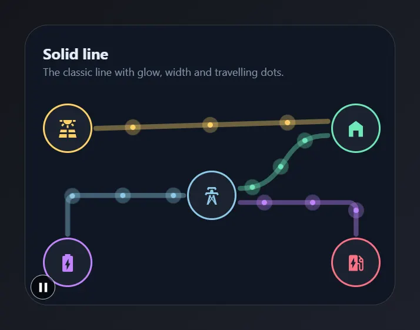

Entities: `sensor.solar_power`, `sensor.house_power`, `sensor.grid_power`, `sensor.battery_power`, `sensor.home_battery`

The flow lines need the module ids `a` to `e`. Every flow card on this page uses the same five round icons and the same four routes: straight, curved and two elbows.

File: [cards/83-flow-solid.yaml](cards/83-flow-solid.yaml)

```yaml
# Flow line style solid: the classic line with a glow and travelling dots, on a straight, a curved and two elbow routes.
# Entities: sensor.solar_power, sensor.house_power, sensor.grid_power, sensor.battery_power, sensor.home_battery
type: custom:magic-card
name: Solid line
background: "#0f1724"
border_radius: 26px
padding: 20px
box_shadow: "0 18px 40px rgba(0,0,0,0.35)"
rows:
  - id: head
    columns:
      - gap: 2px
        modules:
          - type: text
            text: "Solid line"
            design: { font_size: 17px, font_weight: "700", color: "#e6edf7" }
          - type: text
            text: "The classic line with glow, width and travelling dots."
            design: { font_size: 12px, color: "#8a98ad" }
  - id: top
    column_widths: [52px, 1fr, 52px]
    padding: 18px 0 0
    columns:
      - vertical_align: center
        modules:
          - id: a
            type: icon
            icon: mdi:solar-power-variant
            size: 24px
            design: { color: "#ffd166", width: 52px, height: 52px, display: flex, align_items: center, justify_content: center, border_radius: 50%, border: "2px solid #ffd166", background_color: "rgba(255,255,255,0.05)" }
      - modules: []
      - vertical_align: center
        modules:
          - id: b
            type: icon
            icon: mdi:home-variant
            size: 24px
            design: { color: "#6ee7b7", width: 52px, height: 52px, display: flex, align_items: center, justify_content: center, border_radius: 50%, border: "2px solid #6ee7b7", background_color: "rgba(255,255,255,0.05)" }
  - id: middle
    column_widths: [1fr, 52px, 1fr]
    padding: 10px 0
    columns:
      - modules: []
      - vertical_align: center
        modules:
          - id: c
            type: icon
            icon: mdi:transmission-tower
            size: 24px
            design: { color: "#8ecae6", width: 52px, height: 52px, display: flex, align_items: center, justify_content: center, border_radius: 50%, border: "2px solid #8ecae6", background_color: "rgba(255,255,255,0.05)" }
      - modules: []
  - id: bottom
    column_widths: [52px, 1fr, 52px]
    columns:
      - vertical_align: center
        modules:
          - id: d
            type: icon
            icon: mdi:battery-charging
            size: 24px
            design: { color: "#c084fc", width: 52px, height: 52px, display: flex, align_items: center, justify_content: center, border_radius: 50%, border: "2px solid #c084fc", background_color: "rgba(255,255,255,0.05)" }
      - modules: []
      - vertical_align: center
        modules:
          - id: e
            type: icon
            icon: mdi:ev-station
            size: 24px
            design: { color: "#fb7185", width: 52px, height: 52px, display: flex, align_items: center, justify_content: center, border_radius: 50%, border: "2px solid #fb7185", background_color: "rgba(255,255,255,0.05)" }
flows:
  - { id: a-b, from: a, to: b, entity: sensor.solar_power, max: 5000, route: straight, color: "#ffd166", width: 3, glow: 6, dots: 3 }
  - { id: b-c, from: b, to: c, entity: sensor.house_power, max: 5000, route: curve, color: "#6ee7b7", width: 3, glow: 6, dots: 3 }
  - { id: c-d, from: c, to: d, entity: sensor.grid_power, max: 5000, route: elbow, from_side: left, to_side: top, color: "#8ecae6", width: 3, glow: 6, dots: 3 }
  - { id: c-e, from: c, to: e, entity: sensor.battery_power, max: 3000, route: elbow, from_side: right, to_side: top, color: "#c084fc", width: 3, glow: 6, dots: 3 }
```

## Flow line style dashed

The line is cut into dashes that slide along the route.

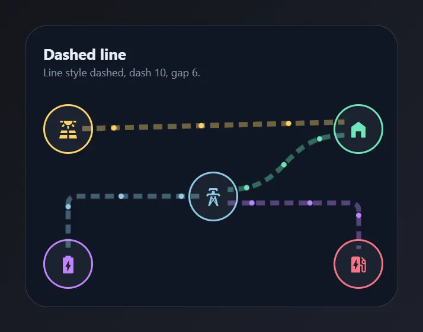

Entities: `sensor.solar_power`, `sensor.house_power`, `sensor.grid_power`, `sensor.battery_power`, `sensor.home_battery`

The dashes slide along the route; with reduced motion they stand still.

File: [cards/84-flow-dashed.yaml](cards/84-flow-dashed.yaml)

```yaml
# Flow line style dashed: the line is cut into dashes that slide along the route.
# Entities: sensor.solar_power, sensor.house_power, sensor.grid_power, sensor.battery_power, sensor.home_battery
type: custom:magic-card
name: Dashed line
background: "#0f1724"
border_radius: 26px
padding: 20px
box_shadow: "0 18px 40px rgba(0,0,0,0.35)"
rows:
  - id: head
    columns:
      - gap: 2px
        modules:
          - type: text
            text: "Dashed line"
            design: { font_size: 17px, font_weight: "700", color: "#e6edf7" }
          - type: text
            text: "Line style dashed, dash 10, gap 6."
            design: { font_size: 12px, color: "#8a98ad" }
  - id: top
    column_widths: [52px, 1fr, 52px]
    padding: 18px 0 0
    columns:
      - vertical_align: center
        modules:
          - id: a
            type: icon
            icon: mdi:solar-power-variant
            size: 24px
            design: { color: "#ffd166", width: 52px, height: 52px, display: flex, align_items: center, justify_content: center, border_radius: 50%, border: "2px solid #ffd166", background_color: "rgba(255,255,255,0.05)" }
      - modules: []
      - vertical_align: center
        modules:
          - id: b
            type: icon
            icon: mdi:home-variant
            size: 24px
            design: { color: "#6ee7b7", width: 52px, height: 52px, display: flex, align_items: center, justify_content: center, border_radius: 50%, border: "2px solid #6ee7b7", background_color: "rgba(255,255,255,0.05)" }
  - id: middle
    column_widths: [1fr, 52px, 1fr]
    padding: 10px 0
    columns:
      - modules: []
      - vertical_align: center
        modules:
          - id: c
            type: icon
            icon: mdi:transmission-tower
            size: 24px
            design: { color: "#8ecae6", width: 52px, height: 52px, display: flex, align_items: center, justify_content: center, border_radius: 50%, border: "2px solid #8ecae6", background_color: "rgba(255,255,255,0.05)" }
      - modules: []
  - id: bottom
    column_widths: [52px, 1fr, 52px]
    columns:
      - vertical_align: center
        modules:
          - id: d
            type: icon
            icon: mdi:battery-charging
            size: 24px
            design: { color: "#c084fc", width: 52px, height: 52px, display: flex, align_items: center, justify_content: center, border_radius: 50%, border: "2px solid #c084fc", background_color: "rgba(255,255,255,0.05)" }
      - modules: []
      - vertical_align: center
        modules:
          - id: e
            type: icon
            icon: mdi:ev-station
            size: 24px
            design: { color: "#fb7185", width: 52px, height: 52px, display: flex, align_items: center, justify_content: center, border_radius: 50%, border: "2px solid #fb7185", background_color: "rgba(255,255,255,0.05)" }
flows:
  - { id: a-b, from: a, to: b, entity: sensor.solar_power, max: 5000, route: straight, color: "#ffd166", line_style: dashed, width: 3, dash_length: 10, dash_gap: 6 }
  - { id: b-c, from: b, to: c, entity: sensor.house_power, max: 5000, route: curve, color: "#6ee7b7", line_style: dashed, width: 3, dash_length: 10, dash_gap: 6 }
  - { id: c-d, from: c, to: d, entity: sensor.grid_power, max: 5000, route: elbow, from_side: left, to_side: top, color: "#8ecae6", line_style: dashed, width: 3, dash_length: 10, dash_gap: 6 }
  - { id: c-e, from: c, to: e, entity: sensor.battery_power, max: 3000, route: elbow, from_side: right, to_side: top, color: "#c084fc", line_style: dashed, width: 3, dash_length: 10, dash_gap: 6 }
```

## Flow line style dotted

Round dots as wide as the line.

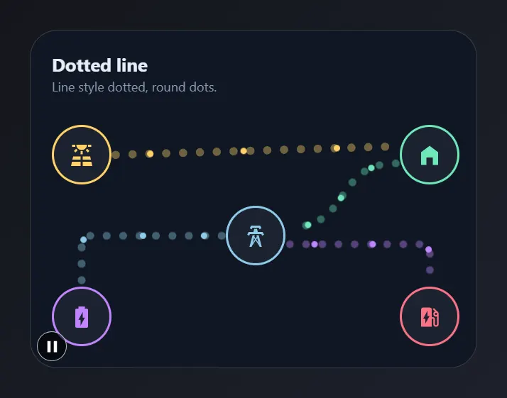

Entities: `sensor.solar_power`, `sensor.house_power`, `sensor.grid_power`, `sensor.battery_power`, `sensor.home_battery`

Each dot is as wide as the line. `dash_gap` sets the space between them.

File: [cards/85-flow-dotted.yaml](cards/85-flow-dotted.yaml)

```yaml
# Flow line style dotted: round dots as wide as the line.
# Entities: sensor.solar_power, sensor.house_power, sensor.grid_power, sensor.battery_power, sensor.home_battery
type: custom:magic-card
name: Dotted line
background: "#0f1724"
border_radius: 26px
padding: 20px
box_shadow: "0 18px 40px rgba(0,0,0,0.35)"
rows:
  - id: head
    columns:
      - gap: 2px
        modules:
          - type: text
            text: "Dotted line"
            design: { font_size: 17px, font_weight: "700", color: "#e6edf7" }
          - type: text
            text: "Line style dotted, round dots."
            design: { font_size: 12px, color: "#8a98ad" }
  - id: top
    column_widths: [52px, 1fr, 52px]
    padding: 18px 0 0
    columns:
      - vertical_align: center
        modules:
          - id: a
            type: icon
            icon: mdi:solar-power-variant
            size: 24px
            design: { color: "#ffd166", width: 52px, height: 52px, display: flex, align_items: center, justify_content: center, border_radius: 50%, border: "2px solid #ffd166", background_color: "rgba(255,255,255,0.05)" }
      - modules: []
      - vertical_align: center
        modules:
          - id: b
            type: icon
            icon: mdi:home-variant
            size: 24px
            design: { color: "#6ee7b7", width: 52px, height: 52px, display: flex, align_items: center, justify_content: center, border_radius: 50%, border: "2px solid #6ee7b7", background_color: "rgba(255,255,255,0.05)" }
  - id: middle
    column_widths: [1fr, 52px, 1fr]
    padding: 10px 0
    columns:
      - modules: []
      - vertical_align: center
        modules:
          - id: c
            type: icon
            icon: mdi:transmission-tower
            size: 24px
            design: { color: "#8ecae6", width: 52px, height: 52px, display: flex, align_items: center, justify_content: center, border_radius: 50%, border: "2px solid #8ecae6", background_color: "rgba(255,255,255,0.05)" }
      - modules: []
  - id: bottom
    column_widths: [52px, 1fr, 52px]
    columns:
      - vertical_align: center
        modules:
          - id: d
            type: icon
            icon: mdi:battery-charging
            size: 24px
            design: { color: "#c084fc", width: 52px, height: 52px, display: flex, align_items: center, justify_content: center, border_radius: 50%, border: "2px solid #c084fc", background_color: "rgba(255,255,255,0.05)" }
      - modules: []
      - vertical_align: center
        modules:
          - id: e
            type: icon
            icon: mdi:ev-station
            size: 24px
            design: { color: "#fb7185", width: 52px, height: 52px, display: flex, align_items: center, justify_content: center, border_radius: 50%, border: "2px solid #fb7185", background_color: "rgba(255,255,255,0.05)" }
flows:
  - { id: a-b, from: a, to: b, entity: sensor.solar_power, max: 5000, route: straight, color: "#ffd166", line_style: dotted, width: 4, dash_gap: 8 }
  - { id: b-c, from: b, to: c, entity: sensor.house_power, max: 5000, route: curve, color: "#6ee7b7", line_style: dotted, width: 4, dash_gap: 8 }
  - { id: c-d, from: c, to: d, entity: sensor.grid_power, max: 5000, route: elbow, from_side: left, to_side: top, color: "#8ecae6", line_style: dotted, width: 4, dash_gap: 8 }
  - { id: c-e, from: c, to: e, entity: sensor.battery_power, max: 3000, route: elbow, from_side: right, to_side: top, color: "#c084fc", line_style: dotted, width: 4, dash_gap: 8 }
```

## Flow line style double

Two parallel rails; on a short elbow the rails may overlap.

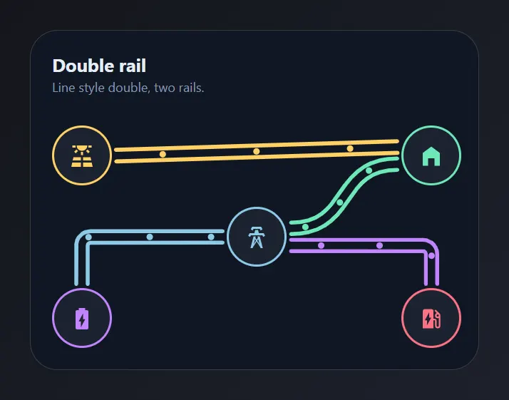

Entities: `sensor.solar_power`, `sensor.house_power`, `sensor.grid_power`, `sensor.battery_power`, `sensor.home_battery`

Each rail is `width` wide, `rail_gap` apart. On a short elbow the rails may overlap.

File: [cards/86-flow-double.yaml](cards/86-flow-double.yaml)

```yaml
# Flow line style double: two parallel rails; on a short elbow the rails may overlap.
# Entities: sensor.solar_power, sensor.house_power, sensor.grid_power, sensor.battery_power, sensor.home_battery
type: custom:magic-card
name: Double rail
background: "#0f1724"
border_radius: 26px
padding: 20px
box_shadow: "0 18px 40px rgba(0,0,0,0.35)"
rows:
  - id: head
    columns:
      - gap: 2px
        modules:
          - type: text
            text: "Double rail"
            design: { font_size: 17px, font_weight: "700", color: "#e6edf7" }
          - type: text
            text: "Line style double, two rails."
            design: { font_size: 12px, color: "#8a98ad" }
  - id: top
    column_widths: [52px, 1fr, 52px]
    padding: 18px 0 0
    columns:
      - vertical_align: center
        modules:
          - id: a
            type: icon
            icon: mdi:solar-power-variant
            size: 24px
            design: { color: "#ffd166", width: 52px, height: 52px, display: flex, align_items: center, justify_content: center, border_radius: 50%, border: "2px solid #ffd166", background_color: "rgba(255,255,255,0.05)" }
      - modules: []
      - vertical_align: center
        modules:
          - id: b
            type: icon
            icon: mdi:home-variant
            size: 24px
            design: { color: "#6ee7b7", width: 52px, height: 52px, display: flex, align_items: center, justify_content: center, border_radius: 50%, border: "2px solid #6ee7b7", background_color: "rgba(255,255,255,0.05)" }
  - id: middle
    column_widths: [1fr, 52px, 1fr]
    padding: 10px 0
    columns:
      - modules: []
      - vertical_align: center
        modules:
          - id: c
            type: icon
            icon: mdi:transmission-tower
            size: 24px
            design: { color: "#8ecae6", width: 52px, height: 52px, display: flex, align_items: center, justify_content: center, border_radius: 50%, border: "2px solid #8ecae6", background_color: "rgba(255,255,255,0.05)" }
      - modules: []
  - id: bottom
    column_widths: [52px, 1fr, 52px]
    columns:
      - vertical_align: center
        modules:
          - id: d
            type: icon
            icon: mdi:battery-charging
            size: 24px
            design: { color: "#c084fc", width: 52px, height: 52px, display: flex, align_items: center, justify_content: center, border_radius: 50%, border: "2px solid #c084fc", background_color: "rgba(255,255,255,0.05)" }
      - modules: []
      - vertical_align: center
        modules:
          - id: e
            type: icon
            icon: mdi:ev-station
            size: 24px
            design: { color: "#fb7185", width: 52px, height: 52px, display: flex, align_items: center, justify_content: center, border_radius: 50%, border: "2px solid #fb7185", background_color: "rgba(255,255,255,0.05)" }
flows:
  - { id: a-b, from: a, to: b, entity: sensor.solar_power, max: 5000, route: straight, color: "#ffd166", line_style: double, width: 2, rail_gap: 7, dots: 3 }
  - { id: b-c, from: b, to: c, entity: sensor.house_power, max: 5000, route: curve, color: "#6ee7b7", line_style: double, width: 2, rail_gap: 7, dots: 3 }
  - { id: c-d, from: c, to: d, entity: sensor.grid_power, max: 5000, route: elbow, from_side: left, to_side: top, color: "#8ecae6", line_style: double, width: 2, rail_gap: 7, dots: 3 }
  - { id: c-e, from: c, to: e, entity: sensor.battery_power, max: 3000, route: elbow, from_side: right, to_side: top, color: "#c084fc", line_style: double, width: 2, rail_gap: 7, dots: 3 }
```

## Flow line style wave

A sine line that stays lower on short stretches and flat through elbow corners.

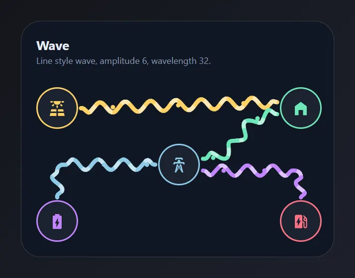

Entities: `sensor.solar_power`, `sensor.house_power`, `sensor.grid_power`, `sensor.battery_power`, `sensor.home_battery`

On a short stretch the wave is lower, and it is flat through each elbow corner. See [Short elbows](#flow-lines-on-short-elbows).

File: [cards/87-flow-wave.yaml](cards/87-flow-wave.yaml)

```yaml
# Flow line style wave: a sine line that stays lower on short stretches and flat through elbow corners.
# Entities: sensor.solar_power, sensor.house_power, sensor.grid_power, sensor.battery_power, sensor.home_battery
type: custom:magic-card
name: Wave
background: "#0f1724"
border_radius: 26px
padding: 20px
box_shadow: "0 18px 40px rgba(0,0,0,0.35)"
rows:
  - id: head
    columns:
      - gap: 2px
        modules:
          - type: text
            text: Wave
            design: { font_size: 17px, font_weight: "700", color: "#e6edf7" }
          - type: text
            text: "Line style wave, amplitude 6, wavelength 32."
            design: { font_size: 12px, color: "#8a98ad" }
  - id: top
    column_widths: [52px, 1fr, 52px]
    padding: 18px 0 0
    columns:
      - vertical_align: center
        modules:
          - id: a
            type: icon
            icon: mdi:solar-power-variant
            size: 24px
            design: { color: "#ffd166", width: 52px, height: 52px, display: flex, align_items: center, justify_content: center, border_radius: 50%, border: "2px solid #ffd166", background_color: "rgba(255,255,255,0.05)" }
      - modules: []
      - vertical_align: center
        modules:
          - id: b
            type: icon
            icon: mdi:home-variant
            size: 24px
            design: { color: "#6ee7b7", width: 52px, height: 52px, display: flex, align_items: center, justify_content: center, border_radius: 50%, border: "2px solid #6ee7b7", background_color: "rgba(255,255,255,0.05)" }
  - id: middle
    column_widths: [1fr, 52px, 1fr]
    padding: 10px 0
    columns:
      - modules: []
      - vertical_align: center
        modules:
          - id: c
            type: icon
            icon: mdi:transmission-tower
            size: 24px
            design: { color: "#8ecae6", width: 52px, height: 52px, display: flex, align_items: center, justify_content: center, border_radius: 50%, border: "2px solid #8ecae6", background_color: "rgba(255,255,255,0.05)" }
      - modules: []
  - id: bottom
    column_widths: [52px, 1fr, 52px]
    columns:
      - vertical_align: center
        modules:
          - id: d
            type: icon
            icon: mdi:battery-charging
            size: 24px
            design: { color: "#c084fc", width: 52px, height: 52px, display: flex, align_items: center, justify_content: center, border_radius: 50%, border: "2px solid #c084fc", background_color: "rgba(255,255,255,0.05)" }
      - modules: []
      - vertical_align: center
        modules:
          - id: e
            type: icon
            icon: mdi:ev-station
            size: 24px
            design: { color: "#fb7185", width: 52px, height: 52px, display: flex, align_items: center, justify_content: center, border_radius: 50%, border: "2px solid #fb7185", background_color: "rgba(255,255,255,0.05)" }
flows:
  - { id: a-b, from: a, to: b, entity: sensor.solar_power, max: 5000, route: straight, color: "#ffd166", line_style: wave, width: 3, amplitude: 7, wavelength: 34 }
  - { id: b-c, from: b, to: c, entity: sensor.house_power, max: 5000, route: curve, color: "#6ee7b7", line_style: wave, width: 3, amplitude: 7, wavelength: 34 }
  - { id: c-d, from: c, to: d, entity: sensor.grid_power, max: 5000, route: elbow, from_side: left, to_side: top, color: "#8ecae6", line_style: wave, width: 3, amplitude: 7, wavelength: 34 }
  - { id: c-e, from: c, to: e, entity: sensor.battery_power, max: 3000, route: elbow, from_side: right, to_side: top, color: "#c084fc", line_style: wave, width: 3, amplitude: 7, wavelength: 34 }
```

## Flow line style zigzag

Straight teeth, and one flow with the electric flicker.

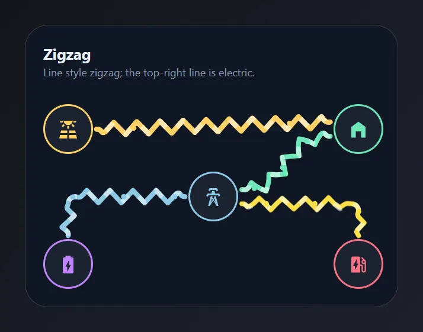

Entities: `sensor.solar_power`, `sensor.house_power`, `sensor.grid_power`, `sensor.battery_power`, `sensor.home_battery`

The top-right line has `electric: true`. Under reduced motion it draws one still zigzag.

File: [cards/88-flow-zigzag.yaml](cards/88-flow-zigzag.yaml)

```yaml
# Flow line style zigzag: straight teeth, and one flow with the electric flicker.
# Entities: sensor.solar_power, sensor.house_power, sensor.grid_power, sensor.battery_power, sensor.home_battery
type: custom:magic-card
name: Zigzag
background: "#0f1724"
border_radius: 26px
padding: 20px
box_shadow: "0 18px 40px rgba(0,0,0,0.35)"
rows:
  - id: head
    columns:
      - gap: 2px
        modules:
          - type: text
            text: Zigzag
            design: { font_size: 17px, font_weight: "700", color: "#e6edf7" }
          - type: text
            text: "Line style zigzag; the bottom-right line is electric."
            design: { font_size: 12px, color: "#8a98ad" }
  - id: top
    column_widths: [52px, 1fr, 52px]
    padding: 18px 0 0
    columns:
      - vertical_align: center
        modules:
          - id: a
            type: icon
            icon: mdi:solar-power-variant
            size: 24px
            design: { color: "#ffd166", width: 52px, height: 52px, display: flex, align_items: center, justify_content: center, border_radius: 50%, border: "2px solid #ffd166", background_color: "rgba(255,255,255,0.05)" }
      - modules: []
      - vertical_align: center
        modules:
          - id: b
            type: icon
            icon: mdi:home-variant
            size: 24px
            design: { color: "#6ee7b7", width: 52px, height: 52px, display: flex, align_items: center, justify_content: center, border_radius: 50%, border: "2px solid #6ee7b7", background_color: "rgba(255,255,255,0.05)" }
  - id: middle
    column_widths: [1fr, 52px, 1fr]
    padding: 10px 0
    columns:
      - modules: []
      - vertical_align: center
        modules:
          - id: c
            type: icon
            icon: mdi:transmission-tower
            size: 24px
            design: { color: "#8ecae6", width: 52px, height: 52px, display: flex, align_items: center, justify_content: center, border_radius: 50%, border: "2px solid #8ecae6", background_color: "rgba(255,255,255,0.05)" }
      - modules: []
  - id: bottom
    column_widths: [52px, 1fr, 52px]
    columns:
      - vertical_align: center
        modules:
          - id: d
            type: icon
            icon: mdi:battery-charging
            size: 24px
            design: { color: "#c084fc", width: 52px, height: 52px, display: flex, align_items: center, justify_content: center, border_radius: 50%, border: "2px solid #c084fc", background_color: "rgba(255,255,255,0.05)" }
      - modules: []
      - vertical_align: center
        modules:
          - id: e
            type: icon
            icon: mdi:ev-station
            size: 24px
            design: { color: "#fb7185", width: 52px, height: 52px, display: flex, align_items: center, justify_content: center, border_radius: 50%, border: "2px solid #fb7185", background_color: "rgba(255,255,255,0.05)" }
flows:
  - { id: a-b, from: a, to: b, entity: sensor.solar_power, max: 5000, route: straight, color: "#ffd166", line_style: zigzag, width: 3, amplitude: 7, wavelength: 26 }
  - { id: b-c, from: b, to: c, entity: sensor.house_power, max: 5000, route: curve, color: "#6ee7b7", line_style: zigzag, width: 3, amplitude: 7, wavelength: 26 }
  - { id: c-d, from: c, to: d, entity: sensor.grid_power, max: 5000, route: elbow, from_side: left, to_side: top, color: "#8ecae6", line_style: zigzag, width: 3, amplitude: 7, wavelength: 26 }
  - { id: c-e, from: c, to: e, entity: sensor.battery_power, max: 3000, route: elbow, from_side: right, to_side: top, color: "#fde047", line_style: zigzag, width: 3, amplitude: 7, wavelength: 26, electric: true }
```

## Flow line style tube

A glass pipe with rising bubbles; with tube_fill_value the liquid length follows the entity value.

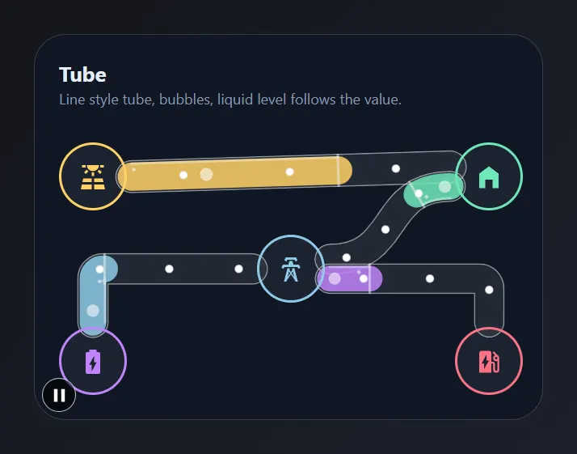

Entities: `sensor.solar_power`, `sensor.house_power`, `sensor.grid_power`, `sensor.battery_power`, `sensor.home_battery`

Each tube has `tube_fill_value: true` and an entity, so the liquid is as long as the value is high (`max` is the full tube). The white dots are the travelling shapes and the bubbles rise inside the liquid.

File: [cards/89-flow-tube.yaml](cards/89-flow-tube.yaml)

```yaml
# Flow line style tube: a glass pipe with rising bubbles; with tube_fill_value the liquid length follows the entity value.
# Entities: sensor.solar_power, sensor.house_power, sensor.grid_power, sensor.battery_power, sensor.home_battery
type: custom:magic-card
name: Tube
background: "#0f1724"
border_radius: 26px
padding: 20px
box_shadow: "0 18px 40px rgba(0,0,0,0.35)"
rows:
  - id: head
    columns:
      - gap: 2px
        modules:
          - type: text
            text: Tube
            design: { font_size: 17px, font_weight: "700", color: "#e6edf7" }
          - type: text
            text: "Line style tube, bubbles, liquid level follows the value."
            design: { font_size: 12px, color: "#8a98ad" }
  - id: top
    column_widths: [52px, 1fr, 52px]
    padding: 18px 0 0
    columns:
      - vertical_align: center
        modules:
          - id: a
            type: icon
            icon: mdi:solar-power-variant
            size: 24px
            design: { color: "#ffd166", width: 52px, height: 52px, display: flex, align_items: center, justify_content: center, border_radius: 50%, border: "2px solid #ffd166", background_color: "rgba(255,255,255,0.05)" }
      - modules: []
      - vertical_align: center
        modules:
          - id: b
            type: icon
            icon: mdi:home-variant
            size: 24px
            design: { color: "#6ee7b7", width: 52px, height: 52px, display: flex, align_items: center, justify_content: center, border_radius: 50%, border: "2px solid #6ee7b7", background_color: "rgba(255,255,255,0.05)" }
  - id: middle
    column_widths: [1fr, 52px, 1fr]
    padding: 10px 0
    columns:
      - modules: []
      - vertical_align: center
        modules:
          - id: c
            type: icon
            icon: mdi:transmission-tower
            size: 24px
            design: { color: "#8ecae6", width: 52px, height: 52px, display: flex, align_items: center, justify_content: center, border_radius: 50%, border: "2px solid #8ecae6", background_color: "rgba(255,255,255,0.05)" }
      - modules: []
  - id: bottom
    column_widths: [52px, 1fr, 52px]
    columns:
      - vertical_align: center
        modules:
          - id: d
            type: icon
            icon: mdi:battery-charging
            size: 24px
            design: { color: "#c084fc", width: 52px, height: 52px, display: flex, align_items: center, justify_content: center, border_radius: 50%, border: "2px solid #c084fc", background_color: "rgba(255,255,255,0.05)" }
      - modules: []
      - vertical_align: center
        modules:
          - id: e
            type: icon
            icon: mdi:ev-station
            size: 24px
            design: { color: "#fb7185", width: 52px, height: 52px, display: flex, align_items: center, justify_content: center, border_radius: 50%, border: "2px solid #fb7185", background_color: "rgba(255,255,255,0.05)" }
flows:
  - { id: a-b, from: a, to: b, entity: sensor.solar_power, max: 5000, route: straight, color: "#ffd166", line_style: tube, width: 14, bubble_count: 4, tube_fill_value: true }
  - { id: b-c, from: b, to: c, entity: sensor.house_power, max: 5000, route: curve, color: "#6ee7b7", line_style: tube, width: 14, bubble_count: 4, tube_fill_value: true }
  - { id: c-d, from: c, to: d, entity: sensor.grid_power, max: 5000, route: elbow, from_side: left, to_side: top, color: "#8ecae6", line_style: tube, width: 14, bubble_count: 4, tube_fill_value: true }
  - { id: c-e, from: c, to: e, entity: sensor.battery_power, max: 3000, route: elbow, from_side: right, to_side: top, color: "#c084fc", line_style: tube, width: 14, bubble_count: 4, tube_fill_value: true }
```

## Flow line style neon

A bright core with a soft glow, optionally flickering.

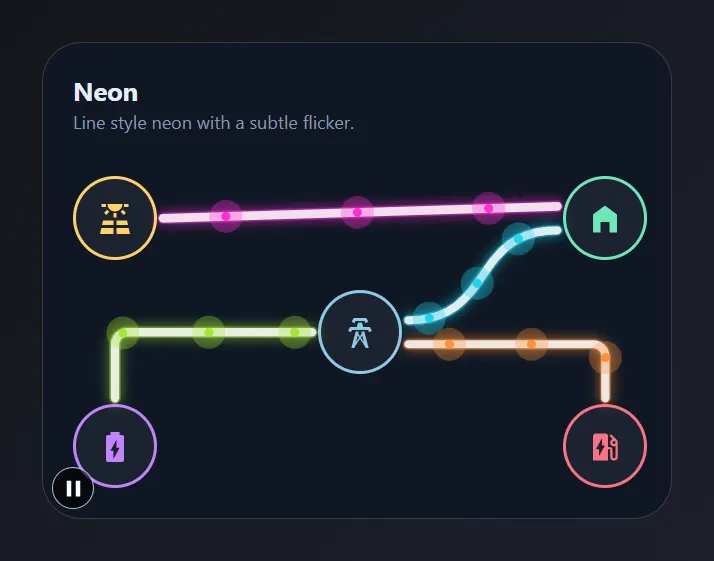

Entities: `sensor.solar_power`, `sensor.house_power`, `sensor.grid_power`, `sensor.battery_power`, `sensor.home_battery`

The glow is `glow: 8` and the flicker is `subtle`. The white core is drawn on dark cards; on a light card the core is the line colour darkened.

File: [cards/90-flow-neon.yaml](cards/90-flow-neon.yaml)

```yaml
# Flow line style neon: a bright core with a soft glow, optionally flickering.
# Entities: sensor.solar_power, sensor.house_power, sensor.grid_power, sensor.battery_power, sensor.home_battery
type: custom:magic-card
name: Neon
background: "#0f1724"
border_radius: 26px
padding: 20px
box_shadow: "0 18px 40px rgba(0,0,0,0.35)"
rows:
  - id: head
    columns:
      - gap: 2px
        modules:
          - type: text
            text: Neon
            design: { font_size: 17px, font_weight: "700", color: "#e6edf7" }
          - type: text
            text: "Line style neon with a subtle flicker."
            design: { font_size: 12px, color: "#8a98ad" }
  - id: top
    column_widths: [52px, 1fr, 52px]
    padding: 18px 0 0
    columns:
      - vertical_align: center
        modules:
          - id: a
            type: icon
            icon: mdi:solar-power-variant
            size: 24px
            design: { color: "#ffd166", width: 52px, height: 52px, display: flex, align_items: center, justify_content: center, border_radius: 50%, border: "2px solid #ffd166", background_color: "rgba(255,255,255,0.05)" }
      - modules: []
      - vertical_align: center
        modules:
          - id: b
            type: icon
            icon: mdi:home-variant
            size: 24px
            design: { color: "#6ee7b7", width: 52px, height: 52px, display: flex, align_items: center, justify_content: center, border_radius: 50%, border: "2px solid #6ee7b7", background_color: "rgba(255,255,255,0.05)" }
  - id: middle
    column_widths: [1fr, 52px, 1fr]
    padding: 10px 0
    columns:
      - modules: []
      - vertical_align: center
        modules:
          - id: c
            type: icon
            icon: mdi:transmission-tower
            size: 24px
            design: { color: "#8ecae6", width: 52px, height: 52px, display: flex, align_items: center, justify_content: center, border_radius: 50%, border: "2px solid #8ecae6", background_color: "rgba(255,255,255,0.05)" }
      - modules: []
  - id: bottom
    column_widths: [52px, 1fr, 52px]
    columns:
      - vertical_align: center
        modules:
          - id: d
            type: icon
            icon: mdi:battery-charging
            size: 24px
            design: { color: "#c084fc", width: 52px, height: 52px, display: flex, align_items: center, justify_content: center, border_radius: 50%, border: "2px solid #c084fc", background_color: "rgba(255,255,255,0.05)" }
      - modules: []
      - vertical_align: center
        modules:
          - id: e
            type: icon
            icon: mdi:ev-station
            size: 24px
            design: { color: "#fb7185", width: 52px, height: 52px, display: flex, align_items: center, justify_content: center, border_radius: 50%, border: "2px solid #fb7185", background_color: "rgba(255,255,255,0.05)" }
flows:
  - { id: a-b, from: a, to: b, entity: sensor.solar_power, max: 5000, route: straight, color: "#ff2fd6", line_style: neon, width: 3, glow: 8, flicker: subtle }
  - { id: b-c, from: b, to: c, entity: sensor.house_power, max: 5000, route: curve, color: "#22d3ee", line_style: neon, width: 3, glow: 8, flicker: subtle }
  - { id: c-d, from: c, to: d, entity: sensor.grid_power, max: 5000, route: elbow, from_side: left, to_side: top, color: "#a3e635", line_style: neon, width: 3, glow: 8, flicker: subtle }
  - { id: c-e, from: c, to: e, entity: sensor.battery_power, max: 3000, route: elbow, from_side: right, to_side: top, color: "#fb923c", line_style: neon, width: 3, glow: 8, flicker: subtle }
```

## Flow line style cable

An insulated wire with an outline; twisted adds diagonal strand marks.

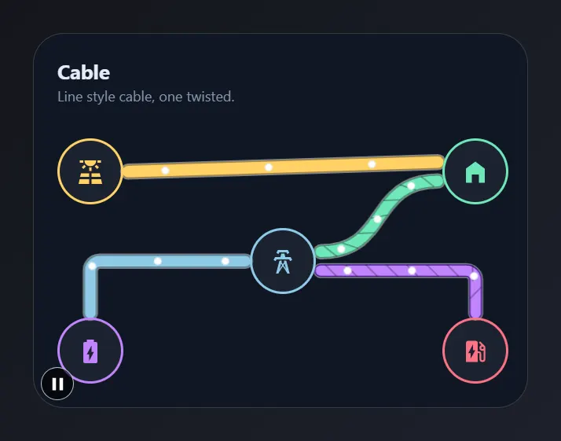

Entities: `sensor.solar_power`, `sensor.house_power`, `sensor.grid_power`, `sensor.battery_power`, `sensor.home_battery`

The second and fourth cables are `twisted`. The fourth sets `cable_color` for a darker sheath.

File: [cards/91-flow-cable.yaml](cards/91-flow-cable.yaml)

```yaml
# Flow line style cable: an insulated wire with an outline; twisted adds diagonal strand marks.
# Entities: sensor.solar_power, sensor.house_power, sensor.grid_power, sensor.battery_power, sensor.home_battery
type: custom:magic-card
name: Cable
background: "#0f1724"
border_radius: 26px
padding: 20px
box_shadow: "0 18px 40px rgba(0,0,0,0.35)"
rows:
  - id: head
    columns:
      - gap: 2px
        modules:
          - type: text
            text: Cable
            design: { font_size: 17px, font_weight: "700", color: "#e6edf7" }
          - type: text
            text: "Line style cable, one twisted."
            design: { font_size: 12px, color: "#8a98ad" }
  - id: top
    column_widths: [52px, 1fr, 52px]
    padding: 18px 0 0
    columns:
      - vertical_align: center
        modules:
          - id: a
            type: icon
            icon: mdi:solar-power-variant
            size: 24px
            design: { color: "#ffd166", width: 52px, height: 52px, display: flex, align_items: center, justify_content: center, border_radius: 50%, border: "2px solid #ffd166", background_color: "rgba(255,255,255,0.05)" }
      - modules: []
      - vertical_align: center
        modules:
          - id: b
            type: icon
            icon: mdi:home-variant
            size: 24px
            design: { color: "#6ee7b7", width: 52px, height: 52px, display: flex, align_items: center, justify_content: center, border_radius: 50%, border: "2px solid #6ee7b7", background_color: "rgba(255,255,255,0.05)" }
  - id: middle
    column_widths: [1fr, 52px, 1fr]
    padding: 10px 0
    columns:
      - modules: []
      - vertical_align: center
        modules:
          - id: c
            type: icon
            icon: mdi:transmission-tower
            size: 24px
            design: { color: "#8ecae6", width: 52px, height: 52px, display: flex, align_items: center, justify_content: center, border_radius: 50%, border: "2px solid #8ecae6", background_color: "rgba(255,255,255,0.05)" }
      - modules: []
  - id: bottom
    column_widths: [52px, 1fr, 52px]
    columns:
      - vertical_align: center
        modules:
          - id: d
            type: icon
            icon: mdi:battery-charging
            size: 24px
            design: { color: "#c084fc", width: 52px, height: 52px, display: flex, align_items: center, justify_content: center, border_radius: 50%, border: "2px solid #c084fc", background_color: "rgba(255,255,255,0.05)" }
      - modules: []
      - vertical_align: center
        modules:
          - id: e
            type: icon
            icon: mdi:ev-station
            size: 24px
            design: { color: "#fb7185", width: 52px, height: 52px, display: flex, align_items: center, justify_content: center, border_radius: 50%, border: "2px solid #fb7185", background_color: "rgba(255,255,255,0.05)" }
flows:
  - { id: a-b, from: a, to: b, entity: sensor.solar_power, max: 5000, route: straight, color: "#ffd166", line_style: cable, width: 6 }
  - { id: b-c, from: b, to: c, entity: sensor.house_power, max: 5000, route: curve, color: "#6ee7b7", line_style: cable, width: 6, twisted: true }
  - { id: c-d, from: c, to: d, entity: sensor.grid_power, max: 5000, route: elbow, from_side: left, to_side: top, color: "#8ecae6", line_style: cable, width: 6 }
  - { id: c-e, from: c, to: e, entity: sensor.battery_power, max: 3000, route: elbow, from_side: right, to_side: top, color: "#c084fc", line_style: cable, width: 6, twisted: true, cable_color: "#4c1d95" }
```

## Flow shapes

Arrow, chevron, star (spinning), diamond, comet and spark travel along a straight line and point where it goes.

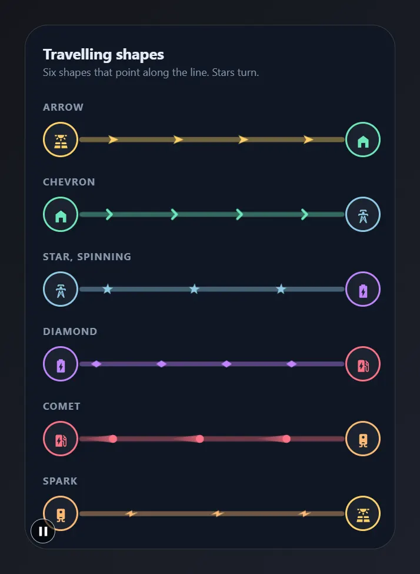

Entities: `sensor.solar_power`, `sensor.house_power`, `sensor.grid_power`, `sensor.battery_power`, `sensor.home_battery`

Every lane is one flow with its own `shape`. The star has `shape_spin: true`. Shapes turn to follow the line.

File: [cards/92-flow-shapes.yaml](cards/92-flow-shapes.yaml)

```yaml
# Flow shapes: arrow, chevron, star (spinning), diamond, comet and spark travel along a straight line and point where it goes.
# Entities: sensor.solar_power, sensor.house_power, sensor.grid_power, sensor.battery_power, sensor.home_battery
type: custom:magic-card
name: "Travelling shapes"
background: "#0f1724"
border_radius: 26px
padding: 20px
box_shadow: "0 18px 40px rgba(0,0,0,0.35)"
rows:
  - id: head
    columns:
      - gap: 2px
        modules:
          - type: text
            text: "Travelling shapes"
            design: { font_size: 17px, font_weight: "700", color: "#e6edf7" }
          - type: text
            text: "Six shapes that point along the line. Stars turn."
            design: { font_size: 12px, color: "#8a98ad" }
  - id: r0
    column_widths: ["1fr"]
    padding: 14px 0 0
    columns:
      - vertical_align: end
        modules:
          - type: text
            text: arrow
            design: { font_size: 11px, font_weight: "700", color: "#8a98ad", text_transform: uppercase, letter_spacing: 1px }
  - id: r1
    column_widths: ["36px", "1fr", "36px"]
    padding: 0
    columns:
      - vertical_align: center
        modules:
          - id: a0
            type: icon
            icon: mdi:solar-power-variant
            size: 18px
            design: { color: "#ffd166", width: 36px, height: 36px, display: flex, align_items: center, justify_content: center, border_radius: 50%, border: "2px solid #ffd166", background_color: "rgba(255,255,255,0.05)" }
      - modules: []
      - vertical_align: center
        modules:
          - id: b0
            type: icon
            icon: mdi:home-variant
            size: 18px
            design: { color: "#6ee7b7", width: 36px, height: 36px, display: flex, align_items: center, justify_content: center, border_radius: 50%, border: "2px solid #6ee7b7", background_color: "rgba(255,255,255,0.05)" }
  - id: r2
    column_widths: ["1fr"]
    padding: 10px 0 0
    columns:
      - vertical_align: end
        modules:
          - type: text
            text: chevron
            design: { font_size: 11px, font_weight: "700", color: "#8a98ad", text_transform: uppercase, letter_spacing: 1px }
  - id: r3
    column_widths: ["36px", "1fr", "36px"]
    padding: 0
    columns:
      - vertical_align: center
        modules:
          - id: a1
            type: icon
            icon: mdi:home-variant
            size: 18px
            design: { color: "#6ee7b7", width: 36px, height: 36px, display: flex, align_items: center, justify_content: center, border_radius: 50%, border: "2px solid #6ee7b7", background_color: "rgba(255,255,255,0.05)" }
      - modules: []
      - vertical_align: center
        modules:
          - id: b1
            type: icon
            icon: mdi:transmission-tower
            size: 18px
            design: { color: "#8ecae6", width: 36px, height: 36px, display: flex, align_items: center, justify_content: center, border_radius: 50%, border: "2px solid #8ecae6", background_color: "rgba(255,255,255,0.05)" }
  - id: r4
    column_widths: ["1fr"]
    padding: 10px 0 0
    columns:
      - vertical_align: end
        modules:
          - type: text
            text: "star, spinning"
            design: { font_size: 11px, font_weight: "700", color: "#8a98ad", text_transform: uppercase, letter_spacing: 1px }
  - id: r5
    column_widths: ["36px", "1fr", "36px"]
    padding: 0
    columns:
      - vertical_align: center
        modules:
          - id: a2
            type: icon
            icon: mdi:transmission-tower
            size: 18px
            design: { color: "#8ecae6", width: 36px, height: 36px, display: flex, align_items: center, justify_content: center, border_radius: 50%, border: "2px solid #8ecae6", background_color: "rgba(255,255,255,0.05)" }
      - modules: []
      - vertical_align: center
        modules:
          - id: b2
            type: icon
            icon: mdi:battery-charging
            size: 18px
            design: { color: "#c084fc", width: 36px, height: 36px, display: flex, align_items: center, justify_content: center, border_radius: 50%, border: "2px solid #c084fc", background_color: "rgba(255,255,255,0.05)" }
  - id: r6
    column_widths: ["1fr"]
    padding: 10px 0 0
    columns:
      - vertical_align: end
        modules:
          - type: text
            text: diamond
            design: { font_size: 11px, font_weight: "700", color: "#8a98ad", text_transform: uppercase, letter_spacing: 1px }
  - id: r7
    column_widths: ["36px", "1fr", "36px"]
    padding: 0
    columns:
      - vertical_align: center
        modules:
          - id: a3
            type: icon
            icon: mdi:battery-charging
            size: 18px
            design: { color: "#c084fc", width: 36px, height: 36px, display: flex, align_items: center, justify_content: center, border_radius: 50%, border: "2px solid #c084fc", background_color: "rgba(255,255,255,0.05)" }
      - modules: []
      - vertical_align: center
        modules:
          - id: b3
            type: icon
            icon: mdi:ev-station
            size: 18px
            design: { color: "#fb7185", width: 36px, height: 36px, display: flex, align_items: center, justify_content: center, border_radius: 50%, border: "2px solid #fb7185", background_color: "rgba(255,255,255,0.05)" }
  - id: r8
    column_widths: ["1fr"]
    padding: 10px 0 0
    columns:
      - vertical_align: end
        modules:
          - type: text
            text: comet
            design: { font_size: 11px, font_weight: "700", color: "#8a98ad", text_transform: uppercase, letter_spacing: 1px }
  - id: r9
    column_widths: ["36px", "1fr", "36px"]
    padding: 0
    columns:
      - vertical_align: center
        modules:
          - id: a4
            type: icon
            icon: mdi:ev-station
            size: 18px
            design: { color: "#fb7185", width: 36px, height: 36px, display: flex, align_items: center, justify_content: center, border_radius: 50%, border: "2px solid #fb7185", background_color: "rgba(255,255,255,0.05)" }
      - modules: []
      - vertical_align: center
        modules:
          - id: b4
            type: icon
            icon: mdi:water-boiler
            size: 18px
            design: { color: "#fdba74", width: 36px, height: 36px, display: flex, align_items: center, justify_content: center, border_radius: 50%, border: "2px solid #fdba74", background_color: "rgba(255,255,255,0.05)" }
  - id: r10
    column_widths: ["1fr"]
    padding: 10px 0 0
    columns:
      - vertical_align: end
        modules:
          - type: text
            text: spark
            design: { font_size: 11px, font_weight: "700", color: "#8a98ad", text_transform: uppercase, letter_spacing: 1px }
  - id: r11
    column_widths: ["36px", "1fr", "36px"]
    padding: 0
    columns:
      - vertical_align: center
        modules:
          - id: a5
            type: icon
            icon: mdi:water-boiler
            size: 18px
            design: { color: "#fdba74", width: 36px, height: 36px, display: flex, align_items: center, justify_content: center, border_radius: 50%, border: "2px solid #fdba74", background_color: "rgba(255,255,255,0.05)" }
      - modules: []
      - vertical_align: center
        modules:
          - id: b5
            type: icon
            icon: mdi:solar-power-variant
            size: 18px
            design: { color: "#ffd166", width: 36px, height: 36px, display: flex, align_items: center, justify_content: center, border_radius: 50%, border: "2px solid #ffd166", background_color: "rgba(255,255,255,0.05)" }
flows:
  - { id: lane-0, from: a0, to: b0, entity: sensor.solar_power, max: 5000, route: straight, color: "#ffd166", width: 3, shape: arrow, dot_size: 11, dots: 4 }
  - { id: lane-1, from: a1, to: b1, entity: sensor.house_power, max: 5000, route: straight, color: "#6ee7b7", width: 3, shape: chevron, dot_size: 10, dots: 4 }
  - { id: lane-2, from: a2, to: b2, entity: sensor.grid_power, max: 5000, route: straight, color: "#8ecae6", width: 3, shape: star, shape_spin: true, dot_size: 12, dots: 3 }
  - { id: lane-3, from: a3, to: b3, entity: sensor.battery_power, max: 3000, route: straight, color: "#c084fc", width: 3, shape: diamond, dot_size: 10, dots: 4 }
  - { id: lane-4, from: a4, to: b4, entity: sensor.solar_power, max: 5000, route: straight, color: "#fb7185", width: 3, shape: comet, dot_size: 9, dots: 3 }
  - { id: lane-5, from: a5, to: b5, entity: sensor.house_power, max: 5000, route: straight, color: "#fdba74", width: 3, shape: spark, dot_size: 11, dots: 3 }
```

## Flow shapes in a swarm

A bubble line, drops, an MDI icon, random spacing with size variation, two alternating shapes, and a pulse that stays in place.

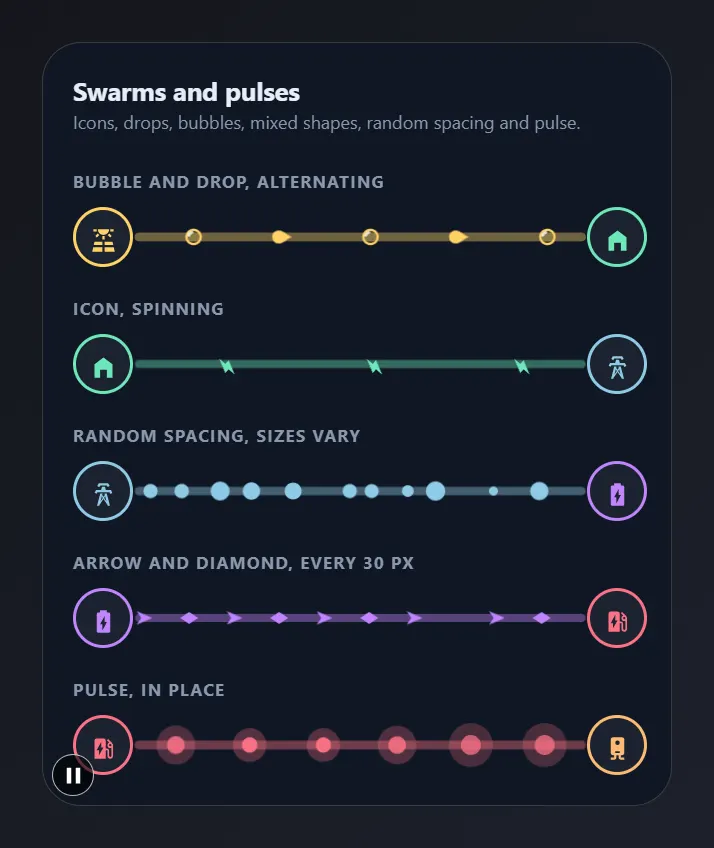

Entities: `sensor.solar_power`, `sensor.house_power`, `sensor.grid_power`, `sensor.battery_power`, `sensor.home_battery`

The icon lane needs `shape_icon` with an MDI icon name. The pulse lane has `motion: pulse`: the shapes stay in place and pulse, faster at a higher value.

File: [cards/93-flow-swarm.yaml](cards/93-flow-swarm.yaml)

```yaml
# Flow shapes in a swarm: a bubble line, drops, an MDI icon, random spacing with size variation, two alternating shapes, and a pulse that stays in place.
# Entities: sensor.solar_power, sensor.house_power, sensor.grid_power, sensor.battery_power, sensor.home_battery
type: custom:magic-card
name: "Swarms and pulses"
background: "#0f1724"
border_radius: 26px
padding: 20px
box_shadow: "0 18px 40px rgba(0,0,0,0.35)"
rows:
  - id: head
    columns:
      - gap: 2px
        modules:
          - type: text
            text: "Swarms and pulses"
            design: { font_size: 17px, font_weight: "700", color: "#e6edf7" }
          - type: text
            text: "Icons, drops, bubbles, mixed shapes, random spacing and pulse."
            design: { font_size: 12px, color: "#8a98ad" }
  - id: r0
    column_widths: ["1fr"]
    padding: 14px 0 0
    columns:
      - vertical_align: end
        modules:
          - type: text
            text: "bubble and drop, alternating"
            design: { font_size: 11px, font_weight: "700", color: "#8a98ad", text_transform: uppercase, letter_spacing: 1px }
  - id: r1
    column_widths: ["36px", "1fr", "36px"]
    padding: 0
    columns:
      - vertical_align: center
        modules:
          - id: a0
            type: icon
            icon: mdi:solar-power-variant
            size: 18px
            design: { color: "#ffd166", width: 36px, height: 36px, display: flex, align_items: center, justify_content: center, border_radius: 50%, border: "2px solid #ffd166", background_color: "rgba(255,255,255,0.05)" }
      - modules: []
      - vertical_align: center
        modules:
          - id: b0
            type: icon
            icon: mdi:home-variant
            size: 18px
            design: { color: "#6ee7b7", width: 36px, height: 36px, display: flex, align_items: center, justify_content: center, border_radius: 50%, border: "2px solid #6ee7b7", background_color: "rgba(255,255,255,0.05)" }
  - id: r2
    column_widths: ["1fr"]
    padding: 10px 0 0
    columns:
      - vertical_align: end
        modules:
          - type: text
            text: "icon, spinning"
            design: { font_size: 11px, font_weight: "700", color: "#8a98ad", text_transform: uppercase, letter_spacing: 1px }
  - id: r3
    column_widths: ["36px", "1fr", "36px"]
    padding: 0
    columns:
      - vertical_align: center
        modules:
          - id: a1
            type: icon
            icon: mdi:home-variant
            size: 18px
            design: { color: "#6ee7b7", width: 36px, height: 36px, display: flex, align_items: center, justify_content: center, border_radius: 50%, border: "2px solid #6ee7b7", background_color: "rgba(255,255,255,0.05)" }
      - modules: []
      - vertical_align: center
        modules:
          - id: b1
            type: icon
            icon: mdi:transmission-tower
            size: 18px
            design: { color: "#8ecae6", width: 36px, height: 36px, display: flex, align_items: center, justify_content: center, border_radius: 50%, border: "2px solid #8ecae6", background_color: "rgba(255,255,255,0.05)" }
  - id: r4
    column_widths: ["1fr"]
    padding: 10px 0 0
    columns:
      - vertical_align: end
        modules:
          - type: text
            text: "random spacing, sizes vary"
            design: { font_size: 11px, font_weight: "700", color: "#8a98ad", text_transform: uppercase, letter_spacing: 1px }
  - id: r5
    column_widths: ["36px", "1fr", "36px"]
    padding: 0
    columns:
      - vertical_align: center
        modules:
          - id: a2
            type: icon
            icon: mdi:transmission-tower
            size: 18px
            design: { color: "#8ecae6", width: 36px, height: 36px, display: flex, align_items: center, justify_content: center, border_radius: 50%, border: "2px solid #8ecae6", background_color: "rgba(255,255,255,0.05)" }
      - modules: []
      - vertical_align: center
        modules:
          - id: b2
            type: icon
            icon: mdi:battery-charging
            size: 18px
            design: { color: "#c084fc", width: 36px, height: 36px, display: flex, align_items: center, justify_content: center, border_radius: 50%, border: "2px solid #c084fc", background_color: "rgba(255,255,255,0.05)" }
  - id: r6
    column_widths: ["1fr"]
    padding: 10px 0 0
    columns:
      - vertical_align: end
        modules:
          - type: text
            text: "arrow and diamond, every 30 px"
            design: { font_size: 11px, font_weight: "700", color: "#8a98ad", text_transform: uppercase, letter_spacing: 1px }
  - id: r7
    column_widths: ["36px", "1fr", "36px"]
    padding: 0
    columns:
      - vertical_align: center
        modules:
          - id: a3
            type: icon
            icon: mdi:battery-charging
            size: 18px
            design: { color: "#c084fc", width: 36px, height: 36px, display: flex, align_items: center, justify_content: center, border_radius: 50%, border: "2px solid #c084fc", background_color: "rgba(255,255,255,0.05)" }
      - modules: []
      - vertical_align: center
        modules:
          - id: b3
            type: icon
            icon: mdi:ev-station
            size: 18px
            design: { color: "#fb7185", width: 36px, height: 36px, display: flex, align_items: center, justify_content: center, border_radius: 50%, border: "2px solid #fb7185", background_color: "rgba(255,255,255,0.05)" }
  - id: r8
    column_widths: ["1fr"]
    padding: 10px 0 0
    columns:
      - vertical_align: end
        modules:
          - type: text
            text: "pulse, in place"
            design: { font_size: 11px, font_weight: "700", color: "#8a98ad", text_transform: uppercase, letter_spacing: 1px }
  - id: r9
    column_widths: ["36px", "1fr", "36px"]
    padding: 0
    columns:
      - vertical_align: center
        modules:
          - id: a4
            type: icon
            icon: mdi:ev-station
            size: 18px
            design: { color: "#fb7185", width: 36px, height: 36px, display: flex, align_items: center, justify_content: center, border_radius: 50%, border: "2px solid #fb7185", background_color: "rgba(255,255,255,0.05)" }
      - modules: []
      - vertical_align: center
        modules:
          - id: b4
            type: icon
            icon: mdi:water-boiler
            size: 18px
            design: { color: "#fdba74", width: 36px, height: 36px, display: flex, align_items: center, justify_content: center, border_radius: 50%, border: "2px solid #fdba74", background_color: "rgba(255,255,255,0.05)" }
flows:
  - { id: lane-0, from: a0, to: b0, entity: sensor.solar_power, max: 5000, route: straight, color: "#ffd166", width: 3, shape: bubble, shape_alternate: drop, dot_size: 11, dots: 5 }
  - { id: lane-1, from: a1, to: b1, entity: sensor.house_power, max: 5000, route: straight, color: "#6ee7b7", width: 3, shape: icon, shape_icon: "mdi:lightning-bolt", shape_spin: true, dot_size: 16, dots: 3 }
  - { id: lane-2, from: a2, to: b2, entity: sensor.grid_power, max: 5000, route: straight, color: "#8ecae6", width: 3, shape: dot, spacing_mode: random, spacing: 26, size_variation: 45, dot_size: 9 }
  - { id: lane-3, from: a3, to: b3, entity: sensor.battery_power, max: 3000, route: straight, color: "#c084fc", width: 3, shape: arrow, shape_alternate: diamond, spacing: 30, dot_size: 10 }
  - { id: lane-4, from: a4, to: b4, entity: sensor.solar_power, max: 5000, route: straight, color: "#fb7185", width: 3, shape: dot, motion: pulse, dots: 6, dot_size: 10, glow: 6 }
```

## Flow gradients and ends

A colour that fades along the line, round and arrow caps, colours by value, and a ring or splash where each shape arrives.

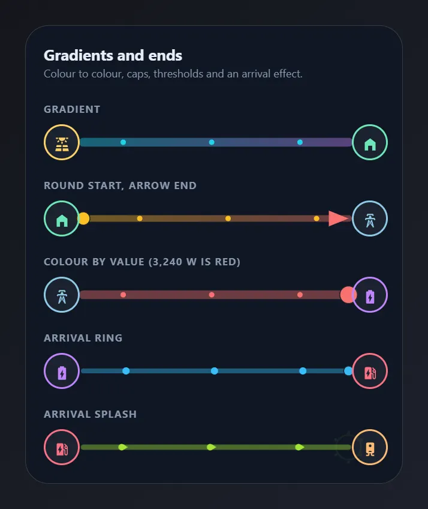

Entities: `sensor.solar_power`, `sensor.house_power`, `sensor.grid_power`, `sensor.battery_power`, `sensor.home_battery`

The value lane sets thresholds on the entity value: green below 2000, yellow from 2000, red from 3000. The ring and the splash play where each shape arrives.

File: [cards/94-flow-gradient-ends.yaml](cards/94-flow-gradient-ends.yaml)

```yaml
# Flow gradients and ends: a colour that fades along the line, round and arrow caps, colours by value, and a ring or splash where each shape arrives.
# Entities: sensor.solar_power, sensor.house_power, sensor.grid_power, sensor.battery_power, sensor.home_battery
type: custom:magic-card
name: "Gradients and ends"
background: "#0f1724"
border_radius: 26px
padding: 20px
box_shadow: "0 18px 40px rgba(0,0,0,0.35)"
rows:
  - id: head
    columns:
      - gap: 2px
        modules:
          - type: text
            text: "Gradients and ends"
            design: { font_size: 17px, font_weight: "700", color: "#e6edf7" }
          - type: text
            text: "Colour to colour, caps, thresholds and an arrival effect."
            design: { font_size: 12px, color: "#8a98ad" }
  - id: r0
    column_widths: ["1fr"]
    padding: 14px 0 0
    columns:
      - vertical_align: end
        modules:
          - type: text
            text: gradient
            design: { font_size: 11px, font_weight: "700", color: "#8a98ad", text_transform: uppercase, letter_spacing: 1px }
  - id: r1
    column_widths: ["36px", "1fr", "36px"]
    padding: 0
    columns:
      - vertical_align: center
        modules:
          - id: a0
            type: icon
            icon: mdi:solar-power-variant
            size: 18px
            design: { color: "#ffd166", width: 36px, height: 36px, display: flex, align_items: center, justify_content: center, border_radius: 50%, border: "2px solid #ffd166", background_color: "rgba(255,255,255,0.05)" }
      - modules: []
      - vertical_align: center
        modules:
          - id: b0
            type: icon
            icon: mdi:home-variant
            size: 18px
            design: { color: "#6ee7b7", width: 36px, height: 36px, display: flex, align_items: center, justify_content: center, border_radius: 50%, border: "2px solid #6ee7b7", background_color: "rgba(255,255,255,0.05)" }
  - id: r2
    column_widths: ["1fr"]
    padding: 10px 0 0
    columns:
      - vertical_align: end
        modules:
          - type: text
            text: "round start, arrow end"
            design: { font_size: 11px, font_weight: "700", color: "#8a98ad", text_transform: uppercase, letter_spacing: 1px }
  - id: r3
    column_widths: ["36px", "1fr", "36px"]
    padding: 0
    columns:
      - vertical_align: center
        modules:
          - id: a1
            type: icon
            icon: mdi:home-variant
            size: 18px
            design: { color: "#6ee7b7", width: 36px, height: 36px, display: flex, align_items: center, justify_content: center, border_radius: 50%, border: "2px solid #6ee7b7", background_color: "rgba(255,255,255,0.05)" }
      - modules: []
      - vertical_align: center
        modules:
          - id: b1
            type: icon
            icon: mdi:transmission-tower
            size: 18px
            design: { color: "#8ecae6", width: 36px, height: 36px, display: flex, align_items: center, justify_content: center, border_radius: 50%, border: "2px solid #8ecae6", background_color: "rgba(255,255,255,0.05)" }
  - id: r4
    column_widths: ["1fr"]
    padding: 10px 0 0
    columns:
      - vertical_align: end
        modules:
          - type: text
            text: "colour by value (3,240 W is red)"
            design: { font_size: 11px, font_weight: "700", color: "#8a98ad", text_transform: uppercase, letter_spacing: 1px }
  - id: r5
    column_widths: ["36px", "1fr", "36px"]
    padding: 0
    columns:
      - vertical_align: center
        modules:
          - id: a2
            type: icon
            icon: mdi:transmission-tower
            size: 18px
            design: { color: "#8ecae6", width: 36px, height: 36px, display: flex, align_items: center, justify_content: center, border_radius: 50%, border: "2px solid #8ecae6", background_color: "rgba(255,255,255,0.05)" }
      - modules: []
      - vertical_align: center
        modules:
          - id: b2
            type: icon
            icon: mdi:battery-charging
            size: 18px
            design: { color: "#c084fc", width: 36px, height: 36px, display: flex, align_items: center, justify_content: center, border_radius: 50%, border: "2px solid #c084fc", background_color: "rgba(255,255,255,0.05)" }
  - id: r6
    column_widths: ["1fr"]
    padding: 10px 0 0
    columns:
      - vertical_align: end
        modules:
          - type: text
            text: "arrival ring"
            design: { font_size: 11px, font_weight: "700", color: "#8a98ad", text_transform: uppercase, letter_spacing: 1px }
  - id: r7
    column_widths: ["36px", "1fr", "36px"]
    padding: 0
    columns:
      - vertical_align: center
        modules:
          - id: a3
            type: icon
            icon: mdi:battery-charging
            size: 18px
            design: { color: "#c084fc", width: 36px, height: 36px, display: flex, align_items: center, justify_content: center, border_radius: 50%, border: "2px solid #c084fc", background_color: "rgba(255,255,255,0.05)" }
      - modules: []
      - vertical_align: center
        modules:
          - id: b3
            type: icon
            icon: mdi:ev-station
            size: 18px
            design: { color: "#fb7185", width: 36px, height: 36px, display: flex, align_items: center, justify_content: center, border_radius: 50%, border: "2px solid #fb7185", background_color: "rgba(255,255,255,0.05)" }
  - id: r8
    column_widths: ["1fr"]
    padding: 10px 0 0
    columns:
      - vertical_align: end
        modules:
          - type: text
            text: "arrival splash"
            design: { font_size: 11px, font_weight: "700", color: "#8a98ad", text_transform: uppercase, letter_spacing: 1px }
  - id: r9
    column_widths: ["36px", "1fr", "36px"]
    padding: 0
    columns:
      - vertical_align: center
        modules:
          - id: a4
            type: icon
            icon: mdi:ev-station
            size: 18px
            design: { color: "#fb7185", width: 36px, height: 36px, display: flex, align_items: center, justify_content: center, border_radius: 50%, border: "2px solid #fb7185", background_color: "rgba(255,255,255,0.05)" }
      - modules: []
      - vertical_align: center
        modules:
          - id: b4
            type: icon
            icon: mdi:water-boiler
            size: 18px
            design: { color: "#fdba74", width: 36px, height: 36px, display: flex, align_items: center, justify_content: center, border_radius: 50%, border: "2px solid #fdba74", background_color: "rgba(255,255,255,0.05)" }
flows:
  - { id: lane-0, from: a0, to: b0, entity: sensor.solar_power, max: 5000, route: straight, color: "#22d3ee", width: 5, color_to: "#c084fc", dots: 3 }
  - { id: lane-1, from: a1, to: b1, entity: sensor.house_power, max: 5000, route: straight, color: "#fbbf24", width: 4, color_to: "#f87171", start_cap: round, end_cap: arrow, dots: 3 }
  - { id: lane-2, from: a2, to: b2, entity: sensor.solar_power, max: 5000, route: straight, color: "#8ecae6", width: 5, color_mode: value, thresholds: [{ from: 0, color: "#4ade80" }, { from: 2000, color: "#facc15" }, { from: 3000, color: "#f87171" }], end_cap: round, dots: 3 }
  - { id: lane-3, from: a3, to: b3, entity: sensor.battery_power, max: 3000, route: straight, color: "#38bdf8", width: 3, shape: dot, dot_size: 8, dots: 3, arrival: ring, arrival_size: 26, end_cap: round }
  - { id: lane-4, from: a4, to: b4, entity: sensor.solar_power, max: 5000, route: straight, color: "#a3e635", width: 3, shape: drop, dot_size: 9, dots: 3, arrival: splash, arrival_size: 30 }
```

## Flow lines on short elbows

The wave and zigzag get lower where the run is short and stay flat through the corner, and double rails may overlap there.

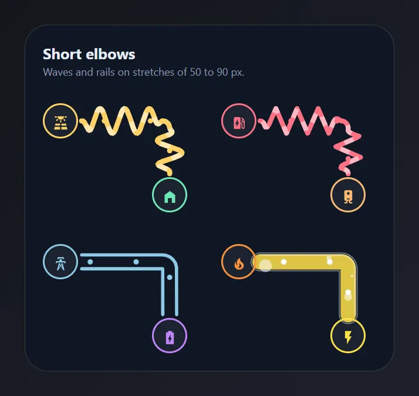

Entities: `sensor.solar_power`, `sensor.house_power`, `sensor.grid_power`, `sensor.battery_power`, `sensor.home_battery`

The elbows run 50 to 90 px. The wave and zigzag ask for an amplitude of 14 px and get less where the stretch is short.

File: [cards/95-flow-short-elbow-wave.yaml](cards/95-flow-short-elbow-wave.yaml)

```yaml
# Flow lines on short elbows: the wave and zigzag get lower where the run is short and stay flat through the corner, and double rails may overlap there.
# Entities: sensor.solar_power, sensor.house_power, sensor.grid_power, sensor.battery_power, sensor.home_battery
type: custom:magic-card
name: "Short elbows"
background: "#0f1724"
border_radius: 26px
padding: 20px
box_shadow: "0 18px 40px rgba(0,0,0,0.35)"
rows:
  - id: head
    columns:
      - gap: 2px
        modules:
          - type: text
            text: "Short elbows"
            design: { font_size: 17px, font_weight: "700", color: "#e6edf7" }
          - type: text
            text: "Waves and rails on stretches of 50 to 90 px."
            design: { font_size: 12px, color: "#8a98ad" }
  - id: r0
    column_widths: ["52px", "56px", "52px", "1fr", "52px", "56px", "52px"]
    padding: 18px 0 0
    columns:
      - vertical_align: center
        modules:
          - id: a1
            type: icon
            icon: mdi:solar-power-variant
            size: 18px
            design: { color: "#ffd166", width: 36px, height: 36px, display: flex, align_items: center, justify_content: center, border_radius: 50%, border: "2px solid #ffd166", background_color: "rgba(255,255,255,0.05)" }
      - modules: []
      - modules: []
      - modules: []
      - vertical_align: center
        modules:
          - id: a2
            type: icon
            icon: mdi:ev-station
            size: 18px
            design: { color: "#fb7185", width: 36px, height: 36px, display: flex, align_items: center, justify_content: center, border_radius: 50%, border: "2px solid #fb7185", background_color: "rgba(255,255,255,0.05)" }
      - modules: []
      - modules: []
  - id: r1
    column_widths: ["52px", "56px", "52px", "1fr", "52px", "56px", "52px"]
    padding: 34px 0 0
    columns:
      - modules: []
      - modules: []
      - vertical_align: center
        modules:
          - id: b1
            type: icon
            icon: mdi:home-variant
            size: 18px
            design: { color: "#6ee7b7", width: 36px, height: 36px, display: flex, align_items: center, justify_content: center, border_radius: 50%, border: "2px solid #6ee7b7", background_color: "rgba(255,255,255,0.05)" }
      - modules: []
      - modules: []
      - modules: []
      - vertical_align: center
        modules:
          - id: b2
            type: icon
            icon: mdi:water-boiler
            size: 18px
            design: { color: "#fdba74", width: 36px, height: 36px, display: flex, align_items: center, justify_content: center, border_radius: 50%, border: "2px solid #fdba74", background_color: "rgba(255,255,255,0.05)" }
  - id: r2
    column_widths: ["52px", "56px", "52px", "1fr", "52px", "56px", "52px"]
    padding: 26px 0 0
    columns:
      - vertical_align: center
        modules:
          - id: a3
            type: icon
            icon: mdi:transmission-tower
            size: 18px
            design: { color: "#8ecae6", width: 36px, height: 36px, display: flex, align_items: center, justify_content: center, border_radius: 50%, border: "2px solid #8ecae6", background_color: "rgba(255,255,255,0.05)" }
      - modules: []
      - modules: []
      - modules: []
      - vertical_align: center
        modules:
          - id: a4
            type: icon
            icon: mdi:fire
            size: 18px
            design: { color: "#fb923c", width: 36px, height: 36px, display: flex, align_items: center, justify_content: center, border_radius: 50%, border: "2px solid #fb923c", background_color: "rgba(255,255,255,0.05)" }
      - modules: []
      - modules: []
  - id: r3
    column_widths: ["52px", "56px", "52px", "1fr", "52px", "56px", "52px"]
    padding: 34px 0 0
    columns:
      - modules: []
      - modules: []
      - vertical_align: center
        modules:
          - id: b3
            type: icon
            icon: mdi:battery-charging
            size: 18px
            design: { color: "#c084fc", width: 36px, height: 36px, display: flex, align_items: center, justify_content: center, border_radius: 50%, border: "2px solid #c084fc", background_color: "rgba(255,255,255,0.05)" }
      - modules: []
      - modules: []
      - modules: []
      - vertical_align: center
        modules:
          - id: b4
            type: icon
            icon: mdi:flash
            size: 18px
            design: { color: "#fde047", width: 36px, height: 36px, display: flex, align_items: center, justify_content: center, border_radius: 50%, border: "2px solid #fde047", background_color: "rgba(255,255,255,0.05)" }
flows:
  - { id: wave, from: a1, to: b1, entity: sensor.solar_power, max: 5000, route: elbow, from_side: right, to_side: top, color: "#ffd166", line_style: wave, amplitude: 14, wavelength: 28, width: 3 }
  - { id: zigzag, from: a2, to: b2, entity: sensor.house_power, max: 5000, route: elbow, from_side: right, to_side: top, color: "#fb7185", line_style: zigzag, amplitude: 14, wavelength: 24, width: 3 }
  - { id: double, from: a3, to: b3, entity: sensor.grid_power, max: 5000, route: elbow, from_side: right, to_side: top, color: "#8ecae6", line_style: double, rail_gap: 12, width: 2 }
  - { id: tube, from: a4, to: b4, entity: sensor.battery_power, max: 3000, route: elbow, from_side: right, to_side: top, color: "#fde047", line_style: tube, width: 12 }
```

## Wall tablet

Six flows on one card, three tubes that fill with the value and three neon lines, with bubbles and flicker on.

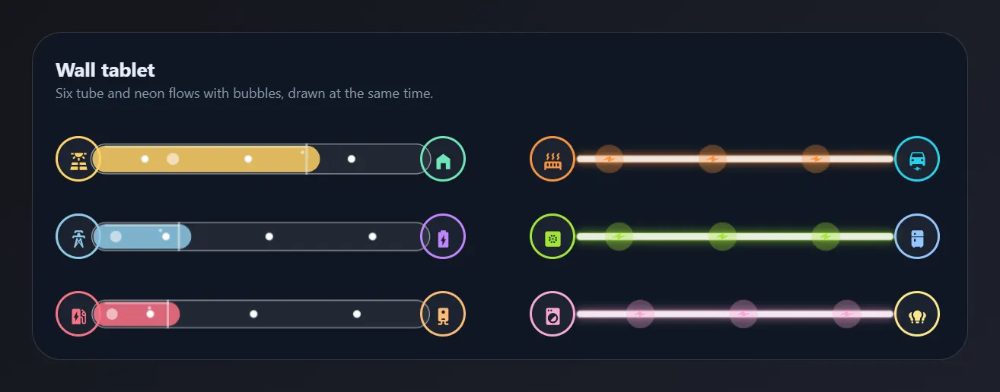

Entities: `sensor.solar_power`, `sensor.house_power`, `sensor.grid_power`, `sensor.battery_power`, `sensor.home_battery`

Six flows, three tubes and three neon lines, on a card 820 px wide. With this many flows the card lowers the detail by itself when the tablet cannot keep up, but never changes the line style.

File: [cards/96-flow-tablet.yaml](cards/96-flow-tablet.yaml)

```yaml
# Wall tablet: six flows on one card, three tubes that fill with the value and three neon lines, with bubbles and flicker on.
# Entities: sensor.solar_power, sensor.house_power, sensor.grid_power, sensor.battery_power, sensor.home_battery
type: custom:magic-card
name: "Wall tablet"
background: "#0f1724"
border_radius: 26px
padding: 20px
box_shadow: "0 18px 40px rgba(0,0,0,0.35)"
rows:
  - id: head
    columns:
      - gap: 2px
        modules:
          - type: text
            text: "Wall tablet"
            design: { font_size: 17px, font_weight: "700", color: "#e6edf7" }
          - type: text
            text: "Six tube and neon flows with bubbles, drawn at the same time."
            design: { font_size: 12px, color: "#8a98ad" }
  - id: r0
    column_widths: ["44px", "1fr", "44px", "36px", "44px", "1fr", "44px"]
    padding: 20px 0 0
    columns:
      - vertical_align: center
        modules:
          - id: l0
            type: icon
            icon: mdi:solar-power-variant
            size: 18px
            design: { color: "#ffd166", width: 36px, height: 36px, display: flex, align_items: center, justify_content: center, border_radius: 50%, border: "2px solid #ffd166", background_color: "rgba(255,255,255,0.05)" }
      - modules: []
      - vertical_align: center
        modules:
          - id: m0
            type: icon
            icon: mdi:home-variant
            size: 18px
            design: { color: "#6ee7b7", width: 36px, height: 36px, display: flex, align_items: center, justify_content: center, border_radius: 50%, border: "2px solid #6ee7b7", background_color: "rgba(255,255,255,0.05)" }
      - modules: []
      - vertical_align: center
        modules:
          - id: n0
            type: icon
            icon: mdi:radiator
            size: 18px
            design: { color: "#fb923c", width: 36px, height: 36px, display: flex, align_items: center, justify_content: center, border_radius: 50%, border: "2px solid #fb923c", background_color: "rgba(255,255,255,0.05)" }
      - modules: []
      - vertical_align: center
        modules:
          - id: o0
            type: icon
            icon: mdi:car-electric
            size: 18px
            design: { color: "#22d3ee", width: 36px, height: 36px, display: flex, align_items: center, justify_content: center, border_radius: 50%, border: "2px solid #22d3ee", background_color: "rgba(255,255,255,0.05)" }
  - id: r1
    column_widths: ["44px", "1fr", "44px", "36px", "44px", "1fr", "44px"]
    padding: 18px 0 0
    columns:
      - vertical_align: center
        modules:
          - id: l1
            type: icon
            icon: mdi:transmission-tower
            size: 18px
            design: { color: "#8ecae6", width: 36px, height: 36px, display: flex, align_items: center, justify_content: center, border_radius: 50%, border: "2px solid #8ecae6", background_color: "rgba(255,255,255,0.05)" }
      - modules: []
      - vertical_align: center
        modules:
          - id: m1
            type: icon
            icon: mdi:battery-charging
            size: 18px
            design: { color: "#c084fc", width: 36px, height: 36px, display: flex, align_items: center, justify_content: center, border_radius: 50%, border: "2px solid #c084fc", background_color: "rgba(255,255,255,0.05)" }
      - modules: []
      - vertical_align: center
        modules:
          - id: n1
            type: icon
            icon: mdi:heat-pump
            size: 18px
            design: { color: "#a3e635", width: 36px, height: 36px, display: flex, align_items: center, justify_content: center, border_radius: 50%, border: "2px solid #a3e635", background_color: "rgba(255,255,255,0.05)" }
      - modules: []
      - vertical_align: center
        modules:
          - id: o1
            type: icon
            icon: mdi:fridge
            size: 18px
            design: { color: "#93c5fd", width: 36px, height: 36px, display: flex, align_items: center, justify_content: center, border_radius: 50%, border: "2px solid #93c5fd", background_color: "rgba(255,255,255,0.05)" }
  - id: r2
    column_widths: ["44px", "1fr", "44px", "36px", "44px", "1fr", "44px"]
    padding: 18px 0 0
    columns:
      - vertical_align: center
        modules:
          - id: l2
            type: icon
            icon: mdi:ev-station
            size: 18px
            design: { color: "#fb7185", width: 36px, height: 36px, display: flex, align_items: center, justify_content: center, border_radius: 50%, border: "2px solid #fb7185", background_color: "rgba(255,255,255,0.05)" }
      - modules: []
      - vertical_align: center
        modules:
          - id: m2
            type: icon
            icon: mdi:water-boiler
            size: 18px
            design: { color: "#fdba74", width: 36px, height: 36px, display: flex, align_items: center, justify_content: center, border_radius: 50%, border: "2px solid #fdba74", background_color: "rgba(255,255,255,0.05)" }
      - modules: []
      - vertical_align: center
        modules:
          - id: n2
            type: icon
            icon: mdi:washing-machine
            size: 18px
            design: { color: "#f9a8d4", width: 36px, height: 36px, display: flex, align_items: center, justify_content: center, border_radius: 50%, border: "2px solid #f9a8d4", background_color: "rgba(255,255,255,0.05)" }
      - modules: []
      - vertical_align: center
        modules:
          - id: o2
            type: icon
            icon: mdi:lightbulb-group
            size: 18px
            design: { color: "#fde68a", width: 36px, height: 36px, display: flex, align_items: center, justify_content: center, border_radius: 50%, border: "2px solid #fde68a", background_color: "rgba(255,255,255,0.05)" }
flows:
  - { id: tube-0, from: l0, to: m0, entity: sensor.solar_power, max: 5000, route: straight, line_style: tube, width: 14, bubble_count: 4, tube_fill_value: true, color: "#ffd166" }
  - { id: tube-1, from: l1, to: m1, entity: sensor.house_power, max: 5000, route: straight, line_style: tube, width: 14, bubble_count: 4, tube_fill_value: true, color: "#8ecae6" }
  - { id: tube-2, from: l2, to: m2, entity: sensor.battery_power, max: 3000, route: straight, line_style: tube, width: 14, bubble_count: 4, tube_fill_value: true, color: "#fb7185" }
  - { id: neon-0, from: n0, to: o0, entity: sensor.grid_power, max: 5000, route: straight, line_style: neon, width: 3, glow: 8, flicker: subtle, color: "#fb923c", shape: spark, dot_size: 9, dots: 3 }
  - { id: neon-1, from: n1, to: o1, entity: sensor.solar_power, max: 5000, route: straight, line_style: neon, width: 3, glow: 8, flicker: subtle, color: "#a3e635", shape: spark, dot_size: 9, dots: 3 }
  - { id: neon-2, from: n2, to: o2, entity: sensor.house_power, max: 5000, route: straight, line_style: neon, width: 3, glow: 8, flicker: subtle, color: "#f9a8d4", shape: spark, dot_size: 9, dots: 3 }
```

## Slider look Minimal

A thin track with a round handle and the value beside it, in three colours.

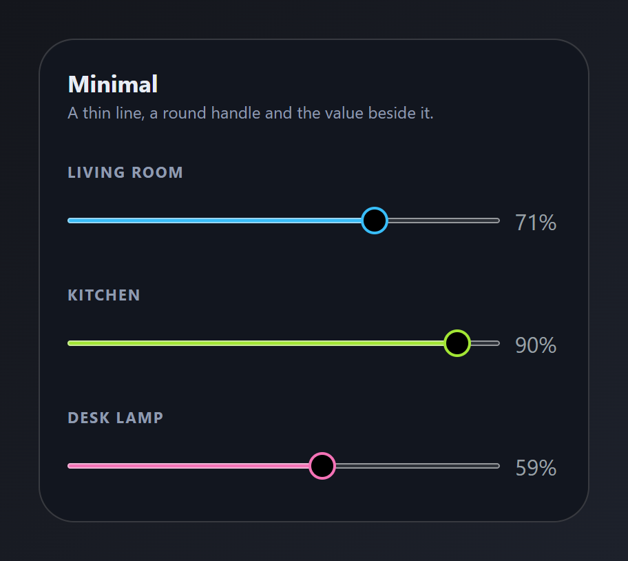

Entities: `light.living_room`, `light.kitchen`, `light.desk`

The value sits beside the track. Set `value_position: bubble` for a bubble that shows while you drag.

File: [cards/97-slider-minimal.yaml](cards/97-slider-minimal.yaml)

```yaml
# Slider look Minimal: a thin track with a round handle and the value beside it, in three colours.
# Entities: light.living_room, light.kitchen, light.desk
type: custom:magic-card
name: Minimal
background: "#12161f"
border_radius: 26px
padding: 20px
box_shadow: "0 18px 40px rgba(0,0,0,0.4)"
rows:
  - id: head
    columns:
      - gap: 2px
        modules:
          - type: text
            text: Minimal
            design: { font_size: 17px, font_weight: "700", color: "#e8edf5" }
          - type: text
            text: "A thin line, a round handle and the value beside it."
            design: { font_size: 12px, color: "#8f9bb0" }
  - id: s0
    padding: 18px 0 0
    columns:
      - gap: 8px
        modules:
          - type: text
            text: "Living room"
            design: { font_size: 11px, font_weight: "700", color: "#8f9bb0", text_transform: uppercase, letter_spacing: 1px }
          - type: slider
            entity: light.living_room
            track_style: thin
            track_thickness: 4
            thumb: circle
            thumb_size: 16
            value_position: beside
            slider_color: "#38bdf8"
  - id: s1
    padding: 16px 0 0
    columns:
      - gap: 8px
        modules:
          - type: text
            text: Kitchen
            design: { font_size: 11px, font_weight: "700", color: "#8f9bb0", text_transform: uppercase, letter_spacing: 1px }
          - type: slider
            entity: light.kitchen
            track_style: thin
            track_thickness: 4
            thumb: circle
            thumb_size: 16
            value_position: beside
            slider_color: "#a3e635"
  - id: s2
    padding: 16px 0 0
    columns:
      - gap: 8px
        modules:
          - type: text
            text: "Desk lamp"
            design: { font_size: 11px, font_weight: "700", color: "#8f9bb0", text_transform: uppercase, letter_spacing: 1px }
          - type: slider
            entity: light.desk
            track_style: thin
            track_thickness: 4
            thumb: circle
            thumb_size: 16
            value_position: beside
            slider_color: "#f472b6"
```

## Slider look Material, on a light card

A 6 px bar with a round handle that has a 1 px border.

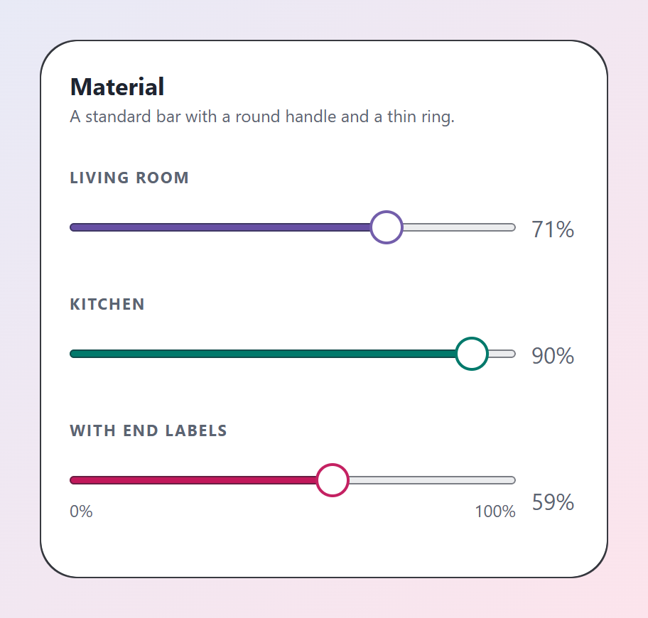

Entities: `light.living_room`, `light.kitchen`, `light.desk`

Shot on a light card with its own text colour. The third slider also shows the end labels (`show_limits`).

File: [cards/98-slider-material.yaml](cards/98-slider-material.yaml)

```yaml
# Slider look Material, on a light card: a 6 px bar with a round handle that has a 1 px border.
# Entities: light.living_room, light.kitchen, light.desk
type: custom:magic-card
name: Material
background: "#ffffff"
border_radius: 26px
padding: 20px
css: "--primary-text-color: #1f2430; --secondary-text-color: #5b6472; --disabled-color: #9aa0ac; --mc-text-secondary: #5b6472;"
box_shadow: "0 14px 34px rgba(30,40,70,0.14)"
rows:
  - id: head
    columns:
      - gap: 2px
        modules:
          - type: text
            text: Material
            design: { font_size: 17px, font_weight: "700", color: "#1f2430" }
          - type: text
            text: "A standard bar with a round handle and a thin ring."
            design: { font_size: 12px, color: "#5b6472" }
  - id: s0
    padding: 18px 0 0
    columns:
      - gap: 8px
        modules:
          - type: text
            text: "Living room"
            design: { font_size: 11px, font_weight: "700", color: "#5b6472", text_transform: uppercase, letter_spacing: 1px }
          - type: slider
            entity: light.living_room
            track_thickness: 6
            track_radius: 3
            thumb: circle
            thumb_size: 20
            thumb_border: 1
            slider_color: "#6750a4"
  - id: s1
    padding: 16px 0 0
    columns:
      - gap: 8px
        modules:
          - type: text
            text: Kitchen
            design: { font_size: 11px, font_weight: "700", color: "#5b6472", text_transform: uppercase, letter_spacing: 1px }
          - type: slider
            entity: light.kitchen
            track_thickness: 6
            track_radius: 3
            thumb: circle
            thumb_size: 20
            thumb_border: 1
            slider_color: "#00796b"
  - id: s2
    padding: 16px 0 0
    columns:
      - gap: 8px
        modules:
          - type: text
            text: "With end labels"
            design: { font_size: 11px, font_weight: "700", color: "#5b6472", text_transform: uppercase, letter_spacing: 1px }
          - type: slider
            entity: light.desk
            track_thickness: 6
            track_radius: 3
            thumb: circle
            thumb_size: 20
            thumb_border: 1
            slider_color: "#c2185b"
            show_limits: true
```

## Slider look Neon

A thin glowing track, a round handle with a glow, and a bright fill.

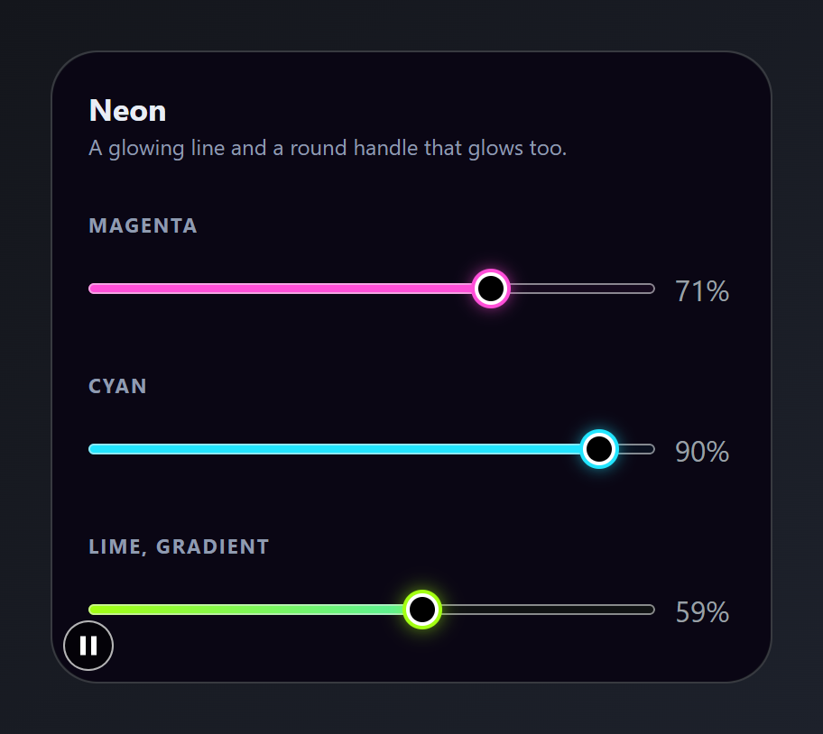

Entities: `light.living_room`, `light.kitchen`, `light.desk`

The track colour is the slider colour at 25 % (`track_color` with an alpha). The handle glows with `thumb_glow`.

File: [cards/99-slider-neon.yaml](cards/99-slider-neon.yaml)

```yaml
# Slider look Neon: a thin glowing track, a round handle with a glow, and a bright fill.
# Entities: light.living_room, light.kitchen, light.desk
type: custom:magic-card
name: Neon
background: "#0a0614"
border_radius: 26px
padding: 20px
box_shadow: "0 18px 40px rgba(0,0,0,0.4)"
rows:
  - id: head
    columns:
      - gap: 2px
        modules:
          - type: text
            text: Neon
            design: { font_size: 17px, font_weight: "700", color: "#e8edf5" }
          - type: text
            text: "A glowing line and a round handle that glows too."
            design: { font_size: 12px, color: "#8f9bb0" }
  - id: s0
    padding: 18px 0 0
    columns:
      - gap: 8px
        modules:
          - type: text
            text: Magenta
            design: { font_size: 11px, font_weight: "700", color: "#8f9bb0", text_transform: uppercase, letter_spacing: 1px }
          - type: slider
            entity: light.living_room
            track_style: thin
            track_thickness: 6
            thumb: circle
            thumb_size: 18
            thumb_border: 2
            thumb_glow: 10
            slider_color: "#ff4fd8"
            track_color: "#ff4fd840"
  - id: s1
    padding: 16px 0 0
    columns:
      - gap: 8px
        modules:
          - type: text
            text: Cyan
            design: { font_size: 11px, font_weight: "700", color: "#8f9bb0", text_transform: uppercase, letter_spacing: 1px }
          - type: slider
            entity: light.kitchen
            track_style: thin
            track_thickness: 6
            thumb: circle
            thumb_size: 18
            thumb_border: 2
            thumb_glow: 10
            slider_color: "#22e5ff"
            track_color: "#22e5ff40"
  - id: s2
    padding: 16px 0 0
    columns:
      - gap: 8px
        modules:
          - type: text
            text: "Lime, gradient"
            design: { font_size: 11px, font_weight: "700", color: "#8f9bb0", text_transform: uppercase, letter_spacing: 1px }
          - type: slider
            entity: light.desk
            track_style: thin
            track_thickness: 6
            thumb: circle
            thumb_size: 18
            thumb_border: 2
            thumb_glow: 12
            fill_mode: gradient
            slider_color: "#a3ff12"
            slider_color_to: "#22e5ff"
            track_color: "#a3ff1240"
```

## Slider look Glass with the flat fill

A translucent track over a colourful card, a pill handle and the value in the track.

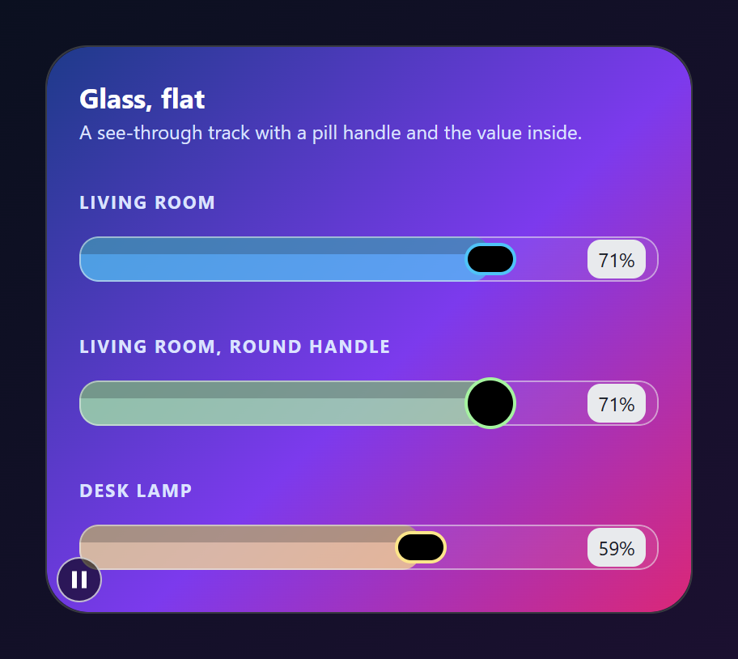

Entities: `light.living_room`, `light.desk`

The track is see-through, so the card behind it shows. Glass has a 1 px outline in the text colour so the track stays visible on any background.

File: [cards/100-slider-glass-flat.yaml](cards/100-slider-glass-flat.yaml)

```yaml
# Slider look Glass with the flat fill: a translucent track over a colourful card, a pill handle and the value in the track.
# Entities: light.living_room, light.desk
type: custom:magic-card
name: "Glass, flat"
background: "linear-gradient(135deg, #1e3a8a 0%, #7c3aed 55%, #db2777 100%)"
border_radius: 26px
padding: 20px
box_shadow: "0 18px 40px rgba(60,20,120,0.45)"
rows:
  - id: head
    columns:
      - gap: 2px
        modules:
          - type: text
            text: "Glass, flat"
            design: { font_size: 17px, font_weight: "700", color: "#ffffff" }
          - type: text
            text: "A see-through track with a pill handle and the value inside."
            design: { font_size: 12px, color: "#dbe2ff" }
  - id: s0
    padding: 18px 0 0
    columns:
      - gap: 8px
        modules:
          - type: text
            text: "Living room"
            design: { font_size: 11px, font_weight: "700", color: "#dbe2ff", text_transform: uppercase, letter_spacing: 1px }
          - type: slider
            entity: light.living_room
            track_style: glass
            track_thickness: 28
            thumb: pill
            thumb_size: 28
            value_position: track
            slider_color: "#4fc3f7"
  - id: s1
    padding: 16px 0 0
    columns:
      - gap: 8px
        modules:
          - type: text
            text: "Living room, round handle"
            design: { font_size: 11px, font_weight: "700", color: "#dbe2ff", text_transform: uppercase, letter_spacing: 1px }
          - type: slider
            entity: light.living_room
            track_style: glass
            track_thickness: 28
            thumb: circle
            thumb_size: 28
            value_position: track
            slider_color: "#a5f3a0"
  - id: s2
    padding: 16px 0 0
    columns:
      - gap: 8px
        modules:
          - type: text
            text: "Desk lamp"
            design: { font_size: 11px, font_weight: "700", color: "#dbe2ff", text_transform: uppercase, letter_spacing: 1px }
          - type: slider
            entity: light.desk
            track_style: glass
            track_thickness: 28
            thumb: pill
            thumb_size: 28
            value_position: track
            slider_color: "#fde68a"
```

## Slider look Glass with blur behind

The track blurs the bright stripes of the card behind it. Needs a browser that supports backdrop-filter; without it the flat glass shows.

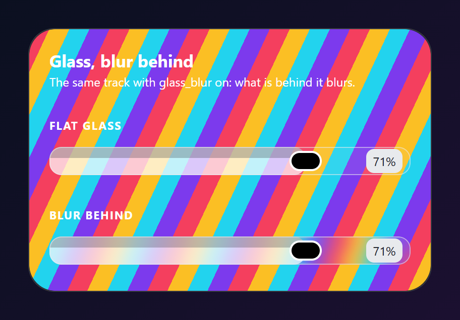

Entities: `light.living_room`

`glass_blur: true` blurs what is behind the track. Browsers that cannot do that show the flat glass instead. Blur can slow down older wall tablets.

File: [cards/101-slider-glass-blur.yaml](cards/101-slider-glass-blur.yaml)

```yaml
# Slider look Glass with blur behind: the track blurs the bright stripes of the card behind it. Needs a browser that supports backdrop-filter; without it the flat glass shows.
# Entities: light.living_room
type: custom:magic-card
name: "Glass, blur behind"
background: "repeating-linear-gradient(115deg, #f43f5e 0 18px, #fbbf24 18px 36px, #22d3ee 36px 54px, #7c3aed 54px 72px)"
border_radius: 26px
padding: 20px
box_shadow: "0 18px 40px rgba(0,0,0,0.5)"
rows:
  - id: head
    columns:
      - gap: 2px
        modules:
          - type: text
            text: "Glass, blur behind"
            design: { font_size: 17px, font_weight: "700", color: "#ffffff" }
          - type: text
            text: "The same track with glass_blur on: what is behind it blurs."
            design: { font_size: 12px, color: "#ffffff" }
  - id: s0
    padding: 18px 0 0
    columns:
      - gap: 8px
        modules:
          - type: text
            text: "Flat glass"
            design: { font_size: 11px, font_weight: "700", color: "#ffffff", text_transform: uppercase, letter_spacing: 1px }
          - type: slider
            entity: light.living_room
            track_style: glass
            track_thickness: 28
            thumb: pill
            thumb_size: 28
            value_position: track
            slider_color: "#ffffff"
  - id: s1
    padding: 16px 0 0
    columns:
      - gap: 8px
        modules:
          - type: text
            text: "Blur behind"
            design: { font_size: 11px, font_weight: "700", color: "#ffffff", text_transform: uppercase, letter_spacing: 1px }
          - type: slider
            entity: light.living_room
            track_style: glass
            track_thickness: 28
            thumb: pill
            thumb_size: 28
            value_position: track
            slider_color: "#ffffff"
            glass_blur: true
```

## Slider look Big fill

A large rounded fill that carries the entity icon and the value, horizontal and vertical. The brightness ramp follows the light, and live updates the light while you drag.

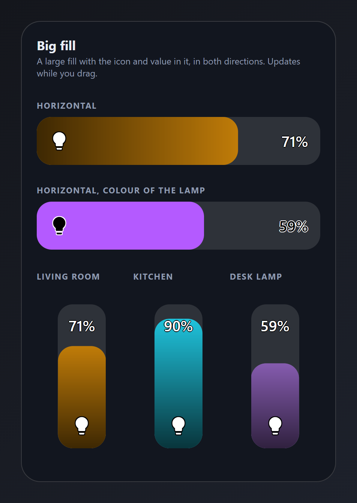

Entities: `light.living_room`, `light.desk`

The vertical sliders need a taller module. Their height comes from `--mc-slider-vertical-height` (set here to 15 rem in the module CSS); the strip itself is 12 rem. `live: true` sends changes at most four times a second while you drag.

File: [cards/102-slider-big-fill.yaml](cards/102-slider-big-fill.yaml)

```yaml
# Slider look Big fill: a large rounded fill that carries the entity icon and the value, horizontal and vertical. The brightness ramp follows the light, and live updates the light while you drag.
# Entities: light.living_room, light.desk
type: custom:magic-card
name: "Big fill"
background: "#12161f"
border_radius: 26px
padding: 20px
box_shadow: "0 18px 40px rgba(0,0,0,0.4)"
rows:
  - id: head
    columns:
      - gap: 2px
        modules:
          - type: text
            text: "Big fill"
            design: { font_size: 17px, font_weight: "700", color: "#e8edf5" }
          - type: text
            text: "A large fill with the icon and value in it, in both directions. Updates while you drag."
            design: { font_size: 12px, color: "#8f9bb0" }
  - id: s0
    padding: 18px 0 0
    columns:
      - gap: 8px
        modules:
          - type: text
            text: Horizontal
            design: { font_size: 11px, font_weight: "700", color: "#8f9bb0", text_transform: uppercase, letter_spacing: 1px }
          - type: slider
            entity: light.living_room
            track_style: big-fill
            fill_mode: auto
            thumb: none
            value_position: track
            live: true
            slider_color: "#f59e0b"
  - id: s1
    padding: 16px 0 0
    columns:
      - gap: 8px
        modules:
          - type: text
            text: "Horizontal, colour of the lamp"
            design: { font_size: 11px, font_weight: "700", color: "#8f9bb0", text_transform: uppercase, letter_spacing: 1px }
          - type: slider
            entity: light.desk
            track_style: big-fill
            use_entity_color: true
            thumb: none
            value_position: track
            live: true
  - id: vertical
    padding: 18px 0 0
    layout: "1-1-1"
    columns:
      - gap: 6px
        modules:
          - type: text
            text: Living room
            design: { font_size: 11px, font_weight: "700", color: "#8f9bb0", text_transform: uppercase, letter_spacing: 1px }
          - type: slider
            entity: light.living_room
            direction: vertical
            design: { css: "--mc-slider-vertical-height: 15rem;" }
            track_style: big-fill
            fill_mode: auto
            thumb: none
            value_position: track
            live: true
            slider_color: "#f59e0b"
      - gap: 6px
        modules:
          - type: text
            text: Kitchen
            design: { font_size: 11px, font_weight: "700", color: "#8f9bb0", text_transform: uppercase, letter_spacing: 1px }
          - type: slider
            entity: light.kitchen
            direction: vertical
            design: { css: "--mc-slider-vertical-height: 15rem;" }
            track_style: big-fill
            fill_mode: auto
            thumb: none
            value_position: track
            live: true
            slider_color: "#22d3ee"
      - gap: 6px
        modules:
          - type: text
            text: Desk lamp
            design: { font_size: 11px, font_weight: "700", color: "#8f9bb0", text_transform: uppercase, letter_spacing: 1px }
          - type: slider
            entity: light.desk
            direction: vertical
            design: { css: "--mc-slider-vertical-height: 15rem;" }
            track_style: big-fill
            fill_mode: auto
            thumb: none
            value_position: track
            live: true
            slider_color: "#c084fc"
```

## Slider stops

Named stops under the track, the handle snaps to them (drag and arrow keys), plus ticks and the end labels.

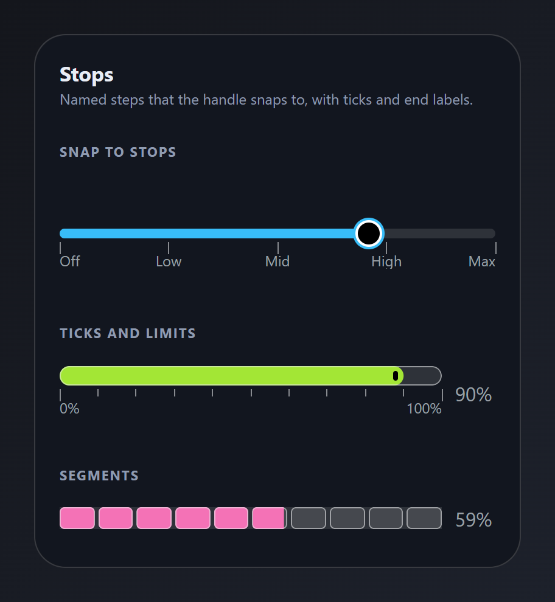

Entities: `light.living_room`, `light.kitchen`, `light.desk`

The first slider snaps to the stops (drag and arrow keys). Stops carry a label of up to 8 characters.

File: [cards/103-slider-stops.yaml](cards/103-slider-stops.yaml)

```yaml
# Slider stops: named stops under the track, the handle snaps to them (drag and arrow keys), plus ticks and the end labels.
# Entities: light.living_room, light.kitchen, light.desk
type: custom:magic-card
name: Stops
background: "#12161f"
border_radius: 26px
padding: 20px
box_shadow: "0 18px 40px rgba(0,0,0,0.4)"
rows:
  - id: head
    columns:
      - gap: 2px
        modules:
          - type: text
            text: Stops
            design: { font_size: 17px, font_weight: "700", color: "#e8edf5" }
          - type: text
            text: "Named steps that the handle snaps to, with ticks and end labels."
            design: { font_size: 12px, color: "#8f9bb0" }
  - id: s0
    padding: 18px 0 0
    columns:
      - gap: 8px
        modules:
          - type: text
            text: "Snap to stops"
            design: { font_size: 11px, font_weight: "700", color: "#8f9bb0", text_transform: uppercase, letter_spacing: 1px }
          - type: slider
            entity: light.living_room
            min: 0
            max: 100
            track_thickness: 8
            track_radius: 4
            thumb: circle
            thumb_size: 22
            thumb_border: 2
            slider_color: "#38bdf8"
            snap: true
            value_position: bubble
            stops: [{ value: 0, label: Off }, { value: 25, label: Low }, { value: 50, label: Mid }, { value: 75, label: High }, { value: 100, label: Max }]
  - id: s1
    padding: 16px 0 0
    columns:
      - gap: 8px
        modules:
          - type: text
            text: "Ticks and limits"
            design: { font_size: 11px, font_weight: "700", color: "#8f9bb0", text_transform: uppercase, letter_spacing: 1px }
          - type: slider
            entity: light.kitchen
            min: 0
            max: 100
            track_style: pill
            track_thickness: 16
            thumb: line
            slider_color: "#a3e635"
            ticks: true
            tick_every: 10
            show_limits: true
  - id: s2
    padding: 16px 0 0
    columns:
      - gap: 8px
        modules:
          - type: text
            text: Segments
            design: { font_size: 11px, font_weight: "700", color: "#8f9bb0", text_transform: uppercase, letter_spacing: 1px }
          - type: slider
            entity: light.desk
            min: 0
            max: 100
            track_style: segmented
            track_thickness: 18
            segments: 10
            segment_gap: 3
            thumb: none
            slider_color: "#f472b6"
```

## Slider track shapes

The track and fill follow a hexagon, a squircle, a wave and a ticket from the shape system.

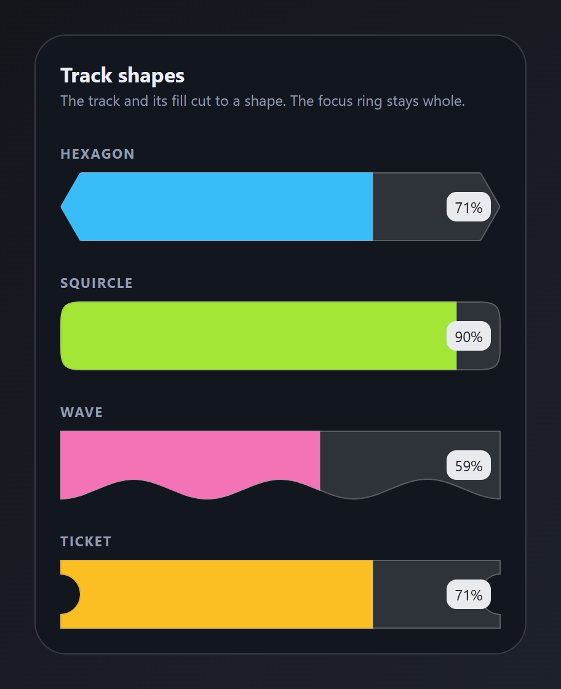

Entities: `light.living_room`, `light.kitchen`, `light.desk`

The track and fill follow the shape. The focus ring is drawn around the whole slider, so it is never cut off.

File: [cards/104-slider-track-shape.yaml](cards/104-slider-track-shape.yaml)

```yaml
# Slider track shapes: the track and fill follow a hexagon, a squircle, a wave and a ticket from the shape system.
# Entities: light.living_room, light.kitchen, light.desk
type: custom:magic-card
name: "Track shapes"
background: "#12161f"
border_radius: 26px
padding: 20px
box_shadow: "0 18px 40px rgba(0,0,0,0.4)"
rows:
  - id: head
    columns:
      - gap: 2px
        modules:
          - type: text
            text: "Track shapes"
            design: { font_size: 17px, font_weight: "700", color: "#e8edf5" }
          - type: text
            text: "The track and its fill cut to a shape. The focus ring stays whole."
            design: { font_size: 12px, color: "#8f9bb0" }
  - id: s0
    padding: 18px 0 0
    columns:
      - gap: 8px
        modules:
          - type: text
            text: Hexagon
            design: { font_size: 11px, font_weight: "700", color: "#8f9bb0", text_transform: uppercase, letter_spacing: 1px }
          - type: slider
            entity: light.living_room
            track_shape: hexagon
            track_thickness: 56
            thumb: none
            value_position: track
            slider_color: "#38bdf8"
  - id: s1
    padding: 16px 0 0
    columns:
      - gap: 8px
        modules:
          - type: text
            text: Squircle
            design: { font_size: 11px, font_weight: "700", color: "#8f9bb0", text_transform: uppercase, letter_spacing: 1px }
          - type: slider
            entity: light.kitchen
            track_shape: squircle
            track_thickness: 56
            thumb: none
            value_position: track
            slider_color: "#a3e635"
  - id: s2
    padding: 16px 0 0
    columns:
      - gap: 8px
        modules:
          - type: text
            text: Wave
            design: { font_size: 11px, font_weight: "700", color: "#8f9bb0", text_transform: uppercase, letter_spacing: 1px }
          - type: slider
            entity: light.desk
            track_shape: wave
            track_thickness: 56
            thumb: none
            value_position: track
            slider_color: "#f472b6"
  - id: s3
    padding: 16px 0 0
    columns:
      - gap: 8px
        modules:
          - type: text
            text: Ticket
            design: { font_size: 11px, font_weight: "700", color: "#8f9bb0", text_transform: uppercase, letter_spacing: 1px }
          - type: slider
            entity: light.living_room
            track_shape: ticket
            track_thickness: 56
            thumb: none
            value_position: track
            slider_color: "#fbbf24"
```
