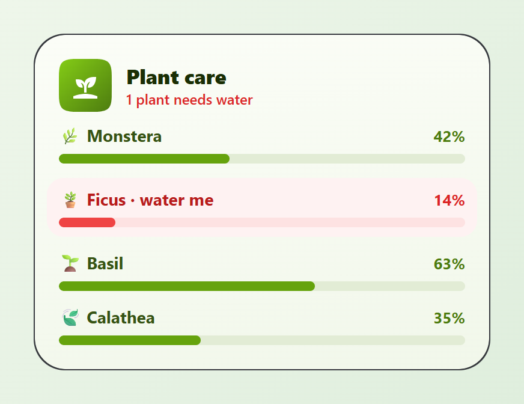
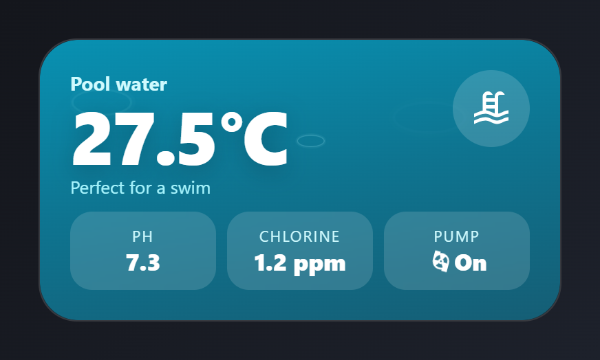
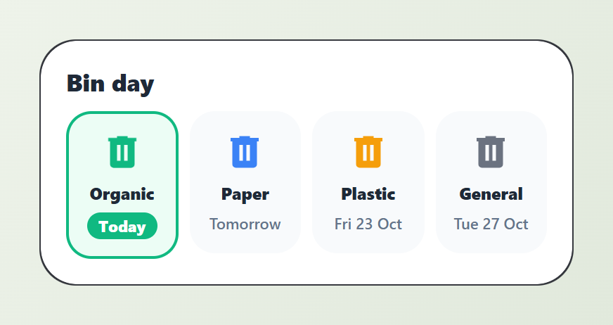
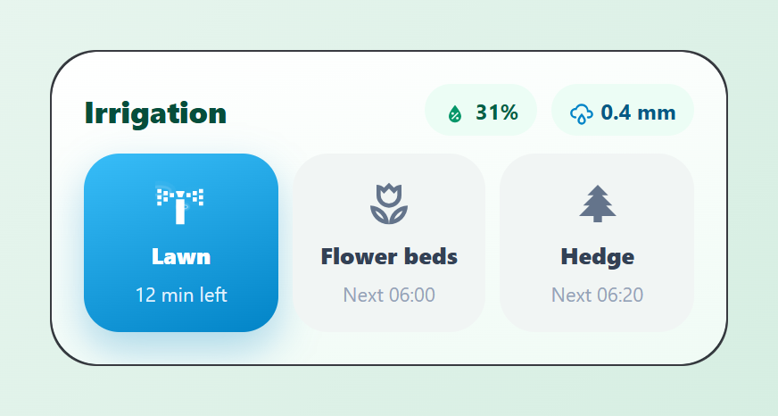
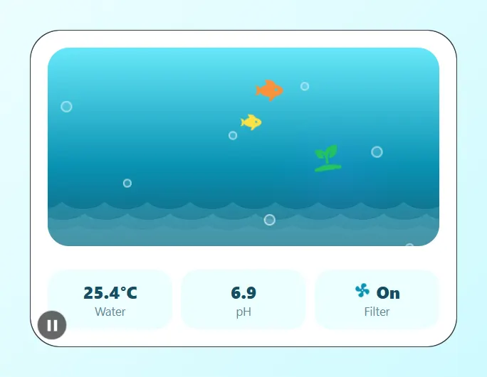

# Garden and outdoors

Plants, the pool, bin day, irrigation and an aquarium. Paste a card into the code editor of a new card, then change the entity ids to your own. Back to the [gallery](README.md).

## Cards

-   [Plant care](#plant-care)
-   [Pool](#pool)
-   [Bin day](#bin-day)
-   [Garden irrigation](#garden-irrigation)
-   [Aquarium](#aquarium)

## Plant care

Soil moisture per plant as coloured bars. Dry plants turn their row red.



Entities: `sensor.monstera_moisture`, `sensor.ficus_moisture`, `sensor.basil_moisture`, `sensor.calathea_moisture`

The "1 plant needs water" line and the red highlight on the Ficus row are typed. Use a display condition per row to make them follow the moisture.

File: [cards/16-plants.yaml](cards/16-plants.yaml)

```yaml
# Plant care: soil moisture per plant as coloured bars. Dry plants turn their row red.
# Entities: sensor.monstera_moisture, sensor.ficus_moisture,
#           sensor.basil_moisture, sensor.calathea_moisture
type: custom:magic-card
name: Plants
background: "linear-gradient(170deg, #fbfdf7 0%, #f1f7ea 100%)"
border_radius: 26px
padding: 20px
box_shadow: "0 14px 34px rgba(63, 98, 18, 0.14)"
rows:
  - id: head
    column_widths: [auto, 1fr]
    gap: 12px
    columns:
      - vertical_align: center
        modules:
          - type: icon
            icon: mdi:sprout
            size: 24px
            design:
              color: "#ffffff"
              width: 44px
              height: 44px
              display: flex
              align_items: center
              justify_content: center
              shape: squircle
              background: "linear-gradient(135deg, #84cc16, #4d7c0f)"
      - vertical_align: center
        gap: 0px
        modules:
          - type: text
            text: Plant care
            design: { font_size: 17px, font_weight: "800", color: "#1a2e05" }
          - type: text
            text: 1 plant needs water
            design: { font_size: 12px, font_weight: "600", color: "#dc2626" }
  - id: list
    columns:
      - gap: 12px
        modules:
          - type: vertical
            gap: 6px
            modules:
              - type: horizontal
                justify: space-between
                align: center
                modules:
                  - type: text
                    text: 🌿 Monstera
                    design: &plant { font_size: 14px, font_weight: "700", color: "#365314" }
                  - type: text
                    use_entity: true
                    entity: sensor.monstera_moisture
                    design: &pct { font_size: 13px, font_weight: "700", color: "#4d7c0f" }
              - type: bar
                entity: sensor.monstera_moisture
                show_value: false
                bar_height: 8px
                bar_background: "#e2ecd5"
                severity: &moist
                  - { from: 0, color: "#ef4444" }
                  - { from: 20, color: "#f59e0b" }
                  - { from: 30, color: "#65a30d" }
                  - { from: 70, color: "#0ea5e9" }
                design: { border_radius: 999px }
          - type: vertical
            gap: 6px
            design:
              padding: 8px 10px
              margin: 0 -10px
              border_radius: 14px
              background_color: "#fef2f2"
            modules:
              - type: horizontal
                justify: space-between
                align: center
                modules:
                  - type: text
                    text: 🪴 Ficus · water me
                    design: { font_size: 14px, font_weight: "700", color: "#b91c1c" }
                  - type: text
                    use_entity: true
                    entity: sensor.ficus_moisture
                    design: { font_size: 13px, font_weight: "700", color: "#dc2626" }
              - type: bar
                entity: sensor.ficus_moisture
                show_value: false
                bar_height: 8px
                bar_background: "#fde2e2"
                severity: *moist
                design: { border_radius: 999px }
          - type: vertical
            gap: 6px
            modules:
              - type: horizontal
                justify: space-between
                align: center
                modules:
                  - type: text
                    text: 🌱 Basil
                    design: *plant
                  - type: text
                    use_entity: true
                    entity: sensor.basil_moisture
                    design: *pct
              - type: bar
                entity: sensor.basil_moisture
                show_value: false
                bar_height: 8px
                bar_background: "#e2ecd5"
                severity: *moist
                design: { border_radius: 999px }
          - type: vertical
            gap: 6px
            modules:
              - type: horizontal
                justify: space-between
                align: center
                modules:
                  - type: text
                    text: 🍃 Calathea
                    design: *plant
                  - type: text
                    use_entity: true
                    entity: sensor.calathea_moisture
                    design: *pct
              - type: bar
                entity: sensor.calathea_moisture
                show_value: false
                bar_height: 8px
                bar_background: "#e2ecd5"
                severity: *moist
                design: { border_radius: 999px }
```

## Pool

Water temperature over a rippling water background, pH and chlorine, and the pump state.



Entities: `sensor.pool_temperature`, `sensor.pool_ph`, `sensor.pool_chlorine`, `switch.pool_pump`

The "Perfect for a swim" line is typed text.

File: [cards/29-pool.yaml](cards/29-pool.yaml)

```yaml
# Pool: water temperature over a rippling water background, pH and chlorine,
# and the pump state.
# Entities: sensor.pool_temperature, sensor.pool_ph, sensor.pool_chlorine, switch.pool_pump
type: custom:magic-card
name: Pool
background: "linear-gradient(170deg, #0891b2 0%, #0e7490 50%, #155e75 100%)"
border_radius: 28px
padding: 22px
box_shadow: "0 20px 44px rgba(8, 145, 178, 0.35)"
rows:
  - id: main
    design:
      animations:
        - { preset: water-ripple, color: "#a5f3fc", strength: 40 }
    column_widths: [1fr, auto]
    columns:
      - gap: 0px
        modules:
          - type: text
            text: Pool water
            design: { font_size: 14px, font_weight: "700", color: "#cffafe" }
          - type: text
            use_entity: true
            entity: sensor.pool_temperature
            design: { font_size: 54px, font_weight: "800", color: "#ffffff", letter_spacing: -2px, line_height: "1.05", text_shadow: "0 4px 18px rgba(8,51,68,0.35)" }
          - type: text
            text: Perfect for a swim
            design: { font_size: 13px, color: "#a5f3fc" }
      - modules:
          - type: icon
            icon: mdi:pool
            size: 30px
            design:
              color: "#ffffff"
              width: 56px
              height: 56px
              display: flex
              align_items: center
              justify_content: center
              border_radius: 50%
              background_color: "rgba(255,255,255,0.16)"
  - id: chem
    layout: "1-1-1"
    gap: 8px
    columns:
      - modules:
          - type: vertical
            gap: 0px
            align: center
            design: &glass { padding: 10px 6px, border_radius: 16px, background_color: "rgba(255,255,255,0.14)", backdrop_filter: blur(6px) }
            modules:
              - type: text
                text: pH
                design: &lab { font_size: 11px, color: "#cffafe", text_transform: uppercase, letter_spacing: 1px }
              - type: text
                use_entity: true
                entity: sensor.pool_ph
                design: &val { font_size: 17px, font_weight: "800", color: "#ffffff" }
      - modules:
          - type: vertical
            gap: 0px
            align: center
            design: *glass
            modules:
              - type: text
                text: Chlorine
                design: *lab
              - type: text
                use_entity: true
                entity: sensor.pool_chlorine
                design: *val
      - modules:
          - type: vertical
            gap: 0px
            align: center
            design: *glass
            actions:
              tap_action: { action: toggle, entity: switch.pool_pump }
            modules:
              - type: text
                text: Pump
                design: *lab
              - type: horizontal
                gap: 4px
                align: center
                modules:
                  - type: icon
                    entity: switch.pool_pump
                    icon: mdi:pump
                    size: 16px
                    design: { color: "#ffffff", animations: [{ preset: fast-spin, trigger: entity_on, target: icon, duration: 3s }] }
                  - type: text
                    use_entity: true
                    entity: switch.pool_pump
                    design: *val
```

## Bin day

The next pickup per bin type. The bin that goes out today pulses.



Entities: `sensor.trash_organic`, `sensor.trash_paper`, `sensor.trash_plastic`, `sensor.trash_rest`

The bin sensors report text such as "Today", "Tomorrow" or a date, for example from the Waste Collection Schedule integration. The highlight on the first bin is typed.

File: [cards/31-trash-pickup.yaml](cards/31-trash-pickup.yaml)

```yaml
# Bin day: the next pickup per bin type. The bin that goes out today pulses.
# Entities: sensor.trash_organic, sensor.trash_paper, sensor.trash_plastic, sensor.trash_rest
#   (text sensors with "Today", "Tomorrow" or a date, e.g. from the Waste Collection integration)
type: custom:magic-card
name: Bins
background: "#ffffff"
border_radius: 26px
padding: 18px
box_shadow: "0 14px 34px rgba(30, 41, 59, 0.12)"
rows:
  - id: title
    columns:
      - modules:
          - type: text
            text: Bin day
            design: { font_size: 17px, font_weight: "800", color: "#1f2937" }
  - id: bins
    layout: "1-1-1-1"
    gap: 8px
    columns:
      - modules:
          - type: vertical
            align: center
            gap: 6px
            design:
              padding: 12px 4px
              border_radius: 18px
              background_color: "#ecfdf5"
              border: "2px solid #10b981"
            modules:
              - type: icon
                icon: mdi:trash-can
                size: 30px
                design:
                  color: "#10b981"
                  animations: [{ preset: rubber-band, duration: 2.4s }]
              - type: text
                text: Organic
                design: &name { font_size: 12px, font_weight: "800", color: "#1f2937" }
              - type: text
                use_entity: true
                entity: sensor.trash_organic
                design: { font_size: 11px, font_weight: "800", color: "#ffffff", padding: 2px 8px, border_radius: 999px, background_color: "#10b981" }
      - modules:
          - type: vertical
            align: center
            gap: 6px
            design: &bin { padding: 12px 4px, border_radius: 18px, background_color: "#f8fafc", border: "2px solid transparent" }
            modules:
              - type: icon
                icon: mdi:trash-can
                size: 30px
                design: { color: "#3b82f6" }
              - type: text
                text: Paper
                design: *name
              - type: text
                use_entity: true
                entity: sensor.trash_paper
                design: &when { font_size: 11px, font_weight: "600", color: "#64748b", text_align: center }
      - modules:
          - type: vertical
            align: center
            gap: 6px
            design: *bin
            modules:
              - type: icon
                icon: mdi:trash-can
                size: 30px
                design: { color: "#f59e0b" }
              - type: text
                text: Plastic
                design: *name
              - type: text
                use_entity: true
                entity: sensor.trash_plastic
                design: *when
      - modules:
          - type: vertical
            align: center
            gap: 6px
            design: *bin
            modules:
              - type: icon
                icon: mdi:trash-can
                size: 30px
                design: { color: "#6b7280" }
              - type: text
                text: General
                design: *name
              - type: text
                use_entity: true
                entity: sensor.trash_rest
                design: *when
```

## Garden irrigation

Soil moisture and rain today, and a toggle per zone. Running zones turn blue with a ripple.



Entities: `switch.zone_lawn`, `switch.zone_beds`, `switch.zone_hedge`, `sensor.soil_moisture`, `sensor.rain_today`

The run time and next start times are typed text.

File: [cards/38-irrigation.yaml](cards/38-irrigation.yaml)

```yaml
# Garden irrigation: soil moisture and rain today, and a toggle per zone.
# Running zones turn blue with a ripple.
# Entities: switch.zone_lawn, switch.zone_beds, switch.zone_hedge,
#           sensor.soil_moisture, sensor.rain_today
type: custom:magic-card
name: Irrigation
background: "linear-gradient(170deg, #ffffff 0%, #f0fbf5 100%)"
border_radius: 26px
padding: 18px
box_shadow: "0 14px 34px rgba(5, 150, 105, 0.14)"
rows:
  - id: head
    column_widths: [1fr, auto, auto]
    gap: 8px
    columns:
      - vertical_align: center
        modules:
          - type: text
            text: Irrigation
            design: { font_size: 17px, font_weight: "800", color: "#064e3b" }
      - vertical_align: center
        modules:
          - type: horizontal
            gap: 4px
            align: center
            design: &chip { padding: 4px 10px, border_radius: 999px, background_color: "#ecfdf5" }
            modules:
              - type: icon
                icon: mdi:water-percent
                size: 14px
                design: { color: "#059669" }
              - type: text
                use_entity: true
                entity: sensor.soil_moisture
                design: { font_size: 12px, font_weight: "700", color: "#065f46" }
      - vertical_align: center
        modules:
          - type: horizontal
            gap: 4px
            align: center
            design: *chip
            modules:
              - type: icon
                icon: mdi:weather-rainy
                size: 14px
                design: { color: "#0284c7" }
              - type: text
                use_entity: true
                entity: sensor.rain_today
                design: { font_size: 12px, font_weight: "700", color: "#075985" }
  - id: zones
    layout: "1-1-1"
    gap: 8px
    columns:
      - modules:
          - type: vertical
            align: center
            gap: 6px
            design:
              padding: 14px 6px
              border_radius: 20px
              background_color: "#f1f5f4"
              conditional:
                - id: running
                  name: Running
                  conditions: [{ type: state, entity: switch.zone_lawn, state: "on" }]
                  design: { background: "linear-gradient(160deg, #38bdf8, #0284c7)", box_shadow: "0 10px 22px rgba(2,132,199,0.3)" }
            actions:
              tap_action: { action: toggle, entity: switch.zone_lawn }
            modules:
              - type: icon
                entity: switch.zone_lawn
                icon: mdi:sprinkler-variant
                size: 28px
                design:
                  color: "#64748b"
                  conditional:
                    - { id: "on", name: "On", conditions: [{ type: state, state: "on" }], design: { color: "#ffffff" } }
                  animations: [{ preset: water-ripple, trigger: entity_on, color: "#e0f2fe" }]
              - type: text
                text: Lawn
                design:
                  font_size: 13px
                  font_weight: "800"
                  color: "#334155"
                  conditional:
                    - { id: "on", name: "On", conditions: [{ type: state, entity: switch.zone_lawn, state: "on" }], design: { color: "#ffffff" } }
              - type: text
                text: 12 min left
                display:
                  conditions: [{ type: state, entity: switch.zone_lawn, state: "on" }]
                design: { font_size: 11px, color: "#e0f2fe" }
      - modules:
          - type: vertical
            align: center
            gap: 6px
            design: &zone { padding: 14px 6px, border_radius: 20px, background_color: "#f1f5f4" }
            actions:
              tap_action: { action: toggle, entity: switch.zone_beds }
            modules:
              - type: icon
                icon: mdi:flower-tulip-outline
                size: 28px
                design: { color: "#64748b" }
              - type: text
                text: Flower beds
                design: &zname { font_size: 13px, font_weight: "800", color: "#334155" }
              - type: text
                text: "Next 06:00"
                design: &znext { font_size: 11px, color: "#94a3b8" }
      - modules:
          - type: vertical
            align: center
            gap: 6px
            design: *zone
            actions:
              tap_action: { action: toggle, entity: switch.zone_hedge }
            modules:
              - type: icon
                icon: mdi:pine-tree
                size: 28px
                design: { color: "#64748b" }
              - type: text
                text: Hedge
                design: *zname
              - type: text
                text: "Next 06:20"
                design: *znext
```

## Aquarium

Fish swim back and forth through a tank with waves and bubbles, above the water temperature, pH and a spinning filter. The swim is a keyframes animation stored in the card; the two fish play it at different speeds.



Entities: `sensor.aquarium_temperature`, `sensor.aquarium_ph`, `switch.aquarium_pump`, `switch.aquarium_light`

The fish and the plant are icons. The second fish runs the same animation at another speed and offset.

File: [cards/58-aquarium.yaml](cards/58-aquarium.yaml)

```yaml
# Aquarium: fish swim back and forth through a tank with waves and bubbles, above the water temperature, pH and a spinning filter.
# The swim is a keyframes animation stored in the card; the two fish play it at different speeds.
# Entities: sensor.aquarium_temperature, sensor.aquarium_ph, switch.aquarium_pump, switch.aquarium_light
type: custom:magic-card
name: Aquarium
background: "#ffffff"
border_radius: 28px
padding: 16px
box_shadow: "0 16px 36px rgba(8, 145, 178, 0.2)"
custom_animations:
  fish-swim:
    name: Fish swim
    kind: keyframes
    duration: 8
    easing: ease-in-out
    iterations: infinite
    keyframes:
      - { at: 0, transform: { x: 0, y: 0, scale_x: 1 } }
      - { at: 22, transform: { x: 120, y: -8, scale_x: 1 } }
      - { at: 46, transform: { x: 240, y: 4, scale_x: 1 } }
      - { at: 50, transform: { x: 240, y: 4, scale_x: -1 } }
      - { at: 74, transform: { x: 120, y: 10, scale_x: -1 } }
      - { at: 96, transform: { x: 0, y: 0, scale_x: -1 } }
      - { at: 100, transform: { x: 0, y: 0, scale_x: 1 } }
rows:
  - id: tank
    columns:
      - modules:
          - type: vertical
            gap: 6px
            align: start
            design:
              height: 160px
              padding: 26px 16px 0
              border_radius: 20px
              background: "linear-gradient(180deg, #67e8f9 0%, #0891b2 60%, #155e75 100%)"
              animations:
                - { id: waves, preset: ocean-waves, color: "#a5f3fc", strength: 35, intensity: 25 }
                - { id: bubbles, preset: bubbles, color: "#ecfeff", strength: 70, intensity: 8 }
                - { id: rays, preset: spotlight, strength: 30 }
            modules:
              - type: icon
                icon: mdi:fish
                size: 32px
                design:
                  color: "#fb923c"
                  animations:
                    - { id: swim, preset: custom:fish-swim, target: icon }
              - type: icon
                icon: mdi:fish
                size: 24px
                design:
                  color: "#fde047"
                  margin_left: 40px
                  animations:
                    - { id: swim, preset: custom:fish-swim, target: icon, duration: 11s, delay: -3s }
              - type: icon
                icon: mdi:sprout
                size: 30px
                design:
                  color: "#22c55e"
                  margin_left: 230px
                  margin_top: -8px
                  animations:
                    - { id: sway, preset: sway, target: icon, intensity: 10, duration: 3s }
  - id: stats
    layout: "1-1-1"
    gap: 8px
    padding: 12px 0 0
    columns:
      - modules:
          - type: vertical
            gap: 0px
            align: center
            design: &stat { padding: 10px 6px, border_radius: 16px, background_color: "#ecfeff" }
            modules:
              - type: text
                use_entity: true
                entity: sensor.aquarium_temperature
                design: &val { font_size: 16px, font_weight: "800", color: "#164e63" }
              - type: text
                text: Water
                design: &lbl { font_size: 11px, color: "#5b8a96" }
      - modules:
          - type: vertical
            gap: 0px
            align: center
            design: *stat
            modules:
              - type: text
                use_entity: true
                entity: sensor.aquarium_ph
                design: *val
              - type: text
                text: pH
                design: *lbl
      - modules:
          - type: vertical
            gap: 0px
            align: center
            design: *stat
            actions:
              tap_action: { action: toggle, entity: switch.aquarium_pump }
            modules:
              - type: horizontal
                gap: 5px
                align: center
                modules:
                  - type: icon
                    entity: switch.aquarium_pump
                    icon: mdi:fan
                    size: 16px
                    icon_fx:
                      device: spin
                    design: { color: "#0891b2" }
                  - type: text
                    use_entity: true
                    entity: switch.aquarium_pump
                    design: *val
              - type: text
                text: Filter
                design: *lbl
```
