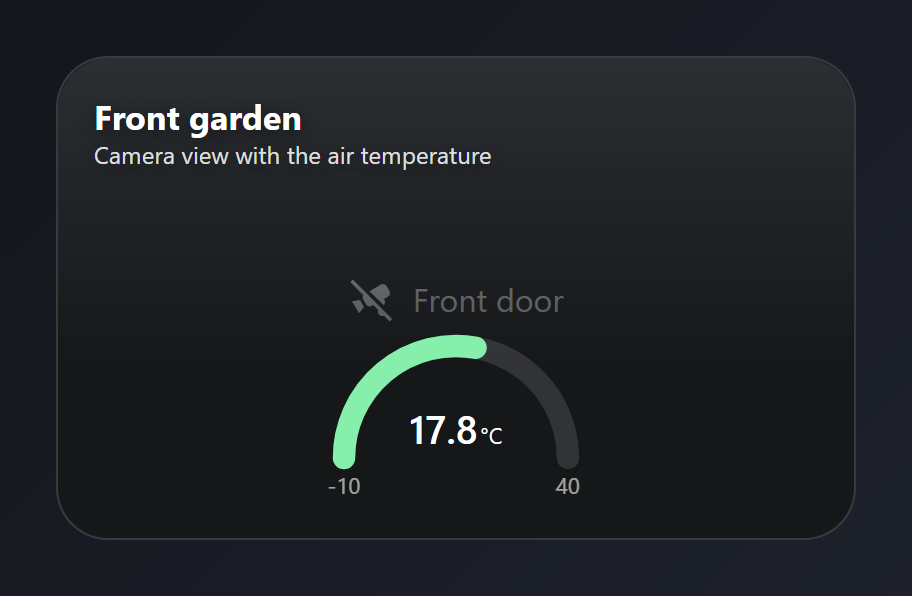
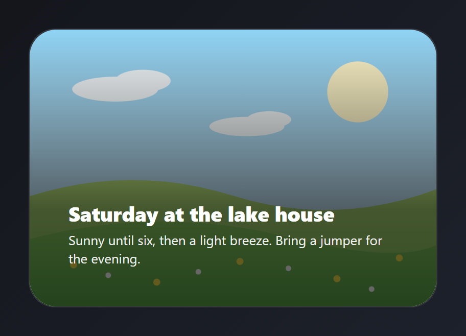
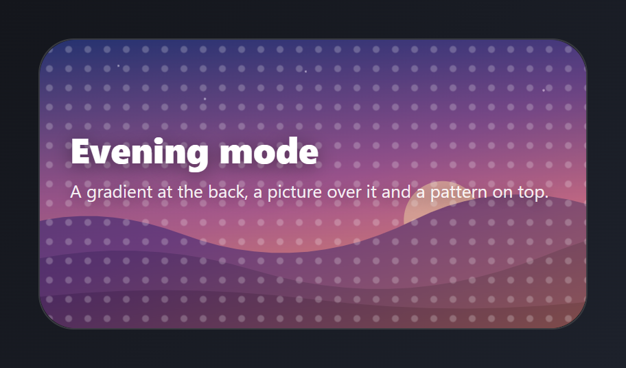
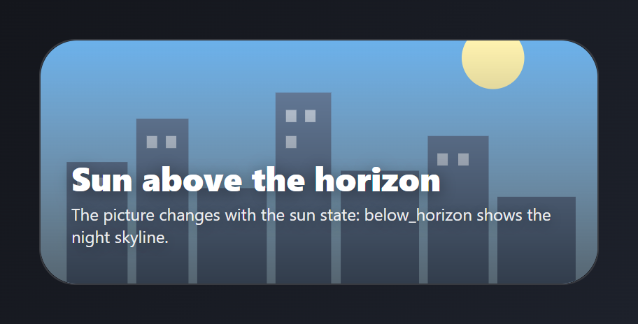
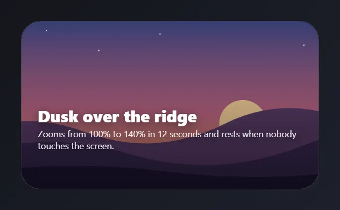
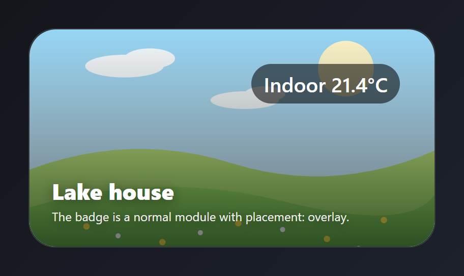
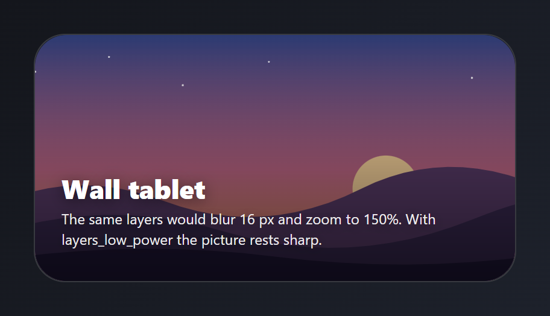
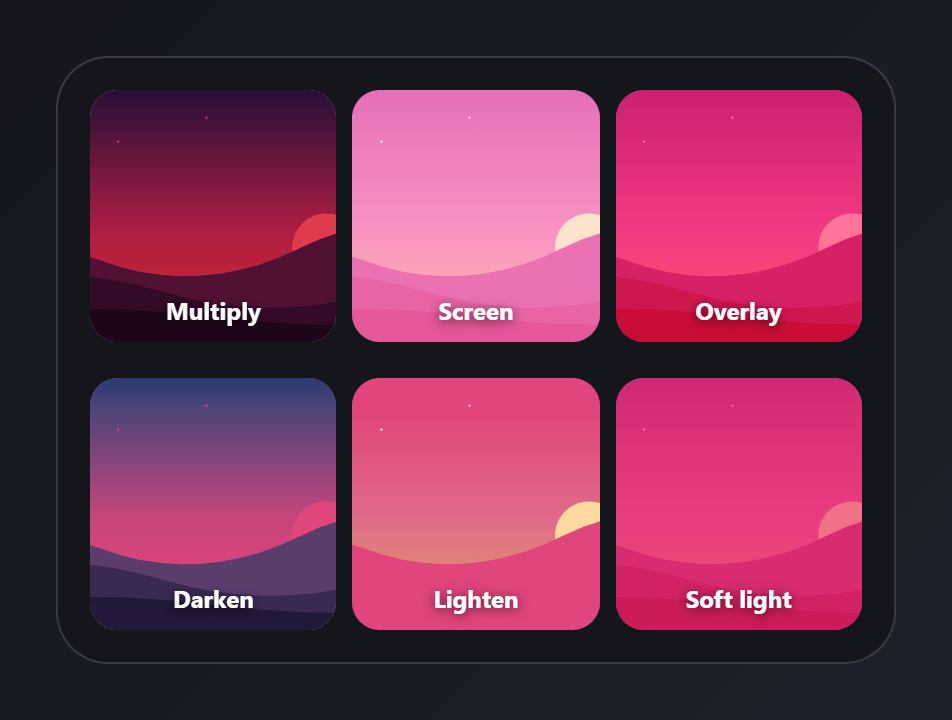
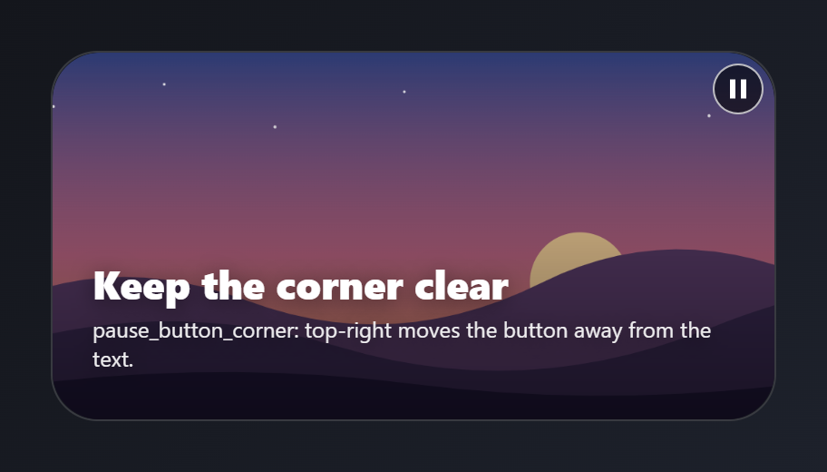
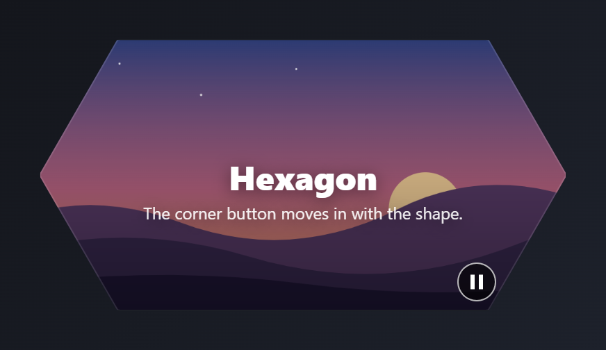

# Layers

A camera or picture behind other modules, a badge on top, a stacked card backdrop that follows a state or slowly pans and zooms, blend modes, low-power mode and the Pause motion button, also on a shaped card. Paste a card into the code editor of a new card, then change the entity ids to your own. Back to the [gallery](README.md).

## Cards

-   Modules in layers
    -   [Camera behind a gauge](#camera-behind-a-gauge)
    -   [Darken behind text](#darken-behind-text)
    -   [An overlay badge](#an-overlay-badge)
    -   [Blend modes](#blend-modes)
-   Card backdrop
    -   [Stacked backdrop](#stacked-backdrop)
    -   [A picture chosen by state](#a-picture-chosen-by-state)
    -   [Pan and zoom](#pan-and-zoom)
    -   [Low-power mode](#low-power-mode)
-   Pause motion button
    -   [Pause button in another corner](#pause-button-in-another-corner)
    -   [Pause button on a shaped card](#pause-button-on-a-shaped-card)

## Camera behind a gauge

The door camera fills the card behind the other modules, darkened from the bottom, and a temperature gauge sits in front.



Entities: `camera.front_door`, `sensor.outdoor_temperature`

The camera module is set to Behind others and fills the whole card (`fill: card`), with a fade from the bottom (`scrim`). The two title lines are typed text. A live camera streams all day, so on a wall tablet use a camera picture in the card backdrop instead.

File: [cards/105-camera-behind-gauge.yaml](cards/105-camera-behind-gauge.yaml)

```yaml
# Camera behind a gauge: the door camera fills the card behind the other modules, darkened from the bottom, and a temperature gauge sits in front.
# Entities: camera.front_door, sensor.outdoor_temperature
type: custom:magic-card
name: Garden camera
background: "#0e1116"
border_radius: 26px
padding: 18px
box_shadow: "0 18px 40px rgba(0,0,0,0.45)"
rows:
  - id: head
    columns:
      - gap: 0px
        modules:
          - type: camera
            entity: camera.front_door
            camera_view: snapshot
            placement: background
            layer:
              fill: card
              scrim:
                style: bottom
                strength: 50
          - type: text
            text: Front garden
            design: { font_size: 17px, font_weight: "700", color: "#ffffff", text_shadow: "0 2px 10px rgba(0,0,0,0.6)" }
          - type: text
            text: Camera view with the air temperature
            design: { font_size: 12px, color: "rgba(255,255,255,0.85)", text_shadow: "0 2px 10px rgba(0,0,0,0.6)" }
  - id: gauge
    design: { margin_top: 56px }
    columns:
      - modules:
          - type: gauge
            entity: sensor.outdoor_temperature
            min: -10
            max: 40
            gauge_style: half
            needle: false
            show_name: false
            decimals: 1
            severity:
              - { from: -10, color: "#7dd3fc" }
              - { from: 10, color: "#86efac" }
              - { from: 25, color: "#fbbf24" }
              - { from: 33, color: "#f87171" }
            design: { color: "#ffffff", max_width: 220px, margin: 0 auto }
```

## Darken behind text

A bright meadow picture sits behind the text, and a dark fade from the bottom keeps the white text readable.



The picture is an image module set to Behind others. `/local/meadow.svg` stands in for a picture in your `www` folder. The title and the text are typed. At 60 %, white text stays readable even on a white picture.

File: [cards/106-backdrop-darken-text.yaml](cards/106-backdrop-darken-text.yaml)

```yaml
# Darken behind text: a bright meadow picture sits behind the text, and a dark fade from the bottom keeps the white text readable.
# Entities: none
type: custom:magic-card
name: Darken behind text
background: "#1c1f26"
border_radius: 26px
padding: 0
box_shadow: "0 18px 40px rgba(0,0,0,0.4)"
rows:
  - id: art
    padding: 150px 22px 22px
    columns:
      - gap: 4px
        modules:
          - type: image
            image: /local/meadow.svg
            placement: background
            layer:
              fill: card
              scrim:
                style: bottom
                color: "#000000"
                strength: 60
          - type: text
            text: Saturday at the lake house
            design: { font_size: 20px, font_weight: "800", color: "#ffffff" }
          - type: text
            text: "Sunny until six, then a light breeze. Bring a jumper for the evening."
            design: { font_size: 13px, line_height: "1.4", color: "rgba(255,255,255,0.92)" }
```

## Stacked backdrop

A dot pattern in front of a picture in front of a gradient. The first entry is the front layer.



The first entry in `background_layers` is the front layer, and a card holds up to four. `/local/hills.svg` stands in for a picture in your `www` folder. The title and the line under it are typed text.

File: [cards/107-stacked-backdrop.yaml](cards/107-stacked-backdrop.yaml)

```yaml
# Stacked backdrop: a dot pattern in front of a picture in front of a gradient. The first entry is the front layer.
# Entities: none
type: custom:magic-card
name: Stacked backdrop
border_radius: 26px
padding: 22px
box_shadow: "0 18px 40px rgba(0,0,0,0.45)"
background: "#14161c"
background_layers:
  - type: pattern
    pattern: dots
    color: "rgba(255,255,255,0.22)"
    size: 14
    thickness: 2
  - type: image
    image: /local/hills.svg
    size: cover
    opacity: 55
  - type: gradient
    gradient: "linear-gradient(160deg, #1f2a6b 0%, #7a3b8f 55%, #f08a5d 100%)"
rows:
  - id: copy
    padding: 40px 0 70px
    columns:
      - gap: 4px
        modules:
          - type: text
            text: Evening mode
            design: { font_size: 26px, font_weight: "800", color: "#ffffff", text_shadow: "0 2px 14px rgba(0,0,0,0.45)" }
          - type: text
            text: "A gradient at the back, a picture over it and a pattern on top."
            design: { font_size: 13px, color: "rgba(255,255,255,0.9)", text_shadow: "0 2px 10px rgba(0,0,0,0.45)" }
```

## A picture chosen by state

The backdrop follows sun.sun, a daytime skyline above the horizon and a night skyline below it. Any other state uses the image key.



Entities: `sun.sun`

The picture follows `sun.sun`: `above_horizon` shows the day skyline, `below_horizon` the night skyline, and any other state uses `image`. The title is typed text. The skylines stand in for pictures in your `www` folder.

File: [cards/108-backdrop-by-state.yaml](cards/108-backdrop-by-state.yaml)

```yaml
# A picture chosen by state: the backdrop follows sun.sun, a daytime skyline above the horizon and a night skyline below it. Any other state uses the image key.
# Entities: sun.sun
type: custom:magic-card
name: Backdrop by state
entity: sun.sun
background: "#10131a"
border_radius: 26px
padding: 22px
box_shadow: "0 18px 40px rgba(0,0,0,0.45)"
background_layers:
  - type: gradient
    gradient: "linear-gradient(to top, rgba(0,0,0,0.55), rgba(0,0,0,0))"
  - type: image
    entity: sun.sun
    image: /local/skyline-night.svg
    states:
      above_horizon: /local/skyline-day.svg
      below_horizon: /local/skyline-night.svg
rows:
  - id: copy
    padding: 60px 0 4px
    columns:
      - gap: 2px
        modules:
          - type: text
            text: Sun above the horizon
            design: { font_size: 24px, font_weight: "800", color: "#ffffff", text_shadow: "0 2px 12px rgba(0,0,0,0.5)" }
          - type: text
            text: "The picture changes with the sun state: below_horizon shows the night skyline."
            design: { font_size: 12px, color: "rgba(255,255,255,0.9)", text_shadow: "0 2px 10px rgba(0,0,0,0.5)" }
```

## Pan and zoom

A slow push in on a wide picture, back and forth. Pause motion appears in the bottom-left corner because the backdrop moves.



The picture moves, so the Pause motion button shows in the bottom-left corner. With `pause_when_idle` the picture rests after two minutes without input, and under reduced motion it rests at its start. `/local/hills.svg` stands in for a picture in your `www` folder.

File: [cards/109-backdrop-pan-zoom.yaml](cards/109-backdrop-pan-zoom.yaml)

```yaml
# Pan and zoom: a slow push in on a wide picture, back and forth. Pause motion appears in the bottom-left corner because the backdrop moves.
# Entities: none
type: custom:magic-card
name: Pan and zoom
background: "#14161c"
border_radius: 26px
padding: 22px
box_shadow: "0 18px 40px rgba(0,0,0,0.45)"
background_layers:
  - type: gradient
    gradient: "linear-gradient(to top, rgba(0,0,0,0.5), rgba(0,0,0,0))"
  - type: image
    image: /local/hills.svg
    pan_zoom:
      from: 100
      to: 140
      focus: bottom-right
      duration: 12
      alternate: true
      pause_when_idle: true
rows:
  - id: copy
    padding: 90px 0 28px
    columns:
      - gap: 2px
        modules:
          - type: text
            text: Dusk over the ridge
            design: { font_size: 22px, font_weight: "800", color: "#ffffff", text_shadow: "0 2px 12px rgba(0,0,0,0.5)" }
          - type: text
            text: "Zooms from 100% to 140% in 12 seconds and rests when nobody touches the screen."
            design: { font_size: 12px, color: "rgba(255,255,255,0.9)", text_shadow: "0 2px 10px rgba(0,0,0,0.5)" }
```

## An overlay badge

A temperature chip anchored top-right, 12 px from the edges, on top of a picture backdrop. Taps go through it.



Entities: `sensor.indoor_temperature`

The badge is an `info` module with `placement: overlay`. It sits in its column, 12 px from the top and right edges, so the column height sets how far down the card it can reach. The title lines are typed text.

File: [cards/110-overlay-badge.yaml](cards/110-overlay-badge.yaml)

```yaml
# An overlay badge: a temperature chip anchored top-right, 12 px from the edges, on top of a picture backdrop. Taps go through it.
# Entities: sensor.indoor_temperature
type: custom:magic-card
name: Overlay badge
background: "#14161c"
border_radius: 26px
padding: 22px
box_shadow: "0 18px 40px rgba(0,0,0,0.45)"
background_layers:
  - type: gradient
    gradient: "linear-gradient(to top, rgba(0,0,0,0.55), rgba(0,0,0,0))"
  - type: image
    image: /local/meadow.svg
rows:
  - id: copy
    columns:
      - gap: 2px
        vertical_align: end
        design: { min_height: 170px }
        modules:
          - type: info
            entity: sensor.indoor_temperature
            show_name: false
            show_state: true
            prefix: "Indoor "
            placement: overlay
            layer:
              anchor: top-right
              offset_x: 12px
              offset_y: 12px
            design:
              padding: 6px 12px
              border_radius: 999px
              background_color: "rgba(0,0,0,0.55)"
              color: "#ffffff"
              font_size: 12px
          - type: text
            text: Lake house
            design: { font_size: 22px, font_weight: "800", color: "#ffffff", text_shadow: "0 2px 12px rgba(0,0,0,0.5)" }
          - type: text
            text: "The badge is a normal module with placement: overlay."
            design: { font_size: 12px, color: "rgba(255,255,255,0.92)", text_shadow: "0 2px 10px rgba(0,0,0,0.5)" }
```

## Low-power mode

Layers_low_power drops blur, blend and pan and zoom, so a wall tablet draws a still picture. The picture, the darkening and the opacity stay.



The blur, blend and pan and zoom are all in the YAML, and `layers_low_power: true` switches them off for the whole card. Remove that line to see them. The picture, the darkening and the opacity stay.

File: [cards/111-low-power.yaml](cards/111-low-power.yaml)

```yaml
# Low-power mode: layers_low_power drops blur, blend and pan and zoom, so a wall tablet draws a still picture. The picture, the darkening and the opacity stay.
# Entities: none
type: custom:magic-card
name: Low-power mode
layers_low_power: true
background: "#14161c"
border_radius: 26px
padding: 22px
box_shadow: "0 18px 40px rgba(0,0,0,0.45)"
background_layers:
  - type: gradient
    gradient: "linear-gradient(to top, rgba(0,0,0,0.6), rgba(0,0,0,0))"
  - type: image
    image: /local/hills.svg
    blur: 16
    blend: overlay
    pan_zoom:
      from: 100
      to: 150
      duration: 20
rows:
  - id: copy
    padding: 90px 0 4px
    columns:
      - gap: 2px
        modules:
          - type: text
            text: Wall tablet
            design: { font_size: 22px, font_weight: "800", color: "#ffffff", text_shadow: "0 2px 12px rgba(0,0,0,0.5)" }
          - type: text
            text: "The same layers would blur 16 px and zoom to 150%. With layers_low_power the picture rests sharp."
            design: { font_size: 12px, line_height: "1.4", color: "rgba(255,255,255,0.92)", text_shadow: "0 2px 10px rgba(0,0,0,0.5)" }
```

## Blend modes

The same picture over the same pink tile in six blend modes. A blend mixes with what is painted behind the layer in its own container, here the column.



Each tile is a column with a pink background. The picture is set to Behind others with a `blend`, and it mixes with what is behind it in its own column. A card without a colour behind the layer shows no effect.

File: [cards/112-blend-modes.yaml](cards/112-blend-modes.yaml)

```yaml
# Blend modes: the same picture over the same pink tile in six blend modes. A blend mixes with what is painted behind the layer in its own container, here the column.
# Entities: none
type: custom:magic-card
name: Blend modes
background: "#14161c"
border_radius: 26px
padding: 16px
box_shadow: "0 18px 40px rgba(0,0,0,0.45)"
rows:
  - id: a
    layout: "1-1-1"
    gap: 8px
    columns:
      - vertical_align: end
        design: { background_color: "#e0457b", border_radius: 14px, min_height: 110px, padding: 8px }
        modules:
          - type: image
            image: /local/hills.svg
            placement: background
            layer: { blend: multiply }
          - type: text
            text: Multiply
            design: { font_size: 12px, font_weight: "700", color: "#ffffff", text_align: center, text_shadow: "0 1px 6px rgba(0,0,0,0.7)" }
      - vertical_align: end
        design: { background_color: "#e0457b", border_radius: 14px, min_height: 110px, padding: 8px }
        modules:
          - type: image
            image: /local/hills.svg
            placement: background
            layer: { blend: screen }
          - type: text
            text: Screen
            design: { font_size: 12px, font_weight: "700", color: "#ffffff", text_align: center, text_shadow: "0 1px 6px rgba(0,0,0,0.7)" }
      - vertical_align: end
        design: { background_color: "#e0457b", border_radius: 14px, min_height: 110px, padding: 8px }
        modules:
          - type: image
            image: /local/hills.svg
            placement: background
            layer: { blend: overlay }
          - type: text
            text: Overlay
            design: { font_size: 12px, font_weight: "700", color: "#ffffff", text_align: center, text_shadow: "0 1px 6px rgba(0,0,0,0.7)" }
  - id: b
    layout: "1-1-1"
    gap: 8px
    design: { margin_top: 8px }
    columns:
      - vertical_align: end
        design: { background_color: "#e0457b", border_radius: 14px, min_height: 110px, padding: 8px }
        modules:
          - type: image
            image: /local/hills.svg
            placement: background
            layer: { blend: darken }
          - type: text
            text: Darken
            design: { font_size: 12px, font_weight: "700", color: "#ffffff", text_align: center, text_shadow: "0 1px 6px rgba(0,0,0,0.7)" }
      - vertical_align: end
        design: { background_color: "#e0457b", border_radius: 14px, min_height: 110px, padding: 8px }
        modules:
          - type: image
            image: /local/hills.svg
            placement: background
            layer: { blend: lighten }
          - type: text
            text: Lighten
            design: { font_size: 12px, font_weight: "700", color: "#ffffff", text_align: center, text_shadow: "0 1px 6px rgba(0,0,0,0.7)" }
      - vertical_align: end
        design: { background_color: "#e0457b", border_radius: 14px, min_height: 110px, padding: 8px }
        modules:
          - type: image
            image: /local/hills.svg
            placement: background
            layer: { blend: soft-light }
          - type: text
            text: Soft light
            design: { font_size: 12px, font_weight: "700", color: "#ffffff", text_align: center, text_shadow: "0 1px 6px rgba(0,0,0,0.7)" }
```

## Pause button in another corner

Pause_button: always puts the Pause motion button top-right instead of the default bottom-left.



The button is always shown here (`pause_button: always`). The default is `hidden`. With `auto` it shows only on cards that have motion; set `auto` or `always` on any card that moves for more than 5 seconds. Corners: `bottom-left` (default), `bottom-right`, `top-left` and `top-right`.

File: [cards/113-pause-corner.yaml](cards/113-pause-corner.yaml)

```yaml
# Pause button in another corner: pause_button: always puts the Pause motion button top-right instead of the default bottom-left.
# Entities: none
type: custom:magic-card
name: Pause corner
pause_button: always
pause_button_corner: top-right
background: "#14161c"
border_radius: 26px
padding: 22px
box_shadow: "0 18px 40px rgba(0,0,0,0.45)"
background_layers:
  - type: gradient
    gradient: "linear-gradient(to top, rgba(0,0,0,0.55), rgba(0,0,0,0))"
  - type: image
    image: /local/hills.svg
    pan_zoom: { from: 100, to: 130, duration: 20 }
rows:
  - id: copy
    padding: 90px 0 4px
    columns:
      - gap: 2px
        modules:
          - type: text
            text: Keep the corner clear
            design: { font_size: 22px, font_weight: "800", color: "#ffffff", text_shadow: "0 2px 12px rgba(0,0,0,0.5)" }
          - type: text
            text: "pause_button_corner: top-right moves the button away from the text."
            design: { font_size: 12px, color: "rgba(255,255,255,0.92)", text_shadow: "0 2px 10px rgba(0,0,0,0.5)" }
```

## Pause button on a shaped card

The card is a hexagon and the button keeps inside the shape's safe area, so the clip never cuts it.



The card is a `hexagon`. On a shaped card the button keeps inside the shape, so the clip never cuts it off.

File: [cards/114-pause-shaped-card.yaml](cards/114-pause-shaped-card.yaml)

```yaml
# Pause button on a shaped card: the card is a hexagon and the button keeps inside the shape's safe area, so the clip never cuts it.
# Entities: none
type: custom:magic-card
name: Shaped card
shape: hexagon
pause_button: always
pause_button_corner: bottom-right
background: "#1d2340"
padding: 22px
background_layers:
  - type: gradient
    gradient: "linear-gradient(to top, rgba(0,0,0,0.45), rgba(0,0,0,0))"
  - type: image
    image: /local/hills.svg
    pan_zoom: { from: 100, to: 130, duration: 20 }
rows:
  - id: copy
    padding: 60px 0 40px
    columns:
      - gap: 2px
        modules:
          - type: text
            text: Hexagon
            design: { font_size: 24px, font_weight: "800", color: "#ffffff", text_align: center, text_shadow: "0 2px 12px rgba(0,0,0,0.5)" }
          - type: text
            text: "The corner button moves in with the shape."
            design: { font_size: 12px, color: "rgba(255,255,255,0.92)", text_align: center, text_shadow: "0 2px 10px rgba(0,0,0,0.5)" }
```
