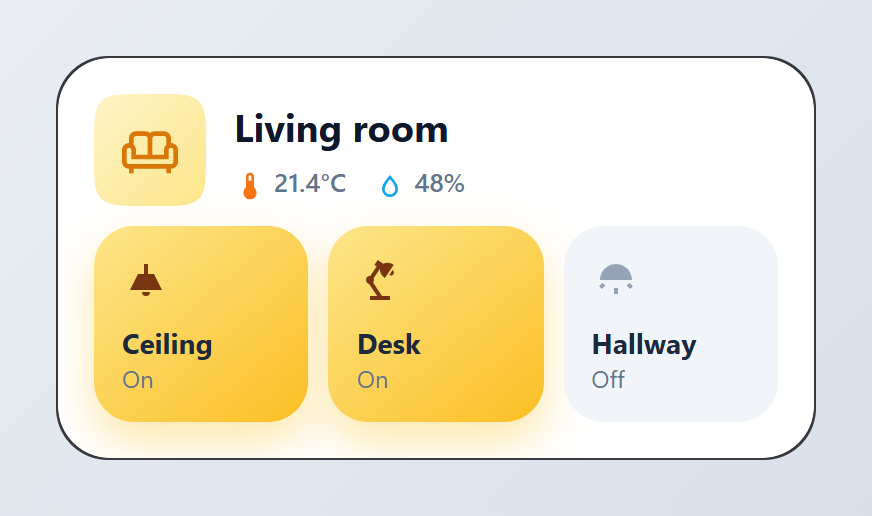
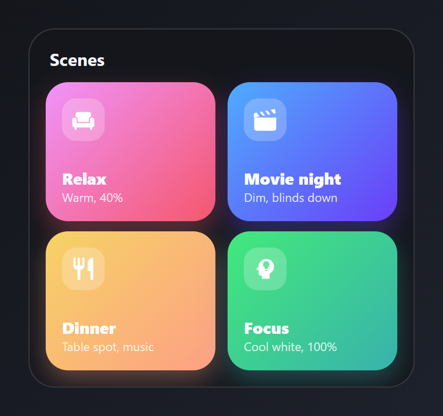
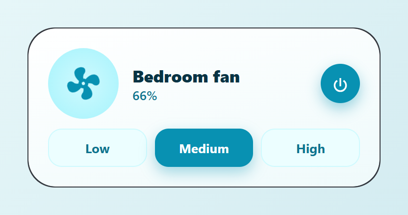
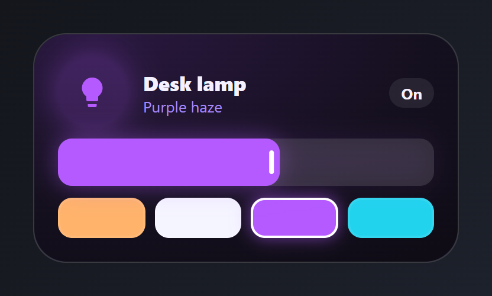
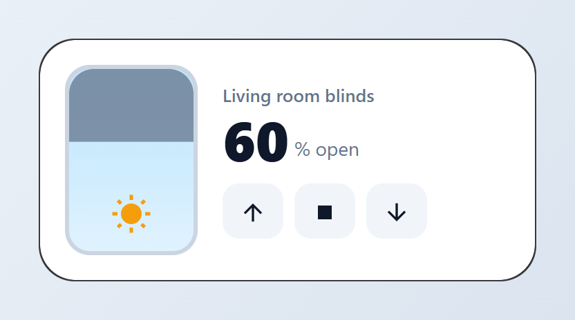
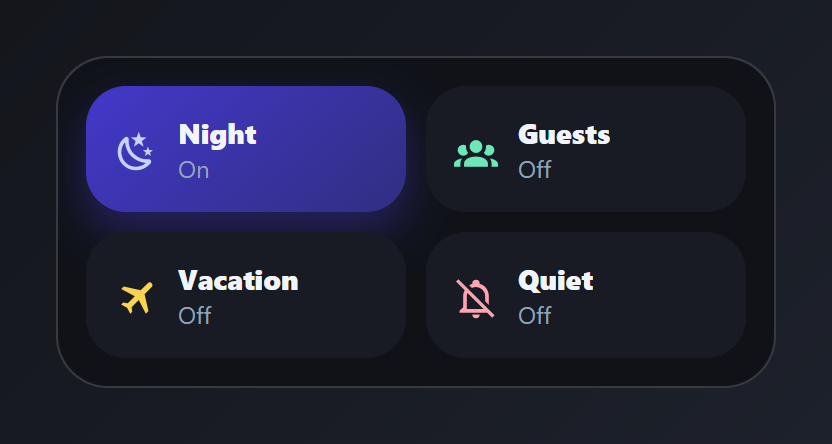
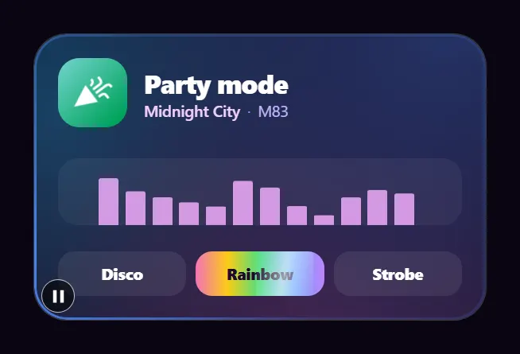
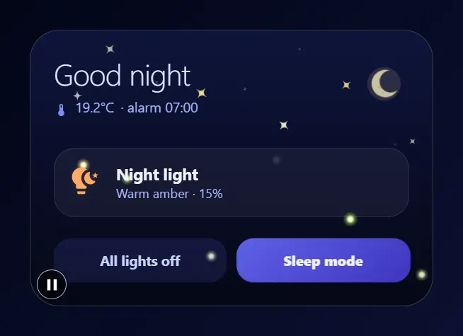
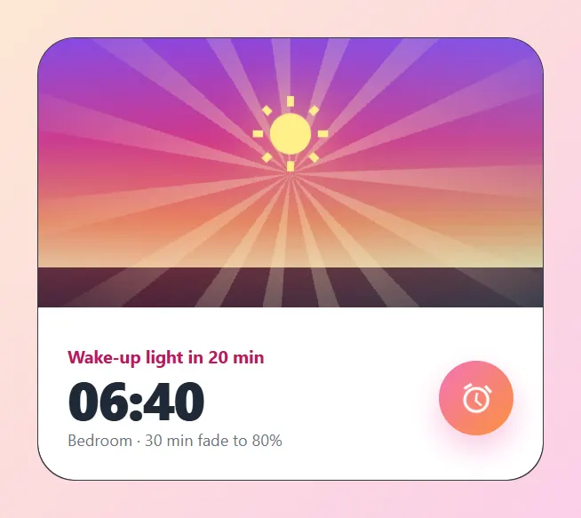

# Lights, rooms and scenes

Room overviews, light tiles, a dimmer, scenes, blinds, a fan, house modes, party lights, a night light and a sunrise alarm. Paste a card into the code editor of a new card, then change the entity ids to your own. Back to the [gallery](README.md).

## Cards

-   [Room card](#room-card)
-   [Scenes](#scenes)
-   [Fan](#fan)
-   [Light dimmer](#light-dimmer)
-   [Blinds](#blinds)
-   [House modes](#house-modes)
-   [Party mode](#party-mode)
-   [Good night](#good-night)
-   [Sunrise alarm](#sunrise-alarm)

## Room card

Room name with climate readings, and light tiles that glow when on. Tap a tile to toggle that light.



Entities: `sensor.indoor_temperature`, `sensor.indoor_humidity`, `light.living_room`, `light.desk`, `light.hallway`

File: [cards/05-room-living.yaml](cards/05-room-living.yaml)

```yaml
# Room card: room name with climate readings, and light tiles that glow when on.
# Tap a tile to toggle that light.
# Entities: sensor.indoor_temperature, sensor.indoor_humidity,
#           light.living_room, light.desk, light.hallway
type: custom:magic-card
name: Living room
background: "#ffffff"
border_radius: 26px
padding: 18px
box_shadow: "0 12px 32px rgba(30, 41, 59, 0.12)"
rows:
  - id: head
    column_widths: [auto, 1fr]
    gap: 14px
    columns:
      - vertical_align: center
        modules:
          - type: icon
            icon: mdi:sofa-outline
            size: 28px
            design:
              color: "#d97706"
              width: 56px
              height: 56px
              display: flex
              align_items: center
              justify_content: center
              shape: squircle
              background: "linear-gradient(135deg, #fef3c7, #fde68a)"
      - vertical_align: center
        gap: 4px
        modules:
          - type: text
            text: Living room
            design: { font_size: 19px, font_weight: "700", color: "#0f172a" }
          - type: horizontal
            gap: 14px
            align: center
            modules:
              - type: horizontal
                gap: 4px
                align: center
                modules:
                  - type: icon
                    icon: mdi:thermometer
                    size: 16px
                    design: { color: "#f97316" }
                  - type: text
                    use_entity: true
                    entity: sensor.indoor_temperature
                    design: { font_size: 13px, font_weight: "500", color: "#64748b" }
              - type: horizontal
                gap: 4px
                align: center
                modules:
                  - type: icon
                    icon: mdi:water-outline
                    size: 16px
                    design: { color: "#0ea5e9" }
                  - type: text
                    use_entity: true
                    entity: sensor.indoor_humidity
                    design: { font_size: 13px, font_weight: "500", color: "#64748b" }
  - id: lights
    layout: "1-1-1"
    gap: 10px
    columns:
      - modules:
          - type: vertical
            gap: 10px
            design: &tile
              padding: 14px
              border_radius: 20px
              background_color: "#f1f5f9"
              transition: background 0.3s, box-shadow 0.3s
              conditional:
                - id: lit
                  name: Light on
                  conditions: [{ type: state, entity: light.living_room, state: "on" }]
                  design:
                    background: "linear-gradient(140deg, #fde68a, #fbbf24)"
                    box_shadow: "0 10px 22px rgba(251,191,36,0.38)"
            actions:
              tap_action: { action: toggle, entity: light.living_room }
              hold_action: { action: more-info, entity: light.living_room }
            modules:
              - type: icon
                entity: light.living_room
                icon: mdi:ceiling-light
                size: 24px
                design:
                  color: "#94a3b8"
                  conditional:
                    - { id: lit, name: On, conditions: [{ type: state, state: "on" }], design: { color: "#78350f" } }
              - type: vertical
                gap: 0px
                modules:
                  - type: text
                    text: Ceiling
                    design: { font_size: 14px, font_weight: "700", color: "#1e293b" }
                  - type: text
                    use_entity: true
                    entity: light.living_room
                    design: { font_size: 12px, color: "#64748b" }
      - modules:
          - type: vertical
            gap: 10px
            design:
              padding: 14px
              border_radius: 20px
              background_color: "#f1f5f9"
              transition: background 0.3s, box-shadow 0.3s
              conditional:
                - id: lit
                  name: Light on
                  conditions: [{ type: state, entity: light.desk, state: "on" }]
                  design:
                    background: "linear-gradient(140deg, #fde68a, #fbbf24)"
                    box_shadow: "0 10px 22px rgba(251,191,36,0.38)"
            actions:
              tap_action: { action: toggle, entity: light.desk }
              hold_action: { action: more-info, entity: light.desk }
            modules:
              - type: icon
                entity: light.desk
                icon: mdi:desk-lamp
                size: 24px
                design:
                  color: "#94a3b8"
                  conditional:
                    - { id: lit, name: On, conditions: [{ type: state, state: "on" }], design: { color: "#78350f" } }
              - type: vertical
                gap: 0px
                modules:
                  - type: text
                    text: Desk
                    design: { font_size: 14px, font_weight: "700", color: "#1e293b" }
                  - type: text
                    use_entity: true
                    entity: light.desk
                    design: { font_size: 12px, color: "#64748b" }
      - modules:
          - type: vertical
            gap: 10px
            design:
              padding: 14px
              border_radius: 20px
              background_color: "#f1f5f9"
              transition: background 0.3s, box-shadow 0.3s
              conditional:
                - id: lit
                  name: Light on
                  conditions: [{ type: state, entity: light.hallway, state: "on" }]
                  design:
                    background: "linear-gradient(140deg, #fde68a, #fbbf24)"
                    box_shadow: "0 10px 22px rgba(251,191,36,0.38)"
            actions:
              tap_action: { action: toggle, entity: light.hallway }
              hold_action: { action: more-info, entity: light.hallway }
            modules:
              - type: icon
                entity: light.hallway
                icon: mdi:wall-sconce-round
                size: 24px
                design:
                  color: "#94a3b8"
                  conditional:
                    - { id: lit, name: On, conditions: [{ type: state, state: "on" }], design: { color: "#78350f" } }
              - type: vertical
                gap: 0px
                modules:
                  - type: text
                    text: Hallway
                    design: { font_size: 14px, font_weight: "700", color: "#1e293b" }
                  - type: text
                    use_entity: true
                    entity: light.hallway
                    design: { font_size: 12px, color: "#64748b" }
```

## Scenes

Four large gradient tiles, one tap each.



Entities: `scene.relax`, `scene.movie`, `scene.dinner`, `scene.focus`

File: [cards/10-scenes.yaml](cards/10-scenes.yaml)

```yaml
# Scenes: four large gradient tiles, one tap each.
# Entities: scene.relax, scene.movie, scene.dinner, scene.focus
type: custom:magic-card
name: Scenes
background: "#14161c"
border_radius: 26px
padding: 16px
box_shadow: "0 18px 40px rgba(0,0,0,0.45)"
rows:
  - id: title
    columns:
      - modules:
          - type: text
            text: Scenes
            design: { font_size: 17px, font_weight: "700", color: "#f1f5f9", padding: 2px 4px }
  - id: r1
    layout: "1-1"
    gap: 12px
    columns:
      - modules:
          - type: vertical
            gap: 26px
            design:
              padding: 16px
              border_radius: 22px
              background: "linear-gradient(135deg, #f093fb 0%, #f5576c 100%)"
              box_shadow: "0 10px 24px rgba(245,87,108,0.35)"
              transition: transform 0.2s
              hover: { transform: translateY(-2px) }
            actions:
              tap_action: { action: perform-action, service: scene.turn_on, data: { entity_id: scene.relax } }
            modules:
              - type: icon
                icon: mdi:sofa-single
                size: 26px
                design: &badge
                  color: "#ffffff"
                  width: 42px
                  height: 42px
                  display: flex
                  align_items: center
                  justify_content: center
                  border_radius: 14px
                  background_color: "rgba(255,255,255,0.22)"
              - type: vertical
                gap: 0px
                modules:
                  - type: text
                    text: Relax
                    design: &label { font_size: 16px, font_weight: "800", color: "#ffffff" }
                  - type: text
                    text: Warm, 40%
                    design: &hint { font_size: 12px, color: "rgba(255,255,255,0.8)" }
      - modules:
          - type: vertical
            gap: 26px
            design:
              padding: 16px
              border_radius: 22px
              background: "linear-gradient(135deg, #4facfe 0%, #6a3ef7 100%)"
              box_shadow: "0 10px 24px rgba(106,62,247,0.35)"
              transition: transform 0.2s
              hover: { transform: translateY(-2px) }
            actions:
              tap_action: { action: perform-action, service: scene.turn_on, data: { entity_id: scene.movie } }
            modules:
              - type: icon
                icon: mdi:movie-open
                size: 26px
                design: *badge
              - type: vertical
                gap: 0px
                modules:
                  - type: text
                    text: Movie night
                    design: *label
                  - type: text
                    text: Dim, blinds down
                    design: *hint
  - id: r2
    layout: "1-1"
    gap: 12px
    columns:
      - modules:
          - type: vertical
            gap: 26px
            design:
              padding: 16px
              border_radius: 22px
              background: "linear-gradient(135deg, #f6d365 0%, #fda085 100%)"
              box_shadow: "0 10px 24px rgba(253,160,133,0.35)"
              transition: transform 0.2s
              hover: { transform: translateY(-2px) }
            actions:
              tap_action: { action: perform-action, service: scene.turn_on, data: { entity_id: scene.dinner } }
            modules:
              - type: icon
                icon: mdi:silverware-fork-knife
                size: 26px
                design: *badge
              - type: vertical
                gap: 0px
                modules:
                  - type: text
                    text: Dinner
                    design: *label
                  - type: text
                    text: Table spot, music
                    design: *hint
      - modules:
          - type: vertical
            gap: 26px
            design:
              padding: 16px
              border_radius: 22px
              background: "linear-gradient(135deg, #43e97b 0%, #38b2ac 100%)"
              box_shadow: "0 10px 24px rgba(56,178,172,0.35)"
              transition: transform 0.2s
              hover: { transform: translateY(-2px) }
            actions:
              tap_action: { action: perform-action, service: scene.turn_on, data: { entity_id: scene.focus } }
            modules:
              - type: icon
                icon: mdi:head-lightbulb
                size: 26px
                design: *badge
              - type: vertical
                gap: 0px
                modules:
                  - type: text
                    text: Focus
                    design: *label
                  - type: text
                    text: Cool white, 100%
                    design: *hint
```

## Fan

A spinning fan icon (faster at higher speeds) with three speed pills. The active speed is highlighted.



Entities: `fan.bedroom`

The speed pills set 33, 66 and 100 %. The highlighted pill follows the `percentage` attribute.

File: [cards/19-fan-control.yaml](cards/19-fan-control.yaml)

```yaml
# Fan: a spinning fan icon (faster at higher speeds) with three speed pills.
# The active speed is highlighted.
# Entities: fan.bedroom
type: custom:magic-card
name: Bedroom fan
background: "linear-gradient(165deg, #ffffff 0%, #effafb 100%)"
border_radius: 28px
padding: 20px
box_shadow: "0 14px 34px rgba(8, 145, 178, 0.16)"
rows:
  - id: main
    column_widths: [auto, 1fr, auto]
    gap: 14px
    columns:
      - vertical_align: center
        modules:
          - type: icon
            entity: fan.bedroom
            icon: mdi:fan
            size: 40px
            icon_fx:
              device: spin
            design:
              color: "#0891b2"
              width: 72px
              height: 72px
              display: flex
              align_items: center
              justify_content: center
              shape: circle
              background: "radial-gradient(circle, #cffafe 0%, #a5f3fc 100%)"
            actions:
              tap_action: { action: toggle }
      - vertical_align: center
        gap: 0px
        modules:
          - type: text
            text: Bedroom fan
            design: { font_size: 17px, font_weight: "800", color: "#083344" }
          - type: text
            use_entity: true
            entity: fan.bedroom
            attribute: percentage
            design: { font_size: 13px, font_weight: "600", color: "#0e7490" }
      - vertical_align: center
        modules:
          - type: icon
            icon: mdi:power
            size: 20px
            design:
              color: "#ffffff"
              width: 40px
              height: 40px
              display: flex
              align_items: center
              justify_content: center
              border_radius: 50%
              background_color: "#0891b2"
              box_shadow: "0 6px 14px rgba(8,145,178,0.4)"
            actions:
              tap_action: { action: toggle, entity: fan.bedroom }
  - id: speeds
    layout: "1-1-1"
    gap: 8px
    columns:
      - modules:
          - type: text
            text: Low
            design: &speed
              text_align: center
              font_size: 13px
              font_weight: "700"
              padding: 10px
              border_radius: 14px
              color: "#0e7490"
              background_color: "#ecfeff"
              border: "1px solid #cffafe"
              conditional:
                - id: active
                  name: Active
                  conditions: [{ type: attribute, entity: fan.bedroom, attribute: percentage, above: 0, below: 34 }]
                  design: { color: "#ffffff", background_color: "#0891b2", border: "1px solid #0891b2" }
            actions:
              tap_action: { action: perform-action, service: fan.set_percentage, data: { entity_id: fan.bedroom, percentage: 33 } }
      - modules:
          - type: text
            text: Medium
            design:
              text_align: center
              font_size: 13px
              font_weight: "700"
              padding: 10px
              border_radius: 14px
              color: "#0e7490"
              background_color: "#ecfeff"
              border: "1px solid #cffafe"
              conditional:
                - id: active
                  name: Active
                  conditions: [{ type: attribute, entity: fan.bedroom, attribute: percentage, above: 33, below: 67 }]
                  design: { color: "#ffffff", background_color: "#0891b2", border: "1px solid #0891b2", box_shadow: "0 6px 14px rgba(8,145,178,0.35)" }
            actions:
              tap_action: { action: perform-action, service: fan.set_percentage, data: { entity_id: fan.bedroom, percentage: 66 } }
      - modules:
          - type: text
            text: High
            design:
              text_align: center
              font_size: 13px
              font_weight: "700"
              padding: 10px
              border_radius: 14px
              color: "#0e7490"
              background_color: "#ecfeff"
              border: "1px solid #cffafe"
              conditional:
                - id: active
                  name: Active
                  conditions: [{ type: attribute, entity: fan.bedroom, attribute: percentage, above: 66 }]
                  design: { color: "#ffffff", background_color: "#0891b2", border: "1px solid #0891b2" }
            actions:
              tap_action: { action: perform-action, service: fan.set_percentage, data: { entity_id: fan.bedroom, percentage: 100 } }
```

## Light dimmer

A glowing bulb in the light's own colour and a wide brightness slider. Tap the bulb to toggle.



Entities: `light.desk`

The colour name and the four preset colours are typed. Each swatch is a `separator` module with a tap action.

File: [cards/23-light-dimmer.yaml](cards/23-light-dimmer.yaml)

```yaml
# Light dimmer: a glowing bulb in the light's own colour and a wide brightness slider.
# Tap the bulb to toggle.
# Entities: light.desk
type: custom:magic-card
name: Desk lamp
background: "radial-gradient(130% 120% at 15% 0%, #2a1840 0%, #15101f 60%, #0f0c16 100%)"
border_radius: 28px
padding: 20px
box_shadow: "0 18px 40px rgba(124, 58, 237, 0.25)"
rows:
  - id: head
    column_widths: [auto, 1fr, auto]
    gap: 14px
    columns:
      - vertical_align: center
        modules:
          - type: icon
            entity: light.desk
            icon: mdi:lightbulb
            size: 30px
            use_entity_color: true
            design:
              color: entity
              width: 58px
              height: 58px
              display: flex
              align_items: center
              justify_content: center
              border_radius: 50%
              background_color: "rgba(180,90,255,0.18)"
              box_shadow: "0 0 30px rgba(180,90,255,0.45)"
            actions:
              tap_action: { action: toggle }
      - vertical_align: center
        gap: 0px
        modules:
          - type: text
            text: Desk lamp
            design: { font_size: 17px, font_weight: "800", color: "#f5f0ff" }
          - type: text
            text: Purple haze
            design: { font_size: 13px, color: "#a78bfa" }
      - vertical_align: center
        modules:
          - type: text
            use_entity: true
            entity: light.desk
            design: { font_size: 13px, font_weight: "700", color: "#f5f0ff", padding: 4px 10px, border_radius: 999px, background_color: "rgba(255,255,255,0.08)" }
  - id: slider
    columns:
      - modules:
          - type: slider
            entity: light.desk
            show_value: false
            slider_color: "#b45aff"
            design: { css: "filter: drop-shadow(0 0 10px rgba(180,90,255,0.45));" }
  - id: presets
    layout: "1-1-1-1"
    gap: 8px
    columns:
      - modules:
          - type: separator
            separator_style: none
            design: { height: 30px, border_radius: 12px, background_color: "#ffb36b", border: "2px solid rgba(255,255,255,0.08)" }
            actions:
              tap_action: { action: perform-action, service: light.turn_on, data: { entity_id: light.desk, color_temp_kelvin: 2700 } }
      - modules:
          - type: separator
            separator_style: none
            design: { height: 30px, border_radius: 12px, background_color: "#f5f5ff", border: "2px solid rgba(255,255,255,0.08)" }
            actions:
              tap_action: { action: perform-action, service: light.turn_on, data: { entity_id: light.desk, color_temp_kelvin: 6000 } }
      - modules:
          - type: separator
            separator_style: none
            design: { height: 30px, border_radius: 12px, background_color: "#b45aff", border: "2px solid #ffffff", box_shadow: "0 0 14px rgba(180,90,255,0.6)" }
            actions:
              tap_action: { action: perform-action, service: light.turn_on, data: { entity_id: light.desk, rgb_color: [180, 90, 255] } }
      - modules:
          - type: separator
            separator_style: none
            design: { height: 30px, border_radius: 12px, background_color: "#22d3ee", border: "2px solid rgba(255,255,255,0.08)" }
            actions:
              tap_action: { action: perform-action, service: light.turn_on, data: { entity_id: light.desk, rgb_color: [34, 211, 238] } }
```

## Blinds

A window that fills from the top with the closed share, the position, and open / stop / close buttons.



Entities: `cover.living_blinds`

File: [cards/30-blinds.yaml](cards/30-blinds.yaml)

```yaml
# Blinds: a window that fills from the top with the closed share, the position,
# and open / stop / close buttons.
# Entities: cover.living_blinds
type: custom:magic-card
name: Blinds
background: "#ffffff"
border_radius: 26px
padding: 18px
box_shadow: "0 14px 34px rgba(30, 41, 59, 0.12)"
rows:
  - id: main
    column_widths: [96px, 1fr]
    gap: 18px
    columns:
      - modules:
          - type: icon
            icon: mdi:white-balance-sunny
            size: 30px
            design:
              color: "#f59e0b"
              height: 120px
              display: flex
              align_items: flex-end
              justify_content: center
              padding_bottom: 12px
              border_radius: 18px
              border: "3px solid #cbd5e1"
              background: "linear-gradient(180deg, #bae6fd, #e0f2fe)"
              value_background:
                type: fill
                entity: cover.living_blinds
                attribute: current_position
                min: 100
                max: 0
                direction: down
                color: "#64748b"
                opacity: 75%
                wave: false
      - vertical_align: center
        gap: 4px
        modules:
          - type: text
            text: Living room blinds
            design: { font_size: 13px, font_weight: "600", color: "#64748b" }
          - type: horizontal
            gap: 4px
            align: end
            modules:
              - type: text
                use_entity: true
                entity: cover.living_blinds
                attribute: current_position
                design: { font_size: 40px, font_weight: "800", color: "#0f172a", line_height: "1" }
              - type: text
                text: "% open"
                design: { font_size: 14px, color: "#64748b", padding_bottom: 4px }
          - type: horizontal
            gap: 8px
            design: { margin_top: 8px }
            modules:
              - type: icon
                icon: mdi:arrow-up
                size: 20px
                design: &btn
                  color: "#0f172a"
                  width: 44px
                  height: 40px
                  display: flex
                  align_items: center
                  justify_content: center
                  border_radius: 12px
                  background_color: "#f1f5f9"
                actions:
                  tap_action: { action: perform-action, service: cover.open_cover, data: { entity_id: cover.living_blinds } }
              - type: icon
                icon: mdi:stop
                size: 20px
                design: *btn
                actions:
                  tap_action: { action: perform-action, service: cover.stop_cover, data: { entity_id: cover.living_blinds } }
              - type: icon
                icon: mdi:arrow-down
                size: 20px
                design: *btn
                actions:
                  tap_action: { action: perform-action, service: cover.close_cover, data: { entity_id: cover.living_blinds } }
```

## House modes

Four switches as a 2x2 grid of toggle tiles. A tile lights up in its own colour while its mode is on.



Entities: `input_boolean.night_mode`, `input_boolean.guest_mode`, `input_boolean.vacation`, `input_boolean.do_not_disturb`

File: [cards/40-house-modes.yaml](cards/40-house-modes.yaml)

```yaml
# House modes: four switches as a 2x2 grid of toggle tiles. A tile lights up in
# its own colour while its mode is on.
# Entities: input_boolean.night_mode, input_boolean.guest_mode,
#           input_boolean.vacation, input_boolean.do_not_disturb
type: custom:magic-card
name: Modes
background: "#101218"
border_radius: 26px
padding: 14px
box_shadow: "0 18px 40px rgba(0,0,0,0.5)"
rows:
  - id: r1
    layout: "1-1"
    gap: 10px
    columns:
      - modules:
          - type: horizontal
            gap: 10px
            align: center
            design:
              padding: 14px
              border_radius: 20px
              background_color: "#181b23"
              conditional:
                - id: "on"
                  name: "On"
                  conditions: [{ type: state, entity: input_boolean.night_mode, state: "on" }]
                  design: { background: "linear-gradient(140deg, #4338ca, #312e81)", box_shadow: "0 10px 22px rgba(67,56,202,0.4)" }
            actions:
              tap_action: { action: toggle, entity: input_boolean.night_mode }
            modules:
              - type: icon
                icon: mdi:weather-night
                size: 22px
                design: { color: "#c7d2fe" }
              - type: vertical
                gap: 0px
                modules:
                  - type: text
                    text: Night
                    design: &name { font_size: 14px, font_weight: "800", color: "#f1f5f9" }
                  - type: text
                    use_entity: true
                    entity: input_boolean.night_mode
                    design: &st { font_size: 12px, color: "#94a3b8" }
      - modules:
          - type: horizontal
            gap: 10px
            align: center
            design:
              padding: 14px
              border_radius: 20px
              background_color: "#181b23"
              conditional:
                - id: "on"
                  name: "On"
                  conditions: [{ type: state, entity: input_boolean.guest_mode, state: "on" }]
                  design: { background: "linear-gradient(140deg, #059669, #065f46)" }
            actions:
              tap_action: { action: toggle, entity: input_boolean.guest_mode }
            modules:
              - type: icon
                icon: mdi:account-group
                size: 22px
                design: { color: "#6ee7b7" }
              - type: vertical
                gap: 0px
                modules:
                  - type: text
                    text: Guests
                    design: *name
                  - type: text
                    use_entity: true
                    entity: input_boolean.guest_mode
                    design: *st
  - id: r2
    layout: "1-1"
    gap: 10px
    columns:
      - modules:
          - type: horizontal
            gap: 10px
            align: center
            design:
              padding: 14px
              border_radius: 20px
              background_color: "#181b23"
              conditional:
                - id: "on"
                  name: "On"
                  conditions: [{ type: state, entity: input_boolean.vacation, state: "on" }]
                  design: { background: "linear-gradient(140deg, #d97706, #92400e)" }
            actions:
              tap_action: { action: toggle, entity: input_boolean.vacation }
            modules:
              - type: icon
                icon: mdi:airplane
                size: 22px
                design: { color: "#fcd34d" }
              - type: vertical
                gap: 0px
                modules:
                  - type: text
                    text: Vacation
                    design: *name
                  - type: text
                    use_entity: true
                    entity: input_boolean.vacation
                    design: *st
      - modules:
          - type: horizontal
            gap: 10px
            align: center
            design:
              padding: 14px
              border_radius: 20px
              background_color: "#181b23"
              conditional:
                - id: "on"
                  name: "On"
                  conditions: [{ type: state, entity: input_boolean.do_not_disturb, state: "on" }]
                  design: { background: "linear-gradient(140deg, #e11d48, #881337)" }
            actions:
              tap_action: { action: toggle, entity: input_boolean.do_not_disturb }
            modules:
              - type: icon
                icon: mdi:bell-off-outline
                size: 22px
                design: { color: "#fda4af" }
              - type: vertical
                gap: 0px
                modules:
                  - type: text
                    text: Quiet
                    design: *name
                  - type: text
                    use_entity: true
                    entity: input_boolean.do_not_disturb
                    design: *st
```

## Party mode

A plasma background, a spinning conic border, the light cycling through the rainbow and an equalizer that bounces while music plays.



Entities: `light.party`, `media_player.living_room`

The light effects on the three buttons (Disco, Rainbow, Strobe) depend on your light. The equalizer plays while the speaker is playing.

File: [cards/48-party-lights.yaml](cards/48-party-lights.yaml)

```yaml
# Party mode: a plasma background, a spinning conic border, the light cycling through the rainbow and an equalizer that bounces while music plays.
# Entities: light.party, media_player.living_room
type: custom:magic-card
name: Party mode
background: "#120a1f"
border_radius: 28px
padding: 20px
box_shadow: "0 20px 50px rgba(217, 70, 239, 0.3)"
animations:
  - { id: plasma, preset: plasma-gradient, strength: 45 }
  - { id: border, preset: conic-border-spin, intensity: 2, strength: 90 }
rows:
  - id: head
    column_widths: [auto, 1fr]
    gap: 14px
    columns:
      - vertical_align: center
        modules:
          - type: icon
            entity: light.party
            icon: mdi:party-popper
            size: 30px
            design:
              color: "#ffffff"
              width: 58px
              height: 58px
              display: flex
              align_items: center
              justify_content: center
              border_radius: 18px
              background: "linear-gradient(135deg, #f0abfc, #8b5cf6)"
              animations:
                - { id: hue, preset: rainbow-hue, duration: 4s }
                - { id: tada, preset: tada, target: icon, intensity: 8 }
      - vertical_align: center
        gap: 0px
        modules:
          - type: text
            text: Party mode
            design: { font_size: 22px, font_weight: "900", color: "#ffffff", letter_spacing: -0.5px }
          - type: horizontal
            gap: 6px
            align: center
            modules:
              - type: text
                use_entity: true
                entity: media_player.living_room
                attribute: media_title
                design: { font_size: 13px, font_weight: "600", color: "#f5d0fe" }
              - type: text
                text: ·
                design: { font_size: 13px, color: "#a78bfa" }
              - type: text
                use_entity: true
                entity: media_player.living_room
                attribute: media_artist
                design: { font_size: 13px, color: "#c4b5fd" }
  - id: eq
    padding: 16px 0 12px
    columns:
      - modules:
          - type: separator
            separator_style: none
            design:
              height: 56px
              border_radius: 16px
              background_color: "rgba(255,255,255,0.05)"
              animations:
                - { id: bars, preset: equalizer-bars, trigger: state, trigger_entity: media_player.living_room, state: playing, color: "#f0abfc", strength: 85, intensity: 12 }
  - id: scenes
    layout: "1-1-1"
    gap: 8px
    columns:
      - modules:
          - type: text
            text: Disco
            design: &pill { text_align: center, padding: 10px, border_radius: 14px, font_size: 13px, font_weight: "800", color: "#ffffff", background_color: "rgba(255,255,255,0.08)" }
            actions:
              tap_action: { action: perform-action, service: light.turn_on, data: { entity_id: light.party, effect: Disco } }
      - modules:
          - type: text
            text: Rainbow
            design:
              text_align: center
              padding: 10px
              border_radius: 14px
              font_size: 13px
              font_weight: "800"
              color: "#1a0b2e"
              background: "linear-gradient(90deg, #f472b6, #facc15, #4ade80, #60a5fa, #c084fc)"
              animations:
                - { id: shine, preset: shine-sweep, intensity: 60, duration: 2s }
            actions:
              tap_action: { action: perform-action, service: light.turn_on, data: { entity_id: light.party, effect: Rainbow } }
      - modules:
          - type: text
            text: Strobe
            design: *pill
            actions:
              tap_action: { action: perform-action, service: light.turn_on, data: { entity_id: light.party, effect: Strobe } }
```

## Good night

A night sky with a moon, stars and fireflies over the header, and the night light glowing in its own warm colour.



Entities: `light.nightlight`, `input_boolean.night_mode`, `sensor.bedroom_temperature`

The alarm time and the "Warm amber · 15%" line are typed text.

File: [cards/49-night-light.yaml](cards/49-night-light.yaml)

```yaml
# Good night: a night sky with a moon, stars and fireflies over the header, and the night light glowing in its own warm colour.
# Entities: light.nightlight, input_boolean.night_mode, sensor.bedroom_temperature
type: custom:magic-card
name: Good night
background: "linear-gradient(180deg, #0b1033 0%, #050816 100%)"
border_radius: 28px
padding: 22px
box_shadow: "0 20px 44px rgba(2, 6, 23, 0.7)"
animations:
  - { id: sky, preset: night, intensity: 70 }
rows:
  - id: moon
    columns:
      - vertical_align: center
        gap: 2px
        modules:
          - type: text
            text: Good night
            design: { font_size: 28px, font_weight: "300", color: "#e0e7ff", letter_spacing: -0.5px }
          - type: horizontal
            gap: 6px
            align: center
            modules:
              - type: icon
                icon: mdi:thermometer
                size: 14px
                design: { color: "#818cf8" }
              - type: text
                use_entity: true
                entity: sensor.bedroom_temperature
                design: { font_size: 13px, color: "#a5b4fc" }
              - type: text
                text: · alarm 07:00
                design: { font_size: 13px, color: "#a5b4fc" }
  - id: light
    padding: 18px 0 0
    columns:
      - modules:
          - type: horizontal
            gap: 14px
            align: center
            design:
              padding: 14px
              border_radius: 20px
              background_color: "rgba(255,255,255,0.05)"
              border: "1px solid rgba(165,180,252,0.14)"
            actions:
              tap_action: { action: toggle, entity: light.nightlight }
            modules:
              - type: icon
                entity: light.nightlight
                icon: mdi:lightbulb-night
                size: 30px
                use_entity_color: true
                icon_fx:
                  device: auto
              - type: vertical
                gap: 0px
                modules:
                  - type: text
                    text: Night light
                    design: { font_size: 15px, font_weight: "700", color: "#eef2ff" }
                  - type: text
                    text: Warm amber · 15%
                    design: { font_size: 12px, color: "#a5b4fc" }
  - id: buttons
    layout: "1-1"
    gap: 10px
    padding: 10px 0 0
    columns:
      - modules:
          - type: text
            text: All lights off
            design: { text_align: center, padding: 12px, border_radius: 16px, font_size: 13px, font_weight: "700", color: "#c7d2fe", background_color: "rgba(99,102,241,0.14)" }
            actions:
              tap_action: { action: perform-action, service: light.turn_off, data: { entity_id: all } }
      - modules:
          - type: text
            text: Sleep mode
            design:
              text_align: center
              padding: 12px
              border_radius: 16px
              font_size: 13px
              font_weight: "800"
              color: "#ffffff"
              background: "linear-gradient(135deg, #6366f1, #4338ca)"
              animations:
                - { id: breathe, preset: breathe, intensity: 3 }
            actions:
              tap_action: { action: toggle, entity: input_boolean.night_mode }
```

## Sunrise alarm

The sun climbs over the horizon in a slowly shifting dawn gradient, with a countdown to the wake-up light. The sun's climb is a small keyframes animation stored in the card.



Entities: `light.bedroom`, `input_boolean.night_mode`

The wake-up time and the countdown are typed text. Drive them with a template from your alarm entity.

File: [cards/50-sunrise-alarm.yaml](cards/50-sunrise-alarm.yaml)

```yaml
# Sunrise alarm: the sun climbs over the horizon in a slowly shifting dawn gradient, with a countdown to the wake-up light.
# The sun's climb is a small keyframes animation stored in the card.
# Entities: light.bedroom, input_boolean.night_mode
type: custom:magic-card
name: Sunrise alarm
background: "#ffffff"
border_radius: 28px
padding: 0px
box_shadow: "0 18px 40px rgba(190, 24, 93, 0.18)"
custom_animations:
  sun-climb:
    name: Sun climb
    kind: keyframes
    duration: 6
    easing: ease-out
    iterations: infinite
    keyframes:
      - { at: 0, transform: { y: 60, scale: 0.85 }, opacity: 0 }
      - { at: 15, transform: { y: 44, scale: 0.9 }, opacity: 1 }
      - { at: 80, transform: { y: -4, scale: 1 }, opacity: 1 }
      - { at: 100, transform: { y: -6, scale: 1 }, opacity: 0 }
rows:
  - id: sky
    padding: 26px 22px 0
    design:
      height: 176px
      background: "linear-gradient(180deg, #7c3aed 0%, #db2777 38%, #fb923c 68%, #fde68a 85%, #431407 85%, #1c0a03 100%)"
      animations:
        - { id: flow, preset: gradient-flow, strength: 50 }
        - { id: rays, preset: sun-rays, color: "#fef3c7", strength: 30, intensity: 8 }
    columns:
      - modules:
          - type: icon
            icon: mdi:white-balance-sunny
            size: 64px
            design:
              color: "#fef08a"
              display: flex
              justify_content: center
              filter: "drop-shadow(0 0 20px rgba(254,240,138,0.9))"
              animations:
                - { id: climb, preset: custom:sun-climb, target: icon }
  - id: info
    padding: 18px 22px 22px
    column_widths: [1fr, auto]
    columns:
      - vertical_align: center
        gap: 2px
        modules:
          - type: text
            text: Wake-up light in 20 min
            design: { font_size: 13px, font_weight: "700", color: "#be185d" }
          - type: text
            text: "06:40"
            design: { font_size: 40px, font_weight: "800", color: "#1f2937", letter_spacing: -1.5px, line_height: "1.05" }
          - type: text
            text: Bedroom · 30 min fade to 80%
            design: { font_size: 12px, color: "#6b7280" }
      - vertical_align: center
        modules:
          - type: icon
            icon: mdi:alarm
            size: 26px
            design:
              color: "#ffffff"
              width: 56px
              height: 56px
              display: flex
              align_items: center
              justify_content: center
              border_radius: 50%
              background: "linear-gradient(135deg, #f472b6, #fb923c)"
              box_shadow: "0 10px 22px rgba(244,114,182,0.4)"
              animations:
                - { id: wiggle, preset: wiggle, target: icon, intensity: 12 }
            actions:
              tap_action: { action: toggle, entity: input_boolean.night_mode }
```
