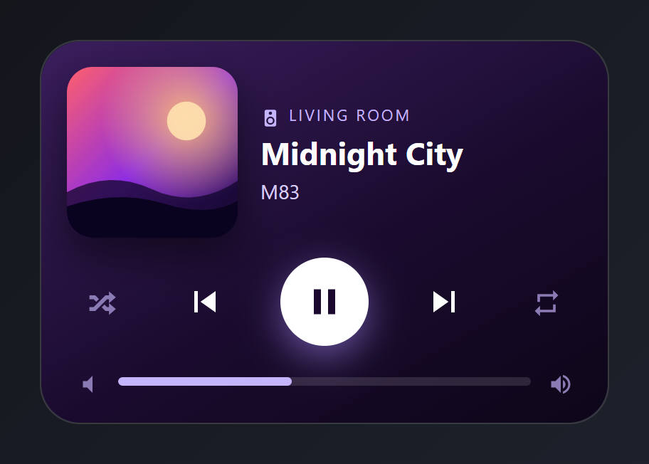
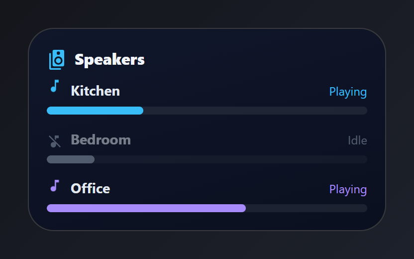
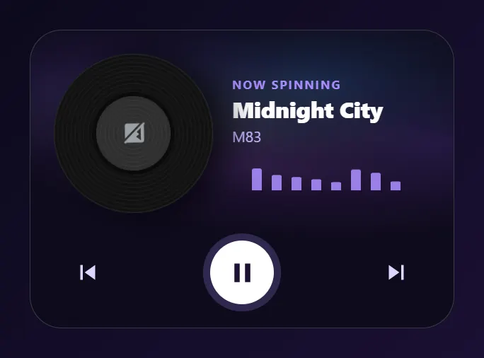

# Media

Players, a record player and speaker volumes. Paste a card into the code editor of a new card, then change the entity ids to your own. Back to the [gallery](README.md).

## Cards

-   [Now playing](#now-playing)
-   [Mini player](#mini-player)
-   [Speaker group](#speaker-group)
-   [Vinyl player](#vinyl-player)

## Now playing

Album art, title and artist, transport controls and a volume slider.



Entities: `media_player.living_room`

File: [cards/04-now-playing.yaml](cards/04-now-playing.yaml)

```yaml
# Now playing: album art, title and artist, transport controls and a volume slider.
# Entities: media_player.living_room
type: custom:magic-card
name: Now playing
background: "linear-gradient(150deg, #3b1e5e 0%, #1a0b2e 55%, #0d0618 100%)"
border_radius: 28px
padding: 18px
box_shadow: "0 20px 44px rgba(91, 33, 182, 0.35)"
rows:
  - id: art
    column_widths: [120px, 1fr]
    gap: 16px
    columns:
      - modules:
          - type: image
            entity: media_player.living_room
            entity_picture: true
            aspect_ratio: "1"
            design:
              border_radius: 18px
              box_shadow: "0 12px 28px rgba(0,0,0,0.5)"
      - vertical_align: center
        gap: 4px
        modules:
          - type: horizontal
            gap: 6px
            align: center
            modules:
              - type: icon
                icon: mdi:speaker
                size: 14px
                design: { color: "#c4b5fd" }
              - type: text
                text: Living room
                design: { font_size: 11px, color: "#c4b5fd", text_transform: uppercase, letter_spacing: 1.5px }
          - type: text
            use_entity: true
            entity: media_player.living_room
            attribute: media_title
            design: { font_size: 22px, font_weight: "700", color: "#ffffff", line_height: "1.15" }
          - type: text
            use_entity: true
            entity: media_player.living_room
            attribute: media_artist
            design: { font_size: 14px, color: "#d8ccf5" }
  - id: controls
    padding: 4px 6px
    columns:
      - modules:
          - type: horizontal
            justify: space-between
            align: center
            modules:
              - type: icon
                icon: mdi:shuffle-variant
                size: 22px
                design: { color: "#8b7bb5", padding: 8px }
                actions:
                  tap_action: { action: perform-action, service: media_player.shuffle_set, data: { entity_id: media_player.living_room, shuffle: true } }
              - type: icon
                icon: mdi:skip-previous
                size: 30px
                design: { color: "#ffffff", padding: 8px }
                actions:
                  tap_action: { action: perform-action, service: media_player.media_previous_track, data: { entity_id: media_player.living_room } }
              - type: icon
                icon: mdi:pause
                size: 30px
                design:
                  color: "#1a0b2e"
                  width: 62px
                  height: 62px
                  display: flex
                  align_items: center
                  justify_content: center
                  border_radius: 50%
                  background_color: "#ffffff"
                  box_shadow: "0 8px 26px rgba(167,139,250,0.55)"
                actions:
                  tap_action: { action: perform-action, service: media_player.media_play_pause, data: { entity_id: media_player.living_room } }
              - type: icon
                icon: mdi:skip-next
                size: 30px
                design: { color: "#ffffff", padding: 8px }
                actions:
                  tap_action: { action: perform-action, service: media_player.media_next_track, data: { entity_id: media_player.living_room } }
              - type: icon
                icon: mdi:repeat
                size: 22px
                design: { color: "#8b7bb5", padding: 8px }
                actions:
                  tap_action: { action: perform-action, service: media_player.repeat_set, data: { entity_id: media_player.living_room, repeat: all } }
  - id: volume
    column_widths: [auto, 1fr, auto]
    gap: 12px
    padding: 0 6px
    columns:
      - vertical_align: center
        modules:
          - type: icon
            icon: mdi:volume-low
            size: 18px
            design: { color: "#8b7bb5" }
      - vertical_align: center
        modules:
          - type: bar
            entity: media_player.living_room
            attribute: volume_level
            min: 0
            max: 1
            show_value: false
            bar_height: 6px
            bar_color: "#c4b5fd"
            bar_background: "rgba(255,255,255,0.12)"
            design: { border_radius: 999px }
      - vertical_align: center
        modules:
          - type: icon
            icon: mdi:volume-high
            size: 18px
            design: { color: "#8b7bb5" }
```

## Mini player

A slim pill with cover art, title, artist and a play/pause button.


Entities: `media_player.living_room`

File: [cards/35-mini-player.yaml](cards/35-mini-player.yaml)

```yaml
# Mini player: a slim pill with cover art, title, artist and a play/pause button.
# Entities: media_player.living_room
type: custom:magic-card
name: Mini player
background: "linear-gradient(90deg, #1f1033 0%, #2d1650 100%)"
border_radius: 999px
padding: 8px
box_shadow: "0 14px 30px rgba(91, 33, 182, 0.35)"
rows:
  - id: pill
    column_widths: [56px, 1fr, auto]
    gap: 12px
    columns:
      - vertical_align: center
        modules:
          - type: image
            entity: media_player.living_room
            entity_picture: true
            aspect_ratio: "1"
            design:
              border_radius: 50%
              animations: [{ preset: fast-spin, duration: 12s }]
      - vertical_align: center
        gap: 0px
        modules:
          - type: text
            use_entity: true
            entity: media_player.living_room
            attribute: media_title
            design: { font_size: 15px, font_weight: "800", color: "#ffffff", white_space: nowrap, overflow: hidden, text_overflow: ellipsis }
          - type: text
            use_entity: true
            entity: media_player.living_room
            attribute: media_artist
            design: { font_size: 12px, color: "#c4b5fd" }
      - vertical_align: center
        modules:
          - type: horizontal
            gap: 4px
            align: center
            modules:
              - type: icon
                icon: mdi:skip-next
                size: 24px
                design: { color: "#c4b5fd", padding: 6px }
                actions:
                  tap_action: { action: perform-action, service: media_player.media_next_track, data: { entity_id: media_player.living_room } }
              - type: icon
                icon: mdi:pause
                size: 26px
                design:
                  color: "#2d1650"
                  width: 52px
                  height: 52px
                  display: flex
                  align_items: center
                  justify_content: center
                  border_radius: 50%
                  background_color: "#ffffff"
                actions:
                  tap_action: { action: perform-action, service: media_player.media_play_pause, data: { entity_id: media_player.living_room } }
```

## Speaker group

One volume bar per room. Playing rooms get a moving equaliser and a coloured bar; idle rooms are greyed out.



Entities: `media_player.kitchen`, `media_player.bedroom`, `media_player.office`

The Bedroom row is styled as idle with typed colours and opacity.

File: [cards/37-speaker-volumes.yaml](cards/37-speaker-volumes.yaml)

```yaml
# Speaker group: one volume bar per room. Playing rooms get a moving equaliser
# and a coloured bar; idle rooms are greyed out.
# Entities: media_player.kitchen, media_player.bedroom, media_player.office
type: custom:magic-card
name: Speakers
background: "linear-gradient(165deg, #10172a 0%, #0b1020 100%)"
border_radius: 26px
padding: 18px
box_shadow: "0 18px 40px rgba(0,0,0,0.5)"
rows:
  - id: title
    columns:
      - modules:
          - type: horizontal
            gap: 8px
            align: center
            modules:
              - type: icon
                icon: mdi:speaker-multiple
                size: 20px
                design: { color: "#38bdf8" }
              - type: text
                text: Speakers
                design: { font_size: 16px, font_weight: "800", color: "#f1f5f9" }
  - id: list
    columns:
      - gap: 14px
        modules:
          - type: vertical
            gap: 6px
            modules:
              - type: horizontal
                justify: space-between
                align: center
                modules:
                  - type: horizontal
                    gap: 8px
                    align: center
                    modules:
                      - type: icon
                        icon: mdi:music-note
                        size: 16px
                        design: { color: "#38bdf8", animations: [{ preset: squash-stretch, duration: 0.9s }] }
                      - type: text
                        text: Kitchen
                        design: &room { font_size: 14px, font_weight: "700", color: "#e2e8f0" }
                  - type: text
                    use_entity: true
                    entity: media_player.kitchen
                    design: &st { font_size: 12px, color: "#38bdf8" }
              - type: bar
                entity: media_player.kitchen
                attribute: volume_level
                min: 0
                max: 1
                show_value: false
                bar_height: 8px
                bar_color: "#38bdf8"
                bar_background: "rgba(255,255,255,0.07)"
                design: { border_radius: 999px }
          - type: vertical
            gap: 6px
            design: { opacity: "0.5" }
            modules:
              - type: horizontal
                justify: space-between
                align: center
                modules:
                  - type: horizontal
                    gap: 8px
                    align: center
                    modules:
                      - type: icon
                        icon: mdi:music-note-off
                        size: 16px
                        design: { color: "#94a3b8" }
                      - type: text
                        text: Bedroom
                        design: *room
                  - type: text
                    use_entity: true
                    entity: media_player.bedroom
                    design: { font_size: 12px, color: "#94a3b8" }
              - type: bar
                entity: media_player.bedroom
                attribute: volume_level
                min: 0
                max: 1
                show_value: false
                bar_height: 8px
                bar_color: "#94a3b8"
                bar_background: "rgba(255,255,255,0.07)"
                design: { border_radius: 999px }
          - type: vertical
            gap: 6px
            modules:
              - type: horizontal
                justify: space-between
                align: center
                modules:
                  - type: horizontal
                    gap: 8px
                    align: center
                    modules:
                      - type: icon
                        icon: mdi:music-note
                        size: 16px
                        design: { color: "#a78bfa", animations: [{ preset: squash-stretch, duration: 0.9s, delay: 0.3s }] }
                      - type: text
                        text: Office
                        design: *room
                  - type: text
                    use_entity: true
                    entity: media_player.office
                    design: { font_size: 12px, color: "#a78bfa" }
              - type: bar
                entity: media_player.office
                attribute: volume_level
                min: 0
                max: 1
                show_value: false
                bar_height: 8px
                bar_color: "#a78bfa"
                bar_background: "rgba(255,255,255,0.07)"
                design: { border_radius: 999px }
```

## Vinyl player

The album art turns like a record while music plays, over a slow aurora, with an equalizer under the title.



Entities: `media_player.living_room`

The record turns while the player is `playing`.

File: [cards/51-vinyl-player.yaml](cards/51-vinyl-player.yaml)

```yaml
# Vinyl player: the album art turns like a record while music plays, over a slow aurora, with an equalizer under the title.
# Entities: media_player.living_room
type: custom:magic-card
name: Vinyl
background: "#0e0b1c"
border_radius: 30px
padding: 22px
box_shadow: "0 22px 48px rgba(0, 0, 0, 0.6)"
animations:
  - { id: aurora, preset: aurora, color: "#8b5cf6", strength: 45 }
rows:
  - id: record
    column_widths: [150px, 1fr]
    gap: 18px
    columns:
      - modules:
          - type: vertical
            gap: 0px
            design:
              width: 150px
              height: 150px
              padding: 40px
              box_sizing: border-box
              border_radius: 50%
              background: "repeating-radial-gradient(circle, #111 0px, #111 2px, #1c1c1c 3px, #111 4px)"
              box_shadow: "0 14px 30px rgba(0,0,0,0.7), inset 0 0 0 1px rgba(255,255,255,0.06)"
              animations:
                - { id: spin, preset: spin, trigger: state, trigger_entity: media_player.living_room, state: playing, duration: 3.6s, easing: linear }
            modules:
              - type: image
                entity: media_player.living_room
                entity_picture: true
                aspect_ratio: "1"
                design:
                  border_radius: 50%
                  box_shadow: "0 0 0 4px #0b0b0b"
      - vertical_align: center
        gap: 4px
        modules:
          - type: text
            text: Now spinning
            design: { font_size: 11px, font_weight: "700", color: "#a78bfa", text_transform: uppercase, letter_spacing: 1.5px }
          - type: text
            use_entity: true
            entity: media_player.living_room
            attribute: media_title
            design: { font_size: 21px, font_weight: "800", color: "#ffffff", line_height: "1.15" }
          - type: text
            use_entity: true
            entity: media_player.living_room
            attribute: media_artist
            design: { font_size: 14px, color: "#c4b5fd" }
          - type: separator
            separator_style: none
            design:
              height: 30px
              margin_top: 8px
              animations:
                - { id: eq, preset: equalizer-bars, trigger: state, trigger_entity: media_player.living_room, state: playing, color: "#a78bfa", strength: 90, intensity: 8 }
  - id: controls
    padding: 16px 10px 0
    columns:
      - modules:
          - type: horizontal
            justify: space-between
            align: center
            modules:
              - type: icon
                icon: mdi:skip-previous
                size: 28px
                design: { color: "#ddd6fe", padding: 8px }
                actions:
                  tap_action: { action: perform-action, service: media_player.media_previous_track, data: { entity_id: media_player.living_room } }
              - type: icon
                icon: mdi:pause
                size: 30px
                design:
                  color: "#1e1033"
                  width: 60px
                  height: 60px
                  display: flex
                  align_items: center
                  justify_content: center
                  border_radius: 50%
                  background_color: "#ffffff"
                  animations:
                    - { id: halo, preset: halo-ripple, color: "#a78bfa", strength: 70, intensity: 10 }
                actions:
                  tap_action: { action: perform-action, service: media_player.media_play_pause, data: { entity_id: media_player.living_room } }
              - type: icon
                icon: mdi:skip-next
                size: 28px
                design: { color: "#ddd6fe", padding: 8px }
                actions:
                  tap_action: { action: perform-action, service: media_player.media_next_track, data: { entity_id: media_player.living_room } }
```
