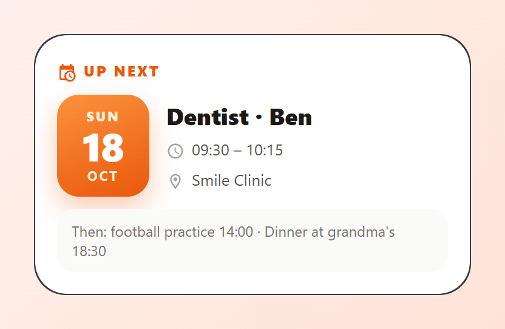
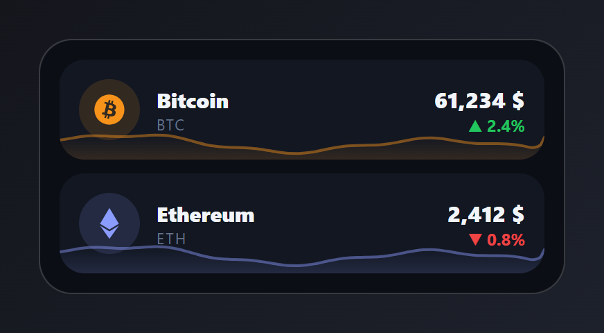
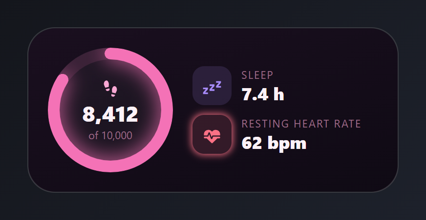

# Personal

Calendar, prices and health. Paste a card into the code editor of a new card, then change the entity ids to your own. Back to the [gallery](README.md).

## Cards

-   [Up next](#up-next)
-   [Crypto prices](#crypto-prices)
-   [Health today](#health-today)

## Up next

The next calendar event as a big date tile with title, time and place.



Entities: `calendar.family`

The date tile, the time and the "Then" line are typed text. Only the title and location come from `calendar.family`.

File: [cards/22-up-next.yaml](cards/22-up-next.yaml)

```yaml
# Up next: the next calendar event as a big date tile with title, time and place.
# Entities: calendar.family
type: custom:magic-card
name: Up next
background: "#ffffff"
border_radius: 26px
padding: 18px
box_shadow: "0 14px 34px rgba(234, 88, 12, 0.14)"
rows:
  - id: label
    columns:
      - modules:
          - type: horizontal
            gap: 6px
            align: center
            modules:
              - type: icon
                icon: mdi:calendar-clock
                size: 16px
                design: { color: "#ea580c" }
              - type: text
                text: Up next
                design: { font_size: 12px, font_weight: "800", color: "#ea580c", text_transform: uppercase, letter_spacing: 1.5px }
  - id: event
    column_widths: [76px, 1fr]
    gap: 14px
    columns:
      - modules:
          - type: vertical
            align: center
            gap: 0px
            design:
              padding: 10px 0
              border_radius: 18px
              background: "linear-gradient(160deg, #fb923c, #ea580c)"
              box_shadow: "0 10px 22px rgba(234,88,12,0.3)"
            modules:
              - type: text
                text: SUN
                design: { font_size: 11px, font_weight: "800", color: "#ffedd5", letter_spacing: 1.5px }
              - type: text
                text: "18"
                design: { font_size: 32px, font_weight: "800", color: "#ffffff", line_height: "1.05" }
              - type: text
                text: OCT
                design: { font_size: 11px, font_weight: "700", color: "#ffedd5", letter_spacing: 1.5px }
      - vertical_align: center
        gap: 4px
        modules:
          - type: text
            use_entity: true
            entity: calendar.family
            attribute: message
            design: { font_size: 19px, font_weight: "800", color: "#1c1917" }
          - type: horizontal
            gap: 6px
            align: center
            modules:
              - type: icon
                icon: mdi:clock-outline
                size: 15px
                design: { color: "#a8a29e" }
              - type: text
                text: "09:30 – 10:15"
                design: { font_size: 13px, color: "#57534e" }
          - type: horizontal
            gap: 6px
            align: center
            modules:
              - type: icon
                icon: mdi:map-marker-outline
                size: 15px
                design: { color: "#a8a29e" }
              - type: text
                use_entity: true
                entity: calendar.family
                attribute: location
                design: { font_size: 13px, color: "#57534e" }
  - id: footer
    columns:
      - modules:
          - type: text
            text: "Then: football practice 14:00 · Dinner at grandma's 18:30"
            design:
              font_size: 12px
              color: "#78716c"
              padding: 10px 12px
              border_radius: 14px
              background_color: "#fafaf9"
```

## Crypto prices

Two coins with their price, 24-hour change and a sparkline.



Entities: `sensor.btc_price`, `sensor.eth_price`

The 24 hour change percentages are typed text.

File: [cards/36-crypto.yaml](cards/36-crypto.yaml)

```yaml
# Crypto prices: two coins with their price, 24-hour change and a sparkline.
# Entities: sensor.btc_price, sensor.eth_price
type: custom:magic-card
name: Crypto
background: "#0b0e14"
border_radius: 24px
padding: 14px
box_shadow: "0 18px 40px rgba(0,0,0,0.5)"
rows:
  - id: btc
    columns:
      - modules:
          - type: horizontal
            gap: 12px
            align: center
            design:
              padding: 14px
              border_radius: 18px
              background_color: "#121722"
              value_background: { type: sparkline, entity: sensor.btc_price, min: 56000, max: 72000, color: "#f7931a", opacity: 14%, line_width: 2 }
            modules:
              - type: icon
                icon: mdi:bitcoin
                size: 26px
                design:
                  color: "#f7931a"
                  width: 44px
                  height: 44px
                  display: flex
                  align_items: center
                  justify_content: center
                  border_radius: 50%
                  background_color: "rgba(247,147,26,0.14)"
              - type: vertical
                gap: 0px
                design: { flex: "1" }
                modules:
                  - type: text
                    text: Bitcoin
                    design: &name { font_size: 15px, font_weight: "800", color: "#f1f5f9" }
                  - type: text
                    text: BTC
                    design: &tick { font_size: 11px, color: "#64748b", letter_spacing: 1px }
              - type: vertical
                gap: 0px
                align: end
                modules:
                  - type: text
                    use_entity: true
                    entity: sensor.btc_price
                    design: &price { font_size: 16px, font_weight: "800", color: "#f1f5f9", font_variant: tabular-nums }
                  - type: text
                    text: "▲ 2.4%"
                    design: { font_size: 12px, font_weight: "700", color: "#22c55e" }
  - id: eth
    columns:
      - modules:
          - type: horizontal
            gap: 12px
            align: center
            design:
              padding: 14px
              border_radius: 18px
              background_color: "#121722"
              value_background: { type: sparkline, entity: sensor.eth_price, min: 2200, max: 2800, color: "#8b9cff", opacity: 14%, line_width: 2 }
            modules:
              - type: icon
                icon: mdi:ethereum
                size: 26px
                design:
                  color: "#8b9cff"
                  width: 44px
                  height: 44px
                  display: flex
                  align_items: center
                  justify_content: center
                  border_radius: 50%
                  background_color: "rgba(139,156,255,0.14)"
              - type: vertical
                gap: 0px
                design: { flex: "1" }
                modules:
                  - type: text
                    text: Ethereum
                    design: *name
                  - type: text
                    text: ETH
                    design: *tick
              - type: vertical
                gap: 0px
                align: end
                modules:
                  - type: text
                    use_entity: true
                    entity: sensor.eth_price
                    design: *price
                  - type: text
                    text: "▼ 0.8%"
                    design: { font_size: 12px, font_weight: "700", color: "#ef4444" }
```

## Health today

Steps toward a goal in a ring, sleep and heart rate.



Entities: `sensor.steps`, `sensor.sleep`, `sensor.heart_rate`

File: [cards/39-health.yaml](cards/39-health.yaml)

```yaml
# Health today: steps toward a goal in a ring, sleep and heart rate.
# Entities: sensor.steps, sensor.sleep, sensor.heart_rate
type: custom:magic-card
name: Health
background: "linear-gradient(160deg, #1a0f1f 0%, #0f0a14 100%)"
border_radius: 28px
padding: 20px
box_shadow: "0 18px 40px rgba(219, 39, 119, 0.2)"
rows:
  - id: main
    column_widths: [auto, 1fr]
    gap: 20px
    columns:
      - vertical_align: center
        modules:
          - type: vertical
            align: center
            gap: 0px
            design:
              width: 128px
              height: 128px
              justify_content: center
              shape: circle
              background_color: "rgba(255,255,255,0.03)"
              ring:
                mode: value
                entity: sensor.steps
                min: 0
                max: 10000
                width: 12
                glow: 10
                color: "#f472b6"
                track_color: "rgba(244,114,182,0.12)"
            modules:
              - type: icon
                icon: mdi:shoe-print
                size: 20px
                design: { color: "#f9a8d4" }
              - type: text
                use_entity: true
                entity: sensor.steps
                design: { font_size: 22px, font_weight: "800", color: "#fdf2f8" }
              - type: text
                text: of 10,000
                design: { font_size: 11px, color: "#9d6b86" }
      - vertical_align: center
        gap: 10px
        modules:
          - type: horizontal
            gap: 10px
            align: center
            modules:
              - type: icon
                icon: mdi:sleep
                size: 20px
                design:
                  color: "#a78bfa"
                  width: 40px
                  height: 40px
                  display: flex
                  align_items: center
                  justify_content: center
                  border_radius: 12px
                  background_color: "rgba(167,139,250,0.14)"
              - type: vertical
                gap: 0px
                modules:
                  - type: text
                    text: Sleep
                    design: &lab { font_size: 11px, color: "#9d6b86", text_transform: uppercase, letter_spacing: 1px }
                  - type: text
                    use_entity: true
                    entity: sensor.sleep
                    design: &val { font_size: 18px, font_weight: "800", color: "#fdf2f8" }
          - type: horizontal
            gap: 10px
            align: center
            modules:
              - type: icon
                icon: mdi:heart-pulse
                size: 20px
                design:
                  color: "#fb7185"
                  width: 40px
                  height: 40px
                  display: flex
                  align_items: center
                  justify_content: center
                  border_radius: 12px
                  background_color: "rgba(251,113,133,0.14)"
                  animations: [{ preset: glow-pulse, color: "#fb7185", intensity: 8, duration: 1s }]
              - type: vertical
                gap: 0px
                modules:
                  - type: text
                    text: Resting heart rate
                    design: *lab
                  - type: text
                    use_entity: true
                    entity: sensor.heart_rate
                    design: *val
```
