# Sci-fi and fantasy

Starship consoles, space stations, enchanted forests and castle keeps, in a card that fits the setting. A few use a theme preset. Paste a card into the code editor of a new card, then change the entity ids to your own. Back to the [gallery](README.md).

## Cards

-   Sci-fi
    -   [Reactor core](#reactor-core)
    -   [Shield grid](#shield-grid)
    -   [Life support](#life-support)
    -   [Airlock](#airlock)
    -   [Star chart](#star-chart)
    -   [Comms array](#comms-array)
    -   [Grow bay](#grow-bay)
    -   [Cargo bay](#cargo-bay)
    -   [Orbital weather](#orbital-weather)
    -   [Mainframe](#mainframe)
    -   [Operations console](#operations-console)
    -   [Operations console, phone-width](#operations-console-phone-width)
-   Fantasy
    -   [Cauldron](#cauldron)
    -   [Enchanted lanterns](#enchanted-lanterns)
    -   [Castle gate](#castle-gate)
    -   [Crystal ball](#crystal-ball)
    -   [Rune ward](#rune-ward)
    -   [Weather tower](#weather-tower)
    -   [Dragon hoard](#dragon-hoard)
    -   [Herb garden](#herb-garden)
    -   [Minstrel hall](#minstrel-hall)
    -   [Quest board](#quest-board)

## Reactor core

A tall capsule of lit cells shows the battery charge, with the solar and house power on either side. The cells are teal and sweep while charging, amber while draining and red under 15 %.

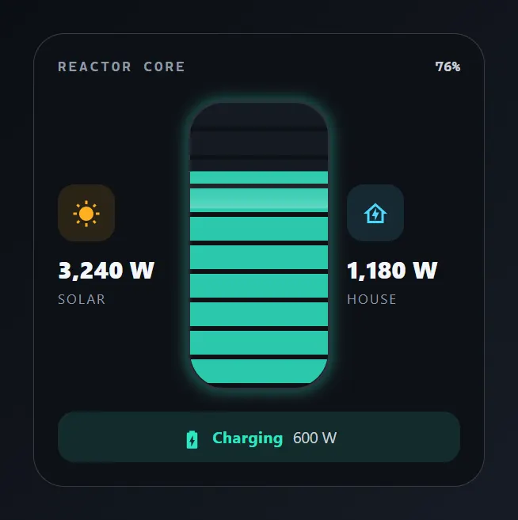

Entities: `sensor.home_battery`, `sensor.battery_power`, `sensor.solar_power`, `sensor.house_power`

File: [cards/61-reactor-core.yaml](cards/61-reactor-core.yaml)

```yaml
# Reactor core: a tall capsule of lit cells shows the battery charge, with the solar and house power on either side.
# The cells are teal and sweep while charging, amber while draining and red under 15 %.
# Entities: sensor.home_battery, sensor.battery_power, sensor.solar_power, sensor.house_power
type: custom:magic-card
name: Reactor core
background: "#0e1116"
border_radius: 26px
padding: 20px
box_shadow: "0 20px 44px rgba(0,0,0,0.55)"
rows:
  - id: head
    column_widths: [1fr, auto]
    columns:
      - modules:
          - type: text
            text: Reactor core
            design: { font_size: 12px, font_weight: "700", color: "#8d99a6", text_transform: uppercase, letter_spacing: 2px, font_family: "ui-monospace, 'Cascadia Mono', Menlo, monospace" }
      - modules:
          - type: text
            use_entity: true
            entity: sensor.home_battery
            design: { font_size: 12px, font_weight: "700", color: "#c8d0d8", font_family: "ui-monospace, 'Cascadia Mono', Menlo, monospace" }
  - id: core
    column_widths: [1fr, 120px, 1fr]
    gap: 14px
    padding: 12px 0 8px
    columns:
      - vertical_align: center
        gap: 4px
        modules:
          - type: icon
            icon: mdi:white-balance-sunny
            size: 24px
            design: { color: "#ffb020", width: 48px, height: 48px, display: flex, align_items: center, justify_content: center, border_radius: 14px, background_color: "rgba(255,176,32,0.12)" }
          - type: text
            use_entity: true
            entity: sensor.solar_power
            design: { font_size: 20px, font_weight: "800", color: "#f3f6f9", margin_top: 6px }
          - type: text
            text: Solar
            design: { font_size: 11px, color: "#8d99a6", text_transform: uppercase, letter_spacing: 1.5px }
      - modules:
          - type: vertical
            gap: 0px
            design:
              height: 240px
              position: relative
              overflow: hidden
              border_radius: 30px
              border: "2px solid #2a323c"
              background_color: "#151a21"
              value_background:
                type: fill
                entity: sensor.home_battery
                color: "#ffb020"
                opacity: 85%
                wave: false
              animations:
                - { id: glow, preset: glow-pulse, color: "#ffb020", strength: 35, intensity: 14, duration: 4s }
              conditional:
                - id: charging
                  name: Charging
                  conditions: [{ type: state, entity: sensor.battery_power, above: 0 }]
                  design:
                    value_background: { type: fill, entity: sensor.home_battery, color: "#2ee6c4", opacity: 85%, wave: false }
                    animations:
                      - { id: sweep, preset: scanline, color: "#d9fff7", strength: 70, intensity: 45, duration: 4s, direction: reverse }
                      - { id: glow, preset: glow-pulse, color: "#2ee6c4", strength: 45, intensity: 16, duration: 4s }
                - id: low
                  name: Under 15 %
                  conditions: [{ type: state, entity: sensor.home_battery, below: 15 }]
                  design:
                    value_background: { type: fill, entity: sensor.home_battery, color: "#ff5a5a", opacity: 85%, wave: false }
                    animations:
                      - { id: glow, preset: glow-pulse, color: "#ff5a5a", strength: 50, intensity: 16, duration: 2s }
            modules:
              - type: separator
                separator_style: none
                design:
                  position: absolute
                  inset: 0
                  background: "repeating-linear-gradient(180deg, transparent 0px, transparent 20px, #0e1116 20px, #0e1116 24px)"
      - vertical_align: center
        gap: 4px
        modules:
          - type: icon
            icon: mdi:home-lightning-bolt-outline
            size: 24px
            design: { color: "#4dd8ff", width: 48px, height: 48px, display: flex, align_items: center, justify_content: center, border_radius: 14px, background_color: "rgba(77,216,255,0.12)" }
          - type: text
            use_entity: true
            entity: sensor.house_power
            design: { font_size: 20px, font_weight: "800", color: "#f3f6f9", margin_top: 6px }
          - type: text
            text: House
            design: { font_size: 11px, color: "#8d99a6", text_transform: uppercase, letter_spacing: 1.5px }
  - id: status
    columns:
      - modules:
          - type: horizontal
            gap: 8px
            align: center
            justify: center
            design:
              padding: 10px
              border_radius: 14px
              background_color: "rgba(255,176,32,0.12)"
              conditional:
                - id: charging
                  name: Charging
                  conditions: [{ type: state, entity: sensor.battery_power, above: 0 }]
                  design: { background_color: "rgba(46,230,196,0.12)" }
            modules:
              - type: icon
                icon: mdi:battery-arrow-down
                size: 18px
                design: { color: "#ffb020" }
                display: { conditions: [{ type: state, entity: sensor.battery_power, below: 1 }] }
              - type: icon
                icon: mdi:battery-charging
                size: 18px
                design: { color: "#2ee6c4" }
                display: { conditions: [{ type: state, entity: sensor.battery_power, above: 0 }] }
              - type: text
                text: Charging
                design: { font_size: 13px, font_weight: "700", color: "#2ee6c4", letter_spacing: 0.5px }
                display: { conditions: [{ type: state, entity: sensor.battery_power, above: 0 }] }
              - type: text
                text: Draining
                design: { font_size: 13px, font_weight: "700", color: "#ffb020", letter_spacing: 0.5px }
                display: { conditions: [{ type: state, entity: sensor.battery_power, below: 1 }] }
              - type: text
                use_entity: true
                entity: sensor.battery_power
                design: { font_size: 13px, color: "#c8d0d8" }
```

## Shield grid

A honeycomb of hex cells for the doors and the hallway motion sensor. A tripped cell turns to the accent colour and flashes. A light wave crosses the grid each time the alarm is set to armed home. It uses theme colours only, so it follows the dashboard's theme.

Shot with the Cobalt Prism theme preset in dark mode. See [theme examples](../themes/examples/README.md#cobalt-prism). With another theme the card uses that theme's colours.

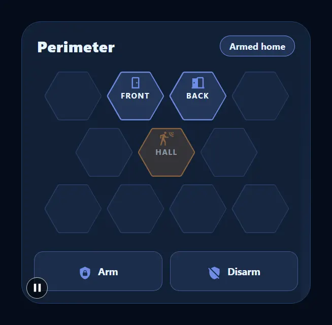

Entities: `alarm_control_panel.home`, `binary_sensor.front_door`, `binary_sensor.back_door`, `binary_sensor.hall_motion`

File: [cards/62-shield-grid.yaml](cards/62-shield-grid.yaml)

```yaml
# Shield grid: a honeycomb of hex cells for the doors and the hallway motion sensor.
# A tripped cell turns to the accent colour and flashes. A light wave crosses the grid each time the alarm is set to armed home.
# It uses theme colours only, so it follows the dashboard's theme.
# Entities: alarm_control_panel.home, binary_sensor.front_door, binary_sensor.back_door, binary_sensor.hall_motion
type: custom:magic-card
name: Shield grid
border_radius: 26px
padding: 16px
animations:
  - { id: wave, preset: shine-sweep, trigger: state, trigger_entity: alarm_control_panel.home, state: armed_home, color: var(--primary-color), strength: 35, intensity: 30, duration: 5s }
rows:
  - id: title
    column_widths: [1fr, auto]
    padding: 2px 4px 10px
    columns:
      - vertical_align: center
        modules:
          - type: text
            text: Perimeter
            design: { font_size: 20px, font_weight: "800", color: var(--primary-text-color), letter_spacing: 0.5px }
      - vertical_align: center
        modules:
          - type: text
            use_entity: true
            entity: alarm_control_panel.home
            design:
              font_size: 12px
              font_weight: "700"
              color: var(--primary-text-color)
              padding: 5px 12px
              border_radius: 999px
              border_width: 1px
              border_style: solid
              border_color: var(--primary-color)
              background_color: "color-mix(in srgb, var(--primary-color) 18%, var(--card-background-color))"
  - id: r1
    column_widths: [76px, 76px, 76px, 76px]
    gap: 6px
    padding: 0 13px
    columns:
      - modules:
          - type: vertical
            align: center
            design: { width: 76px, height: 64px, shape: hexagon, border_width: 1px, border_style: solid, border_color: "color-mix(in srgb, var(--primary-color) 22%, transparent)", background_color: "color-mix(in srgb, var(--primary-color) 6%, var(--card-background-color))" }
            modules: []
      - modules:
          - type: vertical
            align: center
            justify: center
            gap: 0px
            design:
              width: 76px
              height: 64px
              shape: hexagon
              display: flex
              justify_content: center
              border_width: 1.5px
              border_style: solid
              border_color: var(--primary-color)
              background_color: "color-mix(in srgb, var(--primary-color) 20%, var(--card-background-color))"
              conditional:
                - id: tripped
                  name: Tripped
                  conditions: [{ type: state, entity: binary_sensor.front_door, state: "on" }]
                  design:
                    border_color: var(--accent-color)
                    background_color: "color-mix(in srgb, var(--accent-color) 30%, var(--card-background-color))"
                    animations:
                      - { id: flash, preset: blink, trigger: entity_on, trigger_entity: binary_sensor.front_door, color: var(--accent-color), intensity: 45, duration: 1s }
            modules:
              - type: icon
                entity: binary_sensor.front_door
                icon: mdi:door
                size: 20px
                design:
                  color: var(--primary-color)
                  conditional:
                    - { id: tripped, name: Tripped, conditions: [{ type: state, state: "on" }], design: { color: var(--accent-color) } }
              - type: text
                text: Front
                design: { font_size: 10px, font_weight: "700", color: var(--primary-text-color), text_transform: uppercase, letter_spacing: 1px }
      - modules:
          - type: vertical
            align: center
            justify: center
            gap: 0px
            design:
              width: 76px
              height: 64px
              shape: hexagon
              display: flex
              justify_content: center
              border_width: 1.5px
              border_style: solid
              border_color: var(--primary-color)
              background_color: "color-mix(in srgb, var(--primary-color) 20%, var(--card-background-color))"
              conditional:
                - id: tripped
                  name: Tripped
                  conditions: [{ type: state, entity: binary_sensor.back_door, state: "on" }]
                  design:
                    border_color: var(--accent-color)
                    background_color: "color-mix(in srgb, var(--accent-color) 30%, var(--card-background-color))"
                    animations:
                      - { id: flash, preset: blink, trigger: entity_on, trigger_entity: binary_sensor.back_door, color: var(--accent-color), intensity: 45, duration: 1s }
            modules:
              - type: icon
                entity: binary_sensor.back_door
                icon: mdi:door-open
                size: 20px
                design:
                  color: var(--primary-color)
                  conditional:
                    - { id: tripped, name: Tripped, conditions: [{ type: state, state: "on" }], design: { color: var(--accent-color) } }
              - type: text
                text: Back
                design: { font_size: 10px, font_weight: "700", color: var(--primary-text-color), text_transform: uppercase, letter_spacing: 1px }
      - modules:
          - type: vertical
            align: center
            design: { width: 76px, height: 64px, shape: hexagon, border_width: 1px, border_style: solid, border_color: "color-mix(in srgb, var(--primary-color) 22%, transparent)", background_color: "color-mix(in srgb, var(--primary-color) 6%, var(--card-background-color))" }
            modules: []
  - id: r2
    column_widths: [76px, 76px, 76px]
    gap: 6px
    padding: 0 54px
    columns:
      - modules:
          - type: vertical
            align: center
            design: { width: 76px, height: 64px, shape: hexagon, border_width: 1px, border_style: solid, border_color: "color-mix(in srgb, var(--primary-color) 22%, transparent)", background_color: "color-mix(in srgb, var(--primary-color) 6%, var(--card-background-color))" }
            modules: []
      - modules:
          - type: vertical
            align: center
            justify: center
            gap: 0px
            design:
              width: 76px
              height: 64px
              shape: hexagon
              display: flex
              justify_content: center
              border_width: 1.5px
              border_style: solid
              border_color: var(--primary-color)
              background_color: "color-mix(in srgb, var(--primary-color) 20%, var(--card-background-color))"
              conditional:
                - id: tripped
                  name: Tripped
                  conditions: [{ type: state, entity: binary_sensor.hall_motion, state: "on" }]
                  design:
                    border_color: var(--accent-color)
                    background_color: "color-mix(in srgb, var(--accent-color) 30%, var(--card-background-color))"
                    animations:
                      - { id: flash, preset: blink, trigger: entity_on, trigger_entity: binary_sensor.hall_motion, color: var(--accent-color), intensity: 45, duration: 1s }
            modules:
              - type: icon
                entity: binary_sensor.hall_motion
                icon: mdi:motion-sensor
                size: 20px
                design:
                  color: var(--primary-color)
                  conditional:
                    - { id: tripped, name: Tripped, conditions: [{ type: state, state: "on" }], design: { color: var(--accent-color) } }
              - type: text
                text: Hall
                design: { font_size: 10px, font_weight: "700", color: var(--primary-text-color), text_transform: uppercase, letter_spacing: 1px }
      - modules:
          - type: vertical
            align: center
            design: { width: 76px, height: 64px, shape: hexagon, border_width: 1px, border_style: solid, border_color: "color-mix(in srgb, var(--primary-color) 22%, transparent)", background_color: "color-mix(in srgb, var(--primary-color) 6%, var(--card-background-color))" }
            modules: []
  - id: r3
    column_widths: [76px, 76px, 76px, 76px]
    gap: 6px
    padding: 0 13px
    columns:
      - modules:
          - type: vertical
            align: center
            design: { width: 76px, height: 64px, shape: hexagon, border_width: 1px, border_style: solid, border_color: "color-mix(in srgb, var(--primary-color) 22%, transparent)", background_color: "color-mix(in srgb, var(--primary-color) 6%, var(--card-background-color))" }
            modules: []
      - modules:
          - type: vertical
            align: center
            design: { width: 76px, height: 64px, shape: hexagon, border_width: 1px, border_style: solid, border_color: "color-mix(in srgb, var(--primary-color) 22%, transparent)", background_color: "color-mix(in srgb, var(--primary-color) 6%, var(--card-background-color))" }
            modules: []
      - modules:
          - type: vertical
            align: center
            design: { width: 76px, height: 64px, shape: hexagon, border_width: 1px, border_style: solid, border_color: "color-mix(in srgb, var(--primary-color) 22%, transparent)", background_color: "color-mix(in srgb, var(--primary-color) 6%, var(--card-background-color))" }
            modules: []
      - modules:
          - type: vertical
            align: center
            design: { width: 76px, height: 64px, shape: hexagon, border_width: 1px, border_style: solid, border_color: "color-mix(in srgb, var(--primary-color) 22%, transparent)", background_color: "color-mix(in srgb, var(--primary-color) 6%, var(--card-background-color))" }
            modules: []
  - id: actions
    layout: "1-1"
    gap: 10px
    padding: 14px 0 0
    columns:
      - modules:
          - type: horizontal
            gap: 8px
            align: center
            justify: center
            design:
              padding: 14px 0
              border_radius: 12px
              border_width: 1px
              border_style: solid
              border_color: "color-mix(in srgb, var(--primary-color) 45%, transparent)"
              background_color: "color-mix(in srgb, var(--primary-color) 12%, var(--card-background-color))"
            actions:
              tap_action: { action: perform-action, service: alarm_control_panel.alarm_arm_home, data: { entity_id: alarm_control_panel.home } }
            modules:
              - type: icon
                icon: mdi:shield-lock
                size: 18px
                design: { color: var(--primary-color) }
              - type: text
                text: Arm
                design: { font_size: 13px, font_weight: "700", color: var(--primary-text-color) }
      - modules:
          - type: horizontal
            gap: 8px
            align: center
            justify: center
            design:
              padding: 14px 0
              border_radius: 12px
              border_width: 1px
              border_style: solid
              border_color: "color-mix(in srgb, var(--primary-color) 45%, transparent)"
              background_color: "color-mix(in srgb, var(--primary-color) 12%, var(--card-background-color))"
            actions:
              tap_action: { action: perform-action, service: alarm_control_panel.alarm_disarm, data: { entity_id: alarm_control_panel.home } }
            modules:
              - type: icon
                icon: mdi:shield-off
                size: 18px
                design: { color: var(--primary-color) }
              - type: text
                text: Disarm
                design: { font_size: 13px, font_weight: "700", color: var(--primary-text-color) }
```

## Life support

A panel board with a four-colour stripe, the room temperature in a breathing halo and three air bars with a status word each. The halo breathes every 6 s, and every 3 s while the heating or cooling is running. It uses theme colours only, so it follows the dashboard's theme.

Shot with the Deep Survey theme preset in light mode. See [theme examples](../themes/examples/README.md#deep-survey). With another theme the card uses that theme's colours.

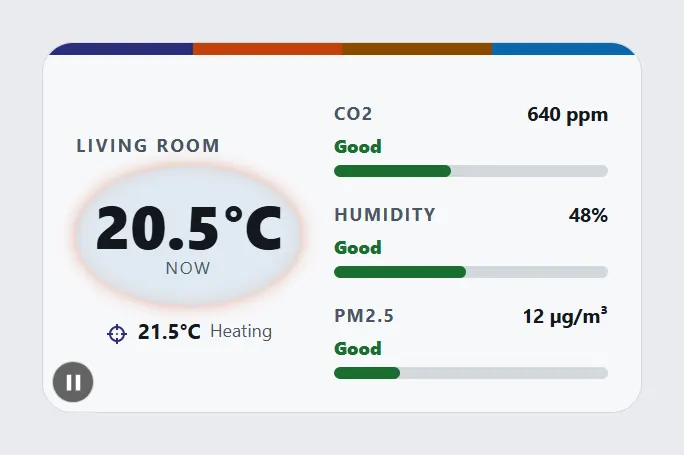

Entities: `climate.living_room`, `sensor.co2`, `sensor.indoor_humidity`, `sensor.pm25`

File: [cards/63-life-support.yaml](cards/63-life-support.yaml)

```yaml
# Life support: a panel board with a four-colour stripe, the room temperature in a breathing halo and three air bars with a status word each.
# The halo breathes every 6 s, and every 3 s while the heating or cooling is running.
# It uses theme colours only, so it follows the dashboard's theme.
# Entities: climate.living_room, sensor.co2, sensor.indoor_humidity, sensor.pm25
type: custom:magic-card
name: Life support
border_radius: 20px
padding: 0px
overflow: hidden
rows:
  - id: stripe
    layout: "1-1-1-1"
    gap: 0px
    columns:
      - modules: [{ type: separator, separator_style: none, design: { height: 8px, background_color: var(--primary-color) } }]
      - modules: [{ type: separator, separator_style: none, design: { height: 8px, background_color: var(--accent-color) } }]
      - modules: [{ type: separator, separator_style: none, design: { height: 8px, background_color: var(--warning-color) } }]
      - modules: [{ type: separator, separator_style: none, design: { height: 8px, background_color: var(--info-color) } }]
  - id: panel
    column_widths: [150px, 1fr]
    gap: 22px
    padding: 20px 22px 22px
    columns:
      - vertical_align: center
        gap: 6px
        modules:
          - type: text
            text: Living room
            design: { font_size: 12px, font_weight: "700", color: var(--secondary-text-color), text_transform: uppercase, letter_spacing: 1.5px }
          - type: vertical
            gap: 0px
            align: center
            design:
              padding: 18px 8px
              border_radius: 50%
              background_color: "color-mix(in srgb, var(--info-color) 10%, var(--card-background-color))"
              animations:
                - { id: halo, preset: aura, color: var(--info-color), strength: 55, intensity: 22, duration: 6s }
              conditional:
                - id: working
                  name: Heating or cooling
                  mode: any
                  conditions: [{ type: attribute, entity: climate.living_room, attribute: hvac_action, state: heating }, { type: attribute, entity: climate.living_room, attribute: hvac_action, state: cooling }]
                  design:
                    animations:
                      - { id: halo, preset: aura, color: var(--accent-color), strength: 55, intensity: 22, duration: 3s }
            modules:
              - type: text
                use_entity: true
                entity: climate.living_room
                attribute: current_temperature
                design: { font_size: 40px, font_weight: "800", color: var(--primary-text-color), line_height: "1.05" }
              - type: text
                text: now
                design: { font_size: 11px, color: var(--secondary-text-color), text_transform: uppercase, letter_spacing: 1.5px }
          - type: horizontal
            gap: 6px
            align: center
            justify: center
            modules:
              - type: icon
                icon: mdi:target
                size: 16px
                design: { color: var(--primary-color) }
              - type: text
                use_entity: true
                entity: climate.living_room
                attribute: temperature
                design: { font_size: 14px, font_weight: "700", color: var(--primary-text-color) }
              - type: text
                use_entity: true
                entity: climate.living_room
                attribute: hvac_action
                design: { font_size: 12px, color: var(--secondary-text-color) }
      - vertical_align: center
        gap: 16px
        modules:
          - type: vertical
            gap: 5px
            modules:
              - type: horizontal
                gap: 8px
                align: center
                modules:
                  - type: text
                    text: CO2
                    design: { font_size: 12px, font_weight: "700", color: var(--secondary-text-color), flex: "1", text_transform: uppercase, letter_spacing: 1px }
                  - type: text
                    use_entity: true
                    entity: sensor.co2
                    design: { font_size: 13px, font_weight: "700", color: var(--primary-text-color) }
              - type: text
                text: Good
                design: { font_size: 12px, font_weight: "800", color: var(--success-color) }
                display: { conditions: [{ type: state, entity: sensor.co2, below: 800 }] }
              - type: text
                text: Watch
                design: { font_size: 12px, font_weight: "800", color: var(--warning-color) }
                display: { conditions: [{ type: state, entity: sensor.co2, above: 799.99, below: 1200 }] }
              - type: text
                text: Poor
                design: { font_size: 12px, font_weight: "800", color: var(--error-color) }
                display: { conditions: [{ type: state, entity: sensor.co2, above: 1199.99 }] }
              - type: bar
                entity: sensor.co2
                min: 0
                max: 1500
                bar_height: 8px
                show_value: false
                bar_color: var(--success-color)
                bar_background: var(--divider-color)
                severity: [{ from: 0, color: var(--success-color) }, { from: 800, color: var(--warning-color) }, { from: 1200, color: var(--error-color) }]
          - type: vertical
            gap: 5px
            modules:
              - type: horizontal
                gap: 8px
                align: center
                modules:
                  - type: text
                    text: Humidity
                    design: { font_size: 12px, font_weight: "700", color: var(--secondary-text-color), flex: "1", text_transform: uppercase, letter_spacing: 1px }
                  - type: text
                    use_entity: true
                    entity: sensor.indoor_humidity
                    design: { font_size: 13px, font_weight: "700", color: var(--primary-text-color) }
              - type: text
                text: Dry
                design: { font_size: 12px, font_weight: "800", color: var(--warning-color) }
                display: { conditions: [{ type: state, entity: sensor.indoor_humidity, below: 30 }] }
              - type: text
                text: Good
                design: { font_size: 12px, font_weight: "800", color: var(--success-color) }
                display: { conditions: [{ type: state, entity: sensor.indoor_humidity, above: 29.99, below: 60 }] }
              - type: text
                text: Humid
                design: { font_size: 12px, font_weight: "800", color: var(--info-color) }
                display: { conditions: [{ type: state, entity: sensor.indoor_humidity, above: 59.99 }] }
              - type: bar
                entity: sensor.indoor_humidity
                min: 0
                max: 100
                bar_height: 8px
                show_value: false
                bar_color: var(--success-color)
                bar_background: var(--divider-color)
                severity: [{ from: 0, color: var(--warning-color) }, { from: 30, color: var(--success-color) }, { from: 60, color: var(--info-color) }]
          - type: vertical
            gap: 5px
            modules:
              - type: horizontal
                gap: 8px
                align: center
                modules:
                  - type: text
                    text: PM2.5
                    design: { font_size: 12px, font_weight: "700", color: var(--secondary-text-color), flex: "1", text_transform: uppercase, letter_spacing: 1px }
                  - type: text
                    use_entity: true
                    entity: sensor.pm25
                    design: { font_size: 13px, font_weight: "700", color: var(--primary-text-color) }
              - type: text
                text: Good
                design: { font_size: 12px, font_weight: "800", color: var(--success-color) }
                display: { conditions: [{ type: state, entity: sensor.pm25, below: 15 }] }
              - type: text
                text: Watch
                design: { font_size: 12px, font_weight: "800", color: var(--warning-color) }
                display: { conditions: [{ type: state, entity: sensor.pm25, above: 14.99, below: 35 }] }
              - type: text
                text: Poor
                design: { font_size: 12px, font_weight: "800", color: var(--error-color) }
                display: { conditions: [{ type: state, entity: sensor.pm25, above: 34.99 }] }
              - type: bar
                entity: sensor.pm25
                min: 0
                max: 50
                bar_height: 8px
                show_value: false
                bar_color: var(--success-color)
                bar_background: var(--divider-color)
                severity: [{ from: 0, color: var(--success-color) }, { from: 15, color: var(--warning-color) }, { from: 35, color: var(--error-color) }]
```

## Airlock

A round hatch for the front door lock. Tap the hatch only while the door is unlocked to lock it. In any other state, a tap opens the lock's own dialog, so unlocking is a second, deliberate step. Hold the hatch for the lock's details. Two lamps show the latch and the door contact. The hatch is two tiles that look the same, and the lock state decides which one shows. Replace the two entities with your own lock and door sensor.

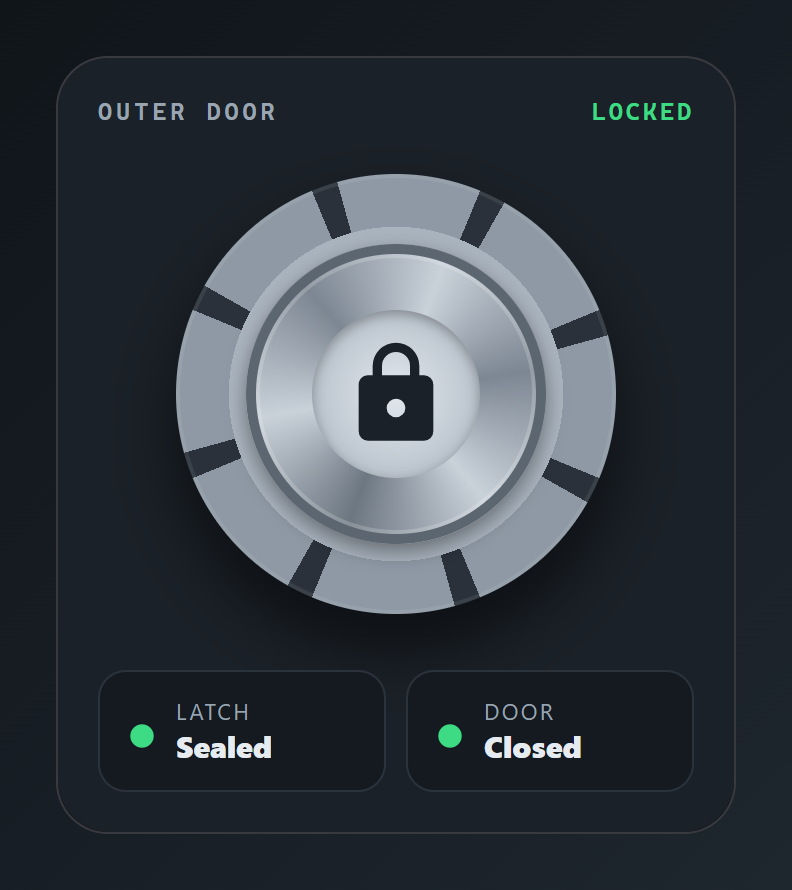

Entities: `lock.front_door`, `binary_sensor.front_door`

File: [cards/64-airlock.yaml](cards/64-airlock.yaml)

```yaml
# Airlock: a round hatch for the front door lock. Tap the hatch only while the door is unlocked to lock it. In any other state, a tap opens the lock's own dialog, so unlocking is a second, deliberate step. Hold the hatch for the lock's details. Two lamps show the latch and the door contact.
# The hatch is two tiles that look the same, and the lock state decides which one shows. Replace the two entities with your own lock and door sensor.
# Entities: lock.front_door, binary_sensor.front_door
type: custom:magic-card
name: Airlock
background: "#1b2128"
border_radius: 26px
padding: 20px
box_shadow: "0 20px 44px rgba(0,0,0,0.55)"
rows:
  - id: caption
    column_widths: [1fr, auto]
    columns:
      - modules:
          - type: text
            text: Outer door
            design: { font_size: 12px, font_weight: "700", color: "#9aa5b1", text_transform: uppercase, letter_spacing: 2px, font_family: "ui-monospace, 'Cascadia Mono', Menlo, monospace" }
      - modules:
          - type: text
            use_entity: true
            entity: lock.front_door
            design: { font_size: 12px, font_weight: "700", color: "#3ddc84", text_transform: uppercase, letter_spacing: 1.5px, font_family: "ui-monospace, 'Cascadia Mono', Menlo, monospace" }
  - id: hatch
    padding: 14px 0 6px
    columns:
      - modules:
          - type: vertical
            align: center
            justify: center
            gap: 0px
            design:
              width: 220px
              height: 220px
              margin: 0 auto
              padding: 35px
              box_sizing: border-box
              border_radius: 50%
              background: "radial-gradient(circle closest-side, #aab4bf 0 76%, transparent 76%), repeating-conic-gradient(from 22.5deg, #2a313a 0deg 7deg, #8e99a5 7deg 45deg)"
              box_shadow: "0 18px 34px rgba(0,0,0,0.55), inset 0 0 0 2px rgba(255,255,255,0.08)"
              transition: transform 0.15s
              hover: { transform: scale(1.01) }
            display: { conditions: [{ type: state, entity: lock.front_door, state: unlocked }] }
            actions:
              tap_action: { action: perform-action, service: lock.lock, data: { entity_id: lock.front_door } }
              hold_action: { action: more-info, entity: lock.front_door }
            modules:
              - type: vertical
                align: center
                justify: center
                gap: 0px
                design:
                  width: 150px
                  height: 150px
                  padding: 33px
                  box_sizing: border-box
                  border_radius: 50%
                  background: "conic-gradient(from 20deg, #c9d1d9, #7d8793, #c9d1d9, #6d7782, #c9d1d9, #7d8793, #c9d1d9)"
                  box_shadow: "inset 0 0 0 5px #5c6671, inset 0 0 0 7px rgba(255,255,255,0.18), 0 4px 10px rgba(0,0,0,0.4)"
                modules:
                  - type: icon
                    entity: lock.front_door
                    icon: mdi:lock
                    icon_on: mdi:lock
                    icon_off: mdi:lock-open-variant
                    size: 56px
                    design:
                      color: "#1b2128"
                      width: 84px
                      height: 84px
                      display: flex
                      align_items: center
                      justify_content: center
                      border_radius: 50%
                      background: "radial-gradient(circle, #e1e7ed 0%, #aab4bf 100%)"
                      box_shadow: "inset 0 2px 6px rgba(0,0,0,0.3)"
          - type: vertical
            align: center
            justify: center
            gap: 0px
            design:
              width: 220px
              height: 220px
              margin: 0 auto
              padding: 35px
              box_sizing: border-box
              border_radius: 50%
              background: "radial-gradient(circle closest-side, #aab4bf 0 76%, transparent 76%), repeating-conic-gradient(from 22.5deg, #2a313a 0deg 7deg, #8e99a5 7deg 45deg)"
              box_shadow: "0 18px 34px rgba(0,0,0,0.55), inset 0 0 0 2px rgba(255,255,255,0.08)"
              transition: transform 0.15s
              hover: { transform: scale(1.01) }
            display: { conditions: [{ type: state, entity: lock.front_door, state_not: unlocked }] }
            actions:
              tap_action: { action: more-info, entity: lock.front_door }
              hold_action: { action: more-info, entity: lock.front_door }
            modules:
              - type: vertical
                align: center
                justify: center
                gap: 0px
                design:
                  width: 150px
                  height: 150px
                  padding: 33px
                  box_sizing: border-box
                  border_radius: 50%
                  background: "conic-gradient(from 20deg, #c9d1d9, #7d8793, #c9d1d9, #6d7782, #c9d1d9, #7d8793, #c9d1d9)"
                  box_shadow: "inset 0 0 0 5px #5c6671, inset 0 0 0 7px rgba(255,255,255,0.18), 0 4px 10px rgba(0,0,0,0.4)"
                modules:
                  - type: icon
                    entity: lock.front_door
                    icon: mdi:lock
                    icon_on: mdi:lock
                    icon_off: mdi:lock-open-variant
                    size: 56px
                    design:
                      color: "#1b2128"
                      width: 84px
                      height: 84px
                      display: flex
                      align_items: center
                      justify_content: center
                      border_radius: 50%
                      background: "radial-gradient(circle, #e1e7ed 0%, #aab4bf 100%)"
                      box_shadow: "inset 0 2px 6px rgba(0,0,0,0.3)"
  - id: lamps
    layout: "1-1"
    gap: 10px
    padding: 12px 0 0
    columns:
      - modules:
          - type: horizontal
            gap: 10px
            align: center
            design:
              padding: 12px 14px
              border_radius: 14px
              background_color: "#141a20"
              border: "1px solid #2a323c"
            modules:
              - type: icon
                icon: mdi:circle
                size: 14px
                design:
                  color: "#3ddc84"
                  conditional:
                    - { id: open, name: Unlocked, conditions: [{ type: state, entity: lock.front_door, state: unlocked }], design: { color: "#ffb020" } }
              - type: vertical
                gap: 0px
                modules:
                  - type: text
                    text: Latch
                    design: { font_size: 11px, color: "#9aa5b1", text_transform: uppercase, letter_spacing: 1.2px }
                  - type: text
                    text: Sealed
                    design: { font_size: 15px, font_weight: "800", color: "#e6ebf0" }
                    display: { conditions: [{ type: state, entity: lock.front_door, state: locked }] }
                  - type: text
                    text: Open
                    design: { font_size: 15px, font_weight: "800", color: "#ffb020" }
                    display: { conditions: [{ type: state, entity: lock.front_door, state_not: locked }] }
      - modules:
          - type: horizontal
            gap: 10px
            align: center
            design:
              padding: 12px 14px
              border_radius: 14px
              background_color: "#141a20"
              border: "1px solid #2a323c"
            modules:
              - type: icon
                icon: mdi:circle
                size: 14px
                design:
                  color: "#3ddc84"
                  conditional:
                    - { id: open, name: Door open, conditions: [{ type: state, entity: binary_sensor.front_door, state: "on" }], design: { color: "#ff5a5a" } }
              - type: vertical
                gap: 0px
                modules:
                  - type: text
                    text: Door
                    design: { font_size: 11px, color: "#9aa5b1", text_transform: uppercase, letter_spacing: 1.2px }
                  - type: text
                    text: Closed
                    design: { font_size: 15px, font_weight: "800", color: "#e6ebf0" }
                    display: { conditions: [{ type: state, entity: binary_sensor.front_door, state: "off" }] }
                  - type: text
                    text: Open
                    design: { font_size: 15px, font_weight: "800", color: "#ff8a8a" }
                    display: { conditions: [{ type: state, entity: binary_sensor.front_door, state: "on" }] }
```

## Star chart

A round map with three orbits and a gold home star. People at home drift on the inner orbit, people away wait on the outer one with a pulse. Each dot moves to the inner orbit with a state rule on its own person entity.

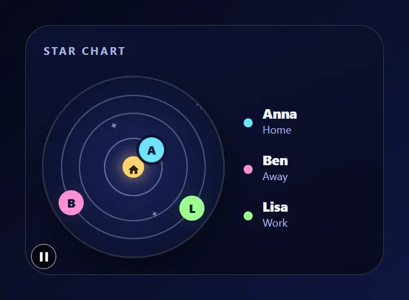

Entities: `person.anna`, `person.ben`, `person.lisa`

File: [cards/65-star-chart.yaml](cards/65-star-chart.yaml)

```yaml
# Star chart: a round map with three orbits and a gold home star. People at home drift on the inner orbit, people away wait on the outer one with a pulse.
# Each dot moves to the inner orbit with a state rule on its own person entity.
# Entities: person.anna, person.ben, person.lisa
type: custom:magic-card
name: Star chart
background: "linear-gradient(160deg, #0d1233 0%, #070a1f 100%)"
border_radius: 28px
padding: 20px
box_shadow: "0 22px 48px rgba(0,0,10,0.6)"
rows:
  - id: head
    padding: 0 0 12px
    columns:
      - modules:
          - type: text
            text: Star chart
            design: { font_size: 12px, font_weight: "700", color: "#aab6e6", text_transform: uppercase, letter_spacing: 2px }
  - id: chart
    column_widths: [200px, 1fr]
    gap: 22px
    columns:
      - modules:
          - type: vertical
            gap: 0px
            design:
              position: relative
              width: 200px
              height: 200px
              border_radius: 50%
              overflow: hidden
              background: "radial-gradient(circle closest-side, transparent 0 31%, rgba(207,216,255,0.40) 31.5% 32.5%, transparent 33%), radial-gradient(circle closest-side, transparent 0 59%, rgba(207,216,255,0.32) 59.5% 60.5%, transparent 61%), radial-gradient(circle closest-side, transparent 0 79%, rgba(207,216,255,0.30) 79.5% 80.5%, transparent 81%), radial-gradient(circle at 50% 50%, #1a2460 0%, #070b1f 100%)"
              box_shadow: "0 0 0 2px rgba(207,216,255,0.18), 0 16px 34px rgba(0,0,0,0.5)"
              animations:
                - { id: stars, preset: twinkle, color: "#cfd8ff", intensity: 6, duration: 6s }
            modules:
              - type: icon
                icon: mdi:home
                size: 14px
                design:
                  position: absolute
                  left: 88px
                  top: 88px
                  width: 24px
                  height: 24px
                  display: flex
                  align_items: center
                  justify_content: center
                  border_radius: 50%
                  background_color: "#ffd36e"
                  color: "#2a1d00"
                  box_shadow: "0 0 18px rgba(255,211,110,0.7)"
              - type: text
                text: A
                design:
                  position: absolute
                  left: 137.4px
                  top: 24.7px
                  width: 28px
                  height: 28px
                  display: flex
                  align_items: center
                  justify_content: center
                  border_radius: 50%
                  background_color: "#6fe3ff"
                  color: "#0a1030"
                  font_size: 13px
                  font_weight: "800"
                  box_shadow: "0 0 0 3px rgba(7,11,31,0.8)"
                  animations:
                    - { id: away, preset: halo-ripple, color: "#6fe3ff", intensity: 8, duration: 3s }
                  conditional:
                    - id: home
                      name: At home
                      conditions: [{ type: state, entity: person.anna, state: home }]
                      design:
                        left: 110.5px
                        top: 65.4px
                        animations:
                          - { id: lap, preset: orbit, intensity: 5, duration: 6s, easing: linear }
              - type: text
                text: B
                design:
                  position: absolute
                  left: 16.7px
                  top: 126px
                  width: 28px
                  height: 28px
                  display: flex
                  align_items: center
                  justify_content: center
                  border_radius: 50%
                  background_color: "#ff8fd1"
                  color: "#0a1030"
                  font_size: 13px
                  font_weight: "800"
                  box_shadow: "0 0 0 3px rgba(7,11,31,0.8)"
                  animations:
                    - { id: away, preset: halo-ripple, color: "#ff8fd1", intensity: 8, duration: 3s }
                  conditional:
                    - id: home
                      name: At home
                      conditions: [{ type: state, entity: person.ben, state: home }]
                      design:
                        left: 56px
                        top: 97px
                        animations:
                          - { id: lap, preset: orbit, intensity: 5, duration: 6s, easing: linear }
              - type: text
                text: L
                design:
                  position: absolute
                  left: 151.5px
                  top: 131.9px
                  width: 28px
                  height: 28px
                  display: flex
                  align_items: center
                  justify_content: center
                  border_radius: 50%
                  background_color: "#9dff8f"
                  color: "#0a1030"
                  font_size: 13px
                  font_weight: "800"
                  box_shadow: "0 0 0 3px rgba(7,11,31,0.8)"
                  animations:
                    - { id: away, preset: halo-ripple, color: "#9dff8f", intensity: 8, duration: 3s }
                  conditional:
                    - id: home
                      name: At home
                      conditions: [{ type: state, entity: person.lisa, state: home }]
                      design:
                        left: 86px
                        top: 118px
                        animations:
                          - { id: lap, preset: orbit, intensity: 5, duration: 6s, easing: linear }
      - vertical_align: center
        gap: 16px
        modules:
          - type: horizontal
            gap: 10px
            align: center
            modules:
              - type: icon
                icon: mdi:circle
                size: 12px
                design: { color: "#6fe3ff" }
              - type: vertical
                gap: 0px
                modules:
                  - type: text
                    use_entity: true
                    entity: person.anna
                    entity_display: name
                    design: { font_size: 15px, font_weight: "800", color: "#f1f4ff" }
                  - type: text
                    use_entity: true
                    entity: person.anna
                    design: { font_size: 12px, color: "#aab6e6" }
          - type: horizontal
            gap: 10px
            align: center
            modules:
              - type: icon
                icon: mdi:circle
                size: 12px
                design: { color: "#ff8fd1" }
              - type: vertical
                gap: 0px
                modules:
                  - type: text
                    use_entity: true
                    entity: person.ben
                    entity_display: name
                    design: { font_size: 15px, font_weight: "800", color: "#f1f4ff" }
                  - type: text
                    use_entity: true
                    entity: person.ben
                    design: { font_size: 12px, color: "#aab6e6" }
          - type: horizontal
            gap: 10px
            align: center
            modules:
              - type: icon
                icon: mdi:circle
                size: 12px
                design: { color: "#9dff8f" }
              - type: vertical
                gap: 0px
                modules:
                  - type: text
                    use_entity: true
                    entity: person.lisa
                    entity_display: name
                    design: { font_size: 15px, font_weight: "800", color: "#f1f4ff" }
                  - type: text
                    use_entity: true
                    entity: person.lisa
                    design: { font_size: 12px, color: "#aab6e6" }
```

## Comms array

An oscilloscope window that shows the track as a live trace while it plays, over a slim transport strip. While the player is paused the trace goes quiet. The title and artist stay on one line.

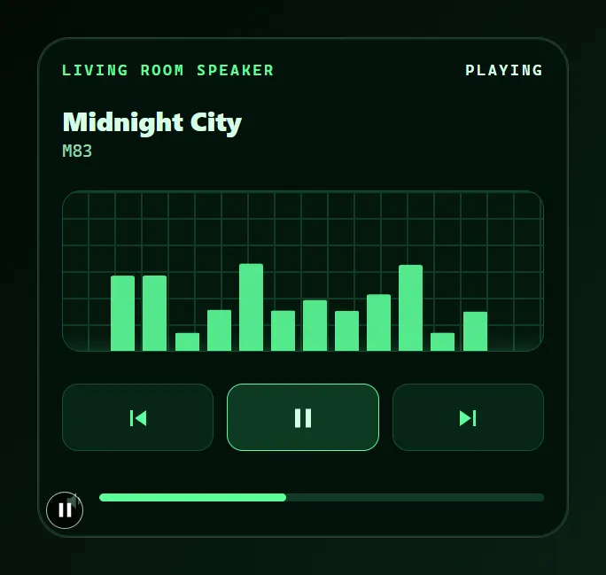

Entities: `media_player.living_room`

File: [cards/66-comms-array.yaml](cards/66-comms-array.yaml)

```yaml
# Comms array: an oscilloscope window that shows the track as a live trace while it plays, over a slim transport strip.
# While the player is paused the trace goes quiet. The title and artist stay on one line.
# Entities: media_player.living_room
type: custom:magic-card
name: Comms array
background: "#04120b"
border_radius: 24px
padding: 18px
box_shadow: "0 20px 44px rgba(0,0,0,0.6), inset 0 0 0 1px #0f3a24"
rows:
  - id: source
    column_widths: [1fr, auto]
    columns:
      - modules:
          - type: text
            use_entity: true
            entity: media_player.living_room
            entity_display: name
            design: { font_size: 11px, font_weight: "700", color: "#5dff9a", text_transform: uppercase, letter_spacing: 2px, font_family: "ui-monospace, 'Cascadia Mono', Menlo, monospace" }
      - modules:
          - type: text
            use_entity: true
            entity: media_player.living_room
            design: { font_size: 11px, font_weight: "700", color: "#d6ffe6", text_transform: uppercase, letter_spacing: 2px, font_family: "ui-monospace, 'Cascadia Mono', Menlo, monospace" }
  - id: track
    padding: 8px 0 12px
    columns:
      - gap: 2px
        modules:
          - type: text
            use_entity: true
            entity: media_player.living_room
            attribute: media_title
            design: { font_size: 20px, font_weight: "800", color: "#d6ffe6", white_space: nowrap, overflow: hidden, text_overflow: ellipsis }
          - type: text
            use_entity: true
            entity: media_player.living_room
            attribute: media_artist
            design: { font_size: 13px, color: "#8fd9ae", font_family: "ui-monospace, 'Cascadia Mono', Menlo, monospace" }
  - id: scope
    columns:
      - modules:
          - type: vertical
            gap: 0px
            design:
              height: 120px
              border_radius: 14px
              border: "1px solid #14502f"
              background: "repeating-linear-gradient(0deg, transparent 0px, transparent 19px, #0f3a24 19px, #0f3a24 20px), repeating-linear-gradient(90deg, transparent 0px, transparent 19px, #0f3a24 19px, #0f3a24 20px), #03170d"
              animations:
                - { id: trace, preset: equalizer-bars, trigger: state, trigger_entity: media_player.living_room, state: playing, color: "#5dff9a", strength: 90, intensity: 12, duration: 1.5s }
                - { id: sweep, preset: scanline, trigger: state, trigger_entity: media_player.living_room, state: playing, color: "#5dff9a", strength: 40, intensity: 40, duration: 3s }
            modules: []
  - id: transport
    layout: "1-1-1"
    gap: 10px
    padding: 14px 0 0
    columns:
      - modules:
          - type: horizontal
            align: center
            justify: center
            design: { padding: 12px 0, border_radius: 12px, border: "1px solid #14502f", background_color: "#072516" }
            actions:
              tap_action: { action: perform-action, service: media_player.media_previous_track, data: { entity_id: media_player.living_room } }
            modules:
              - type: icon
                icon: mdi:skip-previous
                size: 24px
                design: { color: "#5dff9a" }
      - modules:
          - type: horizontal
            align: center
            justify: center
            design: { padding: 12px 0, border_radius: 12px, border: "1px solid #5dff9a", background_color: "#0d3a22" }
            actions:
              tap_action: { action: perform-action, service: media_player.media_play_pause, data: { entity_id: media_player.living_room } }
            modules:
              - type: icon
                entity: media_player.living_room
                icon: mdi:play
                icon_on: mdi:pause
                icon_off: mdi:play
                size: 24px
                design: { color: "#d6ffe6" }
      - modules:
          - type: horizontal
            align: center
            justify: center
            design: { padding: 12px 0, border_radius: 12px, border: "1px solid #14502f", background_color: "#072516" }
            actions:
              tap_action: { action: perform-action, service: media_player.media_next_track, data: { entity_id: media_player.living_room } }
            modules:
              - type: icon
                icon: mdi:skip-next
                size: 24px
                design: { color: "#5dff9a" }
  - id: volume
    column_widths: [auto, 1fr]
    gap: 10px
    padding: 14px 0 0
    columns:
      - vertical_align: center
        modules:
          - type: icon
            icon: mdi:volume-medium
            size: 18px
            design: { color: "#8fd9ae" }
      - vertical_align: center
        modules:
          - type: bar
            entity: media_player.living_room
            attribute: volume_level
            min: 0
            max: 1
            bar_height: 6px
            show_value: false
            bar_color: "#5dff9a"
            bar_background: "#0f3a24"
```

## Grow bay

Three glass tubes show the soil moisture of three plants, with bubbles in the full ones and an amber pulse on a dry one. A tube under 25 % turns amber and loses its bubbles. The status line says when the ficus needs water.

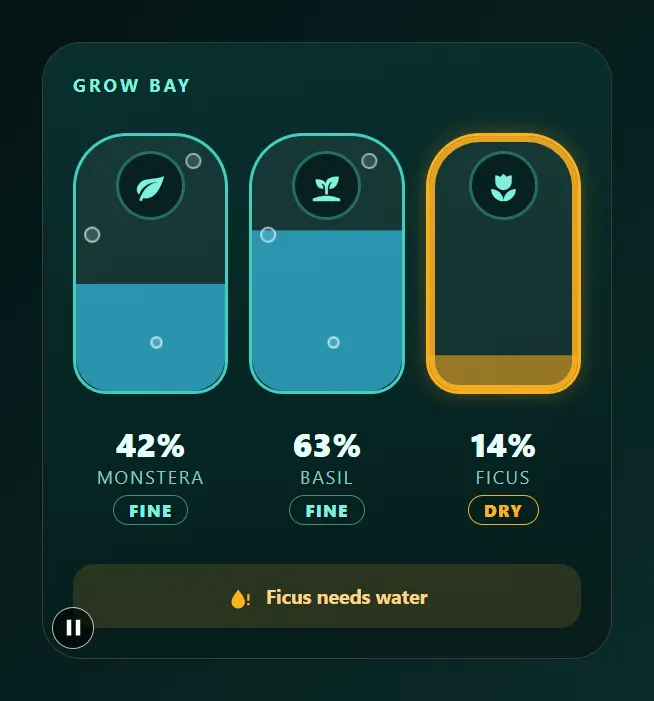

Entities: `sensor.monstera_moisture`, `sensor.basil_moisture`, `sensor.ficus_moisture`

File: [cards/67-grow-bay.yaml](cards/67-grow-bay.yaml)

```yaml
# Grow bay: three glass tubes show the soil moisture of three plants, with bubbles in the full ones and an amber pulse on a dry one.
# A tube under 25 % turns amber and loses its bubbles. The status line says when the ficus needs water.
# Entities: sensor.monstera_moisture, sensor.basil_moisture, sensor.ficus_moisture
type: custom:magic-card
name: Grow bay
background: "linear-gradient(170deg, #08302e 0%, #051c1b 100%)"
border_radius: 26px
padding: 20px
box_shadow: "0 20px 44px rgba(0,0,0,0.5)"
rows:
  - id: head
    padding: 0 0 14px
    columns:
      - modules:
          - type: text
            text: Grow bay
            design: { font_size: 12px, font_weight: "700", color: "#7ff0df", text_transform: uppercase, letter_spacing: 2px }
  - id: tubes
    layout: "1-1-1"
    gap: 14px
    columns:
      - modules:
          - type: vertical
            align: center
            gap: 0px
            design:
              height: 170px
              border_radius: 36px 36px 22px 22px
              border: "2px solid #3fd0c0"
              background_color: "rgba(255,255,255,0.06)"
              overflow: hidden
              value_background:
                type: fill
                entity: sensor.monstera_moisture
                color: "#36c6f0"
                opacity: 65%
                wave: false
              animations:
                - { id: bubbles, preset: bubbles, color: "#e6fbff", strength: 80, intensity: 3, duration: 4s }
              conditional:
                - id: dry
                  name: Dry
                  conditions: [{ type: state, entity: sensor.monstera_moisture, below: 25 }]
                  design:
                    border: "2px solid #ffb020"
                    value_background: { type: fill, entity: sensor.monstera_moisture, color: "#ffb020", opacity: 55%, wave: false }
                    animations:
                      - { id: warn, preset: breathing-border, color: "#ffb020", intensity: 4, duration: 2s }
            modules:
              - type: icon
                icon: mdi:leaf
                size: 22px
                design: { color: "#7ff0df", width: 42px, height: 42px, margin_top: 12px, display: flex, align_items: center, justify_content: center, border_radius: 50%, background_color: "#06201f", box_shadow: "0 0 0 2px rgba(63,208,192,0.35)" }
          - type: vertical
            align: center
            gap: 0px
            design: { padding: 10px 0 0 }
            modules:
              - type: text
                use_entity: true
                entity: sensor.monstera_moisture
                design: { font_size: 22px, font_weight: "800", color: "#e9fffb" }
              - type: text
                use_entity: true
                entity: sensor.monstera_moisture
                entity_display: name
                design: { font_size: 12px, color: "#8cc9c2", text_transform: uppercase, letter_spacing: 1.2px }
              - type: text
                text: Dry
                design: { font_size: 11px, font_weight: "800", color: "#ffb020", margin_top: 4px, padding: 2px 10px, border_radius: 999px, border: "1px solid #ffb020", text_transform: uppercase, letter_spacing: 1px }
                display: { conditions: [{ type: state, entity: sensor.monstera_moisture, below: 25 }] }
              - type: text
                text: Fine
                design: { font_size: 11px, font_weight: "800", color: "#7ff0df", margin_top: 4px, padding: 2px 10px, border_radius: 999px, border: "1px solid rgba(127,240,223,0.5)", text_transform: uppercase, letter_spacing: 1px }
                display: { conditions: [{ type: state, entity: sensor.monstera_moisture, above: 24.99 }] }
      - modules:
          - type: vertical
            align: center
            gap: 0px
            design:
              height: 170px
              border_radius: 36px 36px 22px 22px
              border: "2px solid #3fd0c0"
              background_color: "rgba(255,255,255,0.06)"
              overflow: hidden
              value_background:
                type: fill
                entity: sensor.basil_moisture
                color: "#36c6f0"
                opacity: 65%
                wave: false
              animations:
                - { id: bubbles, preset: bubbles, color: "#e6fbff", strength: 80, intensity: 3, duration: 4s }
              conditional:
                - id: dry
                  name: Dry
                  conditions: [{ type: state, entity: sensor.basil_moisture, below: 25 }]
                  design:
                    border: "2px solid #ffb020"
                    value_background: { type: fill, entity: sensor.basil_moisture, color: "#ffb020", opacity: 55%, wave: false }
                    animations:
                      - { id: warn, preset: breathing-border, color: "#ffb020", intensity: 4, duration: 2s }
            modules:
              - type: icon
                icon: mdi:sprout
                size: 22px
                design: { color: "#7ff0df", width: 42px, height: 42px, margin_top: 12px, display: flex, align_items: center, justify_content: center, border_radius: 50%, background_color: "#06201f", box_shadow: "0 0 0 2px rgba(63,208,192,0.35)" }
          - type: vertical
            align: center
            gap: 0px
            design: { padding: 10px 0 0 }
            modules:
              - type: text
                use_entity: true
                entity: sensor.basil_moisture
                design: { font_size: 22px, font_weight: "800", color: "#e9fffb" }
              - type: text
                use_entity: true
                entity: sensor.basil_moisture
                entity_display: name
                design: { font_size: 12px, color: "#8cc9c2", text_transform: uppercase, letter_spacing: 1.2px }
              - type: text
                text: Dry
                design: { font_size: 11px, font_weight: "800", color: "#ffb020", margin_top: 4px, padding: 2px 10px, border_radius: 999px, border: "1px solid #ffb020", text_transform: uppercase, letter_spacing: 1px }
                display: { conditions: [{ type: state, entity: sensor.basil_moisture, below: 25 }] }
              - type: text
                text: Fine
                design: { font_size: 11px, font_weight: "800", color: "#7ff0df", margin_top: 4px, padding: 2px 10px, border_radius: 999px, border: "1px solid rgba(127,240,223,0.5)", text_transform: uppercase, letter_spacing: 1px }
                display: { conditions: [{ type: state, entity: sensor.basil_moisture, above: 24.99 }] }
      - modules:
          - type: vertical
            align: center
            gap: 0px
            design:
              height: 170px
              border_radius: 36px 36px 22px 22px
              border: "2px solid #3fd0c0"
              background_color: "rgba(255,255,255,0.06)"
              overflow: hidden
              value_background:
                type: fill
                entity: sensor.ficus_moisture
                color: "#36c6f0"
                opacity: 65%
                wave: false
              animations:
                - { id: bubbles, preset: bubbles, color: "#e6fbff", strength: 80, intensity: 3, duration: 4s }
              conditional:
                - id: dry
                  name: Dry
                  conditions: [{ type: state, entity: sensor.ficus_moisture, below: 25 }]
                  design:
                    border: "2px solid #ffb020"
                    value_background: { type: fill, entity: sensor.ficus_moisture, color: "#ffb020", opacity: 55%, wave: false }
                    animations:
                      - { id: warn, preset: breathing-border, color: "#ffb020", intensity: 4, duration: 2s }
            modules:
              - type: icon
                icon: mdi:flower-tulip
                size: 22px
                design: { color: "#7ff0df", width: 42px, height: 42px, margin_top: 12px, display: flex, align_items: center, justify_content: center, border_radius: 50%, background_color: "#06201f", box_shadow: "0 0 0 2px rgba(63,208,192,0.35)" }
          - type: vertical
            align: center
            gap: 0px
            design: { padding: 10px 0 0 }
            modules:
              - type: text
                use_entity: true
                entity: sensor.ficus_moisture
                design: { font_size: 22px, font_weight: "800", color: "#e9fffb" }
              - type: text
                use_entity: true
                entity: sensor.ficus_moisture
                entity_display: name
                design: { font_size: 12px, color: "#8cc9c2", text_transform: uppercase, letter_spacing: 1.2px }
              - type: text
                text: Dry
                design: { font_size: 11px, font_weight: "800", color: "#ffb020", margin_top: 4px, padding: 2px 10px, border_radius: 999px, border: "1px solid #ffb020", text_transform: uppercase, letter_spacing: 1px }
                display: { conditions: [{ type: state, entity: sensor.ficus_moisture, below: 25 }] }
              - type: text
                text: Fine
                design: { font_size: 11px, font_weight: "800", color: "#7ff0df", margin_top: 4px, padding: 2px 10px, border_radius: 999px, border: "1px solid rgba(127,240,223,0.5)", text_transform: uppercase, letter_spacing: 1px }
                display: { conditions: [{ type: state, entity: sensor.ficus_moisture, above: 24.99 }] }
  - id: status
    padding: 16px 0 0
    columns:
      - modules:
          - type: horizontal
            gap: 8px
            align: center
            justify: center
            design: { padding: 10px, border_radius: 14px, background_color: "rgba(255,176,32,0.14)" }
            display: { conditions: [{ type: state, entity: sensor.ficus_moisture, below: 25 }] }
            modules:
              - type: icon
                icon: mdi:water-alert
                size: 18px
                design: { color: "#ffb020" }
              - type: text
                text: Ficus needs water
                design: { font_size: 13px, font_weight: "700", color: "#ffd48a" }
          - type: horizontal
            gap: 8px
            align: center
            justify: center
            design: { padding: 10px, border_radius: 14px, background_color: "rgba(127,240,223,0.12)" }
            display: { conditions: [{ type: state, entity: sensor.ficus_moisture, above: 24.99 }] }
            modules:
              - type: icon
                icon: mdi:check-circle-outline
                size: 18px
                design: { color: "#7ff0df" }
              - type: text
                text: All plants are fine
                design: { font_size: 13px, font_weight: "700", color: "#bff7ef" }
```

## Cargo bay

A roll-up door of steel slats inside a hazard-striped frame. The door rises with the cover position. While the door moves, an amber beacon blinks and dashes run around the opening. Open, stop and close are one tap each.

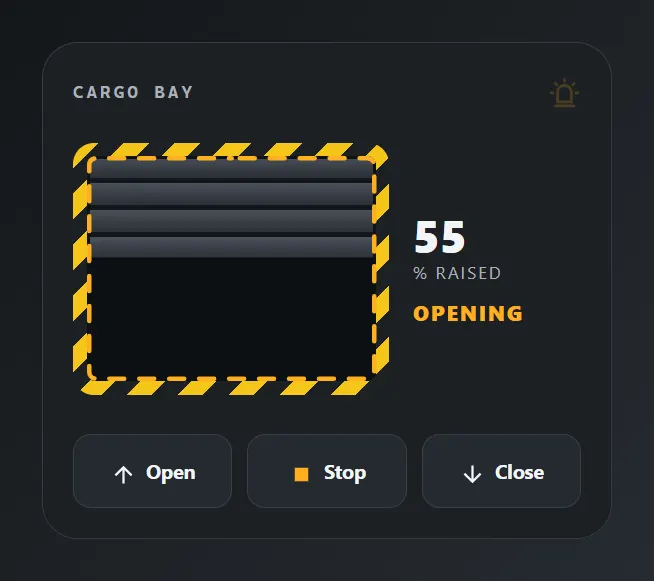

Entities: `cover.workshop_door`

File: [cards/68-cargo-bay.yaml](cards/68-cargo-bay.yaml)

```yaml
# Cargo bay: a roll-up door of steel slats inside a hazard-striped frame. The door rises with the cover position.
# While the door moves, an amber beacon blinks and dashes run around the opening. Open, stop and close are one tap each.
# Entities: cover.workshop_door
type: custom:magic-card
name: Cargo bay
background: "#1d2024"
border_radius: 24px
padding: 20px
box_shadow: "0 20px 44px rgba(0,0,0,0.55)"
rows:
  - id: head
    column_widths: [1fr, auto]
    padding: 0 0 12px
    columns:
      - vertical_align: center
        modules:
          - type: text
            text: Cargo bay
            design: { font_size: 12px, font_weight: "700", color: "#a9b1ba", text_transform: uppercase, letter_spacing: 2px, font_family: "ui-monospace, 'Cascadia Mono', Menlo, monospace" }
      - vertical_align: center
        modules:
          - type: icon
            icon: mdi:alarm-light-outline
            size: 22px
            design:
              color: "#5c646d"
              conditional:
                - id: moving
                  name: Moving
                  mode: any
                  conditions: [{ type: state, entity: cover.workshop_door, state: opening }, { type: state, entity: cover.workshop_door, state: closing }]
                  design:
                    color: "#ffb020"
                    animations:
                      - { id: beacon, preset: blink, target: icon, intensity: 80, duration: 1s }
  - id: door
    column_widths: [1fr, 112px]
    gap: 16px
    columns:
      - modules:
          - type: vertical
            gap: 0px
            design:
              padding: 9px
              border_radius: 14px
              background: "repeating-linear-gradient(135deg, #f5c518 0px, #f5c518 12px, #1d2024 12px, #1d2024 24px)"
            modules:
              - type: vertical
                gap: 0px
                design:
                  height: 150px
                  border_radius: 6px
                  background: "repeating-linear-gradient(180deg, #4a515a 0px, #3a4048 7px, #2a2f35 15px, #14171a 15px, #14171a 18px)"
                  box_shadow: "inset 0 0 0 2px #0f1215"
                  value_background:
                    type: fill
                    entity: cover.workshop_door
                    attribute: current_position
                    color: "#0d1013"
                    opacity: 100%
                    wave: false
                  ring:
                    mode: animated
                    animation: dashes
                    speed: 2s
                    width: 3
                    color: "#ffb020"
                    trigger: state
                    trigger_entity: cover.workshop_door
                    state: opening
                modules: []
      - vertical_align: center
        gap: 2px
        modules:
          - type: text
            use_entity: true
            entity: cover.workshop_door
            attribute: current_position
            design: { font_size: 30px, font_weight: "800", color: "#f3f5f7", line_height: "1.05" }
          - type: text
            text: "% raised"
            design: { font_size: 11px, color: "#a9b1ba", text_transform: uppercase, letter_spacing: 1.5px }
          - type: text
            use_entity: true
            entity: cover.workshop_door
            design: { font_size: 14px, font_weight: "800", color: "#ffb020", margin_top: 8px, text_transform: uppercase, letter_spacing: 1.2px }
  - id: actions
    layout: "1-1-1"
    gap: 10px
    padding: 16px 0 0
    columns:
      - modules:
          - type: horizontal
            align: center
            justify: center
            gap: 6px
            design: { padding: 13px 0, border_radius: 12px, border: "1px solid #3a4048", background_color: "#252a30" }
            actions:
              tap_action: { action: perform-action, service: cover.open_cover, data: { entity_id: cover.workshop_door } }
            modules:
              - type: icon
                icon: mdi:arrow-up
                size: 18px
                design: { color: "#f3f5f7" }
              - type: text
                text: Open
                design: { font_size: 13px, font_weight: "700", color: "#f3f5f7" }
      - modules:
          - type: horizontal
            align: center
            justify: center
            gap: 6px
            design: { padding: 13px 0, border_radius: 12px, border: "1px solid #3a4048", background_color: "#252a30" }
            actions:
              tap_action: { action: perform-action, service: cover.stop_cover, data: { entity_id: cover.workshop_door } }
            modules:
              - type: icon
                icon: mdi:stop
                size: 18px
                design: { color: "#ffb020" }
              - type: text
                text: Stop
                design: { font_size: 13px, font_weight: "700", color: "#f3f5f7" }
      - modules:
          - type: horizontal
            align: center
            justify: center
            gap: 6px
            design: { padding: 13px 0, border_radius: 12px, border: "1px solid #3a4048", background_color: "#252a30" }
            actions:
              tap_action: { action: perform-action, service: cover.close_cover, data: { entity_id: cover.workshop_door } }
            modules:
              - type: icon
                icon: mdi:arrow-down
                size: 18px
                design: { color: "#f3f5f7" }
              - type: text
                text: Close
                design: { font_size: 13px, font_weight: "700", color: "#f3f5f7" }
```

## Orbital weather

The weather seen from orbit. The sky shows the condition, the horizon of the planet glows underneath. Rain streaks fall when it rains, clouds drift when it is cloudy, and stars twinkle in the sky in every weather.

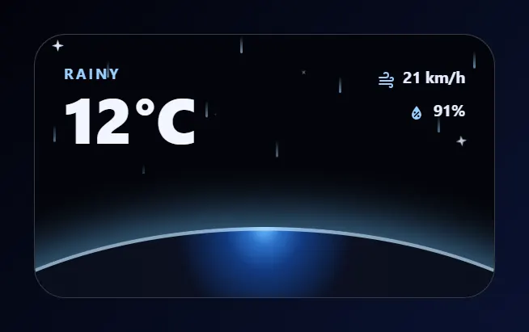

Entities: `weather.harbor`

File: [cards/69-orbital-weather.yaml](cards/69-orbital-weather.yaml)

```yaml
# Orbital weather: the weather seen from orbit. The sky shows the condition, the horizon of the planet glows underneath.
# Rain streaks fall when it rains, clouds drift when it is cloudy, and stars twinkle in the sky in every weather.
# Entities: weather.harbor
type: custom:magic-card
name: Orbital weather
background: "#03040a"
border_radius: 26px
padding: 0px
overflow: hidden
box_shadow: "0 22px 48px rgba(0,0,0,0.6)"
rows:
  - id: sky
    column_widths: [1fr, auto]
    gap: 12px
    padding: 24px 24px 18px
    design:
      animations:
        - { id: stars, preset: twinkle, color: "#dbe7ff", intensity: 8, duration: 5s }
      conditional:
        - id: rainy
          name: Rainy
          conditions: [{ type: state, entity: weather.harbor, state: rainy }]
          design:
            animations:
              - { id: rain, preset: rain-fall, color: "#9ad0ff", strength: 70, intensity: 10, duration: 1s }
              - { id: flash, preset: twinkle, color: "#dbe7ff", intensity: 4, duration: 5s }
        - id: cloudy
          name: Cloudy
          conditions: [{ type: state, entity: weather.harbor, state: cloudy }]
          design:
            animations:
              - { id: clouds, preset: clouds-drift, color: "#7f93b8", strength: 50, intensity: 3, duration: 5s }
    columns:
      - gap: 2px
        modules:
          - type: text
            use_entity: true
            entity: weather.harbor
            design: { font_size: 12px, font_weight: "700", color: "#9ad0ff", text_transform: uppercase, letter_spacing: 2px }
          - type: text
            use_entity: true
            entity: weather.harbor
            attribute: temperature
            design: { font_size: 52px, font_weight: "800", color: "#f2f6ff", line_height: "1.05" }
      - vertical_align: start
        gap: 6px
        modules:
          - type: horizontal
            gap: 6px
            align: center
            justify: end
            modules:
              - type: icon
                icon: mdi:weather-windy
                size: 16px
                design: { color: "#9ad0ff" }
              - type: text
                use_entity: true
                entity: weather.harbor
                attribute: wind_speed
                design: { font_size: 13px, font_weight: "700", color: "#e4ecff" }
          - type: horizontal
            gap: 6px
            align: center
            justify: end
            modules:
              - type: icon
                icon: mdi:water-percent
                size: 16px
                design: { color: "#9ad0ff" }
              - type: text
                use_entity: true
                entity: weather.harbor
                attribute: humidity
                design: { font_size: 13px, font_weight: "700", color: "#e4ecff" }
  - id: horizon
    padding: 0px
    design:
      position: relative
      height: 92px
    columns:
      - modules:
          - type: vertical
            gap: 0px
            design:
              position: absolute
              left: -35%
              top: 34px
              width: 170%
              height: 360px
              border_radius: 50%
              background: "radial-gradient(ellipse at 50% 0%, #6fc3ff 0%, #2a6fc8 3%, #123a80 7%, #0b1020 16%, #070a16 100%)"
              box_shadow: "0 -10px 36px rgba(111,195,255,0.55), inset 0 3px 0 rgba(190,230,255,0.7)"
            modules: []
```

## Mainframe

A server rack with four slots for CPU, memory, disk and temperature, each with a 20-segment load bar and an LED. Bars and LEDs turn amber past 75 % (70 degrees for the temperature) and red past 90 % (85 degrees).

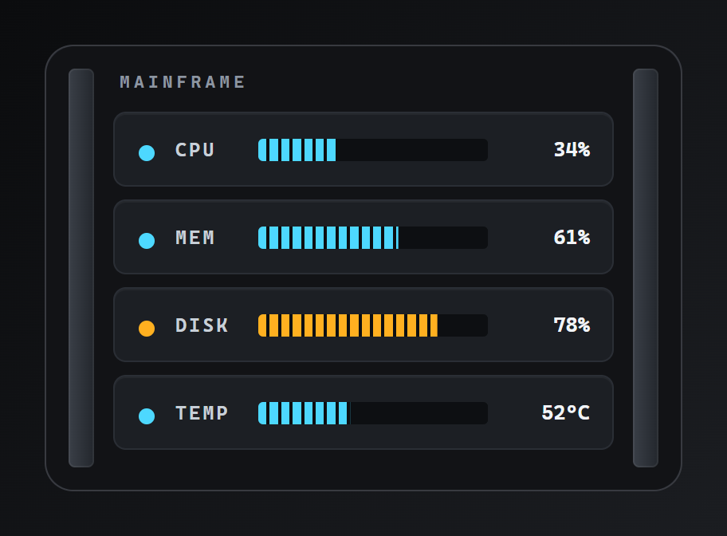

Entities: `sensor.server_cpu`, `sensor.server_ram`, `sensor.server_disk`, `sensor.server_temp`

File: [cards/70-mainframe.yaml](cards/70-mainframe.yaml)

```yaml
# Mainframe: a server rack with four slots for CPU, memory, disk and temperature, each with a 20-segment load bar and an LED.
# Bars and LEDs turn amber past 75 % (70 degrees for the temperature) and red past 90 % (85 degrees).
# Entities: sensor.server_cpu, sensor.server_ram, sensor.server_disk, sensor.server_temp
type: custom:magic-card
name: Mainframe
background: "#121316"
border_radius: 18px
padding: 14px
box_shadow: "0 22px 48px rgba(0,0,0,0.6)"
rows:
  - id: rack
    column_widths: [16px, 1fr, 16px]
    gap: 12px
    columns:
      - modules:
          - type: vertical
            gap: 0px
            design: { height: 100%, min_height: 250px, border_radius: 4px, background: "linear-gradient(90deg, #3a3f47, #23272d)", box_shadow: "inset 0 0 0 1px rgba(255,255,255,0.06)" }
            modules: []
      - gap: 8px
        modules:
          - type: text
            text: Mainframe
            design: { font_size: 11px, font_weight: "700", color: "#8d96a0", text_transform: uppercase, letter_spacing: 2.5px, padding: 2px 4px 4px, font_family: "ui-monospace, 'Cascadia Mono', Menlo, monospace" }
          - type: horizontal
            gap: 12px
            align: center
            design: { padding: 12px 14px, border_radius: 8px, background_color: "#1c1f24", border: "1px solid #2a2e35", box_shadow: "inset 0 1px 0 rgba(255,255,255,0.04)" }
            modules:
              - type: icon
                icon: mdi:circle
                size: 12px
                design:
                  color: "#4dd8ff"
                  conditional:
                    - { id: warm, name: Warning, conditions: [{ type: state, entity: sensor.server_cpu, above: 74.99 }], design: { color: "#ffb020" } }
                    - { id: hot, name: Critical, conditions: [{ type: state, entity: sensor.server_cpu, above: 89.99 }], design: { color: "#ff5a5a" } }
              - type: text
                text: CPU
                design: { font_size: 12px, font_weight: "700", color: "#c8d0d8", width: 40px, letter_spacing: 1.5px, font_family: "ui-monospace, 'Cascadia Mono', Menlo, monospace" }
              - type: vertical
                gap: 0px
                design:
                  position: relative
                  flex: "1"
                  height: 14px
                  border_radius: 3px
                  background_color: "#0d0f12"
                  overflow: hidden
                  value_background:
                    type: fill
                    entity: sensor.server_cpu
                    direction: right
                    min: 0
                    max: 100
                    color: "#4dd8ff"
                    opacity: 100%
                    wave: false
                  conditional:
                    - { id: warm, name: Warning, conditions: [{ type: state, entity: sensor.server_cpu, above: 74.99 }], design: { value_background: { type: fill, entity: sensor.server_cpu, direction: right, min: 0, max: 100, color: "#ffb020", opacity: 100%, wave: false } } }
                    - { id: hot, name: Critical, conditions: [{ type: state, entity: sensor.server_cpu, above: 89.99 }], design: { value_background: { type: fill, entity: sensor.server_cpu, direction: right, min: 0, max: 100, color: "#ff5a5a", opacity: 100%, wave: false } } }
                modules:
                  - type: separator
                    separator_style: none
                    design:
                      position: absolute
                      inset: 0
                      background: "repeating-linear-gradient(90deg, transparent 0px, transparent calc(5% - 2px), #0d0f12 calc(5% - 2px), #0d0f12 5%)"
              - type: text
                use_entity: true
                entity: sensor.server_cpu
                design: { font_size: 13px, font_weight: "700", color: "#f1f4f7", width: 52px, text_align: right, font_family: "ui-monospace, 'Cascadia Mono', Menlo, monospace" }
          - type: horizontal
            gap: 12px
            align: center
            design: { padding: 12px 14px, border_radius: 8px, background_color: "#1c1f24", border: "1px solid #2a2e35", box_shadow: "inset 0 1px 0 rgba(255,255,255,0.04)" }
            modules:
              - type: icon
                icon: mdi:circle
                size: 12px
                design:
                  color: "#4dd8ff"
                  conditional:
                    - { id: warm, name: Warning, conditions: [{ type: state, entity: sensor.server_ram, above: 74.99 }], design: { color: "#ffb020" } }
                    - { id: hot, name: Critical, conditions: [{ type: state, entity: sensor.server_ram, above: 89.99 }], design: { color: "#ff5a5a" } }
              - type: text
                text: MEM
                design: { font_size: 12px, font_weight: "700", color: "#c8d0d8", width: 40px, letter_spacing: 1.5px, font_family: "ui-monospace, 'Cascadia Mono', Menlo, monospace" }
              - type: vertical
                gap: 0px
                design:
                  position: relative
                  flex: "1"
                  height: 14px
                  border_radius: 3px
                  background_color: "#0d0f12"
                  overflow: hidden
                  value_background:
                    type: fill
                    entity: sensor.server_ram
                    direction: right
                    min: 0
                    max: 100
                    color: "#4dd8ff"
                    opacity: 100%
                    wave: false
                  conditional:
                    - { id: warm, name: Warning, conditions: [{ type: state, entity: sensor.server_ram, above: 74.99 }], design: { value_background: { type: fill, entity: sensor.server_ram, direction: right, min: 0, max: 100, color: "#ffb020", opacity: 100%, wave: false } } }
                    - { id: hot, name: Critical, conditions: [{ type: state, entity: sensor.server_ram, above: 89.99 }], design: { value_background: { type: fill, entity: sensor.server_ram, direction: right, min: 0, max: 100, color: "#ff5a5a", opacity: 100%, wave: false } } }
                modules:
                  - type: separator
                    separator_style: none
                    design:
                      position: absolute
                      inset: 0
                      background: "repeating-linear-gradient(90deg, transparent 0px, transparent calc(5% - 2px), #0d0f12 calc(5% - 2px), #0d0f12 5%)"
              - type: text
                use_entity: true
                entity: sensor.server_ram
                design: { font_size: 13px, font_weight: "700", color: "#f1f4f7", width: 52px, text_align: right, font_family: "ui-monospace, 'Cascadia Mono', Menlo, monospace" }
          - type: horizontal
            gap: 12px
            align: center
            design: { padding: 12px 14px, border_radius: 8px, background_color: "#1c1f24", border: "1px solid #2a2e35", box_shadow: "inset 0 1px 0 rgba(255,255,255,0.04)" }
            modules:
              - type: icon
                icon: mdi:circle
                size: 12px
                design:
                  color: "#4dd8ff"
                  conditional:
                    - { id: warm, name: Warning, conditions: [{ type: state, entity: sensor.server_disk, above: 74.99 }], design: { color: "#ffb020" } }
                    - { id: hot, name: Critical, conditions: [{ type: state, entity: sensor.server_disk, above: 89.99 }], design: { color: "#ff5a5a" } }
              - type: text
                text: DISK
                design: { font_size: 12px, font_weight: "700", color: "#c8d0d8", width: 40px, letter_spacing: 1.5px, font_family: "ui-monospace, 'Cascadia Mono', Menlo, monospace" }
              - type: vertical
                gap: 0px
                design:
                  position: relative
                  flex: "1"
                  height: 14px
                  border_radius: 3px
                  background_color: "#0d0f12"
                  overflow: hidden
                  value_background:
                    type: fill
                    entity: sensor.server_disk
                    direction: right
                    min: 0
                    max: 100
                    color: "#4dd8ff"
                    opacity: 100%
                    wave: false
                  conditional:
                    - { id: warm, name: Warning, conditions: [{ type: state, entity: sensor.server_disk, above: 74.99 }], design: { value_background: { type: fill, entity: sensor.server_disk, direction: right, min: 0, max: 100, color: "#ffb020", opacity: 100%, wave: false } } }
                    - { id: hot, name: Critical, conditions: [{ type: state, entity: sensor.server_disk, above: 89.99 }], design: { value_background: { type: fill, entity: sensor.server_disk, direction: right, min: 0, max: 100, color: "#ff5a5a", opacity: 100%, wave: false } } }
                modules:
                  - type: separator
                    separator_style: none
                    design:
                      position: absolute
                      inset: 0
                      background: "repeating-linear-gradient(90deg, transparent 0px, transparent calc(5% - 2px), #0d0f12 calc(5% - 2px), #0d0f12 5%)"
              - type: text
                use_entity: true
                entity: sensor.server_disk
                design: { font_size: 13px, font_weight: "700", color: "#f1f4f7", width: 52px, text_align: right, font_family: "ui-monospace, 'Cascadia Mono', Menlo, monospace" }
          - type: horizontal
            gap: 12px
            align: center
            design: { padding: 12px 14px, border_radius: 8px, background_color: "#1c1f24", border: "1px solid #2a2e35", box_shadow: "inset 0 1px 0 rgba(255,255,255,0.04)" }
            modules:
              - type: icon
                icon: mdi:circle
                size: 12px
                design:
                  color: "#4dd8ff"
                  conditional:
                    - { id: warm, name: Warning, conditions: [{ type: state, entity: sensor.server_temp, above: 69.99 }], design: { color: "#ffb020" } }
                    - { id: hot, name: Critical, conditions: [{ type: state, entity: sensor.server_temp, above: 84.99 }], design: { color: "#ff5a5a" } }
              - type: text
                text: TEMP
                design: { font_size: 12px, font_weight: "700", color: "#c8d0d8", width: 40px, letter_spacing: 1.5px, font_family: "ui-monospace, 'Cascadia Mono', Menlo, monospace" }
              - type: vertical
                gap: 0px
                design:
                  position: relative
                  flex: "1"
                  height: 14px
                  border_radius: 3px
                  background_color: "#0d0f12"
                  overflow: hidden
                  value_background:
                    type: fill
                    entity: sensor.server_temp
                    direction: right
                    min: 20
                    max: 100
                    color: "#4dd8ff"
                    opacity: 100%
                    wave: false
                  conditional:
                    - { id: warm, name: Warning, conditions: [{ type: state, entity: sensor.server_temp, above: 69.99 }], design: { value_background: { type: fill, entity: sensor.server_temp, direction: right, min: 20, max: 100, color: "#ffb020", opacity: 100%, wave: false } } }
                    - { id: hot, name: Critical, conditions: [{ type: state, entity: sensor.server_temp, above: 84.99 }], design: { value_background: { type: fill, entity: sensor.server_temp, direction: right, min: 20, max: 100, color: "#ff5a5a", opacity: 100%, wave: false } } }
                modules:
                  - type: separator
                    separator_style: none
                    design:
                      position: absolute
                      inset: 0
                      background: "repeating-linear-gradient(90deg, transparent 0px, transparent calc(5% - 2px), #0d0f12 calc(5% - 2px), #0d0f12 5%)"
              - type: text
                use_entity: true
                entity: sensor.server_temp
                design: { font_size: 13px, font_weight: "700", color: "#f1f4f7", width: 52px, text_align: right, font_family: "ui-monospace, 'Cascadia Mono', Menlo, monospace" }
      - modules:
          - type: vertical
            gap: 0px
            design: { height: 100%, min_height: 250px, border_radius: 4px, background: "linear-gradient(90deg, #3a3f47, #23272d)", box_shadow: "inset 0 0 0 1px rgba(255,255,255,0.06)" }
            modules: []
```

## Cauldron

An iron pot with a glowing brew. While the switch is on the surface bubbles and steam rises, and the word reads Brewing. Off, the pot rests and the liquid turns to amber. The big number is the boiler temperature.

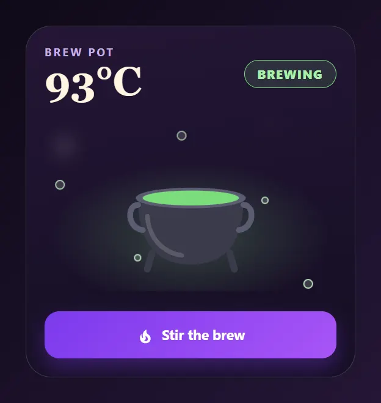

Entities: `switch.coffee_machine`, `sensor.coffee_boiler`

File: [cards/71-cauldron.yaml](cards/71-cauldron.yaml)

```yaml
# Cauldron: an iron pot with a glowing brew. While the switch is on the surface bubbles and steam rises, and the word reads Brewing.
# Off, the pot rests and the liquid turns to amber. The big number is the boiler temperature.
# Entities: switch.coffee_machine, sensor.coffee_boiler
type: custom:magic-card
name: Cauldron
background: "linear-gradient(170deg, #241636 0%, #150e22 100%)"
border_radius: 28px
padding: 20px
box_shadow: "0 22px 48px rgba(10,0,30,0.6)"
rows:
  - id: head
    column_widths: [1fr, auto]
    columns:
      - vertical_align: center
        gap: 0px
        modules:
          - type: text
            text: Brew pot
            design: { font_size: 12px, font_weight: "700", color: "#c4b0e6", text_transform: uppercase, letter_spacing: 2px }
          - type: text
            use_entity: true
            entity: sensor.coffee_boiler
            design: { font_size: 44px, font_weight: "700", color: "#fff4e0", line_height: "1.1", font_family: "Georgia, 'Iowan Old Style', serif" }
      - vertical_align: center
        modules:
          - type: text
            text: Brewing
            design: { font_size: 13px, font_weight: "800", color: "#a8f0a8", padding: 6px 14px, border_radius: 999px, border: "1px solid #7bdc7b", background_color: "rgba(123,220,123,0.14)", text_transform: uppercase, letter_spacing: 1.2px }
            display: { conditions: [{ type: state, entity: switch.coffee_machine, state: "on" }] }
          - type: text
            text: Ready
            design: { font_size: 13px, font_weight: "800", color: "#f0c890", padding: 6px 14px, border_radius: 999px, border: "1px solid #c58b4e", background_color: "rgba(197,139,78,0.14)", text_transform: uppercase, letter_spacing: 1.2px }
            display: { mode: every, conditions: [{ type: state, entity: switch.coffee_machine, state: "off" }, { type: state, entity: sensor.coffee_boiler, above: 80 }] }
          - type: text
            text: Resting
            design: { font_size: 13px, font_weight: "800", color: "#c4b0e6", padding: 6px 14px, border_radius: 999px, border: "1px solid #6d5a92", text_transform: uppercase, letter_spacing: 1.2px }
            display: { mode: every, conditions: [{ type: state, entity: switch.coffee_machine, state: "off" }, { type: state, entity: sensor.coffee_boiler, below: 80.01 }] }
  - id: pot
    padding: 4px 0
    columns:
      - modules:
          - type: vertical
            align: center
            gap: 0px
            design:
              height: 190px
              border_radius: 22px
              overflow: hidden
              background: "radial-gradient(ellipse 48% 42% at 50% 68%, rgba(123,220,123,0.26) 0%, rgba(123,220,123,0) 100%)"
              animations:
                - { id: bubbles, preset: bubbles, trigger: entity_on, trigger_entity: switch.coffee_machine, color: "#d6ffd6", strength: 85, intensity: 5, duration: 4s }
                - { id: steam, preset: steam-rise, trigger: entity_on, trigger_entity: switch.coffee_machine, color: "#ffffff", strength: 35, intensity: 3, duration: 4s }
            modules:
              - type: icon
                icon: svg
                svg: '<svg viewBox="0 0 120 120"><path d="M14 50 C14 96 36 108 60 108 C84 108 106 96 106 50 Z" fill="#3b3b4b"/><path d="M26 98 L22 112 M94 98 L98 112" stroke="#3b3b4b" stroke-width="6" stroke-linecap="round" fill="none"/><path d="M14 56 C4 56 4 76 18 78 M106 56 C116 56 116 76 102 78" stroke="#5c5c72" stroke-width="5" stroke-linecap="round" fill="none"/><ellipse cx="60" cy="50" rx="48" ry="9" fill="#5c5c72"/><ellipse cx="60" cy="50" rx="42" ry="6.5" fill="#7bdc7b"/><path d="M22 66 C24 88 38 98 52 100" stroke="#ffffff" stroke-opacity="0.16" stroke-width="4" stroke-linecap="round" fill="none"/></svg>'
                size: 150px
                design: { margin_top: 26px }
                display: { conditions: [{ type: state, entity: switch.coffee_machine, state: "on" }] }
              - type: icon
                icon: svg
                svg: '<svg viewBox="0 0 120 120"><path d="M14 50 C14 96 36 108 60 108 C84 108 106 96 106 50 Z" fill="#3b3b4b"/><path d="M26 98 L22 112 M94 98 L98 112" stroke="#3b3b4b" stroke-width="6" stroke-linecap="round" fill="none"/><path d="M14 56 C4 56 4 76 18 78 M106 56 C116 56 116 76 102 78" stroke="#5c5c72" stroke-width="5" stroke-linecap="round" fill="none"/><ellipse cx="60" cy="50" rx="48" ry="9" fill="#5c5c72"/><ellipse cx="60" cy="50" rx="42" ry="6.5" fill="#a8794a"/><path d="M22 66 C24 88 38 98 52 100" stroke="#ffffff" stroke-opacity="0.16" stroke-width="4" stroke-linecap="round" fill="none"/></svg>'
                size: 150px
                design: { margin_top: 26px }
                display: { conditions: [{ type: state, entity: switch.coffee_machine, state: "off" }] }
  - id: toggle
    padding: 8px 0 0
    columns:
      - modules:
          - type: horizontal
            gap: 8px
            align: center
            justify: center
            design: { padding: 14px 0, border_radius: 16px, background: "linear-gradient(135deg, #7c3aed, #a855f7)", box_shadow: "0 10px 22px rgba(124,58,237,0.35)" }
            actions:
              tap_action: { action: toggle, entity: switch.coffee_machine }
            modules:
              - type: icon
                icon: mdi:fire
                size: 20px
                design: { color: "#ffffff" }
              - type: text
                text: Stir the brew
                design: { font_size: 15px, font_weight: "700", color: "#ffffff" }
```

## Enchanted lanterns

Four lanterns hang from a beam at different heights, one per room. Tap a lantern to switch its light. Lit lanterns flicker out of step, and the small bar under the name shows the brightness. It uses theme colours only, so it follows the dashboard's theme.

Shot with the Candlelit Cloister theme preset in dark mode. See [theme examples](../themes/examples/README.md#candlelit-cloister). With another theme the card uses that theme's colours.

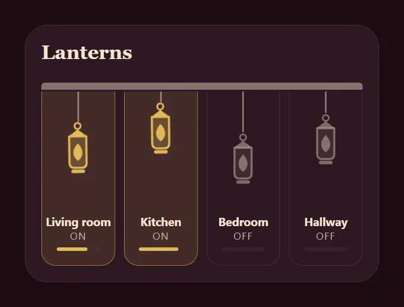

Entities: `light.living_room`, `light.kitchen`, `light.bedroom`, `light.hallway`

File: [cards/72-enchanted-lanterns.yaml](cards/72-enchanted-lanterns.yaml)

```yaml
# Enchanted lanterns: four lanterns hang from a beam at different heights, one per room. Tap a lantern to switch its light.
# Lit lanterns flicker out of step, and the small bar under the name shows the brightness.
# It uses theme colours only, so it follows the dashboard's theme.
# Entities: light.living_room, light.kitchen, light.bedroom, light.hallway
type: custom:magic-card
name: Enchanted lanterns
border_radius: 26px
padding: 18px
rows:
  - id: head
    padding: 0 0 12px
    columns:
      - modules:
          - type: text
            text: Lanterns
            design: { font_size: 22px, font_weight: "700", color: var(--primary-text-color), font_family: "Georgia, 'Iowan Old Style', serif" }
  - id: beam
    padding: 0 0 0
    columns:
      - modules:
          - type: separator
            separator_style: none
            design: { height: 8px, border_radius: 4px 4px 0 0, background_color: "color-mix(in srgb, var(--secondary-text-color) 60%, transparent)" }
  - id: lanterns
    design: { margin_top: -8px }
    layout: "1-1-1-1"
    gap: 10px
    columns:
      - modules:
          - type: vertical
            align: center
            gap: 0px
            design:
              height: 196px
              border_radius: 0 0 16px 16px
              border_width: 0 1px 1px 1px
              border_style: solid
              border_color: var(--divider-color)
              background_color: var(--card-background-color)
              overflow: hidden
              transition: background-color 0.3s
              conditional:
                - id: lit
                  name: Lit
                  conditions: [{ type: state, entity: light.living_room, state: "on" }]
                  design:
                    border_color: "color-mix(in srgb, var(--accent-color) 55%, transparent)"
                    background_color: "color-mix(in srgb, var(--accent-color) 12%, var(--card-background-color))"
            actions:
              tap_action: { action: toggle, entity: light.living_room }
            modules:
              - type: vertical
                gap: 0px
                align: center
                design: { height: 128px }
                modules:
                  - type: vertical
                    gap: 0px
                    design: { width: 2px, height: 34px, background_color: "color-mix(in srgb, var(--secondary-text-color) 60%, transparent)", margin: 0 auto }
                    modules: []
                  - type: icon
                    entity: light.living_room
                    icon: svg
                    svg: '<svg viewBox="0 0 48 64"><circle cx="24" cy="6" r="3.5" fill="none" stroke="currentColor" stroke-width="2"/><path d="M13 18 L24 10 L35 18 Z" fill="currentColor"/><path d="M14 18 H34 V48 Q34 54 28 54 H20 Q14 54 14 48 Z" fill="currentColor" fill-opacity="0.22" stroke="currentColor" stroke-width="2.4" stroke-linejoin="round"/><path d="M24 26 C31 33 31 41 24 46 C17 41 17 33 24 26 Z" fill="currentColor"/><rect x="16" y="56" width="16" height="4" rx="2" fill="currentColor"/></svg>'
                    size: 62px
                    design:
                      color: "color-mix(in srgb, var(--secondary-text-color) 55%, transparent)"
                      conditional:
                        - { id: lit, name: Lit, conditions: [{ type: state, state: "on" }], design: { color: var(--accent-color), animations: [{ id: flicker, preset: flame-flicker, target: icon, intensity: 6, duration: 3s, delay: 0.0s }, { id: glow, preset: glow-pulse, target: icon, color: var(--accent-color), strength: 70, intensity: 14, duration: 3s, delay: 0.0s }] } }
              - type: text
                use_entity: true
                entity: light.living_room
                entity_display: name
                design: { font_size: 13px, font_weight: "700", color: var(--primary-text-color), margin_top: auto, padding: 10px 0 0 }
              - type: text
                use_entity: true
                entity: light.living_room
                design: { font_size: 11px, color: var(--secondary-text-color), text_transform: uppercase, letter_spacing: 1px }
              - type: bar
                entity: light.living_room
                attribute: brightness
                min: 0
                max: 255
                bar_height: 4px
                show_value: false
                bar_color: var(--accent-color)
                bar_background: var(--divider-color)
                design: { width: 60%, margin: 6px auto 12px }
      - modules:
          - type: vertical
            align: center
            gap: 0px
            design:
              height: 196px
              border_radius: 0 0 16px 16px
              border_width: 0 1px 1px 1px
              border_style: solid
              border_color: var(--divider-color)
              background_color: var(--card-background-color)
              overflow: hidden
              transition: background-color 0.3s
              conditional:
                - id: lit
                  name: Lit
                  conditions: [{ type: state, entity: light.kitchen, state: "on" }]
                  design:
                    border_color: "color-mix(in srgb, var(--accent-color) 55%, transparent)"
                    background_color: "color-mix(in srgb, var(--accent-color) 12%, var(--card-background-color))"
            actions:
              tap_action: { action: toggle, entity: light.kitchen }
            modules:
              - type: vertical
                gap: 0px
                align: center
                design: { height: 128px }
                modules:
                  - type: vertical
                    gap: 0px
                    design: { width: 2px, height: 12px, background_color: "color-mix(in srgb, var(--secondary-text-color) 60%, transparent)", margin: 0 auto }
                    modules: []
                  - type: icon
                    entity: light.kitchen
                    icon: svg
                    svg: '<svg viewBox="0 0 48 64"><circle cx="24" cy="6" r="3.5" fill="none" stroke="currentColor" stroke-width="2"/><path d="M13 18 L24 10 L35 18 Z" fill="currentColor"/><path d="M14 18 H34 V48 Q34 54 28 54 H20 Q14 54 14 48 Z" fill="currentColor" fill-opacity="0.22" stroke="currentColor" stroke-width="2.4" stroke-linejoin="round"/><path d="M24 26 C31 33 31 41 24 46 C17 41 17 33 24 26 Z" fill="currentColor"/><rect x="16" y="56" width="16" height="4" rx="2" fill="currentColor"/></svg>'
                    size: 62px
                    design:
                      color: "color-mix(in srgb, var(--secondary-text-color) 55%, transparent)"
                      conditional:
                        - { id: lit, name: Lit, conditions: [{ type: state, state: "on" }], design: { color: var(--accent-color), animations: [{ id: flicker, preset: flame-flicker, target: icon, intensity: 6, duration: 3s, delay: -0.8s }, { id: glow, preset: glow-pulse, target: icon, color: var(--accent-color), strength: 70, intensity: 14, duration: 3s, delay: -0.8s }] } }
              - type: text
                use_entity: true
                entity: light.kitchen
                entity_display: name
                design: { font_size: 13px, font_weight: "700", color: var(--primary-text-color), margin_top: auto, padding: 10px 0 0 }
              - type: text
                use_entity: true
                entity: light.kitchen
                design: { font_size: 11px, color: var(--secondary-text-color), text_transform: uppercase, letter_spacing: 1px }
              - type: bar
                entity: light.kitchen
                attribute: brightness
                min: 0
                max: 255
                bar_height: 4px
                show_value: false
                bar_color: var(--accent-color)
                bar_background: var(--divider-color)
                design: { width: 60%, margin: 6px auto 12px }
      - modules:
          - type: vertical
            align: center
            gap: 0px
            design:
              height: 196px
              border_radius: 0 0 16px 16px
              border_width: 0 1px 1px 1px
              border_style: solid
              border_color: var(--divider-color)
              background_color: var(--card-background-color)
              overflow: hidden
              transition: background-color 0.3s
              conditional:
                - id: lit
                  name: Lit
                  conditions: [{ type: state, entity: light.bedroom, state: "on" }]
                  design:
                    border_color: "color-mix(in srgb, var(--accent-color) 55%, transparent)"
                    background_color: "color-mix(in srgb, var(--accent-color) 12%, var(--card-background-color))"
            actions:
              tap_action: { action: toggle, entity: light.bedroom }
            modules:
              - type: vertical
                gap: 0px
                align: center
                design: { height: 128px }
                modules:
                  - type: vertical
                    gap: 0px
                    design: { width: 2px, height: 46px, background_color: "color-mix(in srgb, var(--secondary-text-color) 60%, transparent)", margin: 0 auto }
                    modules: []
                  - type: icon
                    entity: light.bedroom
                    icon: svg
                    svg: '<svg viewBox="0 0 48 64"><circle cx="24" cy="6" r="3.5" fill="none" stroke="currentColor" stroke-width="2"/><path d="M13 18 L24 10 L35 18 Z" fill="currentColor"/><path d="M14 18 H34 V48 Q34 54 28 54 H20 Q14 54 14 48 Z" fill="currentColor" fill-opacity="0.22" stroke="currentColor" stroke-width="2.4" stroke-linejoin="round"/><path d="M24 26 C31 33 31 41 24 46 C17 41 17 33 24 26 Z" fill="currentColor"/><rect x="16" y="56" width="16" height="4" rx="2" fill="currentColor"/></svg>'
                    size: 62px
                    design:
                      color: "color-mix(in srgb, var(--secondary-text-color) 55%, transparent)"
                      conditional:
                        - { id: lit, name: Lit, conditions: [{ type: state, state: "on" }], design: { color: var(--accent-color), animations: [{ id: flicker, preset: flame-flicker, target: icon, intensity: 6, duration: 3s, delay: -1.6s }, { id: glow, preset: glow-pulse, target: icon, color: var(--accent-color), strength: 70, intensity: 14, duration: 3s, delay: -1.6s }] } }
              - type: text
                use_entity: true
                entity: light.bedroom
                entity_display: name
                design: { font_size: 13px, font_weight: "700", color: var(--primary-text-color), margin_top: auto, padding: 10px 0 0 }
              - type: text
                use_entity: true
                entity: light.bedroom
                design: { font_size: 11px, color: var(--secondary-text-color), text_transform: uppercase, letter_spacing: 1px }
              - type: bar
                entity: light.bedroom
                attribute: brightness
                min: 0
                max: 255
                bar_height: 4px
                show_value: false
                bar_color: var(--accent-color)
                bar_background: var(--divider-color)
                design: { width: 60%, margin: 6px auto 12px }
      - modules:
          - type: vertical
            align: center
            gap: 0px
            design:
              height: 196px
              border_radius: 0 0 16px 16px
              border_width: 0 1px 1px 1px
              border_style: solid
              border_color: var(--divider-color)
              background_color: var(--card-background-color)
              overflow: hidden
              transition: background-color 0.3s
              conditional:
                - id: lit
                  name: Lit
                  conditions: [{ type: state, entity: light.hallway, state: "on" }]
                  design:
                    border_color: "color-mix(in srgb, var(--accent-color) 55%, transparent)"
                    background_color: "color-mix(in srgb, var(--accent-color) 12%, var(--card-background-color))"
            actions:
              tap_action: { action: toggle, entity: light.hallway }
            modules:
              - type: vertical
                gap: 0px
                align: center
                design: { height: 128px }
                modules:
                  - type: vertical
                    gap: 0px
                    design: { width: 2px, height: 24px, background_color: "color-mix(in srgb, var(--secondary-text-color) 60%, transparent)", margin: 0 auto }
                    modules: []
                  - type: icon
                    entity: light.hallway
                    icon: svg
                    svg: '<svg viewBox="0 0 48 64"><circle cx="24" cy="6" r="3.5" fill="none" stroke="currentColor" stroke-width="2"/><path d="M13 18 L24 10 L35 18 Z" fill="currentColor"/><path d="M14 18 H34 V48 Q34 54 28 54 H20 Q14 54 14 48 Z" fill="currentColor" fill-opacity="0.22" stroke="currentColor" stroke-width="2.4" stroke-linejoin="round"/><path d="M24 26 C31 33 31 41 24 46 C17 41 17 33 24 26 Z" fill="currentColor"/><rect x="16" y="56" width="16" height="4" rx="2" fill="currentColor"/></svg>'
                    size: 62px
                    design:
                      color: "color-mix(in srgb, var(--secondary-text-color) 55%, transparent)"
                      conditional:
                        - { id: lit, name: Lit, conditions: [{ type: state, state: "on" }], design: { color: var(--accent-color), animations: [{ id: flicker, preset: flame-flicker, target: icon, intensity: 6, duration: 3s, delay: -2.2s }, { id: glow, preset: glow-pulse, target: icon, color: var(--accent-color), strength: 70, intensity: 14, duration: 3s, delay: -2.2s }] } }
              - type: text
                use_entity: true
                entity: light.hallway
                entity_display: name
                design: { font_size: 13px, font_weight: "700", color: var(--primary-text-color), margin_top: auto, padding: 10px 0 0 }
              - type: text
                use_entity: true
                entity: light.hallway
                design: { font_size: 11px, color: var(--secondary-text-color), text_transform: uppercase, letter_spacing: 1px }
              - type: bar
                entity: light.hallway
                attribute: brightness
                min: 0
                max: 255
                bar_height: 4px
                show_value: false
                bar_color: var(--accent-color)
                bar_background: var(--divider-color)
                design: { width: 60%, margin: 6px auto 12px }
```

## Castle gate

An arched portcullis for the front door lock. The bars are down while the door is locked and lift when it is unlocked. Tap the gate while it is unlocked to lock it. In any other state a tap opens the lock's own dialog, so unlocking is a deliberate second step. Hold the gate for the same dialog. The padlock plate turns from the accent colour to the success colour. The gate is two tiles that look the same, and the lock state decides which one shows. It uses theme colours only, so it follows the dashboard's theme.

Shot with the Ashen Keep theme preset in dark mode. See [theme examples](../themes/examples/README.md#ashen-keep). With another theme the card uses that theme's colours.

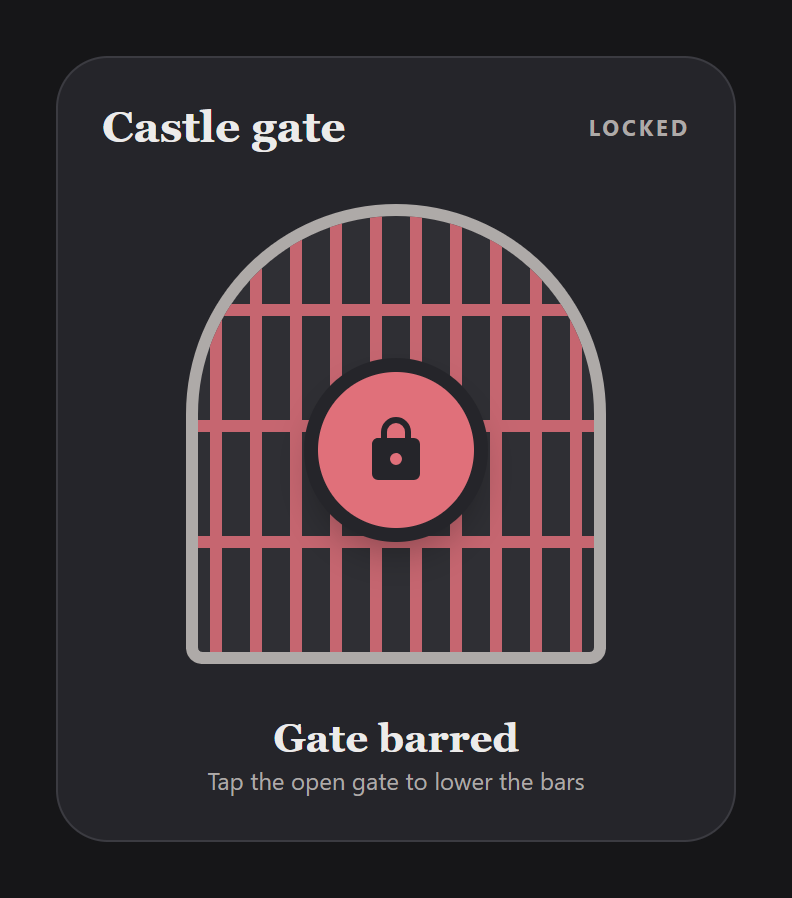

Entities: `lock.front_door`

File: [cards/73-castle-gate.yaml](cards/73-castle-gate.yaml)

```yaml
# Castle gate: an arched portcullis for the front door lock. The bars are down while the door is locked and lift when it is unlocked.
# Tap the gate while it is unlocked to lock it. In any other state a tap opens the lock's own dialog, so unlocking is a deliberate second step. Hold the gate for the same dialog. The padlock plate turns from the accent colour to the success colour.
# The gate is two tiles that look the same, and the lock state decides which one shows.
# It uses theme colours only, so it follows the dashboard's theme.
# Entities: lock.front_door
type: custom:magic-card
name: Castle gate
border_radius: 26px
padding: 22px
rows:
  - id: head
    column_widths: [1fr, auto]
    columns:
      - modules:
          - type: text
            text: Castle gate
            design: { font_size: 22px, font_weight: "700", color: var(--primary-text-color), font_family: "Georgia, 'Iowan Old Style', serif" }
      - vertical_align: center
        modules:
          - type: text
            use_entity: true
            entity: lock.front_door
            design: { font_size: 11px, font_weight: "700", color: var(--secondary-text-color), text_transform: uppercase, letter_spacing: 1.5px }
  - id: gate
    padding: 16px 0 4px
    columns:
      - modules:
          - type: vertical
            align: center
            gap: 0px
            design:
              position: relative
              width: 210px
              height: 230px
              margin: 0 auto
              overflow: hidden
              border_radius: 105px 105px 8px 8px
              border: "6px solid var(--secondary-text-color)"
              background_color: "color-mix(in srgb, var(--primary-text-color) 5%, var(--card-background-color))"
              box_sizing: border-box
              transition: transform 0.15s
              hover: { transform: scale(1.01) }
            display: { conditions: [{ type: state, entity: lock.front_door, state: unlocked }] }
            actions:
              tap_action: { action: perform-action, service: lock.lock, data: { entity_id: lock.front_door } }
              hold_action: { action: more-info, entity: lock.front_door }
            modules:
              - type: separator
                separator_style: none
                design:
                  position: absolute
                  top: 0px
                  left: -1px
                  width: 200px
                  height: 100%
                  background: "repeating-linear-gradient(90deg, transparent 0px, transparent 7px, var(--accent-color) 7px, var(--accent-color) 13px, transparent 13px, transparent 20px), repeating-linear-gradient(0deg, transparent 0px, transparent 52px, var(--accent-color) 52px, var(--accent-color) 58px)"
                  opacity: "0.85"
                  transition: height 0.4s
                  conditional:
                    - { id: open, name: Unlocked, conditions: [{ type: state, entity: lock.front_door, state: unlocked }], design: { height: 40px } }
              - type: icon
                entity: lock.front_door
                icon: mdi:lock
                icon_on: mdi:lock
                icon_off: mdi:lock-open-variant
                size: 36px
                design:
                  position: relative
                  margin_top: 78px
                  width: 78px
                  height: 78px
                  display: flex
                  align_items: center
                  justify_content: center
                  border_radius: 50%
                  color: var(--card-background-color)
                  background_color: var(--accent-color)
                  box_shadow: "0 0 0 7px var(--card-background-color), 0 10px 22px rgba(0,0,0,0.35)"
                  conditional:
                    - { id: open, name: Unlocked, conditions: [{ type: state, state: unlocked }], design: { background_color: var(--success-color) } }
          - type: vertical
            align: center
            gap: 0px
            design:
              position: relative
              width: 210px
              height: 230px
              margin: 0 auto
              overflow: hidden
              border_radius: 105px 105px 8px 8px
              border: "6px solid var(--secondary-text-color)"
              background_color: "color-mix(in srgb, var(--primary-text-color) 5%, var(--card-background-color))"
              box_sizing: border-box
              transition: transform 0.15s
              hover: { transform: scale(1.01) }
            display: { conditions: [{ type: state, entity: lock.front_door, state_not: unlocked }] }
            actions:
              tap_action: { action: more-info, entity: lock.front_door }
              hold_action: { action: more-info, entity: lock.front_door }
            modules:
              - type: separator
                separator_style: none
                design:
                  position: absolute
                  top: 0px
                  left: -1px
                  width: 200px
                  height: 100%
                  background: "repeating-linear-gradient(90deg, transparent 0px, transparent 7px, var(--accent-color) 7px, var(--accent-color) 13px, transparent 13px, transparent 20px), repeating-linear-gradient(0deg, transparent 0px, transparent 52px, var(--accent-color) 52px, var(--accent-color) 58px)"
                  opacity: "0.85"
                  transition: height 0.4s
                  conditional:
                    - { id: open, name: Unlocked, conditions: [{ type: state, entity: lock.front_door, state: unlocked }], design: { height: 40px } }
              - type: icon
                entity: lock.front_door
                icon: mdi:lock
                icon_on: mdi:lock
                icon_off: mdi:lock-open-variant
                size: 36px
                design:
                  position: relative
                  margin_top: 78px
                  width: 78px
                  height: 78px
                  display: flex
                  align_items: center
                  justify_content: center
                  border_radius: 50%
                  color: var(--card-background-color)
                  background_color: var(--accent-color)
                  box_shadow: "0 0 0 7px var(--card-background-color), 0 10px 22px rgba(0,0,0,0.35)"
                  conditional:
                    - { id: open, name: Unlocked, conditions: [{ type: state, state: unlocked }], design: { background_color: var(--success-color) } }
  - id: caption
    padding: 12px 0 0
    columns:
      - gap: 2px
        modules:
          - type: text
            text: Gate barred
            design: { text_align: center, font_size: 20px, font_weight: "700", color: var(--primary-text-color), font_family: "Georgia, 'Iowan Old Style', serif" }
            display: { conditions: [{ type: state, entity: lock.front_door, state: locked }] }
          - type: text
            text: Gate open
            design: { text_align: center, font_size: 20px, font_weight: "700", color: var(--primary-text-color), font_family: "Georgia, 'Iowan Old Style', serif" }
            display: { conditions: [{ type: state, entity: lock.front_door, state: unlocked }] }
          - type: text
            text: Tap the open gate to lower the bars
            design: { text_align: center, font_size: 12px, color: var(--secondary-text-color) }
```

## Crystal ball

The next calendar event floats inside a glass sphere with a slow mist and a soft glow. The time comes from the event start. The location sits under the stand.

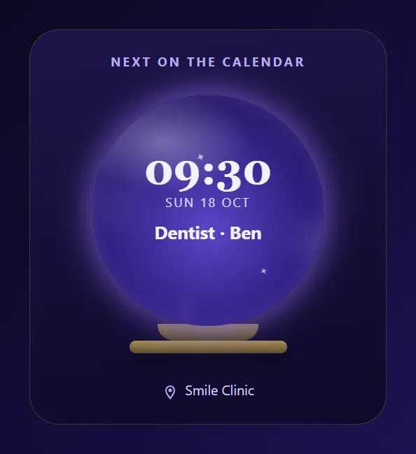

Entities: `calendar.family`

File: [cards/74-crystal-ball.yaml](cards/74-crystal-ball.yaml)

```yaml
# Crystal ball: the next calendar event floats inside a glass sphere with a slow mist and a soft glow.
# The time comes from the event start. The location sits under the stand.
# Entities: calendar.family
type: custom:magic-card
name: Crystal ball
background: "linear-gradient(170deg, #1d1448 0%, #0f0a2a 100%)"
border_radius: 28px
padding: 22px
box_shadow: "0 22px 48px rgba(10,0,40,0.6)"
rows:
  - id: head
    columns:
      - modules:
          - type: text
            text: Next on the calendar
            design: { text_align: center, font_size: 12px, font_weight: "700", color: "#b9a8f0", text_transform: uppercase, letter_spacing: 2px }
  - id: sphere
    padding: 14px 0 0
    columns:
      - modules:
          - type: vertical
            align: center
            gap: 2px
            design:
              width: 220px
              height: 220px
              margin: 0 auto
              padding: 50px 30px 0
              box_sizing: border-box
              border_radius: 50%
              overflow: hidden
              background: "radial-gradient(ellipse 38% 22% at 30% 20%, rgba(255,255,255,0.34), rgba(255,255,255,0) 100%), radial-gradient(circle at 50% 58%, #5b45c8 0%, #2c1d7c 58%, #150f3c 100%)"
              box_shadow: "0 0 0 2px rgba(185,168,240,0.35), 0 0 38px rgba(106,79,216,0.55), inset 0 -14px 28px rgba(0,0,0,0.35)"
              animations:
                - { id: mist, preset: smoke, color: "#cbbcff", strength: 40, intensity: 4, duration: 6s }
                - { id: glow, preset: aura, color: "#8b6cf0", strength: 60, intensity: 26, duration: 6s }
            modules:
              - type: text
                use_template: true
                text: "{{ (state_attr('calendar.family','start_time') or '')[11:16] or '--:--' }}"
                design: { text_align: center, font_size: 40px, font_weight: "700", color: "#f4f0ff", line_height: "1.05", font_family: "Georgia, 'Iowan Old Style', serif" }
              - type: text
                use_template: true
                text: "{{ as_timestamp(state_attr('calendar.family','start_time'), none) | timestamp_custom('%a %-d %b') if state_attr('calendar.family','start_time') else 'Nothing planned' }}"
                design: { text_align: center, font_size: 12px, color: "#e0d8ff", text_transform: uppercase, letter_spacing: 1.5px }
              - type: text
                use_template: true
                text: "{{ state_attr('calendar.family','message') or 'Free day' }}"
                design: { text_align: center, font_size: 17px, font_weight: "700", color: "#f4f0ff", line_height: "1.2", margin_top: 8px }
  - id: stand
    padding: 0
    columns:
      - modules:
          - type: vertical
            align: center
            gap: 0px
            design: { margin_top: -12px }
            modules:
              - type: vertical
                gap: 0px
                design: { width: 96px, height: 16px, border_radius: "0 0 40px 40px", background: "linear-gradient(180deg, #8d7a4a, #4f4228)" }
                modules: []
              - type: vertical
                gap: 0px
                design: { width: 150px, height: 12px, border_radius: 8px, background: "linear-gradient(180deg, #a68f58, #5d4d2c)", box_shadow: "0 8px 14px rgba(0,0,0,0.45)" }
                modules: []
  - id: place
    padding: 14px 0 0
    columns:
      - modules:
          - type: horizontal
            gap: 6px
            align: center
            justify: center
            modules:
              - type: icon
                icon: mdi:map-marker-outline
                size: 16px
                design: { color: "#b9a8f0" }
              - type: text
                use_template: true
                text: "{{ state_attr('calendar.family','location') or 'No location' }}"
                design: { font_size: 13px, color: "#d9d0f7" }
```

## Rune ward

A ring of eight custom marks around a central sigil shows the alarm. Armed, a light runs once around the ring each loop. Triggered, the marks flash red. Disarmed, the ring is grey and still. The three tiles arm and disarm the alarm.

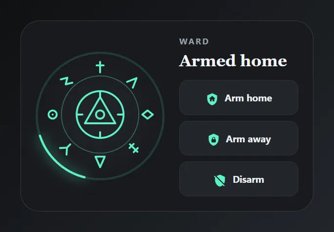

Entities: `alarm_control_panel.home`

File: [cards/75-rune-ward.yaml](cards/75-rune-ward.yaml)

```yaml
# Rune ward: a ring of eight custom marks around a central sigil shows the alarm. Armed, a light runs once around the ring each loop.
# Triggered, the marks flash red. Disarmed, the ring is grey and still. The three tiles arm and disarm the alarm.
# Entities: alarm_control_panel.home
type: custom:magic-card
name: Rune ward
background: "#181a1d"
border_radius: 26px
padding: 20px
box_shadow: "0 22px 48px rgba(0,0,0,0.55)"
rows:
  - id: ward
    column_widths: [180px, 1fr]
    gap: 16px
    columns:
      - vertical_align: center
        modules:
          - type: vertical
            align: center
            gap: 0px
            design:
              width: 176px
              height: 176px
              padding: 6px
              box_sizing: border-box
              border_radius: 50%
              background: "radial-gradient(circle closest-side, #23272c 0%, #181a1d 100%)"
              conditional:
                - id: armed
                  name: Armed
                  mode: any
                  conditions: [{ type: state, entity: alarm_control_panel.home, state: armed_home }, { type: state, entity: alarm_control_panel.home, state: armed_away }]
                  design:
                    ring: { mode: animated, animation: snake, length: 16, speed: 5s, width: 3, glow: 8, color: "#5df0c8", track_color: "#5df0c8", track_opacity: 15 }
                - id: triggered
                  name: Triggered
                  conditions: [{ type: state, entity: alarm_control_panel.home, state: triggered }]
                  design:
                    ring: { mode: animated, animation: pulse, speed: 1s, width: 3, glow: 10, color: "#ff4d6d" }
            modules:
              - type: icon
                entity: alarm_control_panel.home
                icon: svg
                svg: '<svg viewBox="0 0 200 200" fill="none" stroke="currentColor" stroke-width="3.2" stroke-linecap="round" stroke-linejoin="round"><circle cx="100" cy="100" r="66" stroke-opacity="0.35" stroke-width="1.5"/><path d="M100 10 V28 M94 16 H106" transform="rotate(0 100 100)"/><path d="M93 28 L100 12 L107 28" transform="rotate(45 100 100)"/><path d="M100 10 L107 19 L100 28 L93 19 Z" transform="rotate(90 100 100)"/><path d="M100 10 V28 M95 14 H105 M95 24 H105" transform="rotate(135 100 100)"/><path d="M100 10 L108 28 H92 Z" transform="rotate(180 100 100)"/><path d="M92 11 L100 20 L108 11 M100 20 V28" transform="rotate(225 100 100)"/><path d="M107 19 A7 7 0 1 1 93 19 A7 7 0 1 1 107 19 M100 19 V19.1" transform="rotate(270 100 100)"/><path d="M95 10 L105 16 L95 22 L105 28" transform="rotate(315 100 100)"/><circle cx="100" cy="100" r="40"/><path d="M100 70 L126 115 H74 Z"/><circle cx="100" cy="100" r="7"/><path d="M100 60 V70 M100 130 V140 M60 100 H70 M130 100 H140"/></svg>'
                size: 160px
                design:
                  color: "#8a8f98"
                  conditional:
                    - { id: armed, name: Armed, mode: any, conditions: [{ type: state, state: armed_home }, { type: state, state: armed_away }], design: { color: "#5df0c8" } }
                    - { id: triggered, name: Triggered, conditions: [{ type: state, state: triggered }], design: { color: "#ff4d6d", animations: [{ id: flash, preset: blink, target: icon, intensity: 80, duration: 1s }] } }
      - vertical_align: center
        gap: 8px
        modules:
          - type: text
            text: Ward
            design: { font_size: 11px, font_weight: "700", color: "#9aa0a8", text_transform: uppercase, letter_spacing: 2px }
          - type: text
            use_entity: true
            entity: alarm_control_panel.home
            design: { font_size: 22px, font_weight: "700", color: "#f1f4f6", line_height: "1.1", margin_bottom: 6px, font_family: "Georgia, 'Iowan Old Style', serif" }
          - type: horizontal
            gap: 8px
            align: center
            justify: center
            design: { padding: 12px 0, border_radius: 12px, border: "1px solid #2e3237", background_color: "#22252a" }
            actions:
              tap_action: { action: perform-action, service: alarm_control_panel.alarm_arm_home, data: { entity_id: alarm_control_panel.home } }
            modules:
              - type: icon
                icon: mdi:shield-home
                size: 18px
                design: { color: "#5df0c8" }
              - type: text
                text: Arm home
                design: { font_size: 13px, font_weight: "700", color: "#eceff2" }
          - type: horizontal
            gap: 8px
            align: center
            justify: center
            design: { padding: 12px 0, border_radius: 12px, border: "1px solid #2e3237", background_color: "#22252a" }
            actions:
              tap_action: { action: perform-action, service: alarm_control_panel.alarm_arm_away, data: { entity_id: alarm_control_panel.home } }
            modules:
              - type: icon
                icon: mdi:shield-lock
                size: 18px
                design: { color: "#5df0c8" }
              - type: text
                text: Arm away
                design: { font_size: 13px, font_weight: "700", color: "#eceff2" }
          - type: horizontal
            gap: 8px
            align: center
            justify: center
            design: { padding: 12px 0, border_radius: 12px, border: "1px solid #2e3237", background_color: "#22252a" }
            actions:
              tap_action: { action: perform-action, service: alarm_control_panel.alarm_disarm, data: { entity_id: alarm_control_panel.home } }
            modules:
              - type: icon
                icon: mdi:shield-off
                size: 18px
                design: { color: "#5df0c8" }
              - type: text
                text: Disarm
                design: { font_size: 13px, font_weight: "700", color: "#eceff2" }
```

## Weather tower

A stone tower with a window per fact (temperature, wind, humidity) and a flag on top, standing in a sky that drifts with clouds. The flag sways at a breezy pace. The condition icon and the big temperature sit in the sky. It uses theme colours only, so it follows the dashboard's theme.

Shot with the Silverleaf Glade theme preset in light mode. See [theme examples](../themes/examples/README.md#silverleaf-glade). With another theme the card uses that theme's colours.

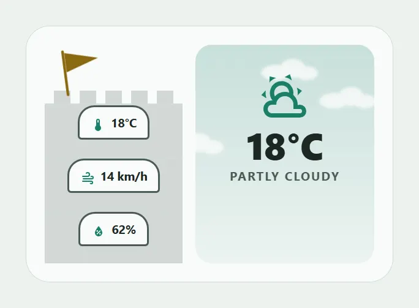

Entities: `weather.home`

File: [cards/76-weather-tower.yaml](cards/76-weather-tower.yaml)

```yaml
# Weather tower: a stone tower with a window per fact (temperature, wind, humidity) and a flag on top, standing in a sky that drifts with clouds.
# The flag sways at a breezy pace. The condition icon and the big temperature sit in the sky.
# It uses theme colours only, so it follows the dashboard's theme.
# Entities: weather.home
type: custom:magic-card
name: Weather tower
border_radius: 26px
padding: 20px
rows:
  - id: scene
    column_widths: [150px, 1fr]
    gap: 14px
    columns:
      - vertical_align: end
        gap: 0px
        modules:
          - type: icon
            icon: svg
            svg: '<svg viewBox="0 0 64 64"><path d="M10 4 V62" stroke="currentColor" stroke-width="3.5" stroke-linecap="round" fill="none"/><path d="M12 6 L56 18 L12 32 Z" fill="currentColor"/></svg>'
            size: 52px
            design:
              color: var(--accent-color)
              margin: 0 0 -8px 14px
              animations:
                - { id: wave, preset: sway, target: icon, intensity: 8, duration: 2.5s }
          - type: separator
            separator_style: none
            design:
              height: 14px
              width: 130px
              margin: 0 auto
              background: "repeating-linear-gradient(90deg, color-mix(in srgb, var(--secondary-text-color) 22%, var(--card-background-color)) 0px, color-mix(in srgb, var(--secondary-text-color) 22%, var(--card-background-color)) 18px, transparent 18px, transparent 28px)"
          - type: horizontal
            gap: 8px
            align: center
            justify: center
            design:
              height: 58px
              box_sizing: border-box
              padding: 0 10px
              background_color: "color-mix(in srgb, var(--secondary-text-color) 22%, var(--card-background-color))"
              border_top: "2px solid var(--divider-color)"
            modules:
              - type: horizontal
                gap: 6px
                align: center
                justify: center
                design:
                  padding: 6px 12px
                  border_radius: 18px 18px 4px 4px
                  background_color: var(--card-background-color)
                  border: "2px solid var(--secondary-text-color)"
                modules:
                  - type: icon
                    icon: mdi:thermometer
                    size: 16px
                    design: { color: var(--primary-color) }
                  - type: text
                    use_entity: true
                    entity: weather.home
                    attribute: temperature
                    design: { font_size: 13px, font_weight: "700", color: var(--primary-text-color) }
          - type: horizontal
            gap: 8px
            align: center
            justify: center
            design:
              height: 58px
              box_sizing: border-box
              padding: 0 10px
              background_color: "color-mix(in srgb, var(--secondary-text-color) 22%, var(--card-background-color))"
              border_top: "2px solid var(--divider-color)"
            modules:
              - type: horizontal
                gap: 6px
                align: center
                justify: center
                design:
                  padding: 6px 12px
                  border_radius: 18px 18px 4px 4px
                  background_color: var(--card-background-color)
                  border: "2px solid var(--secondary-text-color)"
                modules:
                  - type: icon
                    icon: mdi:weather-windy
                    size: 16px
                    design: { color: var(--primary-color) }
                  - type: text
                    use_entity: true
                    entity: weather.home
                    attribute: wind_speed
                    design: { font_size: 13px, font_weight: "700", color: var(--primary-text-color) }
          - type: horizontal
            gap: 8px
            align: center
            justify: center
            design:
              height: 58px
              box_sizing: border-box
              padding: 0 10px
              background_color: "color-mix(in srgb, var(--secondary-text-color) 22%, var(--card-background-color))"
              border_top: "2px solid var(--divider-color)"
            modules:
              - type: horizontal
                gap: 6px
                align: center
                justify: center
                design:
                  padding: 6px 12px
                  border_radius: 18px 18px 4px 4px
                  background_color: var(--card-background-color)
                  border: "2px solid var(--secondary-text-color)"
                modules:
                  - type: icon
                    icon: mdi:water-percent
                    size: 16px
                    design: { color: var(--primary-color) }
                  - type: text
                    use_entity: true
                    entity: weather.home
                    attribute: humidity
                    design: { font_size: 13px, font_weight: "700", color: var(--primary-text-color) }
      - modules:
          - type: vertical
            align: center
            gap: 4px
            design:
              height: 238px
              padding: 28px 12px 0
              box_sizing: border-box
              border_radius: 18px
              overflow: hidden
              background: "linear-gradient(180deg, color-mix(in srgb, var(--primary-color) 22%, var(--card-background-color)), color-mix(in srgb, var(--primary-color) 6%, var(--card-background-color)))"
              animations:
                - { id: clouds, preset: clouds-drift, color: var(--card-background-color), strength: 90, intensity: 3, duration: 5s }
            modules:
              - type: icon
                entity: weather.home
                use_entity_icon: true
                size: 56px
                design: { color: var(--primary-color) }
              - type: text
                use_entity: true
                entity: weather.home
                attribute: temperature
                design: { text_align: center, font_size: 40px, font_weight: "800", color: var(--primary-text-color), line_height: "1.05" }
              - type: text
                use_entity: true
                entity: weather.home
                design: { text_align: center, font_size: 13px, font_weight: "700", color: var(--secondary-text-color), text_transform: uppercase, letter_spacing: 1.5px }
```

## Dragon hoard

A mound of gold coins whose height follows the current energy price. A tall pile means an expensive hour. The pile has three heights: under 20, up to 30 and over 30 ct/kWh. The card draws a pile instead of a bar chart.

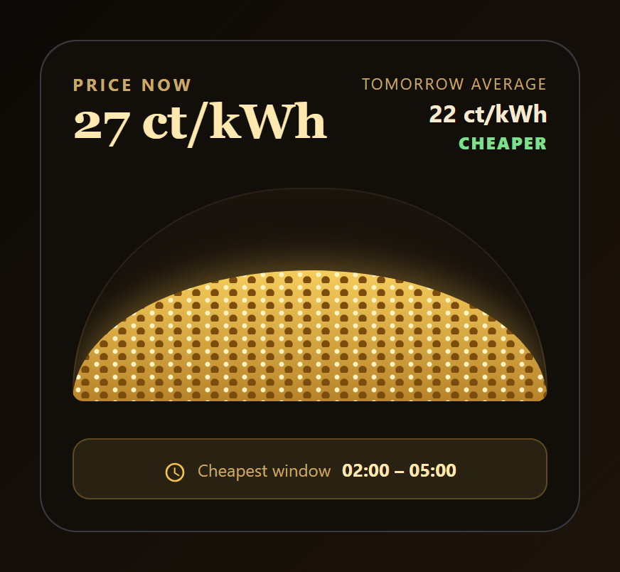

Entities: `sensor.energy_price`, `sensor.energy_price_tomorrow_avg`, `sensor.energy_cheapest_window`

File: [cards/77-dragon-hoard.yaml](cards/77-dragon-hoard.yaml)

```yaml
# Dragon hoard: a mound of gold coins whose height follows the current energy price. A tall pile means an expensive hour.
# The pile has three heights: under 20, up to 30 and over 30 ct/kWh. The card draws a pile instead of a bar chart.
# Entities: sensor.energy_price, sensor.energy_price_tomorrow_avg, sensor.energy_cheapest_window
type: custom:magic-card
name: Dragon hoard
background: "#120e0a"
border_radius: 26px
padding: 22px
box_shadow: "0 22px 48px rgba(0,0,0,0.6)"
rows:
  - id: price
    column_widths: [1fr, auto]
    gap: 14px
    columns:
      - gap: 0px
        modules:
          - type: text
            text: Price now
            design: { font_size: 12px, font_weight: "700", color: "#c9a96a", text_transform: uppercase, letter_spacing: 2px }
          - type: text
            use_entity: true
            entity: sensor.energy_price
            design: { font_size: 34px, font_weight: "700", color: "#ffe9b0", line_height: "1.1", font_family: "Georgia, 'Iowan Old Style', serif" }
      - vertical_align: center
        gap: 2px
        modules:
          - type: text
            text: Tomorrow average
            design: { text_align: right, font_size: 11px, color: "#c9a96a", text_transform: uppercase, letter_spacing: 1.2px }
          - type: text
            use_entity: true
            entity: sensor.energy_price_tomorrow_avg
            design: { text_align: right, font_size: 17px, font_weight: "700", color: "#f6ead0" }
          - type: text
            text: Cheaper
            design: { text_align: right, font_size: 12px, font_weight: "800", color: "#7ddf8a", text_transform: uppercase, letter_spacing: 1px }
            display: { conditions: [{ type: state, entity: sensor.energy_price_tomorrow_avg, below: 25 }] }
          - type: text
            text: Similar
            design: { text_align: right, font_size: 12px, font_weight: "800", color: "#e8d9ae", text_transform: uppercase, letter_spacing: 1px }
            display: { conditions: [{ type: state, entity: sensor.energy_price_tomorrow_avg, above: 24.999, below: 30 }] }
          - type: text
            text: Pricier
            design: { text_align: right, font_size: 12px, font_weight: "800", color: "#ff9a8a", text_transform: uppercase, letter_spacing: 1px }
            display: { conditions: [{ type: state, entity: sensor.energy_price_tomorrow_avg, above: 29.999 }] }
  - id: hoard
    padding: 14px 0 0
    columns:
      - modules:
          - type: vertical
            gap: 0px
            design:
              position: relative
              height: 150px
              border_radius: "50% 50% 8px 8px / 100% 100% 8px 8px"
              overflow: hidden
              background: "linear-gradient(180deg, #1b140d, #0d0a07)"
              box_shadow: "inset 0 0 0 1px #2b2015"
            modules:
              - type: separator
                separator_style: none
                design:
                  position: absolute
                  left: 0px
                  bottom: 0px
                  width: 100%
                  height: 92px
                  border_radius: "50% 50% 0 0 / 100% 100% 0 0"
                  background: "radial-gradient(circle at 4px 3px, #fff3c4 0px, #fff3c4 1.4px, transparent 2px) 0 0 / 13px 9px, radial-gradient(circle at 9px 7px, #7a4d0e 0px, #7a4d0e 2.6px, transparent 3.2px) 0 0 / 13px 9px, linear-gradient(180deg, #f6cd5c 0%, #b8832a 100%)"
                  box_shadow: "0 -6px 24px rgba(242,193,78,0.35)"
                  conditional:
                    - { id: cheap, name: Cheap hour, conditions: [{ type: state, entity: sensor.energy_price, below: 20 }], design: { height: 52px } }
                    - { id: pricey, name: Expensive hour, conditions: [{ type: state, entity: sensor.energy_price, above: 30 }], design: { height: 136px } }
  - id: window
    padding: 16px 0 0
    columns:
      - modules:
          - type: horizontal
            gap: 8px
            align: center
            justify: center
            design: { padding: 10px 12px, border_radius: 12px, background_color: "rgba(242,193,78,0.1)", border: "1px solid rgba(242,193,78,0.25)" }
            modules:
              - type: icon
                icon: mdi:clock-outline
                size: 16px
                design: { color: "#f2c14e" }
              - type: text
                text: Cheapest window
                design: { font_size: 12px, color: "#c9a96a" }
              - type: text
                use_entity: true
                entity: sensor.energy_cheapest_window
                design: { font_size: 13px, font_weight: "700", color: "#ffe9b0" }
```

## Herb garden

Two planter boxes, one per irrigation zone. Tap a box to start or stop its water. A watering zone gets falling drops and swaying leaves, an idle zone stays still. The bar at the bottom is the soil moisture.

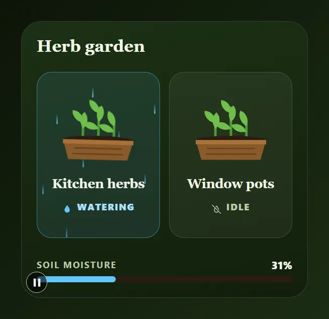

Entities: `switch.zone_lawn`, `switch.zone_beds`, `sensor.soil_moisture`

File: [cards/78-herb-garden.yaml](cards/78-herb-garden.yaml)

```yaml
# Herb garden: two planter boxes, one per irrigation zone. Tap a box to start or stop its water.
# A watering zone gets falling drops and swaying leaves, an idle zone stays still. The bar at the bottom is the soil moisture.
# Entities: switch.zone_lawn, switch.zone_beds, sensor.soil_moisture
type: custom:magic-card
name: Herb garden
background: "linear-gradient(170deg, #1c3014 0%, #121f0c 100%)"
border_radius: 26px
padding: 20px
box_shadow: "0 20px 44px rgba(0,0,0,0.5)"
rows:
  - id: head
    padding: 0 0 12px
    columns:
      - modules:
          - type: text
            text: Herb garden
            design: { font_size: 22px, font_weight: "700", color: "#f1f6e8", font_family: "Georgia, 'Iowan Old Style', serif" }
  - id: beds
    layout: "1-1"
    gap: 12px
    columns:
      - modules:
          - type: vertical
            align: center
            gap: 0px
            design:
              height: 220px
              padding: 14px 8px
              box_sizing: border-box
              border_radius: 20px
              overflow: hidden
              background_color: "rgba(255,255,255,0.05)"
              border: "1px solid rgba(190,220,150,0.18)"
              animations:
                - { id: drops, preset: rain-fall, trigger: entity_on, trigger_entity: switch.zone_lawn, color: "#5ec8ff", strength: 90, intensity: 10, duration: 1s }
              conditional:
                - id: watering
                  name: Watering
                  conditions: [{ type: state, entity: switch.zone_lawn, state: "on" }]
                  design: { background_color: "rgba(94,200,255,0.1)", border: "1px solid rgba(94,200,255,0.45)" }
            actions:
              tap_action: { action: toggle, entity: switch.zone_lawn }
            modules:
              - type: icon
                entity: switch.zone_lawn
                icon: svg
                svg: '<svg viewBox="0 0 120 110"><path d="M38 74 V44 M60 74 V30 M82 74 V48" stroke="#4e9a38" stroke-width="3.5" stroke-linecap="round" fill="none"/><path d="M38 52 C26 48 24 36 26 32 C36 34 40 44 38 52 Z" fill="#6fbf4b" transform="rotate(-10 38 52)"/><path d="M38 60 C26 56 24 44 26 40 C36 42 40 52 38 60 Z" fill="#6fbf4b" transform="rotate(35 38 60)"/><path d="M60 38 C48 34 46 22 48 18 C58 20 62 30 60 38 Z" fill="#6fbf4b" transform="rotate(-5 60 38)"/><path d="M60 50 C48 46 46 34 48 30 C58 32 62 42 60 50 Z" fill="#6fbf4b" transform="rotate(40 60 50)"/><path d="M60 60 C48 56 46 44 48 40 C58 42 62 52 60 60 Z" fill="#6fbf4b" transform="rotate(-40 60 60)"/><path d="M82 56 C70 52 68 40 70 36 C80 38 84 48 82 56 Z" fill="#6fbf4b" transform="rotate(10 82 56)"/><path d="M82 64 C70 60 68 48 70 44 C80 46 84 56 82 64 Z" fill="#6fbf4b" transform="rotate(-35 82 64)"/><ellipse cx="60" cy="76" rx="50" ry="6" fill="#2a1d12"/><path d="M10 76 H110 L102 104 H18 Z" fill="#8a5a2b"/><path d="M10 76 H110 V82 H10 Z" fill="#a8723a"/><path d="M26 88 H94 M24 96 H96" stroke="#6a421c" stroke-width="2" fill="none"/></svg>'
                size: 112px
                design:
                  color: "#6fbf4b"
                  animations: [{ id: sway, preset: sway, target: icon, trigger: entity_on, intensity: 3, duration: 4s }]
              - type: text
                text: Kitchen herbs
                design: { text_align: center, font_size: 17px, font_weight: "700", color: "#f1f6e8", margin_top: 8px, font_family: "Georgia, 'Iowan Old Style', serif" }
              - type: horizontal
                gap: 6px
                align: center
                justify: center
                design: { margin_top: 10px }
                display: { conditions: [{ type: state, entity: switch.zone_lawn, state: "on" }] }
                modules:
                  - type: icon
                    icon: mdi:water
                    size: 14px
                    design: { color: "#5ec8ff" }
                  - type: text
                    text: Watering
                    design: { font_size: 12px, font_weight: "800", color: "#a8e2ff", text_transform: uppercase, letter_spacing: 1.2px }
              - type: horizontal
                gap: 6px
                align: center
                justify: center
                design: { margin_top: 10px }
                display: { conditions: [{ type: state, entity: switch.zone_lawn, state: "off" }] }
                modules:
                  - type: icon
                    icon: mdi:water-off-outline
                    size: 14px
                    design: { color: "#a9b79a" }
                  - type: text
                    text: Idle
                    design: { font_size: 12px, font_weight: "800", color: "#bccaa9", text_transform: uppercase, letter_spacing: 1.2px }
      - modules:
          - type: vertical
            align: center
            gap: 0px
            design:
              height: 220px
              padding: 14px 8px
              box_sizing: border-box
              border_radius: 20px
              overflow: hidden
              background_color: "rgba(255,255,255,0.05)"
              border: "1px solid rgba(190,220,150,0.18)"
              animations:
                - { id: drops, preset: rain-fall, trigger: entity_on, trigger_entity: switch.zone_beds, color: "#5ec8ff", strength: 90, intensity: 10, duration: 1s }
              conditional:
                - id: watering
                  name: Watering
                  conditions: [{ type: state, entity: switch.zone_beds, state: "on" }]
                  design: { background_color: "rgba(94,200,255,0.1)", border: "1px solid rgba(94,200,255,0.45)" }
            actions:
              tap_action: { action: toggle, entity: switch.zone_beds }
            modules:
              - type: icon
                entity: switch.zone_beds
                icon: svg
                svg: '<svg viewBox="0 0 120 110"><path d="M38 74 V44 M60 74 V30 M82 74 V48" stroke="#4e9a38" stroke-width="3.5" stroke-linecap="round" fill="none"/><path d="M38 52 C26 48 24 36 26 32 C36 34 40 44 38 52 Z" fill="#6fbf4b" transform="rotate(-10 38 52)"/><path d="M38 60 C26 56 24 44 26 40 C36 42 40 52 38 60 Z" fill="#6fbf4b" transform="rotate(35 38 60)"/><path d="M60 38 C48 34 46 22 48 18 C58 20 62 30 60 38 Z" fill="#6fbf4b" transform="rotate(-5 60 38)"/><path d="M60 50 C48 46 46 34 48 30 C58 32 62 42 60 50 Z" fill="#6fbf4b" transform="rotate(40 60 50)"/><path d="M60 60 C48 56 46 44 48 40 C58 42 62 52 60 60 Z" fill="#6fbf4b" transform="rotate(-40 60 60)"/><path d="M82 56 C70 52 68 40 70 36 C80 38 84 48 82 56 Z" fill="#6fbf4b" transform="rotate(10 82 56)"/><path d="M82 64 C70 60 68 48 70 44 C80 46 84 56 82 64 Z" fill="#6fbf4b" transform="rotate(-35 82 64)"/><ellipse cx="60" cy="76" rx="50" ry="6" fill="#2a1d12"/><path d="M10 76 H110 L102 104 H18 Z" fill="#8a5a2b"/><path d="M10 76 H110 V82 H10 Z" fill="#a8723a"/><path d="M26 88 H94 M24 96 H96" stroke="#6a421c" stroke-width="2" fill="none"/></svg>'
                size: 112px
                design:
                  color: "#6fbf4b"
                  animations: [{ id: sway, preset: sway, target: icon, trigger: entity_on, intensity: 3, duration: 4s }]
              - type: text
                text: Window pots
                design: { text_align: center, font_size: 17px, font_weight: "700", color: "#f1f6e8", margin_top: 8px, font_family: "Georgia, 'Iowan Old Style', serif" }
              - type: horizontal
                gap: 6px
                align: center
                justify: center
                design: { margin_top: 10px }
                display: { conditions: [{ type: state, entity: switch.zone_beds, state: "on" }] }
                modules:
                  - type: icon
                    icon: mdi:water
                    size: 14px
                    design: { color: "#5ec8ff" }
                  - type: text
                    text: Watering
                    design: { font_size: 12px, font_weight: "800", color: "#a8e2ff", text_transform: uppercase, letter_spacing: 1.2px }
              - type: horizontal
                gap: 6px
                align: center
                justify: center
                design: { margin_top: 10px }
                display: { conditions: [{ type: state, entity: switch.zone_beds, state: "off" }] }
                modules:
                  - type: icon
                    icon: mdi:water-off-outline
                    size: 14px
                    design: { color: "#a9b79a" }
                  - type: text
                    text: Idle
                    design: { font_size: 12px, font_weight: "800", color: "#bccaa9", text_transform: uppercase, letter_spacing: 1.2px }
  - id: soil
    padding: 16px 0 0
    columns:
      - gap: 6px
        modules:
          - type: horizontal
            justify: space-between
            align: center
            modules:
              - type: text
                text: Soil moisture
                design: { font_size: 12px, font_weight: "700", color: "#bccaa9", text_transform: uppercase, letter_spacing: 1.2px }
              - type: text
                use_entity: true
                entity: sensor.soil_moisture
                design: { font_size: 14px, font_weight: "800", color: "#f1f6e8" }
          - type: bar
            entity: sensor.soil_moisture
            min: 0
            max: 100
            bar_height: 8px
            show_value: false
            bar_color: "#5ec8ff"
            bar_background: "#2a1d12"
```

## Minstrel hall

A stage with three arched alcoves, one per speaker. Tap an alcove to play or pause that room. A playing alcove glows and shows bouncing bars, a paused one stays dark. The thin bar is the volume.

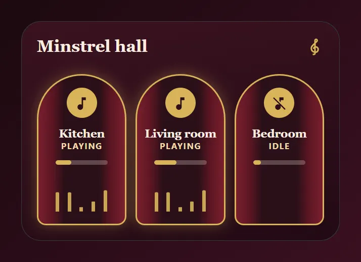

Entities: `media_player.kitchen`, `media_player.living_room`, `media_player.bedroom`

File: [cards/79-minstrel-hall.yaml](cards/79-minstrel-hall.yaml)

```yaml
# Minstrel hall: a stage with three arched alcoves, one per speaker. Tap an alcove to play or pause that room.
# A playing alcove glows and shows bouncing bars, a paused one stays dark. The thin bar is the volume.
# Entities: media_player.kitchen, media_player.living_room, media_player.bedroom
type: custom:magic-card
name: Minstrel hall
background: "linear-gradient(170deg, #3a1220 0%, #230a14 100%)"
border_radius: 26px
padding: 20px
box_shadow: "0 22px 48px rgba(20,0,10,0.6)"
rows:
  - id: head
    column_widths: [1fr, auto]
    padding: 0 0 14px
    columns:
      - modules:
          - type: text
            text: Minstrel hall
            design: { font_size: 22px, font_weight: "700", color: "#fbeee0", font_family: "Georgia, 'Iowan Old Style', serif" }
      - vertical_align: center
        modules:
          - type: icon
            icon: mdi:music-clef-treble
            size: 24px
            design: { color: "#d9b45a" }
  - id: alcoves
    layout: "1-1-1"
    gap: 12px
    columns:
      - modules:
          - type: vertical
            align: center
            gap: 0px
            design:
              height: 200px
              padding: 16px 8px 14px
              box_sizing: border-box
              border_radius: 70px 70px 14px 14px
              border: "2px solid #d9b45a"
              overflow: hidden
              background: "linear-gradient(90deg, #7a1f2e 0%, #5b1623 16%, #2a0f18 30%, #2a0f18 70%, #5b1623 84%, #7a1f2e 100%)"
              conditional:
                - id: playing
                  name: Playing
                  conditions: [{ type: state, entity: media_player.kitchen, state: playing }]
                  design: { box_shadow: "0 0 18px rgba(217,180,90,0.35)" }
            actions:
              tap_action: { action: perform-action, service: media_player.media_play_pause, data: { entity_id: media_player.kitchen } }
              hold_action: { action: more-info, entity: media_player.kitchen }
            modules:
              - type: icon
                entity: media_player.kitchen
                icon: mdi:music-note-off
                icon_on: mdi:music-note
                icon_off: mdi:music-note-off
                size: 22px
                design: { color: "#2a0f18", width: 40px, height: 40px, display: flex, align_items: center, justify_content: center, border_radius: 50%, background_color: "#d9b45a" }
              - type: text
                text: Kitchen
                design: { text_align: center, font_size: 15px, font_weight: "700", color: "#fbeee0", margin_top: 12px, font_family: "Georgia, 'Iowan Old Style', serif" }
              - type: text
                use_entity: true
                entity: media_player.kitchen
                design: { text_align: center, font_size: 11px, font_weight: "700", color: "#f0d9a8", text_transform: uppercase, letter_spacing: 1.2px }
              - type: bar
                entity: media_player.kitchen
                attribute: volume_level
                min: 0
                max: 1
                bar_height: 6px
                show_value: false
                bar_color: "#d9b45a"
                bar_background: "rgba(251,238,224,0.25)"
                design: { width: 70%, margin: 12px auto 0 }
              - type: separator
                separator_style: none
                design:
                  position: relative
                  left: 5px
                  width: 100%
                  height: 52px
                  margin_top: 10px
                  animations:
                    - { id: bars, preset: equalizer-bars, trigger: state, trigger_entity: media_player.kitchen, state: playing, color: "#d9b45a", strength: 90, intensity: 5, duration: 1.5s }
      - modules:
          - type: vertical
            align: center
            gap: 0px
            design:
              height: 200px
              padding: 16px 8px 14px
              box_sizing: border-box
              border_radius: 70px 70px 14px 14px
              border: "2px solid #d9b45a"
              overflow: hidden
              background: "linear-gradient(90deg, #7a1f2e 0%, #5b1623 16%, #2a0f18 30%, #2a0f18 70%, #5b1623 84%, #7a1f2e 100%)"
              conditional:
                - id: playing
                  name: Playing
                  conditions: [{ type: state, entity: media_player.living_room, state: playing }]
                  design: { box_shadow: "0 0 18px rgba(217,180,90,0.35)" }
            actions:
              tap_action: { action: perform-action, service: media_player.media_play_pause, data: { entity_id: media_player.living_room } }
              hold_action: { action: more-info, entity: media_player.living_room }
            modules:
              - type: icon
                entity: media_player.living_room
                icon: mdi:music-note-off
                icon_on: mdi:music-note
                icon_off: mdi:music-note-off
                size: 22px
                design: { color: "#2a0f18", width: 40px, height: 40px, display: flex, align_items: center, justify_content: center, border_radius: 50%, background_color: "#d9b45a" }
              - type: text
                text: Living room
                design: { text_align: center, font_size: 15px, font_weight: "700", color: "#fbeee0", margin_top: 12px, font_family: "Georgia, 'Iowan Old Style', serif" }
              - type: text
                use_entity: true
                entity: media_player.living_room
                design: { text_align: center, font_size: 11px, font_weight: "700", color: "#f0d9a8", text_transform: uppercase, letter_spacing: 1.2px }
              - type: bar
                entity: media_player.living_room
                attribute: volume_level
                min: 0
                max: 1
                bar_height: 6px
                show_value: false
                bar_color: "#d9b45a"
                bar_background: "rgba(251,238,224,0.25)"
                design: { width: 70%, margin: 12px auto 0 }
              - type: separator
                separator_style: none
                design:
                  position: relative
                  left: 5px
                  width: 100%
                  height: 52px
                  margin_top: 10px
                  animations:
                    - { id: bars, preset: equalizer-bars, trigger: state, trigger_entity: media_player.living_room, state: playing, color: "#d9b45a", strength: 90, intensity: 5, duration: 1.5s, delay: -0.7s }
      - modules:
          - type: vertical
            align: center
            gap: 0px
            design:
              height: 200px
              padding: 16px 8px 14px
              box_sizing: border-box
              border_radius: 70px 70px 14px 14px
              border: "2px solid #d9b45a"
              overflow: hidden
              background: "linear-gradient(90deg, #7a1f2e 0%, #5b1623 16%, #2a0f18 30%, #2a0f18 70%, #5b1623 84%, #7a1f2e 100%)"
              conditional:
                - id: playing
                  name: Playing
                  conditions: [{ type: state, entity: media_player.bedroom, state: playing }]
                  design: { box_shadow: "0 0 18px rgba(217,180,90,0.35)" }
            actions:
              tap_action: { action: perform-action, service: media_player.media_play_pause, data: { entity_id: media_player.bedroom } }
              hold_action: { action: more-info, entity: media_player.bedroom }
            modules:
              - type: icon
                entity: media_player.bedroom
                icon: mdi:music-note-off
                icon_on: mdi:music-note
                icon_off: mdi:music-note-off
                size: 22px
                design: { color: "#2a0f18", width: 40px, height: 40px, display: flex, align_items: center, justify_content: center, border_radius: 50%, background_color: "#d9b45a" }
              - type: text
                text: Bedroom
                design: { text_align: center, font_size: 15px, font_weight: "700", color: "#fbeee0", margin_top: 12px, font_family: "Georgia, 'Iowan Old Style', serif" }
              - type: text
                use_entity: true
                entity: media_player.bedroom
                design: { text_align: center, font_size: 11px, font_weight: "700", color: "#f0d9a8", text_transform: uppercase, letter_spacing: 1.2px }
              - type: bar
                entity: media_player.bedroom
                attribute: volume_level
                min: 0
                max: 1
                bar_height: 6px
                show_value: false
                bar_color: "#d9b45a"
                bar_background: "rgba(251,238,224,0.25)"
                design: { width: 70%, margin: 12px auto 0 }
              - type: separator
                separator_style: none
                design:
                  position: relative
                  left: 5px
                  width: 100%
                  height: 52px
                  margin_top: 10px
                  animations:
                    - { id: bars, preset: equalizer-bars, trigger: state, trigger_entity: media_player.bedroom, state: playing, color: "#d9b45a", strength: 90, intensity: 5, duration: 1.5s }
```

## Quest board

A wooden board with four pinned parchment notes and a wax seal that counts the open chores. The seal shows how many items on the to-do list are open. Tap a note to open the list. Replace the four titles with your own chores.

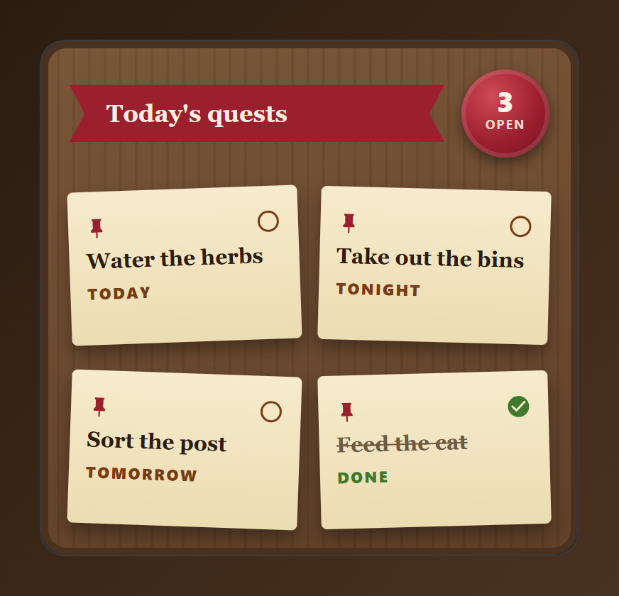

Entities: `todo.chores`

File: [cards/80-quest-board.yaml](cards/80-quest-board.yaml)

```yaml
# Quest board: a wooden board with four pinned parchment notes and a wax seal that counts the open chores.
# The seal shows how many items on the to-do list are open. Tap a note to open the list. Replace the four titles with your own chores.
# Entities: todo.chores
type: custom:magic-card
name: Quest board
background: "repeating-linear-gradient(90deg, rgba(0,0,0,0.07) 0px, rgba(0,0,0,0.07) 2px, transparent 2px, transparent 11px), linear-gradient(170deg, #7a5638 0%, #5f4029 100%)"
border_radius: 18px
padding: 20px
box_shadow: "0 22px 48px rgba(0,0,0,0.55), inset 0 0 0 5px #4a3220"
rows:
  - id: head
    column_widths: [1fr, auto]
    gap: 12px
    columns:
      - vertical_align: center
        modules:
          - type: text
            text: Today's quests
            design:
              font_size: 17px
              font_weight: "700"
              color: "#fbeee0"
              padding: 10px 26px
              background_color: "#9c1f2e"
              css: "clip-path: polygon(0 0, 100% 0, 96% 50%, 100% 100%, 0 100%, 4% 50%); box-shadow: 0 4px 8px rgba(0,0,0,0.4)"
              font_family: "Georgia, 'Iowan Old Style', serif"
      - vertical_align: center
        modules:
          - type: vertical
            align: center
            gap: 0px
            design:
              width: 62px
              height: 62px
              padding: 12px 0 0
              box_sizing: border-box
              border_radius: 50%
              background: "radial-gradient(circle at 35% 30%, #d04a58 0%, #9c1f2e 55%, #6e1220 100%)"
              box_shadow: "0 4px 10px rgba(0,0,0,0.45), inset 0 0 0 3px rgba(255,255,255,0.12)"
            modules:
              - type: text
                use_entity: true
                entity: todo.chores
                design: { text_align: center, font_size: 20px, font_weight: "800", color: "#fff1e6", line_height: "1" }
              - type: text
                text: open
                design: { text_align: center, font_size: 9px, font_weight: "700", color: "#ffd9c9", text_transform: uppercase, letter_spacing: 1px }
  - id: notes1
    layout: "1-1"
    gap: 14px
    padding: 12px 0 0
    columns:
      - modules:
          - type: vertical
            gap: 0px
            design: { transform: "rotate(-2deg)", padding: 0 }
            modules:
              - type: vertical
                gap: 6px
                design:
                  height: 108px
                  padding: 12px 12px 10px
                  box_sizing: border-box
                  border_radius: 4px
                  background: "linear-gradient(180deg, #f6ebcc, #ecdcb2)"
                  box_shadow: "0 6px 12px rgba(0,0,0,0.35)"
                actions:
                  tap_action: { action: more-info, entity: todo.chores }
                modules:
                  - type: horizontal
                    justify: space-between
                    align: center
                    modules:
                      - type: icon
                        icon: mdi:pin
                        size: 16px
                        design: { color: "#9c1f2e" }
                      - type: icon
                        icon: mdi:circle-outline
                        size: 18px
                        design: { color: "#7a3b12" }
                  - type: text
                    text: Water the herbs
                    design: { font_size: 15px, font_weight: "700", color: "#2b1d10", line_height: "1.2", font_family: "Georgia, 'Iowan Old Style', serif" }
                  - type: text
                    text: Today
                    design: { font_size: 11px, font_weight: "800", color: "#7a3b12", text_transform: uppercase, letter_spacing: 1.2px }
      - modules:
          - type: vertical
            gap: 0px
            design: { transform: "rotate(1.5deg)", padding: 0 }
            modules:
              - type: vertical
                gap: 6px
                design:
                  height: 108px
                  padding: 12px 12px 10px
                  box_sizing: border-box
                  border_radius: 4px
                  background: "linear-gradient(180deg, #f6ebcc, #ecdcb2)"
                  box_shadow: "0 6px 12px rgba(0,0,0,0.35)"
                actions:
                  tap_action: { action: more-info, entity: todo.chores }
                modules:
                  - type: horizontal
                    justify: space-between
                    align: center
                    modules:
                      - type: icon
                        icon: mdi:pin
                        size: 16px
                        design: { color: "#9c1f2e" }
                      - type: icon
                        icon: mdi:circle-outline
                        size: 18px
                        design: { color: "#7a3b12" }
                  - type: text
                    text: Take out the bins
                    design: { font_size: 15px, font_weight: "700", color: "#2b1d10", line_height: "1.2", font_family: "Georgia, 'Iowan Old Style', serif" }
                  - type: text
                    text: Tonight
                    design: { font_size: 11px, font_weight: "800", color: "#7a3b12", text_transform: uppercase, letter_spacing: 1.2px }
  - id: notes2
    layout: "1-1"
    gap: 14px
    padding: 12px 0 0
    columns:
      - modules:
          - type: vertical
            gap: 0px
            design: { transform: "rotate(2deg)", padding: 0 }
            modules:
              - type: vertical
                gap: 6px
                design:
                  height: 108px
                  padding: 12px 12px 10px
                  box_sizing: border-box
                  border_radius: 4px
                  background: "linear-gradient(180deg, #f6ebcc, #ecdcb2)"
                  box_shadow: "0 6px 12px rgba(0,0,0,0.35)"
                actions:
                  tap_action: { action: more-info, entity: todo.chores }
                modules:
                  - type: horizontal
                    justify: space-between
                    align: center
                    modules:
                      - type: icon
                        icon: mdi:pin
                        size: 16px
                        design: { color: "#9c1f2e" }
                      - type: icon
                        icon: mdi:circle-outline
                        size: 18px
                        design: { color: "#7a3b12" }
                  - type: text
                    text: Sort the post
                    design: { font_size: 15px, font_weight: "700", color: "#2b1d10", line_height: "1.2", font_family: "Georgia, 'Iowan Old Style', serif" }
                  - type: text
                    text: Tomorrow
                    design: { font_size: 11px, font_weight: "800", color: "#7a3b12", text_transform: uppercase, letter_spacing: 1.2px }
      - modules:
          - type: vertical
            gap: 0px
            design: { transform: "rotate(-1.5deg)", padding: 0 }
            modules:
              - type: vertical
                gap: 6px
                design:
                  height: 108px
                  padding: 12px 12px 10px
                  box_sizing: border-box
                  border_radius: 4px
                  background: "linear-gradient(180deg, #f6ebcc, #ecdcb2)"
                  box_shadow: "0 6px 12px rgba(0,0,0,0.35)"
                actions:
                  tap_action: { action: more-info, entity: todo.chores }
                modules:
                  - type: horizontal
                    justify: space-between
                    align: center
                    modules:
                      - type: icon
                        icon: mdi:pin
                        size: 16px
                        design: { color: "#9c1f2e" }
                      - type: icon
                        icon: mdi:check-circle
                        size: 18px
                        design: { color: "#3f7a2c" }
                  - type: text
                    text: Feed the cat
                    design: { font_size: 15px, font_weight: "700", color: "#6d5a43", line_height: "1.2", font_family: "Georgia, 'Iowan Old Style', serif", text_decoration: line-through }
                  - type: text
                    text: Done
                    design: { font_size: 11px, font_weight: "800", color: "#3f7a2c", text_transform: uppercase, letter_spacing: 1.2px }
```

## Operations console

A retro starship-style panel with rounded elbow frames, a sidebar of command blocks, a number cascade and a pulsing power core. Environment, power and security readouts sit side by side, the lights are four pills you tap to toggle. While the alarm is triggered the card turns red and the title becomes a flashing alert.

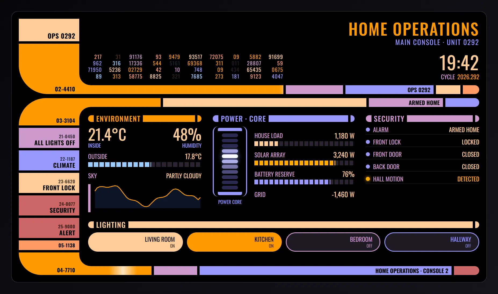

Entities: `alarm_control_panel.home`, `lock.front_door`, `climate.living_room`, `sensor.indoor_temperature`, `sensor.indoor_humidity`, `sensor.outdoor_temperature`, `weather.home`, `sensor.house_power`, `sensor.solar_power`, `sensor.home_battery`, `sensor.grid_power`, `binary_sensor.front_door`, `binary_sensor.back_door`, `binary_sensor.hall_motion`, `light.living_room`, `light.kitchen`, `light.bedroom`, `light.hallway`, `script.all_lights_off`, `script.red_alert`

File: [cards/81-ops-console.yaml](cards/81-ops-console.yaml)

```yaml
# Operations console: a retro starship-style panel with rounded elbow frames, a sidebar of command blocks, a number cascade and a pulsing power core.
# Environment, power and security readouts sit side by side, the lights are four pills you tap to toggle. While the alarm is triggered the card turns red and the title becomes a flashing alert.
# Entities: alarm_control_panel.home, lock.front_door, climate.living_room, sensor.indoor_temperature, sensor.indoor_humidity, sensor.outdoor_temperature, weather.home, sensor.house_power, sensor.solar_power, sensor.home_battery, sensor.grid_power, binary_sensor.front_door, binary_sensor.back_door, binary_sensor.hall_motion, light.living_room, light.kitchen, light.bedroom, light.hallway, script.all_lights_off, script.red_alert
type: custom:magic-card
name: Home operations panel
background: '#000000'
border_radius: 16px
padding: 18px
box_shadow: none
css: 'font-family: Antonio, ''Oswald'', ''Arial Narrow'', sans-serif; text-transform: uppercase; color: #FFCC99;'
custom_animations:
  data-blink:
    name: Data blink
    kind: keyframes
    duration: 2.6
    iterations: infinite
    target: element
    easing: linear
    keyframes: [{at: 0, opacity: 1}, {at: 46, opacity: 1}, {at: 48, opacity: 0.18}, {at: 70, opacity: 0.18}, {at: 72, opacity: 1}, {at: 100, opacity: 1}]
  core-cell:
    name: Core cell pulse
    kind: keyframes
    duration: 1.8
    iterations: infinite
    target: element
    easing: ease-out
    keyframes:
      - {at: 0, background: '#2A2850', filter: brightness(1)}
      - {at: 12, background: '#C8C8FF', filter: 'brightness(1.25) drop-shadow(0 0 6px #9999FF)'}
      - {at: 45, background: '#2A2850', filter: brightness(1)}
      - {at: 100, background: '#2A2850', filter: brightness(1)}
  block-flash:
    name: Block flash
    kind: keyframes
    duration: 9
    iterations: infinite
    target: element
    easing: linear
    keyframes: [{at: 0, filter: brightness(1)}, {at: 2, filter: brightness(1.45)}, {at: 5, filter: brightness(1)}, {at: 100, filter: brightness(1)}]
  bar-scan:
    name: Bar scan
    kind: keyframes
    duration: 3.2
    iterations: infinite
    target: element
    easing: ease-in-out
    keyframes: [{at: 0, transform: {x: 0}, opacity: 0}, {at: 8, opacity: 1}, {at: 92, opacity: 1}, {at: 100, transform: {x: 640}, opacity: 0}]
  alert-strobe:
    name: Alert strobe
    kind: keyframes
    duration: 1
    iterations: infinite
    target: element
    easing: linear
    keyframes: [{at: 0, opacity: 1}, {at: 50, opacity: 1}, {at: 52, opacity: 0.25}, {at: 98, opacity: 0.25}, {at: 100, opacity: 1}]
conditional_appearance:
  - id: red-alert
    name: Alert
    mode: every
    conditions: [{type: state, entity: alarm_control_panel.home, state: triggered}]
    overrides: {background: 'radial-gradient(ellipse at 60% 35%, #3a0000 0%, #120000 55%, #000000 100%)'}
rows:
  - id: frame_upper
    column_widths: [150px, 1fr]
    gap: 0px
    columns:
      - id: upper_sidebar
        vertical_align: stretch
        gap: 6px
        modules:
          - type: vertical
            gap: 2px
            design:
              background_color: '#FFCC99'
              height: 56px
              min_height: 56px
              box_sizing: border-box
              padding: 6px 10px 6px 8px
              display: flex
              flex_direction: column
              justify_content: flex-end
              align_items: flex-end
              conditional: [{id: red, name: Alert, conditions: [{type: state, entity: alarm_control_panel.home, state: triggered}], design: {background_color: '#CC6666'}}]
            modules: [{type: text, text: OPS 0292, design: {color: '#000000', font_size: 16px, font_weight: '600', letter_spacing: 0.5px, line_height: '1', text_align: right}}]
          - type: vertical
            gap: 2px
            design:
              background_color: '#FF9900'
              height: 84px
              min_height: 84px
              flex: '1'
              box_sizing: border-box
              padding: 6px 10px 6px 8px
              display: flex
              flex_direction: column
              justify_content: flex-end
              align_items: flex-end
              border_bottom_left_radius: 72px
              conditional: [{id: red, name: Alert, conditions: [{type: state, entity: alarm_control_panel.home, state: triggered}], design: {background_color: '#FF3B3B'}}]
            modules: [{type: text, text: 02-4410, design: {color: '#000000', font_size: 14px, font_weight: '600', letter_spacing: 0.5px, line_height: '1', text_align: right}}]
      - id: upper_content
        vertical_align: stretch
        gap: 0px
        modules:
          - type: vertical
            gap: 16px
            design: {flex: '1', padding: 4px 0 14px 22px, box_sizing: border-box, display: flex, flex_direction: column, justify_content: space-between}
            modules:
              - type: vertical
                gap: 4px
                design: {}
                modules:
                  - type: text
                    text: Home operations
                    design: {color: '#FF9900', font_size: 40px, font_weight: '500', line_height: '1', text_align: right, letter_spacing: 2px, white_space: nowrap}
                    display: {conditions: [{type: state, entity: alarm_control_panel.home, state_not: triggered}]}
                  - type: text
                    text: Main console · Unit 0292
                    design: {color: '#9999FF', font_size: 17px, line_height: '1.2', text_align: right, letter_spacing: 1.5px}
                    display: {conditions: [{type: state, entity: alarm_control_panel.home, state_not: triggered}]}
                  - type: text
                    text: ■ Alert ■
                    design: {color: '#FF3B3B', font_size: 40px, font_weight: '700', line_height: '1', text_align: right, letter_spacing: 4px, animations: [{preset: custom:alert-strobe}]}
                    display: {conditions: [{type: state, entity: alarm_control_panel.home, state: triggered}]}
                  - type: text
                    text: Main console · Unit 0292
                    design: {color: '#CC6666', font_size: 17px, line_height: '1.2', text_align: right, letter_spacing: 1.5px}
                    display: {conditions: [{type: state, entity: alarm_control_panel.home, state: triggered}]}
              - type: horizontal
                gap: 24px
                align: end
                design: {}
                modules:
                  - type: vertical
                    gap: 0px
                    design: {flex: '1', min_width: 0px}
                    modules:
                      - type: horizontal
                        gap: 18px
                        align: start
                        justify: start
                        design: {overflow: hidden}
                        modules:
                          - type: vertical
                            gap: 0px
                            design: {min_width: 0px}
                            modules:
                              - type: text
                                text: '217'
                                design:
                                  color: '#FF9966'
                                  font_size: 13px
                                  line_height: '1.25'
                                  text_align: right
                                  font_variant: tabular-nums
                                  letter_spacing: 1px
                                  animations: [{preset: custom:data-blink, delay: -1.00s, duration: 3.6s}]
                              - type: text
                                text: '962'
                                design:
                                  color: '#9999FF'
                                  font_size: 13px
                                  line_height: '1.25'
                                  text_align: right
                                  font_variant: tabular-nums
                                  letter_spacing: 1px
                                  animations: [{preset: custom:data-blink, delay: -0.98s, duration: 3.2s}]
                              - type: text
                                text: '71950'
                                design:
                                  color: '#9999FF'
                                  font_size: 13px
                                  line_height: '1.25'
                                  text_align: right
                                  font_variant: tabular-nums
                                  letter_spacing: 1px
                                  animations: [{preset: custom:data-blink, delay: -1.65s, duration: 3.7s}]
                              - type: text
                                text: '89'
                                design:
                                  color: '#99CCFF'
                                  font_size: 13px
                                  line_height: '1.25'
                                  text_align: right
                                  font_variant: tabular-nums
                                  letter_spacing: 1px
                                  animations: [{preset: custom:data-blink, delay: -2.25s, duration: 2.4s}]
                          - type: vertical
                            gap: 0px
                            design: {min_width: 0px}
                            modules:
                              - type: text
                                text: '31'
                                design:
                                  color: '#FF9966'
                                  font_size: 13px
                                  line_height: '1.25'
                                  text_align: right
                                  font_variant: tabular-nums
                                  letter_spacing: 1px
                                  animations: [{preset: custom:data-blink, delay: -1.62s, duration: 3.9s}]
                              - type: text
                                text: '316'
                                design:
                                  color: '#99CCFF'
                                  font_size: 13px
                                  line_height: '1.25'
                                  text_align: right
                                  font_variant: tabular-nums
                                  letter_spacing: 1px
                                  animations: [{preset: custom:data-blink, delay: -0.27s, duration: 3.8s}]
                              - type: text
                                text: '5236'
                                design:
                                  color: '#FFCC99'
                                  font_size: 13px
                                  line_height: '1.25'
                                  text_align: right
                                  font_variant: tabular-nums
                                  letter_spacing: 1px
                                  animations: [{preset: custom:data-blink, delay: -1.47s, duration: 2.1s}]
                              - type: text
                                text: '313'
                                design:
                                  color: '#FF9900'
                                  font_size: 13px
                                  line_height: '1.25'
                                  text_align: right
                                  font_variant: tabular-nums
                                  letter_spacing: 1px
                                  animations: [{preset: custom:data-blink, delay: -1.18s, duration: 2.4s}]
                          - type: vertical
                            gap: 0px
                            design: {min_width: 0px}
                            modules:
                              - type: text
                                text: '91176'
                                design:
                                  color: '#CC99CC'
                                  font_size: 13px
                                  line_height: '1.25'
                                  text_align: right
                                  font_variant: tabular-nums
                                  letter_spacing: 1px
                                  animations: [{preset: custom:data-blink, delay: -0.47s, duration: 2.4s}]
                              - type: text
                                text: '17336'
                                design:
                                  color: '#CC99CC'
                                  font_size: 13px
                                  line_height: '1.25'
                                  text_align: right
                                  font_variant: tabular-nums
                                  letter_spacing: 1px
                                  animations: [{preset: custom:data-blink, delay: -1.47s, duration: 2.8s}]
                              - type: text
                                text: '02729'
                                design:
                                  color: '#FF9900'
                                  font_size: 13px
                                  line_height: '1.25'
                                  text_align: right
                                  font_variant: tabular-nums
                                  letter_spacing: 1px
                                  animations: [{preset: custom:data-blink, delay: -2.46s, duration: 3.6s}]
                              - type: text
                                text: '58775'
                                design:
                                  color: '#FF9966'
                                  font_size: 13px
                                  line_height: '1.25'
                                  text_align: right
                                  font_variant: tabular-nums
                                  letter_spacing: 1px
                                  animations: [{preset: custom:data-blink, delay: -2.47s, duration: 2.3s}]
                          - type: vertical
                            gap: 0px
                            design: {min_width: 0px}
                            modules:
                              - type: text
                                text: '93'
                                design:
                                  color: '#FF9966'
                                  font_size: 13px
                                  line_height: '1.25'
                                  text_align: right
                                  font_variant: tabular-nums
                                  letter_spacing: 1px
                                  animations: [{preset: custom:data-blink, delay: -2.49s, duration: 2.4s}]
                              - type: text
                                text: '544'
                                design:
                                  color: '#FF9900'
                                  font_size: 13px
                                  line_height: '1.25'
                                  text_align: right
                                  font_variant: tabular-nums
                                  letter_spacing: 1px
                                  animations: [{preset: custom:data-blink, delay: -0.49s, duration: 3.0s}]
                              - type: text
                                text: '42'
                                design:
                                  color: '#FF9966'
                                  font_size: 13px
                                  line_height: '1.25'
                                  text_align: right
                                  font_variant: tabular-nums
                                  letter_spacing: 1px
                                  animations: [{preset: custom:data-blink, delay: -1.29s, duration: 3.5s}]
                              - type: text
                                text: '8825'
                                design:
                                  color: '#FFCC99'
                                  font_size: 13px
                                  line_height: '1.25'
                                  text_align: right
                                  font_variant: tabular-nums
                                  letter_spacing: 1px
                                  animations: [{preset: custom:data-blink, delay: -2.12s, duration: 3.4s}]
                          - type: vertical
                            gap: 0px
                            design: {min_width: 0px}
                            modules:
                              - type: text
                                text: '9479'
                                design:
                                  color: '#FF9900'
                                  font_size: 13px
                                  line_height: '1.25'
                                  text_align: right
                                  font_variant: tabular-nums
                                  letter_spacing: 1px
                                  animations: [{preset: custom:data-blink, delay: -0.67s, duration: 3.1s}]
                              - type: text
                                text: '5161'
                                design:
                                  color: '#99CCFF'
                                  font_size: 13px
                                  line_height: '1.25'
                                  text_align: right
                                  font_variant: tabular-nums
                                  letter_spacing: 1px
                                  animations: [{preset: custom:data-blink, delay: -2.34s, duration: 4.0s}]
                              - type: text
                                text: '10'
                                design:
                                  color: '#CC99CC'
                                  font_size: 13px
                                  line_height: '1.25'
                                  text_align: right
                                  font_variant: tabular-nums
                                  letter_spacing: 1px
                                  animations: [{preset: custom:data-blink, delay: -0.60s, duration: 3.8s}]
                              - type: text
                                text: '321'
                                design:
                                  color: '#FFCC99'
                                  font_size: 13px
                                  line_height: '1.25'
                                  text_align: right
                                  font_variant: tabular-nums
                                  letter_spacing: 1px
                                  animations: [{preset: custom:data-blink, delay: -0.64s, duration: 4.1s}]
                          - type: vertical
                            gap: 0px
                            design: {min_width: 0px}
                            modules:
                              - type: text
                                text: '93517'
                                design:
                                  color: '#FFCC99'
                                  font_size: 13px
                                  line_height: '1.25'
                                  text_align: right
                                  font_variant: tabular-nums
                                  letter_spacing: 1px
                                  animations: [{preset: custom:data-blink, delay: -0.64s, duration: 3.8s}]
                              - type: text
                                text: '69368'
                                design:
                                  color: '#FF9900'
                                  font_size: 13px
                                  line_height: '1.25'
                                  text_align: right
                                  font_variant: tabular-nums
                                  letter_spacing: 1px
                                  animations: [{preset: custom:data-blink, delay: -0.72s, duration: 3.5s}]
                              - type: text
                                text: '748'
                                design:
                                  color: '#9999FF'
                                  font_size: 13px
                                  line_height: '1.25'
                                  text_align: right
                                  font_variant: tabular-nums
                                  letter_spacing: 1px
                                  animations: [{preset: custom:data-blink, delay: -0.59s, duration: 3.8s}]
                              - type: text
                                text: '7685'
                                design:
                                  color: '#99CCFF'
                                  font_size: 13px
                                  line_height: '1.25'
                                  text_align: right
                                  font_variant: tabular-nums
                                  letter_spacing: 1px
                                  animations: [{preset: custom:data-blink, delay: -1.61s, duration: 3.3s}]
                          - type: vertical
                            gap: 0px
                            design: {min_width: 0px}
                            modules:
                              - type: text
                                text: '72075'
                                design:
                                  color: '#FF9966'
                                  font_size: 13px
                                  line_height: '1.25'
                                  text_align: right
                                  font_variant: tabular-nums
                                  letter_spacing: 1px
                                  animations: [{preset: custom:data-blink, delay: -0.12s, duration: 3.0s}]
                              - type: text
                                text: '311'
                                design:
                                  color: '#FF9900'
                                  font_size: 13px
                                  line_height: '1.25'
                                  text_align: right
                                  font_variant: tabular-nums
                                  letter_spacing: 1px
                                  animations: [{preset: custom:data-blink, delay: -0.76s, duration: 2.4s}]
                              - type: text
                                text: '09'
                                design:
                                  color: '#FF9900'
                                  font_size: 13px
                                  line_height: '1.25'
                                  text_align: right
                                  font_variant: tabular-nums
                                  letter_spacing: 1px
                                  animations: [{preset: custom:data-blink, delay: -0.26s, duration: 2.5s}]
                              - type: text
                                text: '273'
                                design:
                                  color: '#FF9900'
                                  font_size: 13px
                                  line_height: '1.25'
                                  text_align: right
                                  font_variant: tabular-nums
                                  letter_spacing: 1px
                                  animations: [{preset: custom:data-blink, delay: -1.61s, duration: 2.3s}]
                          - type: vertical
                            gap: 0px
                            design: {min_width: 0px}
                            modules:
                              - type: text
                                text: '09'
                                design:
                                  color: '#FF9900'
                                  font_size: 13px
                                  line_height: '1.25'
                                  text_align: right
                                  font_variant: tabular-nums
                                  letter_spacing: 1px
                                  animations: [{preset: custom:data-blink, delay: -1.36s, duration: 2.6s}]
                              - type: text
                                text: '011'
                                design:
                                  color: '#CC99CC'
                                  font_size: 13px
                                  line_height: '1.25'
                                  text_align: right
                                  font_variant: tabular-nums
                                  letter_spacing: 1px
                                  animations: [{preset: custom:data-blink, delay: -2.01s, duration: 4.1s}]
                              - type: text
                                text: '434'
                                design:
                                  color: '#CC99CC'
                                  font_size: 13px
                                  line_height: '1.25'
                                  text_align: right
                                  font_variant: tabular-nums
                                  letter_spacing: 1px
                                  animations: [{preset: custom:data-blink, delay: -0.21s, duration: 4.0s}]
                              - type: text
                                text: '181'
                                design:
                                  color: '#9999FF'
                                  font_size: 13px
                                  line_height: '1.25'
                                  text_align: right
                                  font_variant: tabular-nums
                                  letter_spacing: 1px
                                  animations: [{preset: custom:data-blink, delay: -2.60s, duration: 2.1s}]
                          - type: vertical
                            gap: 0px
                            design: {min_width: 0px}
                            modules:
                              - type: text
                                text: '5882'
                                design:
                                  color: '#FF9900'
                                  font_size: 13px
                                  line_height: '1.25'
                                  text_align: right
                                  font_variant: tabular-nums
                                  letter_spacing: 1px
                                  animations: [{preset: custom:data-blink, delay: -1.88s, duration: 3.6s}]
                              - type: text
                                text: '28807'
                                design:
                                  color: '#CC99CC'
                                  font_size: 13px
                                  line_height: '1.25'
                                  text_align: right
                                  font_variant: tabular-nums
                                  letter_spacing: 1px
                                  animations: [{preset: custom:data-blink, delay: -1.32s, duration: 3.6s}]
                              - type: text
                                text: '65435'
                                design:
                                  color: '#FFCC99'
                                  font_size: 13px
                                  line_height: '1.25'
                                  text_align: right
                                  font_variant: tabular-nums
                                  letter_spacing: 1px
                                  animations: [{preset: custom:data-blink, delay: -2.10s, duration: 3.6s}]
                              - type: text
                                text: '9123'
                                design:
                                  color: '#FF9966'
                                  font_size: 13px
                                  line_height: '1.25'
                                  text_align: right
                                  font_variant: tabular-nums
                                  letter_spacing: 1px
                                  animations: [{preset: custom:data-blink, delay: -0.08s, duration: 3.4s}]
                          - type: vertical
                            gap: 0px
                            design: {min_width: 0px}
                            modules:
                              - type: text
                                text: '91699'
                                design:
                                  color: '#FFCC99'
                                  font_size: 13px
                                  line_height: '1.25'
                                  text_align: right
                                  font_variant: tabular-nums
                                  letter_spacing: 1px
                                  animations: [{preset: custom:data-blink, delay: -2.58s, duration: 3.7s}]
                              - type: text
                                text: '59'
                                design:
                                  color: '#FF9966'
                                  font_size: 13px
                                  line_height: '1.25'
                                  text_align: right
                                  font_variant: tabular-nums
                                  letter_spacing: 1px
                                  animations: [{preset: custom:data-blink, delay: -0.08s, duration: 2.3s}]
                              - type: text
                                text: '0675'
                                design:
                                  color: '#FF9900'
                                  font_size: 13px
                                  line_height: '1.25'
                                  text_align: right
                                  font_variant: tabular-nums
                                  letter_spacing: 1px
                                  animations: [{preset: custom:data-blink, delay: -2.02s, duration: 3.8s}]
                              - type: text
                                text: '4047'
                                design:
                                  color: '#9999FF'
                                  font_size: 13px
                                  line_height: '1.25'
                                  text_align: right
                                  font_variant: tabular-nums
                                  letter_spacing: 1px
                                  animations: [{preset: custom:data-blink, delay: -1.59s, duration: 2.1s}]
                  - type: vertical
                    gap: 6px
                    align: end
                    design: {min_width: 150px}
                    modules:
                      - type: text
                        use_template: true
                        text: '{{ now().strftime(''%H:%M'') }}'
                        design: {color: '#FFCC99', font_size: 46px, line_height: '1', text_align: right, font_variant: tabular-nums, letter_spacing: 1px}
                      - type: horizontal
                        gap: 6px
                        align: center
                        justify: end
                        design: {}
                        modules:
                          - {type: text, text: Cycle, design: {color: '#CC99CC', font_size: 15px, line_height: '1'}}
                          - {type: text, use_template: true, text: '{{ now().strftime(''%Y.%j'') }}', design: {color: '#FF9900', font_size: 15px, line_height: '1', font_variant: tabular-nums}}
          - type: horizontal
            gap: 6px
            align: stretch
            design: {position: relative, overflow: visible}
            modules:
              - type: vertical
                gap: 0px
                design:
                  height: 22px
                  background_color: '#FF9900'
                  flex: '5'
                  min_width: 0px
                  position: relative
                  overflow: visible
                  conditional: [{id: red, name: Alert, conditions: [{type: state, entity: alarm_control_panel.home, state: triggered}], design: {background_color: '#FF3B3B'}}]
                modules:
                  - type: separator
                    separator_style: none
                    design:
                      conditional:
                        - id: red
                          name: Alert
                          conditions: [{type: state, entity: alarm_control_panel.home, state: triggered}]
                          design: {background: 'radial-gradient(circle at 100% 0%, transparent 27.5px, #FF3B3B 28px)'}
                      position: absolute
                      left: 0px
                      bottom: 100%
                      width: 28px
                      height: 28px
                      pointer_events: none
                      background: 'radial-gradient(circle at 100% 0%, transparent 27.5px, #FF9900 28px)'
                  - type: vertical
                    gap: 0px
                    design: {position: absolute, inset: '0', overflow: hidden, pointer_events: none}
                    modules:
                      - type: separator
                        separator_style: none
                        design:
                          position: absolute
                          top: 0px
                          left: -70px
                          width: 70px
                          height: 100%
                          background: linear-gradient(90deg, transparent, rgba(255,255,255,0.75), transparent)
                          animations: [{preset: custom:bar-scan, duration: 3.6s}]
              - {type: separator, separator_style: none, design: {height: 22px, background_color: '#CC99CC', flex: '1.4', min_width: 0px}}
              - type: text
                text: OPS 0292
                design:
                  height: 22px
                  background_color: '#9999FF'
                  flex: '2'
                  min_width: 0px
                  color: '#000000'
                  font_size: 14px
                  font_weight: '600'
                  line_height: 22px
                  text_align: right
                  padding: 0 8px
                  box_sizing: border-box
                  white_space: nowrap
                  overflow: hidden
              - {type: separator, separator_style: none, design: {height: 22px, background_color: '#FFCC99', flex: '0.6', min_width: 0px}}
              - {type: separator, separator_style: none, design: {height: 22px, background_color: '#FF9966', flex: '0.4', min_width: 0px, border_radius: 0 11px 11px 0}}
  - id: frame_lower
    column_widths: [150px, 1fr]
    gap: 0px
    columns:
      - id: lower_sidebar
        vertical_align: stretch
        gap: 6px
        modules:
          - type: vertical
            gap: 2px
            design:
              background_color: '#FF9900'
              height: 68px
              min_height: 68px
              box_sizing: border-box
              padding: 6px 10px 6px 8px
              display: flex
              flex_direction: column
              justify_content: flex-end
              align_items: flex-end
              border_top_left_radius: 72px
              conditional: [{id: red, name: Alert, conditions: [{type: state, entity: alarm_control_panel.home, state: triggered}], design: {background_color: '#FF3B3B'}}]
            modules: [{type: text, text: 03-3104, design: {color: '#000000', font_size: 13px, font_weight: '600', letter_spacing: 0.5px, line_height: '1', text_align: right}}]
          - type: vertical
            gap: 2px
            design:
              background_color: '#CC99CC'
              height: 50px
              min_height: 50px
              box_sizing: border-box
              padding: 6px 10px 6px 8px
              display: flex
              flex_direction: column
              justify_content: flex-end
              align_items: flex-end
              cursor: pointer
              transition: filter 0.15s
              hover: {filter: brightness(1.25)}
              conditional: [{id: red, name: Alert, conditions: [{type: state, entity: alarm_control_panel.home, state: triggered}], design: {background_color: '#CC6666'}}]
              animations: [{preset: custom:block-flash, delay: 0.0s}]
            modules:
              - {type: text, text: 21-0450, design: {color: '#000000', font_size: 11px, font_weight: '600', letter_spacing: 0.5px, line_height: '1', text_align: right, opacity: '0.7'}}
              - {type: text, text: All lights off, design: {color: '#000000', font_size: 15px, font_weight: '600', letter_spacing: 0.5px, line_height: '1', text_align: right}}
            actions: {tap_action: {action: perform-action, service: script.turn_on, data: {entity_id: script.all_lights_off}}}
          - type: vertical
            gap: 2px
            design:
              background_color: '#9999FF'
              height: 50px
              min_height: 50px
              box_sizing: border-box
              padding: 6px 10px 6px 8px
              display: flex
              flex_direction: column
              justify_content: flex-end
              align_items: flex-end
              cursor: pointer
              transition: filter 0.15s
              hover: {filter: brightness(1.25)}
              conditional: [{id: red, name: Alert, conditions: [{type: state, entity: alarm_control_panel.home, state: triggered}], design: {background_color: '#CC6666'}}]
              animations: [{preset: custom:block-flash, delay: 1.7s}]
            modules:
              - {type: text, text: 22-1187, design: {color: '#000000', font_size: 11px, font_weight: '600', letter_spacing: 0.5px, line_height: '1', text_align: right, opacity: '0.7'}}
              - {type: text, text: Climate, design: {color: '#000000', font_size: 15px, font_weight: '600', letter_spacing: 0.5px, line_height: '1', text_align: right}}
            actions: {tap_action: {action: more-info, entity: climate.living_room}}
          - type: vertical
            gap: 2px
            design:
              background_color: '#FFCC99'
              height: 50px
              min_height: 50px
              box_sizing: border-box
              padding: 6px 10px 6px 8px
              display: flex
              flex_direction: column
              justify_content: flex-end
              align_items: flex-end
              cursor: pointer
              transition: filter 0.15s
              hover: {filter: brightness(1.25)}
              conditional:
                - {id: open, name: Unlocked, conditions: [{type: state, entity: lock.front_door, state: unlocked}], design: {background_color: '#FFAA00'}}
                - {id: red, name: Alert, conditions: [{type: state, entity: alarm_control_panel.home, state: triggered}], design: {background_color: '#CC6666'}}
              animations: [{preset: custom:block-flash, delay: 3.4s}]
            modules:
              - {type: text, text: 23-6620, design: {color: '#000000', font_size: 11px, font_weight: '600', letter_spacing: 0.5px, line_height: '1', text_align: right, opacity: '0.7'}}
              - {type: text, text: Front lock, design: {color: '#000000', font_size: 15px, font_weight: '600', letter_spacing: 0.5px, line_height: '1', text_align: right}}
            actions: {tap_action: {action: more-info, entity: lock.front_door}}
          - type: vertical
            gap: 2px
            design:
              background_color: '#FF9966'
              height: 50px
              min_height: 50px
              box_sizing: border-box
              padding: 6px 10px 6px 8px
              display: flex
              flex_direction: column
              justify_content: flex-end
              align_items: flex-end
              cursor: pointer
              transition: filter 0.15s
              hover: {filter: brightness(1.25)}
              conditional:
                - {id: armed, name: Armed, conditions: [{type: state, entity: alarm_control_panel.home, state_not: disarmed}], design: {background_color: '#CC6666'}}
                - {id: red, name: Alert, conditions: [{type: state, entity: alarm_control_panel.home, state: triggered}], design: {background_color: '#CC6666'}}
              animations: [{preset: custom:block-flash, delay: 5.1s}]
            modules:
              - {type: text, text: 24-0077, design: {color: '#000000', font_size: 11px, font_weight: '600', letter_spacing: 0.5px, line_height: '1', text_align: right, opacity: '0.7'}}
              - {type: text, text: Security, design: {color: '#000000', font_size: 15px, font_weight: '600', letter_spacing: 0.5px, line_height: '1', text_align: right}}
            actions: {tap_action: {action: more-info, entity: alarm_control_panel.home}}
          - type: vertical
            gap: 2px
            design:
              background_color: '#CC6666'
              height: 50px
              min_height: 50px
              box_sizing: border-box
              padding: 6px 10px 6px 8px
              display: flex
              flex_direction: column
              justify_content: flex-end
              align_items: flex-end
              cursor: pointer
              transition: filter 0.15s
              hover: {filter: brightness(1.25)}
              conditional: [{id: red, name: Alert, conditions: [{type: state, entity: alarm_control_panel.home, state: triggered}], design: {background_color: '#FF3B3B'}}]
              animations: [{preset: custom:block-flash, delay: 6.8s}]
            modules:
              - {type: text, text: 25-9000, design: {color: '#000000', font_size: 11px, font_weight: '600', letter_spacing: 0.5px, line_height: '1', text_align: right, opacity: '0.7'}}
              - {type: text, text: Alert, design: {color: '#000000', font_size: 15px, font_weight: '600', letter_spacing: 0.5px, line_height: '1', text_align: right}}
            actions: {tap_action: {action: perform-action, service: script.turn_on, data: {entity_id: script.red_alert}}, hold_action: {action: more-info, entity: alarm_control_panel.home}}
          - type: vertical
            gap: 2px
            design:
              background_color: '#FF9966'
              height: 24px
              min_height: 24px
              flex: '1'
              box_sizing: border-box
              padding: 6px 10px 6px 8px
              display: flex
              flex_direction: column
              justify_content: flex-end
              align_items: flex-end
              conditional: [{id: red, name: Alert, conditions: [{type: state, entity: alarm_control_panel.home, state: triggered}], design: {background_color: '#CC6666'}}]
            modules: [{type: text, text: 05-1138, design: {color: '#000000', font_size: 12px, font_weight: '600', letter_spacing: 0.5px, line_height: '1', text_align: right}}]
          - type: vertical
            gap: 2px
            design:
              background_color: '#FF9900'
              height: 56px
              min_height: 56px
              box_sizing: border-box
              padding: 6px 10px 6px 8px
              display: flex
              flex_direction: column
              justify_content: flex-end
              align_items: flex-end
              border_bottom_left_radius: 72px
              conditional: [{id: red, name: Alert, conditions: [{type: state, entity: alarm_control_panel.home, state: triggered}], design: {background_color: '#FF3B3B'}}]
            modules: [{type: text, text: 04-7710, design: {color: '#000000', font_size: 13px, font_weight: '600', letter_spacing: 0.5px, line_height: '1', text_align: right}}]
      - id: lower_content
        vertical_align: stretch
        gap: 0px
        modules:
          - type: horizontal
            gap: 6px
            align: stretch
            design: {position: relative, overflow: visible}
            modules:
              - type: vertical
                gap: 0px
                design:
                  height: 22px
                  background_color: '#FF9900'
                  flex: '1.2'
                  min_width: 0px
                  position: relative
                  overflow: visible
                  conditional: [{id: red, name: Alert, conditions: [{type: state, entity: alarm_control_panel.home, state: triggered}], design: {background_color: '#FF3B3B'}}]
                modules:
                  - type: separator
                    separator_style: none
                    design:
                      conditional:
                        - id: red
                          name: Alert
                          conditions: [{type: state, entity: alarm_control_panel.home, state: triggered}]
                          design: {background: 'radial-gradient(circle at 100% 100%, transparent 27.5px, #FF3B3B 28px)'}
                      position: absolute
                      left: 0px
                      top: 100%
                      width: 28px
                      height: 28px
                      pointer_events: none
                      background: 'radial-gradient(circle at 100% 100%, transparent 27.5px, #FF9900 28px)'
              - {type: separator, separator_style: none, design: {height: 22px, background_color: '#FFCC99', flex: '3', min_width: 0px}}
              - type: text
                use_entity: true
                entity: alarm_control_panel.home
                design:
                  height: 22px
                  background_color: '#CC99CC'
                  flex: '1'
                  min_width: 170px
                  color: '#000000'
                  font_size: 14px
                  font_weight: '600'
                  line_height: 22px
                  text_align: right
                  padding: 0 8px
                  box_sizing: border-box
                  white_space: nowrap
                  overflow: hidden
              - {type: separator, separator_style: none, design: {height: 22px, background_color: '#9999FF', flex: '0.5', min_width: 0px, border_radius: 0 11px 11px 0}}
          - type: vertical
            gap: 22px
            design: {padding: 20px 0 20px 22px, box_sizing: border-box, flex: '1'}
            modules:
              - type: row
                column_widths: [1fr, 1.25fr, 1fr]
                gap: 28px
                columns:
                  - modules:
                      - type: vertical
                        gap: 10px
                        design: {min_width: 0px}
                        modules:
                          - type: horizontal
                            gap: 6px
                            align: center
                            design: {}
                            modules:
                              - {type: separator, separator_style: none, design: {width: 14px, height: 17px, background_color: '#FF9900', border_radius: 8.5px 0 0 8.5px}}
                              - {type: text, text: Environment, design: {color: '#FF9900', font_size: 18px, font_weight: '500', line_height: '1', white_space: nowrap, letter_spacing: 1px}}
                              - {type: separator, separator_style: none, design: {flex: '1', height: 17px, background_color: '#FF9900', min_width: 12px}}
                              - {type: separator, separator_style: none, design: {width: 10px, height: 17px, background_color: '#FF9900', border_radius: 0 8.5px 8.5px 0}}
                          - type: horizontal
                            gap: 6px
                            align: end
                            justify: space-between
                            design: {}
                            modules:
                              - type: vertical
                                gap: 2px
                                design: {}
                                modules:
                                  - {type: text, use_entity: true, entity: sensor.indoor_temperature, design: {color: '#FFCC99', font_size: 38px, line_height: '1', font_variant: tabular-nums}}
                                  - {type: text, text: Inside, design: {color: '#9999FF', font_size: 13px, line_height: '1.2'}}
                              - type: vertical
                                gap: 2px
                                align: end
                                design: {}
                                modules:
                                  - {type: text, use_entity: true, entity: sensor.indoor_humidity, design: {color: '#FFCC99', font_size: 38px, line_height: '1', font_variant: tabular-nums, text_align: right}}
                                  - {type: text, text: Humidity, design: {color: '#9999FF', font_size: 13px, line_height: '1.2', text_align: right}}
                          - type: vertical
                            gap: 5px
                            design: {}
                            modules:
                              - type: horizontal
                                gap: 8px
                                align: center
                                justify: space-between
                                design: {}
                                modules:
                                  - {type: text, text: Outside, design: {color: '#CC99CC', font_size: 15px, line_height: '1.1', white_space: nowrap}}
                                  - type: text
                                    use_entity: true
                                    entity: sensor.outdoor_temperature
                                    design: {color: '#FFCC99', font_size: 17px, line_height: '1.1', font_variant: tabular-nums, text_align: right, white_space: nowrap}
                              - type: vertical
                                gap: 0px
                                design:
                                  position: relative
                                  height: 12px
                                  background_color: '#2A2230'
                                  overflow: hidden
                                  border_radius: 0 6px 6px 0
                                  value_background: {type: fill, entity: sensor.outdoor_temperature, direction: right, min: -10, max: 40, color: '#99CCFF', opacity: 100%, wave: false}
                                  conditional:
                                    - id: range-0
                                      name: Warm
                                      conditions: [{type: state, entity: sensor.outdoor_temperature, above: 25}]
                                      design: {value_background: {type: fill, entity: sensor.outdoor_temperature, direction: right, min: -10, max: 40, color: '#FF9900', opacity: 100%, wave: false}}
                                    - id: range-1
                                      name: Hot
                                      conditions: [{type: state, entity: sensor.outdoor_temperature, above: 30}]
                                      design: {value_background: {type: fill, entity: sensor.outdoor_temperature, direction: right, min: -10, max: 40, color: '#CC6666', opacity: 100%, wave: false}}
                                modules:
                                  - type: separator
                                    separator_style: none
                                    design: {position: absolute, inset: '0', background: 'repeating-linear-gradient(90deg, transparent 0px, transparent calc(5% - 3px), #000 calc(5% - 3px), #000 5%)'}
                          - type: horizontal
                            gap: 6px
                            align: center
                            justify: space-between
                            design: {}
                            modules:
                              - {type: text, text: Sky, design: {color: '#CC99CC', font_size: 15px}}
                              - {type: text, use_entity: true, entity: weather.home, design: {color: '#FFCC99', font_size: 15px, text_align: right}}
                          - type: graphs
                            entity: sensor.indoor_temperature
                            hours_to_show: 24
                            points_per_hour: 2
                            line_color: '#FF9900'
                            fill: true
                            show_labels: false
                            design: {border_left: '6px solid #CC99CC', padding_left: 8px, height: 70px, overflow: hidden}
                  - modules:
                      - type: vertical
                        gap: 10px
                        design: {min_width: 0px}
                        modules:
                          - type: horizontal
                            gap: 6px
                            align: center
                            design: {}
                            modules:
                              - {type: separator, separator_style: none, design: {width: 14px, height: 17px, background_color: '#9999FF', border_radius: 8.5px 0 0 8.5px}}
                              - {type: text, text: Power · Core, design: {color: '#9999FF', font_size: 18px, font_weight: '500', line_height: '1', white_space: nowrap, letter_spacing: 1px}}
                              - {type: separator, separator_style: none, design: {flex: '1', height: 17px, background_color: '#9999FF', min_width: 12px}}
                              - {type: separator, separator_style: none, design: {width: 10px, height: 17px, background_color: '#9999FF', border_radius: 0 8.5px 8.5px 0}}
                          - type: horizontal
                            gap: 18px
                            align: center
                            design: {}
                            modules:
                              - type: vertical
                                gap: 6px
                                align: center
                                design: {}
                                modules:
                                  - type: vertical
                                    gap: 0px
                                    design: {padding: 4px 10px, border_left: '3px solid #9999FF', border_right: '3px solid #9999FF', border_radius: 14px, box_sizing: border-box}
                                    modules:
                                      - {type: separator, separator_style: none, design: {width: 60px, height: 8px, background_color: '#9999FF', border_radius: 4px 4px 0 0, margin: 0 auto}}
                                      - type: vertical
                                        gap: 4px
                                        design: {padding: 6px 0}
                                        modules:
                                          - type: separator
                                            separator_style: none
                                            design: {width: 40px, height: 9px, border_radius: 4.5px, background_color: '#2A2850', margin: 0 auto, animations: [{preset: custom:core-cell, delay: 1.20s}]}
                                          - type: separator
                                            separator_style: none
                                            design: {width: 40px, height: 9px, border_radius: 4.5px, background_color: '#2A2850', margin: 0 auto, animations: [{preset: custom:core-cell, delay: 1.08s}]}
                                          - type: separator
                                            separator_style: none
                                            design: {width: 40px, height: 9px, border_radius: 4.5px, background_color: '#2A2850', margin: 0 auto, animations: [{preset: custom:core-cell, delay: 0.96s}]}
                                          - type: separator
                                            separator_style: none
                                            design: {width: 40px, height: 9px, border_radius: 4.5px, background_color: '#2A2850', margin: 0 auto, animations: [{preset: custom:core-cell, delay: 0.84s}]}
                                          - type: separator
                                            separator_style: none
                                            design: {width: 40px, height: 9px, border_radius: 4.5px, background_color: '#2A2850', margin: 0 auto, animations: [{preset: custom:core-cell, delay: 0.72s}]}
                                          - type: separator
                                            separator_style: none
                                            design: {width: 40px, height: 9px, border_radius: 4.5px, background_color: '#2A2850', margin: 0 auto, animations: [{preset: custom:core-cell, delay: 0.60s}]}
                                          - type: separator
                                            separator_style: none
                                            design: {width: 40px, height: 9px, border_radius: 4.5px, background_color: '#2A2850', margin: 0 auto, animations: [{preset: custom:core-cell, delay: 0.48s}]}
                                          - type: separator
                                            separator_style: none
                                            design: {width: 40px, height: 9px, border_radius: 4.5px, background_color: '#2A2850', margin: 0 auto, animations: [{preset: custom:core-cell, delay: 0.36s}]}
                                          - type: separator
                                            separator_style: none
                                            design: {width: 40px, height: 9px, border_radius: 4.5px, background_color: '#2A2850', margin: 0 auto, animations: [{preset: custom:core-cell, delay: 0.24s}]}
                                          - type: separator
                                            separator_style: none
                                            design: {width: 40px, height: 9px, border_radius: 4.5px, background_color: '#2A2850', margin: 0 auto, animations: [{preset: custom:core-cell, delay: 0.12s}]}
                                          - type: separator
                                            separator_style: none
                                            design: {width: 40px, height: 9px, border_radius: 4.5px, background_color: '#2A2850', margin: 0 auto, animations: [{preset: custom:core-cell, delay: 0.00s}]}
                                      - {type: separator, separator_style: none, design: {width: 60px, height: 8px, background_color: '#9999FF', border_radius: 0 0 4px 4px, margin: 0 auto}}
                                  - {type: text, text: Power core, design: {color: '#9999FF', font_size: 12px, text_align: center, line_height: '1.2', white_space: nowrap}}
                              - type: vertical
                                gap: 12px
                                design: {flex: '1', min_width: 0px}
                                modules:
                                  - type: vertical
                                    gap: 5px
                                    design: {}
                                    modules:
                                      - type: horizontal
                                        gap: 8px
                                        align: center
                                        justify: space-between
                                        design: {}
                                        modules:
                                          - {type: text, text: House load, design: {color: '#CC99CC', font_size: 15px, line_height: '1.1', white_space: nowrap}}
                                          - type: text
                                            use_entity: true
                                            entity: sensor.house_power
                                            design: {color: '#FFCC99', font_size: 17px, line_height: '1.1', font_variant: tabular-nums, text_align: right, white_space: nowrap}
                                      - type: vertical
                                        gap: 0px
                                        design:
                                          position: relative
                                          height: 12px
                                          background_color: '#2A2230'
                                          overflow: hidden
                                          border_radius: 0 6px 6px 0
                                          value_background: {type: fill, entity: sensor.house_power, direction: right, min: 0, max: 5000, color: '#FFCC99', opacity: 100%, wave: false}
                                          conditional:
                                            - id: range-0
                                              name: High
                                              conditions: [{type: state, entity: sensor.house_power, above: 2500}]
                                              design: {value_background: {type: fill, entity: sensor.house_power, direction: right, min: 0, max: 5000, color: '#FF9900', opacity: 100%, wave: false}}
                                            - id: range-1
                                              name: Overload
                                              conditions: [{type: state, entity: sensor.house_power, above: 4000}]
                                              design: {value_background: {type: fill, entity: sensor.house_power, direction: right, min: 0, max: 5000, color: '#CC6666', opacity: 100%, wave: false}}
                                        modules:
                                          - type: separator
                                            separator_style: none
                                            design: {position: absolute, inset: '0', background: 'repeating-linear-gradient(90deg, transparent 0px, transparent calc(5% - 3px), #000 calc(5% - 3px), #000 5%)'}
                                  - type: vertical
                                    gap: 5px
                                    design: {}
                                    modules:
                                      - type: horizontal
                                        gap: 8px
                                        align: center
                                        justify: space-between
                                        design: {}
                                        modules:
                                          - {type: text, text: Solar array, design: {color: '#CC99CC', font_size: 15px, line_height: '1.1', white_space: nowrap}}
                                          - type: text
                                            use_entity: true
                                            entity: sensor.solar_power
                                            design: {color: '#FFCC99', font_size: 17px, line_height: '1.1', font_variant: tabular-nums, text_align: right, white_space: nowrap}
                                      - type: vertical
                                        gap: 0px
                                        design:
                                          position: relative
                                          height: 12px
                                          background_color: '#2A2230'
                                          overflow: hidden
                                          border_radius: 0 6px 6px 0
                                          value_background: {type: fill, entity: sensor.solar_power, direction: right, min: 0, max: 4000, color: '#FFAA00', opacity: 100%, wave: false}
                                        modules:
                                          - type: separator
                                            separator_style: none
                                            design: {position: absolute, inset: '0', background: 'repeating-linear-gradient(90deg, transparent 0px, transparent calc(5% - 3px), #000 calc(5% - 3px), #000 5%)'}
                                  - type: vertical
                                    gap: 5px
                                    design: {}
                                    modules:
                                      - type: horizontal
                                        gap: 8px
                                        align: center
                                        justify: space-between
                                        design: {}
                                        modules:
                                          - {type: text, text: Battery reserve, design: {color: '#CC99CC', font_size: 15px, line_height: '1.1', white_space: nowrap}}
                                          - type: text
                                            use_entity: true
                                            entity: sensor.home_battery
                                            design: {color: '#FFCC99', font_size: 17px, line_height: '1.1', font_variant: tabular-nums, text_align: right, white_space: nowrap}
                                      - type: vertical
                                        gap: 0px
                                        design:
                                          position: relative
                                          height: 12px
                                          background_color: '#2A2230'
                                          overflow: hidden
                                          border_radius: 0 6px 6px 0
                                          value_background: {type: fill, entity: sensor.home_battery, direction: right, min: 0, max: 100, color: '#9999FF', opacity: 100%, wave: false}
                                          conditional:
                                            - id: range-0
                                              name: Low
                                              conditions: [{type: state, entity: sensor.home_battery, below: 50}]
                                              design: {value_background: {type: fill, entity: sensor.home_battery, direction: right, min: 0, max: 100, color: '#FF9900', opacity: 100%, wave: false}}
                                            - id: range-1
                                              name: Critical
                                              conditions: [{type: state, entity: sensor.home_battery, below: 20}]
                                              design: {value_background: {type: fill, entity: sensor.home_battery, direction: right, min: 0, max: 100, color: '#CC6666', opacity: 100%, wave: false}}
                                        modules:
                                          - type: separator
                                            separator_style: none
                                            design: {position: absolute, inset: '0', background: 'repeating-linear-gradient(90deg, transparent 0px, transparent calc(5% - 3px), #000 calc(5% - 3px), #000 5%)'}
                                  - type: horizontal
                                    gap: 6px
                                    align: center
                                    justify: space-between
                                    design: {}
                                    modules:
                                      - {type: text, text: Grid, design: {color: '#CC99CC', font_size: 15px}}
                                      - {type: text, use_entity: true, entity: sensor.grid_power, design: {color: '#FFCC99', font_size: 17px, font_variant: tabular-nums, text_align: right}}
                  - modules:
                      - type: vertical
                        gap: 6px
                        design: {min_width: 0px}
                        modules:
                          - type: horizontal
                            gap: 6px
                            align: center
                            design: {}
                            modules:
                              - {type: separator, separator_style: none, design: {width: 14px, height: 17px, background_color: '#CC99CC', border_radius: 8.5px 0 0 8.5px}}
                              - {type: text, text: Security, design: {color: '#CC99CC', font_size: 18px, font_weight: '500', line_height: '1', white_space: nowrap, letter_spacing: 1px}}
                              - {type: separator, separator_style: none, design: {flex: '1', height: 17px, background_color: '#CC99CC', min_width: 12px}}
                              - {type: separator, separator_style: none, design: {width: 10px, height: 17px, background_color: '#CC99CC', border_radius: 0 8.5px 8.5px 0}}
                          - type: horizontal
                            gap: 8px
                            align: center
                            design: {padding: 3px 0, border_bottom: '1px solid #2A2230'}
                            modules:
                              - type: separator
                                separator_style: none
                                design:
                                  width: 10px
                                  height: 10px
                                  border_radius: 50%
                                  background_color: '#9999FF'
                                  conditional:
                                    - {id: active, name: Active, conditions: [{type: state, entity: alarm_control_panel.home, state: triggered}], design: {background_color: '#FF3B3B', box_shadow: '0 0 8px #FF3B3B'}}
                                  animations: [{preset: blink, trigger: state, trigger_entity: alarm_control_panel.home, state: triggered, duration: 0.9s, intensity: 80}]
                              - {type: text, text: Alarm, design: {color: '#CC99CC', font_size: 15px, flex: '1', white_space: nowrap, line_height: '1.2'}}
                              - type: text
                                use_entity: true
                                entity: alarm_control_panel.home
                                design:
                                  color: '#FFCC99'
                                  font_size: 15px
                                  line_height: '1.2'
                                  white_space: nowrap
                                  text_align: right
                                  conditional: [{id: active, name: Active, conditions: [{type: state, entity: alarm_control_panel.home, state: triggered}], design: {color: '#FF3B3B'}}]
                          - type: horizontal
                            gap: 8px
                            align: center
                            design: {padding: 3px 0, border_bottom: '1px solid #2A2230'}
                            modules:
                              - type: separator
                                separator_style: none
                                design:
                                  width: 10px
                                  height: 10px
                                  border_radius: 50%
                                  background_color: '#9999FF'
                                  conditional: [{id: active, name: Active, conditions: [{type: state, entity: lock.front_door, state: unlocked}], design: {background_color: '#FF9900', box_shadow: '0 0 8px #FF9900'}}]
                                  animations: [{preset: blink, trigger: state, trigger_entity: lock.front_door, state: unlocked, duration: 0.9s, intensity: 80}]
                              - {type: text, text: Front lock, design: {color: '#CC99CC', font_size: 15px, flex: '1', white_space: nowrap, line_height: '1.2'}}
                              - type: text
                                use_entity: true
                                entity: lock.front_door
                                design:
                                  color: '#FFCC99'
                                  font_size: 15px
                                  line_height: '1.2'
                                  white_space: nowrap
                                  text_align: right
                                  conditional: [{id: active, name: Active, conditions: [{type: state, entity: lock.front_door, state: unlocked}], design: {color: '#FF9900'}}]
                          - type: horizontal
                            gap: 8px
                            align: center
                            design: {padding: 3px 0, border_bottom: '1px solid #2A2230'}
                            modules:
                              - type: separator
                                separator_style: none
                                design:
                                  width: 10px
                                  height: 10px
                                  border_radius: 50%
                                  background_color: '#9999FF'
                                  conditional:
                                    - {id: active, name: Active, conditions: [{type: state, entity: binary_sensor.front_door, state: 'on'}], design: {background_color: '#FF9900', box_shadow: '0 0 8px #FF9900'}}
                                  animations: [{preset: blink, trigger: state, trigger_entity: binary_sensor.front_door, state: 'on', duration: 0.9s, intensity: 80}]
                              - {type: text, text: Front door, design: {color: '#CC99CC', font_size: 15px, flex: '1', white_space: nowrap, line_height: '1.2'}}
                              - type: text
                                use_entity: true
                                entity: binary_sensor.front_door
                                design:
                                  color: '#FFCC99'
                                  font_size: 15px
                                  line_height: '1.2'
                                  white_space: nowrap
                                  text_align: right
                                  conditional: [{id: active, name: Active, conditions: [{type: state, entity: binary_sensor.front_door, state: 'on'}], design: {color: '#FF9900'}}]
                          - type: horizontal
                            gap: 8px
                            align: center
                            design: {padding: 3px 0, border_bottom: '1px solid #2A2230'}
                            modules:
                              - type: separator
                                separator_style: none
                                design:
                                  width: 10px
                                  height: 10px
                                  border_radius: 50%
                                  background_color: '#9999FF'
                                  conditional: [{id: active, name: Active, conditions: [{type: state, entity: binary_sensor.back_door, state: 'on'}], design: {background_color: '#FF9900', box_shadow: '0 0 8px #FF9900'}}]
                                  animations: [{preset: blink, trigger: state, trigger_entity: binary_sensor.back_door, state: 'on', duration: 0.9s, intensity: 80}]
                              - {type: text, text: Back door, design: {color: '#CC99CC', font_size: 15px, flex: '1', white_space: nowrap, line_height: '1.2'}}
                              - type: text
                                use_entity: true
                                entity: binary_sensor.back_door
                                design:
                                  color: '#FFCC99'
                                  font_size: 15px
                                  line_height: '1.2'
                                  white_space: nowrap
                                  text_align: right
                                  conditional: [{id: active, name: Active, conditions: [{type: state, entity: binary_sensor.back_door, state: 'on'}], design: {color: '#FF9900'}}]
                          - type: horizontal
                            gap: 8px
                            align: center
                            design: {padding: 3px 0, border_bottom: '1px solid #2A2230'}
                            modules:
                              - type: separator
                                separator_style: none
                                design:
                                  width: 10px
                                  height: 10px
                                  border_radius: 50%
                                  background_color: '#9999FF'
                                  conditional:
                                    - {id: active, name: Active, conditions: [{type: state, entity: binary_sensor.hall_motion, state: 'on'}], design: {background_color: '#FFAA00', box_shadow: '0 0 8px #FFAA00'}}
                                  animations: [{preset: blink, trigger: state, trigger_entity: binary_sensor.hall_motion, state: 'on', duration: 0.9s, intensity: 80}]
                              - {type: text, text: Hall motion, design: {color: '#CC99CC', font_size: 15px, flex: '1', white_space: nowrap, line_height: '1.2'}}
                              - type: text
                                use_entity: true
                                entity: binary_sensor.hall_motion
                                design:
                                  color: '#FFCC99'
                                  font_size: 15px
                                  line_height: '1.2'
                                  white_space: nowrap
                                  text_align: right
                                  conditional: [{id: active, name: Active, conditions: [{type: state, entity: binary_sensor.hall_motion, state: 'on'}], design: {color: '#FFAA00'}}]
              - type: vertical
                gap: 10px
                design: {}
                modules:
                  - type: horizontal
                    gap: 6px
                    align: center
                    design: {}
                    modules:
                      - {type: separator, separator_style: none, design: {width: 14px, height: 17px, background_color: '#FFCC99', border_radius: 8.5px 0 0 8.5px}}
                      - {type: text, text: Lighting, design: {color: '#FFCC99', font_size: 18px, font_weight: '500', line_height: '1', white_space: nowrap, letter_spacing: 1px}}
                      - {type: separator, separator_style: none, design: {flex: '1', height: 17px, background_color: '#FFCC99', min_width: 12px}}
                      - {type: separator, separator_style: none, design: {width: 10px, height: 17px, background_color: '#FFCC99', border_radius: 0 8.5px 8.5px 0}}
                  - type: horizontal
                    gap: 10px
                    align: stretch
                    design: {}
                    modules:
                      - type: vertical
                        gap: 4px
                        design:
                          flex: '1'
                          min_width: 0px
                          height: 48px
                          box_sizing: border-box
                          padding: 0 18px
                          display: flex
                          flex_direction: column
                          justify_content: center
                          align_items: flex-end
                          text_align: right
                          border_radius: 24px
                          background_color: '#1E1A24'
                          color: '#FFCC99'
                          cursor: pointer
                          border: '2px solid #FFCC99'
                          transition: background-color 0.3s, color 0.3s
                          hover: {filter: brightness(1.2)}
                          conditional: [{id: 'on', name: 'On', conditions: [{type: state, entity: light.living_room, state: 'on'}], design: {background_color: '#FFCC99', color: '#000000'}}]
                          animations: [{preset: glow-pulse, trigger: entity_on, trigger_entity: light.living_room, color: '#FFCC99', intensity: 10, duration: 2.8s}]
                        modules:
                          - {type: text, text: Living room, design: {font_size: 15px, line_height: '1', white_space: nowrap, overflow: hidden, text_overflow: ellipsis}}
                          - {type: text, use_entity: true, entity: light.living_room, design: {font_size: 11px, line_height: '1', opacity: '0.75'}}
                        actions: {tap_action: {action: toggle, entity: light.living_room}, hold_action: {action: more-info, entity: light.living_room}}
                      - type: vertical
                        gap: 4px
                        design:
                          flex: '1'
                          min_width: 0px
                          height: 48px
                          box_sizing: border-box
                          padding: 0 18px
                          display: flex
                          flex_direction: column
                          justify_content: center
                          align_items: flex-end
                          text_align: right
                          border_radius: 24px
                          background_color: '#1E1A24'
                          color: '#FF9900'
                          cursor: pointer
                          border: '2px solid #FF9900'
                          transition: background-color 0.3s, color 0.3s
                          hover: {filter: brightness(1.2)}
                          conditional: [{id: 'on', name: 'On', conditions: [{type: state, entity: light.kitchen, state: 'on'}], design: {background_color: '#FF9900', color: '#000000'}}]
                          animations: [{preset: glow-pulse, trigger: entity_on, trigger_entity: light.kitchen, color: '#FF9900', intensity: 10, duration: 2.8s}]
                        modules:
                          - {type: text, text: Kitchen, design: {font_size: 15px, line_height: '1', white_space: nowrap, overflow: hidden, text_overflow: ellipsis}}
                          - {type: text, use_entity: true, entity: light.kitchen, design: {font_size: 11px, line_height: '1', opacity: '0.75'}}
                        actions: {tap_action: {action: toggle, entity: light.kitchen}, hold_action: {action: more-info, entity: light.kitchen}}
                      - type: vertical
                        gap: 4px
                        design:
                          flex: '1'
                          min_width: 0px
                          height: 48px
                          box_sizing: border-box
                          padding: 0 18px
                          display: flex
                          flex_direction: column
                          justify_content: center
                          align_items: flex-end
                          text_align: right
                          border_radius: 24px
                          background_color: '#1E1A24'
                          color: '#CC99CC'
                          cursor: pointer
                          border: '2px solid #CC99CC'
                          transition: background-color 0.3s, color 0.3s
                          hover: {filter: brightness(1.2)}
                          conditional: [{id: 'on', name: 'On', conditions: [{type: state, entity: light.bedroom, state: 'on'}], design: {background_color: '#CC99CC', color: '#000000'}}]
                          animations: [{preset: glow-pulse, trigger: entity_on, trigger_entity: light.bedroom, color: '#CC99CC', intensity: 10, duration: 2.8s}]
                        modules:
                          - {type: text, text: Bedroom, design: {font_size: 15px, line_height: '1', white_space: nowrap, overflow: hidden, text_overflow: ellipsis}}
                          - {type: text, use_entity: true, entity: light.bedroom, design: {font_size: 11px, line_height: '1', opacity: '0.75'}}
                        actions: {tap_action: {action: toggle, entity: light.bedroom}, hold_action: {action: more-info, entity: light.bedroom}}
                      - type: vertical
                        gap: 4px
                        design:
                          flex: '1'
                          min_width: 0px
                          height: 48px
                          box_sizing: border-box
                          padding: 0 18px
                          display: flex
                          flex_direction: column
                          justify_content: center
                          align_items: flex-end
                          text_align: right
                          border_radius: 24px
                          background_color: '#1E1A24'
                          color: '#9999FF'
                          cursor: pointer
                          border: '2px solid #9999FF'
                          transition: background-color 0.3s, color 0.3s
                          hover: {filter: brightness(1.2)}
                          conditional: [{id: 'on', name: 'On', conditions: [{type: state, entity: light.hallway, state: 'on'}], design: {background_color: '#9999FF', color: '#000000'}}]
                          animations: [{preset: glow-pulse, trigger: entity_on, trigger_entity: light.hallway, color: '#9999FF', intensity: 10, duration: 2.8s}]
                        modules:
                          - {type: text, text: Hallway, design: {font_size: 15px, line_height: '1', white_space: nowrap, overflow: hidden, text_overflow: ellipsis}}
                          - {type: text, use_entity: true, entity: light.hallway, design: {font_size: 11px, line_height: '1', opacity: '0.75'}}
                        actions: {tap_action: {action: toggle, entity: light.hallway}, hold_action: {action: more-info, entity: light.hallway}}
          - type: horizontal
            gap: 6px
            align: stretch
            design: {position: relative, overflow: visible}
            modules:
              - type: vertical
                gap: 0px
                design:
                  height: 22px
                  background_color: '#FF9900'
                  flex: '1'
                  min_width: 0px
                  position: relative
                  overflow: visible
                  conditional: [{id: red, name: Alert, conditions: [{type: state, entity: alarm_control_panel.home, state: triggered}], design: {background_color: '#FF3B3B'}}]
                modules:
                  - type: separator
                    separator_style: none
                    design:
                      conditional:
                        - id: red
                          name: Alert
                          conditions: [{type: state, entity: alarm_control_panel.home, state: triggered}]
                          design: {background: 'radial-gradient(circle at 100% 0%, transparent 27.5px, #FF3B3B 28px)'}
                      position: absolute
                      left: 0px
                      bottom: 100%
                      width: 28px
                      height: 28px
                      pointer_events: none
                      background: 'radial-gradient(circle at 100% 0%, transparent 27.5px, #FF9900 28px)'
                  - type: vertical
                    gap: 0px
                    design: {position: absolute, inset: '0', overflow: hidden, pointer_events: none}
                    modules:
                      - type: separator
                        separator_style: none
                        design:
                          position: absolute
                          top: 0px
                          left: -70px
                          width: 70px
                          height: 100%
                          background: linear-gradient(90deg, transparent, rgba(255,255,255,0.75), transparent)
                          animations: [{preset: custom:bar-scan, duration: 4.4s, delay: 1.3s}]
              - {type: separator, separator_style: none, design: {height: 22px, background_color: '#CC99CC', flex: '0.6', min_width: 0px}}
              - type: text
                text: Home operations · Console 2
                design:
                  height: 22px
                  background_color: '#9999FF'
                  flex: '3.4'
                  min_width: 0px
                  color: '#000000'
                  font_size: 14px
                  font_weight: '600'
                  line_height: 22px
                  text_align: right
                  padding: 0 8px
                  box_sizing: border-box
                  white_space: nowrap
                  overflow: hidden
              - {type: separator, separator_style: none, design: {height: 22px, background_color: '#CC6666', flex: '0.35', min_width: 0px, border_radius: 0 11px 11px 0}}
```

## Operations console, phone-width

The same panel stacked in one column, with a slimmer sidebar and the lights in two rows.

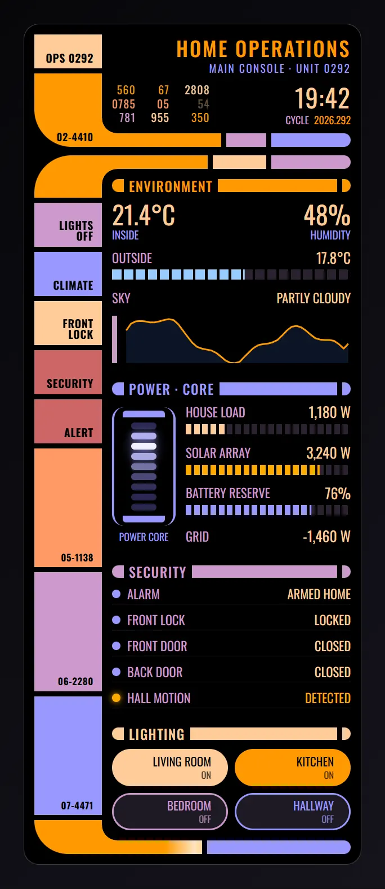

Entities: `alarm_control_panel.home`, `lock.front_door`, `climate.living_room`, `sensor.indoor_temperature`, `sensor.indoor_humidity`, `sensor.outdoor_temperature`, `weather.home`, `sensor.house_power`, `sensor.solar_power`, `sensor.home_battery`, `sensor.grid_power`, `binary_sensor.front_door`, `binary_sensor.back_door`, `binary_sensor.hall_motion`, `light.living_room`, `light.kitchen`, `light.bedroom`, `light.hallway`, `script.all_lights_off`, `script.red_alert`

File: [cards/82-ops-console-mobile.yaml](cards/82-ops-console-mobile.yaml)

```yaml
# Operations console, phone-width: the same panel stacked in one column, with a slimmer sidebar and the lights in two rows.
# Entities: alarm_control_panel.home, lock.front_door, climate.living_room, sensor.indoor_temperature, sensor.indoor_humidity, sensor.outdoor_temperature, weather.home, sensor.house_power, sensor.solar_power, sensor.home_battery, sensor.grid_power, binary_sensor.front_door, binary_sensor.back_door, binary_sensor.hall_motion, light.living_room, light.kitchen, light.bedroom, light.hallway, script.all_lights_off, script.red_alert
type: custom:magic-card
name: Home operations panel
background: '#000000'
border_radius: 18px
padding: 12px
box_shadow: none
css: 'font-family: Antonio, ''Oswald'', ''Arial Narrow'', sans-serif; text-transform: uppercase; color: #FFCC99;'
custom_animations:
  data-blink:
    name: Data blink
    kind: keyframes
    duration: 2.6
    iterations: infinite
    target: element
    easing: linear
    keyframes: [{at: 0, opacity: 1}, {at: 46, opacity: 1}, {at: 48, opacity: 0.18}, {at: 70, opacity: 0.18}, {at: 72, opacity: 1}, {at: 100, opacity: 1}]
  core-cell:
    name: Core cell pulse
    kind: keyframes
    duration: 1.8
    iterations: infinite
    target: element
    easing: ease-out
    keyframes:
      - {at: 0, background: '#2A2850', filter: brightness(1)}
      - {at: 12, background: '#C8C8FF', filter: 'brightness(1.25) drop-shadow(0 0 6px #9999FF)'}
      - {at: 45, background: '#2A2850', filter: brightness(1)}
      - {at: 100, background: '#2A2850', filter: brightness(1)}
  block-flash:
    name: Block flash
    kind: keyframes
    duration: 9
    iterations: infinite
    target: element
    easing: linear
    keyframes: [{at: 0, filter: brightness(1)}, {at: 2, filter: brightness(1.45)}, {at: 5, filter: brightness(1)}, {at: 100, filter: brightness(1)}]
  bar-scan:
    name: Bar scan
    kind: keyframes
    duration: 3.2
    iterations: infinite
    target: element
    easing: ease-in-out
    keyframes: [{at: 0, transform: {x: 0}, opacity: 0}, {at: 8, opacity: 1}, {at: 92, opacity: 1}, {at: 100, transform: {x: 640}, opacity: 0}]
  alert-strobe:
    name: Alert strobe
    kind: keyframes
    duration: 1
    iterations: infinite
    target: element
    easing: linear
    keyframes: [{at: 0, opacity: 1}, {at: 50, opacity: 1}, {at: 52, opacity: 0.25}, {at: 98, opacity: 0.25}, {at: 100, opacity: 1}]
conditional_appearance:
  - id: red-alert
    name: Alert
    mode: every
    conditions: [{type: state, entity: alarm_control_panel.home, state: triggered}]
    overrides: {background: 'radial-gradient(ellipse at 60% 35%, #3a0000 0%, #120000 55%, #000000 100%)'}
rows:
  - id: frame_upper
    column_widths: [80px, 1fr]
    gap: 0px
    columns:
      - id: upper_sidebar
        vertical_align: stretch
        gap: 6px
        modules:
          - type: vertical
            gap: 2px
            design:
              background_color: '#FFCC99'
              height: 40px
              min_height: 40px
              box_sizing: border-box
              padding: 6px 10px 6px 8px
              display: flex
              flex_direction: column
              justify_content: flex-end
              align_items: flex-end
              conditional: [{id: red, name: Alert, conditions: [{type: state, entity: alarm_control_panel.home, state: triggered}], design: {background_color: '#CC6666'}}]
            modules: [{type: text, text: OPS 0292, design: {color: '#000000', font_size: 13px, font_weight: '600', letter_spacing: 0.5px, line_height: '1', text_align: right}}]
          - type: vertical
            gap: 2px
            design:
              background_color: '#FF9900'
              height: 64px
              min_height: 64px
              flex: '1'
              box_sizing: border-box
              padding: 6px 10px 6px 8px
              display: flex
              flex_direction: column
              justify_content: flex-end
              align_items: flex-end
              border_bottom_left_radius: 44px
              conditional: [{id: red, name: Alert, conditions: [{type: state, entity: alarm_control_panel.home, state: triggered}], design: {background_color: '#FF3B3B'}}]
            modules: [{type: text, text: 02-4410, design: {color: '#000000', font_size: 12px, font_weight: '600', letter_spacing: 0.5px, line_height: '1', text_align: right}}]
      - id: upper_content
        vertical_align: stretch
        gap: 0px
        modules:
          - type: vertical
            gap: 10px
            design: {flex: '1', padding: 4px 0 10px 12px, box_sizing: border-box, display: flex, flex_direction: column, justify_content: space-between}
            modules:
              - type: vertical
                gap: 4px
                design: {}
                modules:
                  - type: text
                    text: Home operations
                    design: {color: '#FF9900', font_size: 24px, font_weight: '500', line_height: '1', text_align: right, letter_spacing: 2px, white_space: nowrap}
                    display: {conditions: [{type: state, entity: alarm_control_panel.home, state_not: triggered}]}
                  - type: text
                    text: Main console · Unit 0292
                    design: {color: '#9999FF', font_size: 13px, line_height: '1.2', text_align: right, letter_spacing: 1.5px}
                    display: {conditions: [{type: state, entity: alarm_control_panel.home, state_not: triggered}]}
                  - type: text
                    text: ■ Alert ■
                    design: {color: '#FF3B3B', font_size: 24px, font_weight: '700', line_height: '1', text_align: right, letter_spacing: 4px, animations: [{preset: custom:alert-strobe}]}
                    display: {conditions: [{type: state, entity: alarm_control_panel.home, state: triggered}]}
                  - type: text
                    text: Main console · Unit 0292
                    design: {color: '#CC6666', font_size: 13px, line_height: '1.2', text_align: right, letter_spacing: 1.5px}
                    display: {conditions: [{type: state, entity: alarm_control_panel.home, state: triggered}]}
              - type: horizontal
                gap: 10px
                align: end
                design: {}
                modules:
                  - type: vertical
                    gap: 0px
                    design: {flex: '1', min_width: 0px}
                    modules:
                      - type: horizontal
                        gap: 18px
                        align: start
                        justify: start
                        design: {overflow: hidden}
                        modules:
                          - type: vertical
                            gap: 0px
                            design: {min_width: 0px}
                            modules:
                              - type: text
                                text: '560'
                                design:
                                  color: '#FF9900'
                                  font_size: 13px
                                  line_height: '1.25'
                                  text_align: right
                                  font_variant: tabular-nums
                                  letter_spacing: 1px
                                  animations: [{preset: custom:data-blink, delay: -0.63s, duration: 3.1s}]
                              - type: text
                                text: '0785'
                                design:
                                  color: '#FF9966'
                                  font_size: 13px
                                  line_height: '1.25'
                                  text_align: right
                                  font_variant: tabular-nums
                                  letter_spacing: 1px
                                  animations: [{preset: custom:data-blink, delay: -1.53s, duration: 3.0s}]
                              - type: text
                                text: '781'
                                design:
                                  color: '#CC99CC'
                                  font_size: 13px
                                  line_height: '1.25'
                                  text_align: right
                                  font_variant: tabular-nums
                                  letter_spacing: 1px
                                  animations: [{preset: custom:data-blink, delay: -0.20s, duration: 3.2s}]
                          - type: vertical
                            gap: 0px
                            design: {min_width: 0px}
                            modules:
                              - type: text
                                text: '67'
                                design:
                                  color: '#FF9900'
                                  font_size: 13px
                                  line_height: '1.25'
                                  text_align: right
                                  font_variant: tabular-nums
                                  letter_spacing: 1px
                                  animations: [{preset: custom:data-blink, delay: -1.46s, duration: 3.2s}]
                              - type: text
                                text: '05'
                                design:
                                  color: '#FF9966'
                                  font_size: 13px
                                  line_height: '1.25'
                                  text_align: right
                                  font_variant: tabular-nums
                                  letter_spacing: 1px
                                  animations: [{preset: custom:data-blink, delay: -2.52s, duration: 2.3s}]
                              - type: text
                                text: '955'
                                design:
                                  color: '#FFCC99'
                                  font_size: 13px
                                  line_height: '1.25'
                                  text_align: right
                                  font_variant: tabular-nums
                                  letter_spacing: 1px
                                  animations: [{preset: custom:data-blink, delay: -1.09s, duration: 3.3s}]
                          - type: vertical
                            gap: 0px
                            design: {min_width: 0px}
                            modules:
                              - type: text
                                text: '2808'
                                design:
                                  color: '#FFCC99'
                                  font_size: 13px
                                  line_height: '1.25'
                                  text_align: right
                                  font_variant: tabular-nums
                                  letter_spacing: 1px
                                  animations: [{preset: custom:data-blink, delay: -2.56s, duration: 3.1s}]
                              - type: text
                                text: '54'
                                design:
                                  color: '#FFCC99'
                                  font_size: 13px
                                  line_height: '1.25'
                                  text_align: right
                                  font_variant: tabular-nums
                                  letter_spacing: 1px
                                  animations: [{preset: custom:data-blink, delay: -0.40s, duration: 3.9s}]
                              - type: text
                                text: '350'
                                design:
                                  color: '#FF9900'
                                  font_size: 13px
                                  line_height: '1.25'
                                  text_align: right
                                  font_variant: tabular-nums
                                  letter_spacing: 1px
                                  animations: [{preset: custom:data-blink, delay: -2.41s, duration: 2.6s}]
                  - type: vertical
                    gap: 6px
                    align: end
                    design: {min_width: 86px}
                    modules:
                      - type: text
                        use_template: true
                        text: '{{ now().strftime(''%H:%M'') }}'
                        design: {color: '#FFCC99', font_size: 30px, line_height: '1', text_align: right, font_variant: tabular-nums, letter_spacing: 1px}
                      - type: horizontal
                        gap: 6px
                        align: center
                        justify: end
                        design: {}
                        modules:
                          - {type: text, text: Cycle, design: {color: '#CC99CC', font_size: 12px, line_height: '1'}}
                          - {type: text, use_template: true, text: '{{ now().strftime(''%Y.%j'') }}', design: {color: '#FF9900', font_size: 12px, line_height: '1', font_variant: tabular-nums}}
          - type: horizontal
            gap: 6px
            align: stretch
            design: {position: relative, overflow: visible}
            modules:
              - type: vertical
                gap: 0px
                design:
                  height: 16px
                  background_color: '#FF9900'
                  flex: '3'
                  min_width: 0px
                  position: relative
                  overflow: visible
                  conditional: [{id: red, name: Alert, conditions: [{type: state, entity: alarm_control_panel.home, state: triggered}], design: {background_color: '#FF3B3B'}}]
                modules:
                  - type: separator
                    separator_style: none
                    design:
                      conditional:
                        - id: red
                          name: Alert
                          conditions: [{type: state, entity: alarm_control_panel.home, state: triggered}]
                          design: {background: 'radial-gradient(circle at 100% 0%, transparent 17.5px, #FF3B3B 18px)'}
                      position: absolute
                      left: 0px
                      bottom: 100%
                      width: 18px
                      height: 18px
                      pointer_events: none
                      background: 'radial-gradient(circle at 100% 0%, transparent 17.5px, #FF9900 18px)'
                  - type: vertical
                    gap: 0px
                    design: {position: absolute, inset: '0', overflow: hidden, pointer_events: none}
                    modules:
                      - type: separator
                        separator_style: none
                        design:
                          position: absolute
                          top: 0px
                          left: -70px
                          width: 70px
                          height: 100%
                          background: linear-gradient(90deg, transparent, rgba(255,255,255,0.75), transparent)
                          animations: [{preset: custom:bar-scan, duration: 3.6s}]
              - {type: separator, separator_style: none, design: {height: 16px, background_color: '#CC99CC', flex: '1', min_width: 0px}}
              - {type: separator, separator_style: none, design: {height: 16px, background_color: '#9999FF', flex: '2', min_width: 0px, border_radius: 0 8px 8px 0}}
  - id: frame_lower
    column_widths: [80px, 1fr]
    gap: 0px
    columns:
      - id: lower_sidebar
        vertical_align: stretch
        gap: 6px
        modules:
          - type: vertical
            gap: 2px
            design:
              background_color: '#FF9900'
              height: 50px
              min_height: 50px
              box_sizing: border-box
              padding: 6px 10px 6px 8px
              display: flex
              flex_direction: column
              justify_content: flex-end
              align_items: flex-end
              border_top_left_radius: 44px
              conditional: [{id: red, name: Alert, conditions: [{type: state, entity: alarm_control_panel.home, state: triggered}], design: {background_color: '#FF3B3B'}}]
            modules: [{type: text, text: '', design: {color: '#000000', font_size: 13px, font_weight: '600', letter_spacing: 0.5px, line_height: '1', text_align: right}}]
          - type: vertical
            gap: 2px
            design:
              background_color: '#CC99CC'
              height: 52px
              min_height: 52px
              box_sizing: border-box
              padding: 6px 10px 6px 8px
              display: flex
              flex_direction: column
              justify_content: flex-end
              align_items: flex-end
              cursor: pointer
              transition: filter 0.15s
              hover: {filter: brightness(1.25)}
              conditional: [{id: red, name: Alert, conditions: [{type: state, entity: alarm_control_panel.home, state: triggered}], design: {background_color: '#CC6666'}}]
              animations: [{preset: custom:block-flash, delay: 0.0s}]
            modules: [{type: text, text: Lights off, design: {color: '#000000', font_size: 13px, font_weight: '600', letter_spacing: 0.5px, line_height: '1', text_align: right}}]
            actions: {tap_action: {action: perform-action, service: script.turn_on, data: {entity_id: script.all_lights_off}}}
          - type: vertical
            gap: 2px
            design:
              background_color: '#9999FF'
              height: 52px
              min_height: 52px
              box_sizing: border-box
              padding: 6px 10px 6px 8px
              display: flex
              flex_direction: column
              justify_content: flex-end
              align_items: flex-end
              cursor: pointer
              transition: filter 0.15s
              hover: {filter: brightness(1.25)}
              conditional: [{id: red, name: Alert, conditions: [{type: state, entity: alarm_control_panel.home, state: triggered}], design: {background_color: '#CC6666'}}]
              animations: [{preset: custom:block-flash, delay: 1.7s}]
            modules: [{type: text, text: Climate, design: {color: '#000000', font_size: 13px, font_weight: '600', letter_spacing: 0.5px, line_height: '1', text_align: right}}]
            actions: {tap_action: {action: more-info, entity: climate.living_room}}
          - type: vertical
            gap: 2px
            design:
              background_color: '#FFCC99'
              height: 52px
              min_height: 52px
              box_sizing: border-box
              padding: 6px 10px 6px 8px
              display: flex
              flex_direction: column
              justify_content: flex-end
              align_items: flex-end
              cursor: pointer
              transition: filter 0.15s
              hover: {filter: brightness(1.25)}
              conditional:
                - {id: open, name: Unlocked, conditions: [{type: state, entity: lock.front_door, state: unlocked}], design: {background_color: '#FFAA00'}}
                - {id: red, name: Alert, conditions: [{type: state, entity: alarm_control_panel.home, state: triggered}], design: {background_color: '#CC6666'}}
              animations: [{preset: custom:block-flash, delay: 3.4s}]
            modules: [{type: text, text: Front lock, design: {color: '#000000', font_size: 13px, font_weight: '600', letter_spacing: 0.5px, line_height: '1', text_align: right}}]
            actions: {tap_action: {action: more-info, entity: lock.front_door}}
          - type: vertical
            gap: 2px
            design:
              background_color: '#FF9966'
              height: 52px
              min_height: 52px
              box_sizing: border-box
              padding: 6px 10px 6px 8px
              display: flex
              flex_direction: column
              justify_content: flex-end
              align_items: flex-end
              cursor: pointer
              transition: filter 0.15s
              hover: {filter: brightness(1.25)}
              conditional:
                - {id: armed, name: Armed, conditions: [{type: state, entity: alarm_control_panel.home, state_not: disarmed}], design: {background_color: '#CC6666'}}
                - {id: red, name: Alert, conditions: [{type: state, entity: alarm_control_panel.home, state: triggered}], design: {background_color: '#CC6666'}}
              animations: [{preset: custom:block-flash, delay: 5.1s}]
            modules: [{type: text, text: Security, design: {color: '#000000', font_size: 13px, font_weight: '600', letter_spacing: 0.5px, line_height: '1', text_align: right}}]
            actions: {tap_action: {action: more-info, entity: alarm_control_panel.home}}
          - type: vertical
            gap: 2px
            design:
              background_color: '#CC6666'
              height: 52px
              min_height: 52px
              box_sizing: border-box
              padding: 6px 10px 6px 8px
              display: flex
              flex_direction: column
              justify_content: flex-end
              align_items: flex-end
              cursor: pointer
              transition: filter 0.15s
              hover: {filter: brightness(1.25)}
              conditional: [{id: red, name: Alert, conditions: [{type: state, entity: alarm_control_panel.home, state: triggered}], design: {background_color: '#FF3B3B'}}]
              animations: [{preset: custom:block-flash, delay: 6.8s}]
            modules: [{type: text, text: Alert, design: {color: '#000000', font_size: 13px, font_weight: '600', letter_spacing: 0.5px, line_height: '1', text_align: right}}]
            actions: {tap_action: {action: perform-action, service: script.turn_on, data: {entity_id: script.red_alert}}, hold_action: {action: more-info, entity: alarm_control_panel.home}}
          - type: vertical
            gap: 2px
            design:
              background_color: '#FF9966'
              height: 40px
              min_height: 40px
              flex: '1'
              box_sizing: border-box
              padding: 6px 10px 6px 8px
              display: flex
              flex_direction: column
              justify_content: flex-end
              align_items: flex-end
              conditional: [{id: red, name: Alert, conditions: [{type: state, entity: alarm_control_panel.home, state: triggered}], design: {background_color: '#CC6666'}}]
            modules: [{type: text, text: 05-1138, design: {color: '#000000', font_size: 11px, font_weight: '600', letter_spacing: 0.5px, line_height: '1', text_align: right}}]
          - type: vertical
            gap: 2px
            design:
              background_color: '#CC99CC'
              height: 40px
              min_height: 40px
              flex: '1'
              box_sizing: border-box
              padding: 6px 10px 6px 8px
              display: flex
              flex_direction: column
              justify_content: flex-end
              align_items: flex-end
              conditional: [{id: red, name: Alert, conditions: [{type: state, entity: alarm_control_panel.home, state: triggered}], design: {background_color: '#CC6666'}}]
            modules: [{type: text, text: 06-2280, design: {color: '#000000', font_size: 11px, font_weight: '600', letter_spacing: 0.5px, line_height: '1', text_align: right}}]
          - type: vertical
            gap: 2px
            design:
              background_color: '#9999FF'
              height: 40px
              min_height: 40px
              flex: '1'
              box_sizing: border-box
              padding: 6px 10px 6px 8px
              display: flex
              flex_direction: column
              justify_content: flex-end
              align_items: flex-end
              conditional: [{id: red, name: Alert, conditions: [{type: state, entity: alarm_control_panel.home, state: triggered}], design: {background_color: '#CC6666'}}]
            modules: [{type: text, text: 07-4471, design: {color: '#000000', font_size: 11px, font_weight: '600', letter_spacing: 0.5px, line_height: '1', text_align: right}}]
          - type: vertical
            gap: 2px
            design:
              background_color: '#FF9900'
              height: 40px
              min_height: 40px
              box_sizing: border-box
              padding: 6px 10px 6px 8px
              display: flex
              flex_direction: column
              justify_content: flex-end
              align_items: flex-end
              border_bottom_left_radius: 44px
              conditional: [{id: red, name: Alert, conditions: [{type: state, entity: alarm_control_panel.home, state: triggered}], design: {background_color: '#FF3B3B'}}]
            modules: [{type: text, text: '', design: {color: '#000000', font_size: 13px, font_weight: '600', letter_spacing: 0.5px, line_height: '1', text_align: right}}]
      - id: lower_content
        vertical_align: stretch
        gap: 0px
        modules:
          - type: horizontal
            gap: 6px
            align: stretch
            design: {position: relative, overflow: visible}
            modules:
              - type: vertical
                gap: 0px
                design:
                  height: 16px
                  background_color: '#FF9900'
                  flex: '2'
                  min_width: 0px
                  position: relative
                  overflow: visible
                  conditional: [{id: red, name: Alert, conditions: [{type: state, entity: alarm_control_panel.home, state: triggered}], design: {background_color: '#FF3B3B'}}]
                modules:
                  - type: separator
                    separator_style: none
                    design:
                      conditional:
                        - id: red
                          name: Alert
                          conditions: [{type: state, entity: alarm_control_panel.home, state: triggered}]
                          design: {background: 'radial-gradient(circle at 100% 100%, transparent 17.5px, #FF3B3B 18px)'}
                      position: absolute
                      left: 0px
                      top: 100%
                      width: 18px
                      height: 18px
                      pointer_events: none
                      background: 'radial-gradient(circle at 100% 100%, transparent 17.5px, #FF9900 18px)'
              - {type: separator, separator_style: none, design: {height: 16px, background_color: '#FFCC99', flex: '1', min_width: 0px}}
              - {type: separator, separator_style: none, design: {height: 16px, background_color: '#CC99CC', flex: '1.5', min_width: 0px, border_radius: 0 8px 8px 0}}
          - type: vertical
            gap: 22px
            design: {padding: 12px 0 12px 12px, box_sizing: border-box, flex: '1'}
            modules:
              - type: vertical
                gap: 10px
                design: {min_width: 0px}
                modules:
                  - type: horizontal
                    gap: 6px
                    align: center
                    design: {}
                    modules:
                      - {type: separator, separator_style: none, design: {width: 14px, height: 15px, background_color: '#FF9900', border_radius: 7.5px 0 0 7.5px}}
                      - {type: text, text: Environment, design: {color: '#FF9900', font_size: 16px, font_weight: '500', line_height: '1', white_space: nowrap, letter_spacing: 1px}}
                      - {type: separator, separator_style: none, design: {flex: '1', height: 15px, background_color: '#FF9900', min_width: 12px}}
                      - {type: separator, separator_style: none, design: {width: 10px, height: 15px, background_color: '#FF9900', border_radius: 0 7.5px 7.5px 0}}
                  - type: horizontal
                    gap: 6px
                    align: end
                    justify: space-between
                    design: {}
                    modules:
                      - type: vertical
                        gap: 2px
                        design: {}
                        modules:
                          - {type: text, use_entity: true, entity: sensor.indoor_temperature, design: {color: '#FFCC99', font_size: 30px, line_height: '1', font_variant: tabular-nums}}
                          - {type: text, text: Inside, design: {color: '#9999FF', font_size: 13px, line_height: '1.2'}}
                      - type: vertical
                        gap: 2px
                        align: end
                        design: {}
                        modules:
                          - {type: text, use_entity: true, entity: sensor.indoor_humidity, design: {color: '#FFCC99', font_size: 30px, line_height: '1', font_variant: tabular-nums, text_align: right}}
                          - {type: text, text: Humidity, design: {color: '#9999FF', font_size: 13px, line_height: '1.2', text_align: right}}
                  - type: vertical
                    gap: 5px
                    design: {}
                    modules:
                      - type: horizontal
                        gap: 8px
                        align: center
                        justify: space-between
                        design: {}
                        modules:
                          - {type: text, text: Outside, design: {color: '#CC99CC', font_size: 15px, line_height: '1.1', white_space: nowrap}}
                          - type: text
                            use_entity: true
                            entity: sensor.outdoor_temperature
                            design: {color: '#FFCC99', font_size: 17px, line_height: '1.1', font_variant: tabular-nums, text_align: right, white_space: nowrap}
                      - type: vertical
                        gap: 0px
                        design:
                          position: relative
                          height: 12px
                          background_color: '#2A2230'
                          overflow: hidden
                          border_radius: 0 6px 6px 0
                          value_background: {type: fill, entity: sensor.outdoor_temperature, direction: right, min: -10, max: 40, color: '#99CCFF', opacity: 100%, wave: false}
                          conditional:
                            - id: range-0
                              name: Warm
                              conditions: [{type: state, entity: sensor.outdoor_temperature, above: 25}]
                              design: {value_background: {type: fill, entity: sensor.outdoor_temperature, direction: right, min: -10, max: 40, color: '#FF9900', opacity: 100%, wave: false}}
                            - id: range-1
                              name: Hot
                              conditions: [{type: state, entity: sensor.outdoor_temperature, above: 30}]
                              design: {value_background: {type: fill, entity: sensor.outdoor_temperature, direction: right, min: -10, max: 40, color: '#CC6666', opacity: 100%, wave: false}}
                        modules:
                          - type: separator
                            separator_style: none
                            design: {position: absolute, inset: '0', background: 'repeating-linear-gradient(90deg, transparent 0px, transparent calc(5% - 3px), #000 calc(5% - 3px), #000 5%)'}
                  - type: horizontal
                    gap: 6px
                    align: center
                    justify: space-between
                    design: {}
                    modules: [{type: text, text: Sky, design: {color: '#CC99CC', font_size: 15px}}, {type: text, use_entity: true, entity: weather.home, design: {color: '#FFCC99', font_size: 15px, text_align: right}}]
                  - type: graphs
                    entity: sensor.indoor_temperature
                    hours_to_show: 24
                    points_per_hour: 2
                    line_color: '#FF9900'
                    fill: true
                    show_labels: false
                    design: {border_left: '6px solid #CC99CC', padding_left: 8px, height: 56px, overflow: hidden}
              - type: vertical
                gap: 10px
                design: {min_width: 0px}
                modules:
                  - type: horizontal
                    gap: 6px
                    align: center
                    design: {}
                    modules:
                      - {type: separator, separator_style: none, design: {width: 14px, height: 15px, background_color: '#9999FF', border_radius: 7.5px 0 0 7.5px}}
                      - {type: text, text: Power · Core, design: {color: '#9999FF', font_size: 16px, font_weight: '500', line_height: '1', white_space: nowrap, letter_spacing: 1px}}
                      - {type: separator, separator_style: none, design: {flex: '1', height: 15px, background_color: '#9999FF', min_width: 12px}}
                      - {type: separator, separator_style: none, design: {width: 10px, height: 15px, background_color: '#9999FF', border_radius: 0 7.5px 7.5px 0}}
                  - type: horizontal
                    gap: 12px
                    align: center
                    design: {}
                    modules:
                      - type: vertical
                        gap: 6px
                        align: center
                        design: {}
                        modules:
                          - type: vertical
                            gap: 0px
                            design: {padding: 4px 10px, border_left: '3px solid #9999FF', border_right: '3px solid #9999FF', border_radius: 14px, box_sizing: border-box}
                            modules:
                              - {type: separator, separator_style: none, design: {width: 50px, height: 8px, background_color: '#9999FF', border_radius: 4px 4px 0 0, margin: 0 auto}}
                              - type: vertical
                                gap: 4px
                                design: {padding: 6px 0}
                                modules:
                                  - type: separator
                                    separator_style: none
                                    design: {width: 30px, height: 8px, border_radius: 4px, background_color: '#2A2850', margin: 0 auto, animations: [{preset: custom:core-cell, delay: 0.96s}]}
                                  - type: separator
                                    separator_style: none
                                    design: {width: 30px, height: 8px, border_radius: 4px, background_color: '#2A2850', margin: 0 auto, animations: [{preset: custom:core-cell, delay: 0.84s}]}
                                  - type: separator
                                    separator_style: none
                                    design: {width: 30px, height: 8px, border_radius: 4px, background_color: '#2A2850', margin: 0 auto, animations: [{preset: custom:core-cell, delay: 0.72s}]}
                                  - type: separator
                                    separator_style: none
                                    design: {width: 30px, height: 8px, border_radius: 4px, background_color: '#2A2850', margin: 0 auto, animations: [{preset: custom:core-cell, delay: 0.60s}]}
                                  - type: separator
                                    separator_style: none
                                    design: {width: 30px, height: 8px, border_radius: 4px, background_color: '#2A2850', margin: 0 auto, animations: [{preset: custom:core-cell, delay: 0.48s}]}
                                  - type: separator
                                    separator_style: none
                                    design: {width: 30px, height: 8px, border_radius: 4px, background_color: '#2A2850', margin: 0 auto, animations: [{preset: custom:core-cell, delay: 0.36s}]}
                                  - type: separator
                                    separator_style: none
                                    design: {width: 30px, height: 8px, border_radius: 4px, background_color: '#2A2850', margin: 0 auto, animations: [{preset: custom:core-cell, delay: 0.24s}]}
                                  - type: separator
                                    separator_style: none
                                    design: {width: 30px, height: 8px, border_radius: 4px, background_color: '#2A2850', margin: 0 auto, animations: [{preset: custom:core-cell, delay: 0.12s}]}
                                  - type: separator
                                    separator_style: none
                                    design: {width: 30px, height: 8px, border_radius: 4px, background_color: '#2A2850', margin: 0 auto, animations: [{preset: custom:core-cell, delay: 0.00s}]}
                              - {type: separator, separator_style: none, design: {width: 50px, height: 8px, background_color: '#9999FF', border_radius: 0 0 4px 4px, margin: 0 auto}}
                          - {type: text, text: Power core, design: {color: '#9999FF', font_size: 12px, text_align: center, line_height: '1.2', white_space: nowrap}}
                      - type: vertical
                        gap: 12px
                        design: {flex: '1', min_width: 0px}
                        modules:
                          - type: vertical
                            gap: 5px
                            design: {}
                            modules:
                              - type: horizontal
                                gap: 8px
                                align: center
                                justify: space-between
                                design: {}
                                modules:
                                  - {type: text, text: House load, design: {color: '#CC99CC', font_size: 15px, line_height: '1.1', white_space: nowrap}}
                                  - type: text
                                    use_entity: true
                                    entity: sensor.house_power
                                    design: {color: '#FFCC99', font_size: 17px, line_height: '1.1', font_variant: tabular-nums, text_align: right, white_space: nowrap}
                              - type: vertical
                                gap: 0px
                                design:
                                  position: relative
                                  height: 12px
                                  background_color: '#2A2230'
                                  overflow: hidden
                                  border_radius: 0 6px 6px 0
                                  value_background: {type: fill, entity: sensor.house_power, direction: right, min: 0, max: 5000, color: '#FFCC99', opacity: 100%, wave: false}
                                  conditional:
                                    - id: range-0
                                      name: High
                                      conditions: [{type: state, entity: sensor.house_power, above: 2500}]
                                      design: {value_background: {type: fill, entity: sensor.house_power, direction: right, min: 0, max: 5000, color: '#FF9900', opacity: 100%, wave: false}}
                                    - id: range-1
                                      name: Overload
                                      conditions: [{type: state, entity: sensor.house_power, above: 4000}]
                                      design: {value_background: {type: fill, entity: sensor.house_power, direction: right, min: 0, max: 5000, color: '#CC6666', opacity: 100%, wave: false}}
                                modules:
                                  - type: separator
                                    separator_style: none
                                    design: {position: absolute, inset: '0', background: 'repeating-linear-gradient(90deg, transparent 0px, transparent calc(5% - 3px), #000 calc(5% - 3px), #000 5%)'}
                          - type: vertical
                            gap: 5px
                            design: {}
                            modules:
                              - type: horizontal
                                gap: 8px
                                align: center
                                justify: space-between
                                design: {}
                                modules:
                                  - {type: text, text: Solar array, design: {color: '#CC99CC', font_size: 15px, line_height: '1.1', white_space: nowrap}}
                                  - type: text
                                    use_entity: true
                                    entity: sensor.solar_power
                                    design: {color: '#FFCC99', font_size: 17px, line_height: '1.1', font_variant: tabular-nums, text_align: right, white_space: nowrap}
                              - type: vertical
                                gap: 0px
                                design:
                                  position: relative
                                  height: 12px
                                  background_color: '#2A2230'
                                  overflow: hidden
                                  border_radius: 0 6px 6px 0
                                  value_background: {type: fill, entity: sensor.solar_power, direction: right, min: 0, max: 4000, color: '#FFAA00', opacity: 100%, wave: false}
                                modules:
                                  - type: separator
                                    separator_style: none
                                    design: {position: absolute, inset: '0', background: 'repeating-linear-gradient(90deg, transparent 0px, transparent calc(5% - 3px), #000 calc(5% - 3px), #000 5%)'}
                          - type: vertical
                            gap: 5px
                            design: {}
                            modules:
                              - type: horizontal
                                gap: 8px
                                align: center
                                justify: space-between
                                design: {}
                                modules:
                                  - {type: text, text: Battery reserve, design: {color: '#CC99CC', font_size: 15px, line_height: '1.1', white_space: nowrap}}
                                  - type: text
                                    use_entity: true
                                    entity: sensor.home_battery
                                    design: {color: '#FFCC99', font_size: 17px, line_height: '1.1', font_variant: tabular-nums, text_align: right, white_space: nowrap}
                              - type: vertical
                                gap: 0px
                                design:
                                  position: relative
                                  height: 12px
                                  background_color: '#2A2230'
                                  overflow: hidden
                                  border_radius: 0 6px 6px 0
                                  value_background: {type: fill, entity: sensor.home_battery, direction: right, min: 0, max: 100, color: '#9999FF', opacity: 100%, wave: false}
                                  conditional:
                                    - id: range-0
                                      name: Low
                                      conditions: [{type: state, entity: sensor.home_battery, below: 50}]
                                      design: {value_background: {type: fill, entity: sensor.home_battery, direction: right, min: 0, max: 100, color: '#FF9900', opacity: 100%, wave: false}}
                                    - id: range-1
                                      name: Critical
                                      conditions: [{type: state, entity: sensor.home_battery, below: 20}]
                                      design: {value_background: {type: fill, entity: sensor.home_battery, direction: right, min: 0, max: 100, color: '#CC6666', opacity: 100%, wave: false}}
                                modules:
                                  - type: separator
                                    separator_style: none
                                    design: {position: absolute, inset: '0', background: 'repeating-linear-gradient(90deg, transparent 0px, transparent calc(5% - 3px), #000 calc(5% - 3px), #000 5%)'}
                          - type: horizontal
                            gap: 6px
                            align: center
                            justify: space-between
                            design: {}
                            modules:
                              - {type: text, text: Grid, design: {color: '#CC99CC', font_size: 15px}}
                              - {type: text, use_entity: true, entity: sensor.grid_power, design: {color: '#FFCC99', font_size: 17px, font_variant: tabular-nums, text_align: right}}
              - type: vertical
                gap: 6px
                design: {min_width: 0px}
                modules:
                  - type: horizontal
                    gap: 6px
                    align: center
                    design: {}
                    modules:
                      - {type: separator, separator_style: none, design: {width: 14px, height: 15px, background_color: '#CC99CC', border_radius: 7.5px 0 0 7.5px}}
                      - {type: text, text: Security, design: {color: '#CC99CC', font_size: 16px, font_weight: '500', line_height: '1', white_space: nowrap, letter_spacing: 1px}}
                      - {type: separator, separator_style: none, design: {flex: '1', height: 15px, background_color: '#CC99CC', min_width: 12px}}
                      - {type: separator, separator_style: none, design: {width: 10px, height: 15px, background_color: '#CC99CC', border_radius: 0 7.5px 7.5px 0}}
                  - type: horizontal
                    gap: 8px
                    align: center
                    design: {padding: 3px 0, border_bottom: '1px solid #2A2230'}
                    modules:
                      - type: separator
                        separator_style: none
                        design:
                          width: 10px
                          height: 10px
                          border_radius: 50%
                          background_color: '#9999FF'
                          conditional: [{id: active, name: Active, conditions: [{type: state, entity: alarm_control_panel.home, state: triggered}], design: {background_color: '#FF3B3B', box_shadow: '0 0 8px #FF3B3B'}}]
                          animations: [{preset: blink, trigger: state, trigger_entity: alarm_control_panel.home, state: triggered, duration: 0.9s, intensity: 80}]
                      - {type: text, text: Alarm, design: {color: '#CC99CC', font_size: 15px, flex: '1', white_space: nowrap, line_height: '1.2'}}
                      - type: text
                        use_entity: true
                        entity: alarm_control_panel.home
                        design:
                          color: '#FFCC99'
                          font_size: 15px
                          line_height: '1.2'
                          white_space: nowrap
                          text_align: right
                          conditional: [{id: active, name: Active, conditions: [{type: state, entity: alarm_control_panel.home, state: triggered}], design: {color: '#FF3B3B'}}]
                  - type: horizontal
                    gap: 8px
                    align: center
                    design: {padding: 3px 0, border_bottom: '1px solid #2A2230'}
                    modules:
                      - type: separator
                        separator_style: none
                        design:
                          width: 10px
                          height: 10px
                          border_radius: 50%
                          background_color: '#9999FF'
                          conditional: [{id: active, name: Active, conditions: [{type: state, entity: lock.front_door, state: unlocked}], design: {background_color: '#FF9900', box_shadow: '0 0 8px #FF9900'}}]
                          animations: [{preset: blink, trigger: state, trigger_entity: lock.front_door, state: unlocked, duration: 0.9s, intensity: 80}]
                      - {type: text, text: Front lock, design: {color: '#CC99CC', font_size: 15px, flex: '1', white_space: nowrap, line_height: '1.2'}}
                      - type: text
                        use_entity: true
                        entity: lock.front_door
                        design:
                          color: '#FFCC99'
                          font_size: 15px
                          line_height: '1.2'
                          white_space: nowrap
                          text_align: right
                          conditional: [{id: active, name: Active, conditions: [{type: state, entity: lock.front_door, state: unlocked}], design: {color: '#FF9900'}}]
                  - type: horizontal
                    gap: 8px
                    align: center
                    design: {padding: 3px 0, border_bottom: '1px solid #2A2230'}
                    modules:
                      - type: separator
                        separator_style: none
                        design:
                          width: 10px
                          height: 10px
                          border_radius: 50%
                          background_color: '#9999FF'
                          conditional: [{id: active, name: Active, conditions: [{type: state, entity: binary_sensor.front_door, state: 'on'}], design: {background_color: '#FF9900', box_shadow: '0 0 8px #FF9900'}}]
                          animations: [{preset: blink, trigger: state, trigger_entity: binary_sensor.front_door, state: 'on', duration: 0.9s, intensity: 80}]
                      - {type: text, text: Front door, design: {color: '#CC99CC', font_size: 15px, flex: '1', white_space: nowrap, line_height: '1.2'}}
                      - type: text
                        use_entity: true
                        entity: binary_sensor.front_door
                        design:
                          color: '#FFCC99'
                          font_size: 15px
                          line_height: '1.2'
                          white_space: nowrap
                          text_align: right
                          conditional: [{id: active, name: Active, conditions: [{type: state, entity: binary_sensor.front_door, state: 'on'}], design: {color: '#FF9900'}}]
                  - type: horizontal
                    gap: 8px
                    align: center
                    design: {padding: 3px 0, border_bottom: '1px solid #2A2230'}
                    modules:
                      - type: separator
                        separator_style: none
                        design:
                          width: 10px
                          height: 10px
                          border_radius: 50%
                          background_color: '#9999FF'
                          conditional: [{id: active, name: Active, conditions: [{type: state, entity: binary_sensor.back_door, state: 'on'}], design: {background_color: '#FF9900', box_shadow: '0 0 8px #FF9900'}}]
                          animations: [{preset: blink, trigger: state, trigger_entity: binary_sensor.back_door, state: 'on', duration: 0.9s, intensity: 80}]
                      - {type: text, text: Back door, design: {color: '#CC99CC', font_size: 15px, flex: '1', white_space: nowrap, line_height: '1.2'}}
                      - type: text
                        use_entity: true
                        entity: binary_sensor.back_door
                        design:
                          color: '#FFCC99'
                          font_size: 15px
                          line_height: '1.2'
                          white_space: nowrap
                          text_align: right
                          conditional: [{id: active, name: Active, conditions: [{type: state, entity: binary_sensor.back_door, state: 'on'}], design: {color: '#FF9900'}}]
                  - type: horizontal
                    gap: 8px
                    align: center
                    design: {padding: 3px 0, border_bottom: '1px solid #2A2230'}
                    modules:
                      - type: separator
                        separator_style: none
                        design:
                          width: 10px
                          height: 10px
                          border_radius: 50%
                          background_color: '#9999FF'
                          conditional: [{id: active, name: Active, conditions: [{type: state, entity: binary_sensor.hall_motion, state: 'on'}], design: {background_color: '#FFAA00', box_shadow: '0 0 8px #FFAA00'}}]
                          animations: [{preset: blink, trigger: state, trigger_entity: binary_sensor.hall_motion, state: 'on', duration: 0.9s, intensity: 80}]
                      - {type: text, text: Hall motion, design: {color: '#CC99CC', font_size: 15px, flex: '1', white_space: nowrap, line_height: '1.2'}}
                      - type: text
                        use_entity: true
                        entity: binary_sensor.hall_motion
                        design:
                          color: '#FFCC99'
                          font_size: 15px
                          line_height: '1.2'
                          white_space: nowrap
                          text_align: right
                          conditional: [{id: active, name: Active, conditions: [{type: state, entity: binary_sensor.hall_motion, state: 'on'}], design: {color: '#FFAA00'}}]
              - type: vertical
                gap: 10px
                design: {}
                modules:
                  - type: horizontal
                    gap: 6px
                    align: center
                    design: {}
                    modules:
                      - {type: separator, separator_style: none, design: {width: 14px, height: 15px, background_color: '#FFCC99', border_radius: 7.5px 0 0 7.5px}}
                      - {type: text, text: Lighting, design: {color: '#FFCC99', font_size: 16px, font_weight: '500', line_height: '1', white_space: nowrap, letter_spacing: 1px}}
                      - {type: separator, separator_style: none, design: {flex: '1', height: 15px, background_color: '#FFCC99', min_width: 12px}}
                      - {type: separator, separator_style: none, design: {width: 10px, height: 15px, background_color: '#FFCC99', border_radius: 0 7.5px 7.5px 0}}
                  - type: vertical
                    gap: 8px
                    design: {}
                    modules:
                      - type: horizontal
                        gap: 8px
                        align: stretch
                        design: {}
                        modules:
                          - type: vertical
                            gap: 4px
                            design:
                              flex: '1'
                              min_width: 0px
                              height: 44px
                              box_sizing: border-box
                              padding: 0 18px
                              display: flex
                              flex_direction: column
                              justify_content: center
                              align_items: flex-end
                              text_align: right
                              border_radius: 22px
                              background_color: '#1E1A24'
                              color: '#FFCC99'
                              cursor: pointer
                              border: '2px solid #FFCC99'
                              transition: background-color 0.3s, color 0.3s
                              hover: {filter: brightness(1.2)}
                              conditional: [{id: 'on', name: 'On', conditions: [{type: state, entity: light.living_room, state: 'on'}], design: {background_color: '#FFCC99', color: '#000000'}}]
                              animations: [{preset: glow-pulse, trigger: entity_on, trigger_entity: light.living_room, color: '#FFCC99', intensity: 10, duration: 2.8s}]
                            modules:
                              - {type: text, text: Living room, design: {font_size: 14px, line_height: '1', white_space: nowrap, overflow: hidden, text_overflow: ellipsis}}
                              - {type: text, use_entity: true, entity: light.living_room, design: {font_size: 11px, line_height: '1', opacity: '0.75'}}
                            actions: {tap_action: {action: toggle, entity: light.living_room}, hold_action: {action: more-info, entity: light.living_room}}
                          - type: vertical
                            gap: 4px
                            design:
                              flex: '1'
                              min_width: 0px
                              height: 44px
                              box_sizing: border-box
                              padding: 0 18px
                              display: flex
                              flex_direction: column
                              justify_content: center
                              align_items: flex-end
                              text_align: right
                              border_radius: 22px
                              background_color: '#1E1A24'
                              color: '#FF9900'
                              cursor: pointer
                              border: '2px solid #FF9900'
                              transition: background-color 0.3s, color 0.3s
                              hover: {filter: brightness(1.2)}
                              conditional: [{id: 'on', name: 'On', conditions: [{type: state, entity: light.kitchen, state: 'on'}], design: {background_color: '#FF9900', color: '#000000'}}]
                              animations: [{preset: glow-pulse, trigger: entity_on, trigger_entity: light.kitchen, color: '#FF9900', intensity: 10, duration: 2.8s}]
                            modules:
                              - {type: text, text: Kitchen, design: {font_size: 14px, line_height: '1', white_space: nowrap, overflow: hidden, text_overflow: ellipsis}}
                              - {type: text, use_entity: true, entity: light.kitchen, design: {font_size: 11px, line_height: '1', opacity: '0.75'}}
                            actions: {tap_action: {action: toggle, entity: light.kitchen}, hold_action: {action: more-info, entity: light.kitchen}}
                      - type: horizontal
                        gap: 8px
                        align: stretch
                        design: {}
                        modules:
                          - type: vertical
                            gap: 4px
                            design:
                              flex: '1'
                              min_width: 0px
                              height: 44px
                              box_sizing: border-box
                              padding: 0 18px
                              display: flex
                              flex_direction: column
                              justify_content: center
                              align_items: flex-end
                              text_align: right
                              border_radius: 22px
                              background_color: '#1E1A24'
                              color: '#CC99CC'
                              cursor: pointer
                              border: '2px solid #CC99CC'
                              transition: background-color 0.3s, color 0.3s
                              hover: {filter: brightness(1.2)}
                              conditional: [{id: 'on', name: 'On', conditions: [{type: state, entity: light.bedroom, state: 'on'}], design: {background_color: '#CC99CC', color: '#000000'}}]
                              animations: [{preset: glow-pulse, trigger: entity_on, trigger_entity: light.bedroom, color: '#CC99CC', intensity: 10, duration: 2.8s}]
                            modules:
                              - {type: text, text: Bedroom, design: {font_size: 14px, line_height: '1', white_space: nowrap, overflow: hidden, text_overflow: ellipsis}}
                              - {type: text, use_entity: true, entity: light.bedroom, design: {font_size: 11px, line_height: '1', opacity: '0.75'}}
                            actions: {tap_action: {action: toggle, entity: light.bedroom}, hold_action: {action: more-info, entity: light.bedroom}}
                          - type: vertical
                            gap: 4px
                            design:
                              flex: '1'
                              min_width: 0px
                              height: 44px
                              box_sizing: border-box
                              padding: 0 18px
                              display: flex
                              flex_direction: column
                              justify_content: center
                              align_items: flex-end
                              text_align: right
                              border_radius: 22px
                              background_color: '#1E1A24'
                              color: '#9999FF'
                              cursor: pointer
                              border: '2px solid #9999FF'
                              transition: background-color 0.3s, color 0.3s
                              hover: {filter: brightness(1.2)}
                              conditional: [{id: 'on', name: 'On', conditions: [{type: state, entity: light.hallway, state: 'on'}], design: {background_color: '#9999FF', color: '#000000'}}]
                              animations: [{preset: glow-pulse, trigger: entity_on, trigger_entity: light.hallway, color: '#9999FF', intensity: 10, duration: 2.8s}]
                            modules:
                              - {type: text, text: Hallway, design: {font_size: 14px, line_height: '1', white_space: nowrap, overflow: hidden, text_overflow: ellipsis}}
                              - {type: text, use_entity: true, entity: light.hallway, design: {font_size: 11px, line_height: '1', opacity: '0.75'}}
                            actions: {tap_action: {action: toggle, entity: light.hallway}, hold_action: {action: more-info, entity: light.hallway}}
          - type: horizontal
            gap: 6px
            align: stretch
            design: {position: relative, overflow: visible}
            modules:
              - type: vertical
                gap: 0px
                design:
                  height: 16px
                  background_color: '#FF9900'
                  flex: '1.4'
                  min_width: 0px
                  position: relative
                  overflow: visible
                  conditional: [{id: red, name: Alert, conditions: [{type: state, entity: alarm_control_panel.home, state: triggered}], design: {background_color: '#FF3B3B'}}]
                modules:
                  - type: separator
                    separator_style: none
                    design:
                      conditional:
                        - id: red
                          name: Alert
                          conditions: [{type: state, entity: alarm_control_panel.home, state: triggered}]
                          design: {background: 'radial-gradient(circle at 100% 0%, transparent 17.5px, #FF3B3B 18px)'}
                      position: absolute
                      left: 0px
                      bottom: 100%
                      width: 18px
                      height: 18px
                      pointer_events: none
                      background: 'radial-gradient(circle at 100% 0%, transparent 17.5px, #FF9900 18px)'
                  - type: vertical
                    gap: 0px
                    design: {position: absolute, inset: '0', overflow: hidden, pointer_events: none}
                    modules:
                      - type: separator
                        separator_style: none
                        design:
                          position: absolute
                          top: 0px
                          left: -70px
                          width: 70px
                          height: 100%
                          background: linear-gradient(90deg, transparent, rgba(255,255,255,0.75), transparent)
                          animations: [{preset: custom:bar-scan, duration: 4.4s, delay: 1.3s}]
              - {type: separator, separator_style: none, design: {height: 16px, background_color: '#9999FF', flex: '2', min_width: 0px, border_radius: 0 8px 8px 0}}
```
