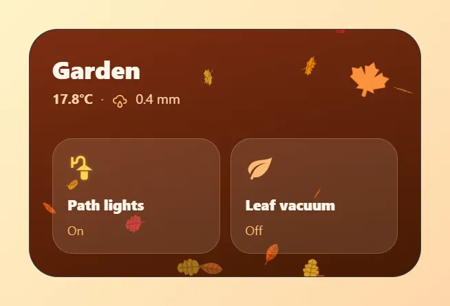
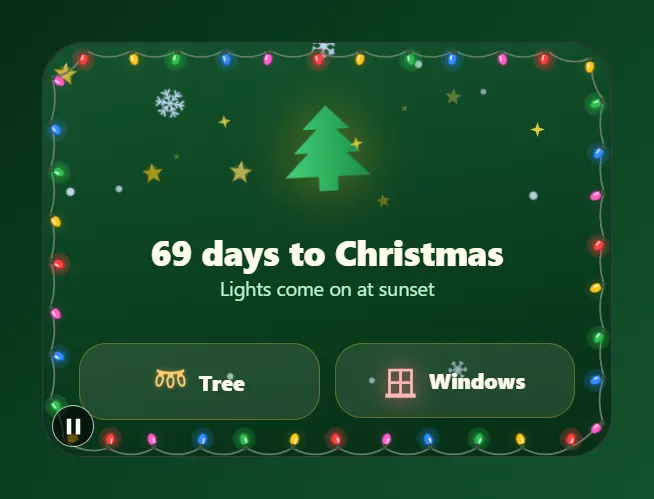

# Seasonal

Autumn leaves, a Halloween porch and a Christmas countdown, drawn by the card's seasonal scenes. Paste a card into the code editor of a new card, then change the entity ids to your own. Back to the [gallery](README.md).

## Cards

-   [Autumn garden](#autumn-garden)
-   [Halloween porch](#halloween-porch)
-   [Christmas countdown](#christmas-countdown)

## Autumn garden

The card's autumn scene drops leaves and a little drizzle over the garden lights, the rain today and a leaf vacuum switch. `seasonal: autumn` keeps the scene all year. Use `seasonal: auto` to follow the calendar instead.



Entities: `light.garden`, `sensor.outdoor_temperature`, `sensor.rain_today`, `switch.leaf_vacuum`

The leaf vacuum icon morphs between a leaf and a leaf circle when the switch turns on or off.

File: [cards/57-autumn-garden.yaml](cards/57-autumn-garden.yaml)

```yaml
# Autumn garden: the card's autumn scene drops leaves and a little drizzle over the garden lights, the rain today and a leaf vacuum switch.
# `seasonal: autumn` keeps the scene all year. Use `seasonal: auto` to follow the calendar instead.
# Entities: light.garden, sensor.outdoor_temperature, sensor.rain_today, switch.leaf_vacuum
type: custom:magic-card
name: Autumn garden
background: "linear-gradient(165deg, #7c2d12 0%, #451a03 100%)"
border_radius: 28px
padding: 22px
box_shadow: "0 18px 40px rgba(124, 45, 18, 0.4)"
seasonal:
  scene: autumn
  intensity: 70%
rows:
  - id: head
    column_widths: [1fr, auto]
    columns:
      - vertical_align: center
        gap: 2px
        modules:
          - type: text
            text: Garden
            design: { font_size: 24px, font_weight: "800", color: "#fff7ed" }
          - type: horizontal
            gap: 8px
            align: center
            modules:
              - type: text
                use_entity: true
                entity: sensor.outdoor_temperature
                design: { font_size: 13px, font_weight: "700", color: "#fed7aa" }
              - type: text
                text: ·
                design: { font_size: 13px, color: "#fdba74" }
              - type: icon
                icon: mdi:weather-rainy
                size: 15px
                design: { color: "#fdba74" }
              - type: text
                use_entity: true
                entity: sensor.rain_today
                design: { font_size: 13px, color: "#fed7aa" }
      - vertical_align: center
        modules:
          - type: icon
            icon: mdi:leaf-maple
            size: 44px
            design:
              color: "#fb923c"
              animations:
                - { id: sway, preset: pendulum, target: icon, intensity: 18 }
  - id: tiles
    layout: "1-1"
    gap: 10px
    padding: 18px 0 0
    columns:
      - modules:
          - type: vertical
            gap: 8px
            design:
              padding: 14px
              border_radius: 20px
              background_color: "rgba(255,237,213,0.12)"
              border: "1px solid rgba(253,186,116,0.25)"
            actions:
              tap_action: { action: toggle, entity: light.garden }
            modules:
              - type: icon
                entity: light.garden
                icon: mdi:outdoor-lamp
                size: 28px
                icon_fx:
                  device: auto
                design: { color: "#fcd34d" }
              - type: text
                text: Path lights
                design: { font_size: 14px, font_weight: "800", color: "#fff7ed" }
              - type: text
                use_entity: true
                entity: light.garden
                design: { font_size: 12px, color: "#fdba74" }
      - modules:
          - type: vertical
            gap: 8px
            design:
              padding: 14px
              border_radius: 20px
              background_color: "rgba(255,237,213,0.12)"
              border: "1px solid rgba(253,186,116,0.25)"
            actions:
              tap_action: { action: toggle, entity: switch.leaf_vacuum }
            modules:
              - type: icon
                entity: switch.leaf_vacuum
                icon_on: mdi:leaf-circle
                icon_off: mdi:leaf
                size: 28px
                icon_fx:
                  morph: true
                  draw: change
                design: { color: "#fdba74" }
              - type: text
                text: Leaf vacuum
                design: { font_size: 14px, font_weight: "800", color: "#fff7ed" }
              - type: text
                use_entity: true
                entity: switch.leaf_vacuum
                design: { font_size: 12px, color: "#fdba74" }
```

## Halloween porch

The Halloween scene with bats, fog, a cobweb and a pumpkin, a flickering jack-o'-lantern, and switches for the porch light and the fog machine. `seasonal: halloween` keeps the scene all year. Use `seasonal: auto` to show it only from 24 to 31 October.


Entities: `light.porch`, `switch.fog_machine`

The "Halloween in 14 days" line is typed text.

File: [cards/59-halloween.yaml](cards/59-halloween.yaml)

```yaml
# Halloween porch: the Halloween scene with bats, fog, a cobweb and a pumpkin, a flickering jack-o'-lantern, and switches for the porch light and the fog machine.
# `seasonal: halloween` keeps the scene all year. Use `seasonal: auto` to show it only from 24 to 31 October.
# Entities: light.porch, switch.fog_machine
type: custom:magic-card
name: Halloween
background: "linear-gradient(170deg, #1f1033 0%, #0c0614 100%)"
border_radius: 28px
padding: 22px
box_shadow: "0 20px 48px rgba(234, 88, 12, 0.25)"
seasonal:
  scene: halloween
  intensity: 80%
rows:
  - id: head
    column_widths: [auto, 1fr]
    gap: 16px
    columns:
      - vertical_align: center
        modules:
          - type: icon
            icon: mdi:halloween
            size: 52px
            design:
              color: "#fb923c"
              filter: "drop-shadow(0 0 16px rgba(251,146,60,0.75))"
              animations:
                - { id: flicker, preset: flame-flicker, target: icon, intensity: 14 }
                - { id: bob, preset: float, target: icon, intensity: 4, duration: 2.6s }
      - vertical_align: center
        gap: 0px
        modules:
          - type: text
            text: Trick or treat
            design: { font_size: 24px, font_weight: "900", color: "#fed7aa", letter_spacing: 0.5px }
          - type: text
            text: Halloween in 14 days
            design: { font_size: 13px, color: "#c4b5fd" }
  - id: switches
    layout: "1-1"
    gap: 10px
    padding: 34px 0 0
    columns:
      - modules:
          - type: horizontal
            gap: 10px
            align: center
            design: &tile
              padding: 12px
              border_radius: 18px
              background_color: "rgba(251,146,60,0.12)"
              border: "1px solid rgba(251,146,60,0.3)"
            actions:
              tap_action: { action: toggle, entity: light.porch }
            modules:
              - type: icon
                entity: light.porch
                icon: mdi:coach-lamp
                size: 24px
                use_entity_color: true
                icon_fx:
                  device: auto
              - type: text
                text: Porch
                design: { font_size: 14px, font_weight: "800", color: "#ffedd5" }
      - modules:
          - type: horizontal
            gap: 10px
            align: center
            design:
              padding: 12px
              border_radius: 18px
              background_color: "rgba(167,139,250,0.12)"
              border: "1px solid rgba(167,139,250,0.3)"
              animations:
                - { id: smoke, preset: smoke, trigger: entity_on, trigger_entity: switch.fog_machine, color: "#ddd6fe", strength: 60, intensity: 5 }
            actions:
              tap_action: { action: toggle, entity: switch.fog_machine }
            modules:
              - type: icon
                icon: mdi:weather-fog
                size: 24px
                design: { color: "#c4b5fd" }
              - type: text
                text: Fog machine
                design: { font_size: 14px, font_weight: "800", color: "#ede9fe" }
```

## Christmas countdown

The Christmas scene with falling snow, twinkling stars and lights along the border, a swaying tree, and switches for the tree and the window lights. `seasonal: christmas` keeps the scene all year. Use `seasonal: auto` to show it only from 1 to 26 December.



Entities: `light.christmas_tree`, `switch.christmas_lights`

The countdown is typed text. A template such as `{{ (as_datetime(now().year ~ '-12-25') - now()).days }}` keeps it current.

File: [cards/60-christmas.yaml](cards/60-christmas.yaml)

```yaml
# Christmas countdown: the Christmas scene with falling snow, twinkling stars and lights along the border, a swaying tree, and switches for the tree and the window lights.
# `seasonal: christmas` keeps the scene all year. Use `seasonal: auto` to show it only from 1 to 26 December.
# Entities: light.christmas_tree, switch.christmas_lights
type: custom:magic-card
name: Christmas
background: "linear-gradient(170deg, #14532d 0%, #052e16 100%)"
border_radius: 28px
padding: 24px
box_shadow: "0 20px 48px rgba(5, 46, 22, 0.55)"
seasonal:
  scene: christmas
  intensity: 75%
rows:
  - id: tree
    padding: 8px 0 0
    columns:
      - modules:
          - type: icon
            entity: light.christmas_tree
            icon: mdi:pine-tree
            size: 76px
            icon_fx:
              colors: { style: gradient, gradient: ["#4ade80", "#15803d"], angle: 90 }
            design:
              display: flex
              justify_content: center
              filter: "drop-shadow(0 0 18px rgba(250,204,21,0.45))"
              animations:
                - { id: sway, preset: sway, target: icon, intensity: 3, duration: 3s }
                - { id: stars, preset: twinkle, color: "#fde047", strength: 90, intensity: 8 }
  - id: text
    padding: 6px 0 0
    columns:
      - gap: 0px
        modules:
          - type: text
            text: 69 days to Christmas
            design: { text_align: center, font_size: 23px, font_weight: "800", color: "#fefce8" }
          - type: text
            text: Lights come on at sunset
            design: { text_align: center, font_size: 13px, color: "#bbf7d0" }
  - id: switches
    layout: "1-1"
    gap: 10px
    padding: 18px 0 0
    columns:
      - modules:
          - type: horizontal
            gap: 8px
            justify: center
            align: center
            design: &tile
              padding: 12px
              border_radius: 18px
              background_color: "rgba(254,252,232,0.1)"
              border: "1px solid rgba(250,204,21,0.3)"
            actions:
              tap_action: { action: toggle, entity: light.christmas_tree }
            modules:
              - type: icon
                entity: light.christmas_tree
                icon: mdi:string-lights
                size: 22px
                use_entity_color: true
                icon_fx:
                  device: auto
              - type: text
                text: Tree
                design: { font_size: 14px, font_weight: "800", color: "#fefce8" }
      - modules:
          - type: horizontal
            gap: 8px
            justify: center
            align: center
            design: *tile
            actions:
              tap_action: { action: toggle, entity: switch.christmas_lights }
            modules:
              - type: icon
                entity: switch.christmas_lights
                icon: mdi:window-closed-variant
                size: 22px
                design:
                  color: "#fca5a5"
                  animations:
                    - { id: glow, preset: neon-flicker, target: icon, trigger: entity_on, color: "#f87171", intensity: 8 }
              - type: text
                text: Windows
                design: { font_size: 14px, font_weight: "800", color: "#fefce8" }
```
